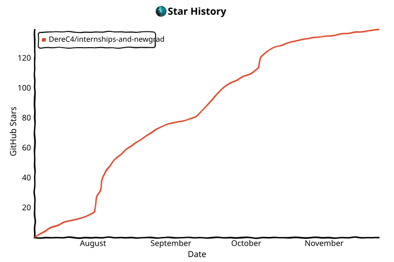

   
# About
> Star and bookmark this repository if it helps you
 
  <!-- BADGES_START_DEREXXD -->    <!-- BADGES_END_DEREXXD -->

When I was in college (aka literally just a month ago) and in the horrible trenches of recruiting, there were like 3 billion different repos, job sites, and I had a horrible time keeping track of all those tabs, opening them every day to spam 25 more futile applications before going to bed. So I made a single site of my own to have a dead simple front end to collect all of the job postings in one place. Now, I will do it here. But when i wake up ofc. I am sleepy rn it is 6 am. 

# Internships and Newgrad Job Listings

<!-- A DerexXD certified divider lives here -->

> 📍 **Browsing: 💼 Internships** &nbsp;|&nbsp; 🔄 **Switch to: [🎓 New Grad Listings](NEWGRAD.md)**

### Filter by Track
- [Software Engineering (1945)](tracks/internships/SWE.md)
- [Quantitative Finance (125)](tracks/internships/QUANT.md)
- [AI & Machine Learning (473)](tracks/internships/AI_ML.md)
- [Data Science & Analytics (462)](tracks/internships/DATA.md)

---

| Company | Role | Location | Age |
| --- | --- | --- | --- |
| Amazon | [Associate Delivery Consultant Intern, AIML, AWS Professional Services](https://go.vansh.nyc/1M1?utm_source=github-vansh-ouckah) | Montreal, Canada | 0d |
| Applied Materials | [Data Analyst Intern](https://amat.wd1.myworkdayjobs.com/External/job/Santa-ClaraCA/Summer-2027-Data-Finance-Analyst-Intern--Bachelor-s--Santa-Clara--CA-_R2626652?utm_source=Simplify&ref=Simplify) | Santa Clara, CA | 0d |
| Citi | [Markets Analyst Intern - Quantitative Analysis](https://citi.wd5.myworkdayjobs.com/2/job/New-York-New-York-United-States/Markets---Quantitative-Analysis--Summer-Analyst---New-York-City---US--2027_25928747?utm_source=Simplify&ref=Simplify) | NYC | 0d |
| Intercept | [Analytics & Intelligence Co-op](https://intercept.bamboohr.com/careers/50/?utm_source=Simplify&ref=Simplify) | Toronto, ON, Canada | 0d |
| Intercept | [Solutions Engineer Co-op](https://intercept.bamboohr.com/careers/49/?utm_source=Simplify&ref=Simplify) | Toronto, ON, Canada | 0d |
| Intercept | [Product Co-op](https://intercept.bamboohr.com/careers/48/?utm_source=Simplify&ref=Simplify) | Toronto, ON, Canada | 0d |
| The Home Depot | [Full Stack Software Developer Intern](https://go.vansh.nyc/1Lv?utm_source=github-vansh-ouckah) | Canada | 0d |

<!-- DerexXD 0d divider -->

| Company | Role | Location | Age |
| --- | --- | --- | --- |
| Atoms | [Software Engineer Intern](https://job-boards.greenhouse.io/cssmerge/jobs/8963704002?utm_source=Simplify&ref=Simplify) | 5 locationsSeattle, WA SF LA NYC Mountain View, CA | 1d |
| Baker Hughes | [Modelling and Data Analytics Intern](https://bakerhughes.wd5.myworkdayjobs.com/BakerHughes/job/GB-HA-FARNBOROUGH-107-RANGE-ROAD/Intern---Modelling-and-Data-Analytics---2027_R173444?utm_source=Simplify&ref=Simplify) | Farnborough, UK | 1d |
| Baker Hughes | [Software Developer Intern](https://bakerhughes.wd5.myworkdayjobs.com/BakerHughes/job/GB-NU-CRAMLINGTON-ATLEY-WAY-NORTH-NELSON-INDUSTRIAL-ESTATE/Intern---Software-Developer---2027_R173441?utm_source=Simplify&ref=Simplify) | Cramlington, UK | 1d |
| Bank of Montreal | [Product Associate Co-op Intern](https://bmo.wd3.myworkdayjobs.com/Privileged/job/Toronto-ON-CAN/Product-Associate--Summer-2027--Co-op-Internship----4-Months_R260031145-2?utm_source=Simplify&ref=Simplify) | Toronto, ON, Canada | 1d |
| Bank of Montreal | [Business Analyst Co-op Intern](https://bmo.wd3.myworkdayjobs.com/Privileged/job/Toronto-ON-CAN/Business-Analyst--Summer-2027--Co-op-Internship----4-Months_R260031168-3?utm_source=Simplify&ref=Simplify) | Toronto, ON, Canada | 1d |
| Bank of Montreal | [Agile Center of Excellence Co-op Intern - 4 Months](https://bmo.wd3.myworkdayjobs.com/Privileged/job/Toronto-ON-CAN/Agile-Center-of-Excellence--Summer-2027--Co-op-Internship----4-Months_R260031148-3?utm_source=Simplify&ref=Simplify) | Toronto, ON, Canada | 1d |
| Capital Blue Cross | [Intern-AI-Assisted Development](https://careers-capbluecross.icims.com/jobs/5237/intern-ai-assisted-development/job) | Harrisburg, PA | 1d |
| Capital Blue Cross | [Intern-Data Engineering](https://careers-capbluecross.icims.com/jobs/5301/intern-data-engineering/job) | Harrisburg, PA | 1d |
| Capital Blue Cross | [Intern-Data Science - Analytics & AI](https://careers-capbluecross.icims.com/jobs/5241/intern-data-science%2c-analytics-%26-ai/job) | Harrisburg, PA | 1d |
| CodeRabbit | [Software Engineer - Intern](https://jobs.ashbyhq.com/coderabbit/c30ab34a-98f3-4c41-b4ba-179bdbab32c9) | San Francisco, CA | 1d |
| IXL Learning | [Software Engineer - Intern](https://www.ixl.com/company/jobs?gh_jid=8963039002) | San Mateo, CA | 1d |
| Microsoft | [Research Intern - Machine Learning for Biology and Healthcare](https://apply.careers.microsoft.com/careers/job/1970393557097217) | Redmond, WA | 1d |
| PQShield | [Hardware Engineer Intern - Placement Year](https://pqshield.com/careers/apply/5049819101?gh_jid=5049819101&utm_source=Simplify&ref=Simplify) | Oxford, UK | 1d |
| PQShield | [Software Engineer Intern](https://pqshield.com/careers/apply/5049820101?gh_jid=5049820101&utm_source=Simplify&ref=Simplify) | Oxford, UK | 1d |
| Semtech | [Test Engineer Intern](https://semtech.wd1.myworkdayjobs.com/SemtechCareers/job/GBR---Bristol/Test-Engineer-Internship--University-Placement-Year-2027-_REQ3737?utm_source=Simplify&ref=Simplify) | Bristol, UK | 1d |
| Semtech | [Product Engineer Intern](https://semtech.wd1.myworkdayjobs.com/SemtechCareers/job/GBR---Bristol/Product-Engineer-Internship--University-Placement-Year-2027-_REQ3724?utm_source=Simplify&ref=Simplify) | Bristol, UK | 1d |
| Synopsys | [Technical-Engineering Intern](https://synopsys.avature.net/careers/JobDetail/19725?utm_source=Simplify&ref=Simplify) | Mississauga, ON, Canada | 1d |
| ABB | [Software Intern](https://go.vansh.nyc/1Kd?utm_source=github-vansh-ouckah) | Dorval, Canada | 2d |
| AMD | [Hardware Engineering Intern](https://careers.amd.com/jobs/102333?icims=1&lang=en-us&utm_source=Simplify&ref=Simplify) | Belfast, UK | 2d |
| ASML | [Internship-Timing and Energy Software](https://asml.wd3.myworkdayjobs.com/en-US/asmlext1/job/San-Diego-CA-USA/Internship-Timing-and-Energy-Software_J-00358478) | San Diego, CA | 2d |
| Apex Technology | [Software Engineering Internship - Test & Automation - Summer 2027](https://jobs.ashbyhq.com/apex-technology-inc/692bb497-59ba-44df-bacf-fffd2f7c6344) | Los Angeles, CA | 2d |
| Apex Technology | [Flight Software Engineering Internship - Summer 2027](https://jobs.ashbyhq.com/apex-technology-inc/744ea544-2601-4e58-8fac-94ea300653e3) | Los Angeles, CA | 2d |
| Apex Technology | [Ground Software Engineering Internship - Spring or Summer 2027](https://jobs.ashbyhq.com/apex-technology-inc/2d5ad921-241f-4e7a-b9ff-9d01763da88c) | Los Angeles, CA | 2d |
| Apex Technology | [Software Engineering - Operating Systems Internship - Summer 2027](https://jobs.ashbyhq.com/apex-technology-inc/3ce65300-2818-4601-9ee4-34a3c012d915) | Los Angeles, CA | 2d |
| Bandwidth | [Software Engineer Intern - Summer 2027](https://job-boards.greenhouse.io/bandwidth/jobs/8414444) | Raleigh, NC | 2d |
| Bandwidth | [Software Engineer Intern - Summer 2027](https://job-boards.greenhouse.io/bandwidth/jobs/8414430) | Raleigh, NC | 2d |
| Bandwidth | [Software Engineer Intern - Summer 2027](https://job-boards.greenhouse.io/bandwidth/jobs/8414436) | Raleigh, NC | 2d |
| Bandwidth | [Software Engineer Intern - Summer 2027](https://job-boards.greenhouse.io/bandwidth/jobs/8414426) | Raleigh, NC | 2d |
| Bandwidth | [Software Engineer Intern - Summer 2027](https://job-boards.greenhouse.io/bandwidth/jobs/8414440) | Raleigh, NC | 2d |
| Best Egg | [Software Engineering Summer Intern](https://jobs.lever.co/BestEgg/c29a9c21-d939-4a5a-82fd-4b1440d71392) | Wilmington, DE | 2d |
| Cantor Fitzgerald | [Technology Summer Intern - Development](https://hdow.fa.us6.oraclecloud.com/hcmUI/CandidateExperience/en/sites/CX_1003/job/250630?utm_source=Simplify&ref=Simplify) | NYC | 2d |
| Cisco | [Security Engineer I (Intern) - United States](https://zapply.jobs/l/d/phenom-cisco-2025885?s=gh-internships-2027) | Research Triangle Park, North... | 2d |
| Coinbase | [Security Engineer Intern](https://zapply.jobs/l/d/greenhouse-coinbase-8415869?s=gh-internships-2027) | Hybrid - New York, NY | 2d |
| ConnectPrep | [Data Analyst Internship](https://apply.workable.com/connectprep/j/9F465A2E1A/) | Washington, DC | 2d |
| Dandy | [Summer 2027 Internship - Software Engineering Intern](https://jobs.ashbyhq.com/dandy/d43558e9-8e51-4980-b00d-39275063f099) | New York City, NY | 2d |
| Digital Control | [Software Engineering Intern](https://go.vansh.nyc/1K0?utm_source=github-vansh-ouckah) | Kent, WA | 2d |
| Digital Control | [Software Engineering Intern](https://apply.workable.com/digital-control/j/AB9A181560/) | Kent, WA | 2d |
| Firestorm | [Field Engineering Intern](https://zapply.jobs/l/d/gem-firestorm-am9icG9zdDrnrtsfLHPI0s2AXbtv-ZpN?s=gh-internships-2027) | San Diego, United States | 2d |
| Firestorm | [Aerospace Engineering Intern](https://zapply.jobs/l/d/gem-firestorm-am9icG9zdDq34Gmi0VhCUI9oRYF2VY7g?s=gh-internships-2027) | San Diego, United States | 2d |
| Firestorm | [Mechanical Engineering Intern](https://zapply.jobs/l/d/gem-firestorm-am9icG9zdDrWT320YdAoaMIVTtrwfFQn?s=gh-internships-2027) | San Diego, United States | 2d |
| General Atomics | [Intern - Aircraft Design Engineer](https://zapply.jobs/l/d/brassring-general-atomics-5238580?s=gh-internships-2027) | Adelanto, California | 2d |
| Harvard Maintenance | [AI Engineering Intern](https://hmi-harvard.icims.com/jobs/41029/ai-engineering-intern/job) | Miami, FL | 2d |
| Hewlett Packard Enterprise | [Enterprise Architect Intern](https://hpe.wd5.myworkdayjobs.com/jobsathpe/job/Winnersh-Berkshire-United-Kingdom/Enterprise-Architect-Intern_1216773?utm_source=Simplify&ref=Simplify) | Winnersh, UK | 2d |
| HeyGen | [Product Marketing MBA Intern (Contract)](https://zapply.jobs/l/d/greenhouse-heygen-5309913007?s=gh-internships-2027) | Los Angeles, San Francisco | 2d |
| IXL Learning | [Software Engineer, Intern](https://zapply.jobs/l/d/greenhouse-ixllearning-8963039002?s=gh-internships-2027) | San Mateo, CA | 2d |
| Jabil | [Data Scientist Intern](https://jabil.wd5.myworkdayjobs.com/en-US/jabil_careers/job/St-PetersburgTampa-FL/Data-Scientist-Intern_J2468236) | St. Petersburg, FL +1 | 2d |
| Jack Henry | [Enterprise Pricing & Data Analytics Intern](https://jackhenry.avature.net/careers/JobDetail/17682?utm_source=Simplify&ref=Simplify) | 6 locationsAllen, TX Birmingham, AL Monett, MO Lenexa, KS Springfield, MO Overland Park, KS | 2d |
| KLA | [Software Engineering Intern](https://kla.wd1.myworkdayjobs.com/en-US/ur/job/Ann-Arbor-MI/Software-Engineering-Intern_2641821-2) | Ann Arbor, MI | 2d |
| Kimley-Horn | [Data Science Intern](https://careers-kimley-horn.icims.com/jobs/29737/job) | Mesa, AZ | 2d |
| Lightmatter | [Firmware Intern - Summer 2027](https://boards.greenhouse.io/lightmatter/jobs/5492829008?gh_jid=5492829008) | Boston, MA | 2d |
| Lucid Motors | [Network Analytics & Reporting Intern](https://zapply.jobs/l/d/greenhouse-lucidmotors-5306687007?s=gh-internships-2027) | Amsterdam, NH | 2d |
| Lucid Motors | [Salesforce Engineer Intern](https://zapply.jobs/l/d/greenhouse-lucidmotors-5306844007?s=gh-new-grad-software-engineering-jobs-2027) | Amsterdam, NH | 2d |
| Lucid Motors | [Instructional Designer Intern](https://zapply.jobs/l/d/greenhouse-lucidmotors-5306676007?s=gh-internships-2027) | Amsterdam, NH | 2d |
| Lucid Motors | [Sales Strategy, Planning & Analytics Intern](https://zapply.jobs/l/d/greenhouse-lucidmotors-5306856007?s=gh-internships-2027) | Amsterdam, NH | 2d |
| Lucid Motors | [Business Analyst Intern](https://zapply.jobs/l/d/greenhouse-lucidmotors-5306854007?s=gh-internships-2027) | Amsterdam, NH | 2d |
| Marvell | [Applied AI/ML Research Scientist Intern](https://marvell.wd1.myworkdayjobs.com/en-US/marvellcareers/job/Santa-Clara-CA/Applied-AI-ML-Research-Scientist-Intern_2603847-1) | Santa Clara, CA | 2d |
| Marvell | [Applied AI/ML Research Scientist Intern](https://marvell.wd1.myworkdayjobs.com/en-US/marvellcareers2/job/Santa-Clara-CA/Applied-AI-ML-Research-Scientist-Intern_2603847) | Santa Clara, CA | 2d |
| Microsoft | [Research Intern - Machine Learning for Biology and Healthcare](https://zapply.jobs/l/d/microsoft-200068907?s=gh-internships-2027) | Redmond, Washington, United States | 2d |
| Microsoft | [Research Intern - AI Systems Architecture and Efficient LLM Inference](https://apply.careers.microsoft.com/careers/job/1970393557079428) | Redmond, WA | 2d |
| Noblis | [Spring 2027 Internship - AI/ML Research Intern](https://jobs-noblis.icims.com/jobs/28841/job) | USA | 2d |
| OpenSesame | [Product Intern](https://boards.greenhouse.io/opensesame/jobs/8418204?utm_source=Simplify&ref=Simplify) | Remote in USA | 2d |
| OpenSesame | [Software Engineer Intern](https://boards.greenhouse.io/opensesame/jobs/8418272?utm_source=Simplify&ref=Simplify) | Remote in USA | 2d |
| Otto Engineering | [Embedded Software Intern - Communications - Summer 2027](https://otto-engineering-inc.breezy.hr/p/c0fdaec6842c-embedded-software-intern-communications-summer-2027) | Carpentersville, IL | 2d |
| SambaNova Systems | [Physical Design Engineer Intern](https://sambanova.ai/sambanova-available-positions/?gh_jid=6271338004&utm_source=Simplify&ref=Simplify) | Austin, TX San Jose, CA | 2d |
| SambaNova Systems | [ML Infrastructure Engineer Intern](https://sambanova.ai/sambanova-available-positions/?gh_jid=6271289004) | Austin, TX +1 | 2d |
| SambaNova Systems | [Cloud Platform Engineer Intern - San Jose](https://sambanova.ai/sambanova-available-positions/?gh_jid=6271352004) | San Jose, CA | 2d |
| SambaNova Systems | [DFT Engineer Intern](https://sambanova.ai/sambanova-available-positions/?gh_jid=6271345004&utm_source=Simplify&ref=Simplify) | Austin, TX San Jose, CA | 2d |
| SambaNova Systems | [Machine Learning Engineer Intern](https://sambanova.ai/sambanova-available-positions/?gh_jid=6271395004) | Austin, TX +1 | 2d |
| SambaNova Systems | [Post-Silicon Validation Engineer Intern](https://sambanova.ai/sambanova-available-positions/?gh_jid=6271200004&utm_source=Simplify&ref=Simplify) | Austin, TX San Jose, CA | 2d |
| SambaNova Systems | [AI Performance Engineer Intern](https://sambanova.ai/sambanova-available-positions/?gh_jid=6271183004) | Austin, TX +1 | 2d |
| Samsung Semiconductor | [Intern - LLM Inference Acceleration Architecture - MoE & Attention-FFN Disaggregation](https://job-boards.greenhouse.io/samsungsemiconductor/jobs/8216717003) | San Jose, CA | 2d |
| Siemens | [Agentic Analytics & Data Intern](https://go.vansh.nyc/1Ll?utm_source=github-vansh-ouckah) | United States | 2d |
| Staples | [Full Stack Software Engineer Intern 🎓](https://fa-exhh-saasfaprod1.fa.ocs.oraclecloud.com/hcmUI/CandidateExperience/en/sites/StaplesInc/job/77145?utm_source=Simplify&ref=Simplify) | Austin, TX | 2d |
| T-Mobile | [Summer 2027 Software Engineering Intern](https://tmobile.wd1.myworkdayjobs.com/en-US/external/job/Overland-Park-Kansas/Summer-2027-Software-Engineering-Intern_REQ381368) | Overland Park, KS +1 | 2d |
| T-Mobile | [Summer 2027 Software Engineering Intern](https://tmobile.wd1.myworkdayjobs.com/en-US/external/job/Overland-Park-Kansas/Summer-2027-Software-Engineering-Intern_REQ381315) | Overland Park, KS | 2d |
| T-Mobile | [Summer 2027 Software Engineer Internship](https://tmobile.wd1.myworkdayjobs.com/en-US/external/job/Overland-Park-Kansas/Summer-2027-Software-Engineer-Internship_REQ381357) | Overland Park, KS | 2d |
| Takeda | [2027 Summer Internship Program: Statistical Machine Learning and Precision Medicine Intern](https://takeda.wd502.myworkdayjobs.com/en-US/external/job/Boston-MA/XMLNAME-2027-Summer-Internship-Program--Statistical-Machine-Learning-and-Precision-Medicine-Intern_R0195449) | Boston, MA | 2d |
| Tesla | [Robotics Audio DSP Engineer Intern](https://www.tesla.com/careers/search/job/291227?utm_source=Simplify&ref=Simplify) | Palo Alto, CA | 2d |
| TikTok | [Machine Learning Engineer Intern - PhD 🎓](https://lifeattiktok.com/search/7712192759532357893?utm_source=Simplify&ref=Simplify) | Seattle, WA | 2d |
| Total Quality Logistics | [Software Development Intern](https://tql.avature.net/en_US/TQLexternalcareers/JobDetail/19763?utm_source=Simplify&ref=Simplify) | Cincinnati, OH | 2d |
| Total Quality Logistics | [Data Science & Analytics Intern](https://tql.avature.net/en_US/TQLexternalcareers/JobDetail/19764?utm_source=Simplify&ref=Simplify) | Cincinnati, OH | 2d |
| Total Quality Logistics | [Product Management Intern](https://tql.avature.net/en_US/TQLexternalcareers/JobDetail/19765?utm_source=Simplify&ref=Simplify) | Cincinnati, OH | 2d |
| Total Quality Logistics | [AI Product Intern](https://tql.avature.net/en_US/TQLexternalcareers/JobDetail/19757?utm_source=Simplify&ref=Simplify) | Cincinnati, OH | 2d |
| Veolia Environnement SA | [Quality Intern](https://zapply.jobs/l/d/sr-VeoliaEnvironnementSA-744000163761609?s=gh-internships-2027) | Minnetonka, MN | 2d |
| Verisk | [Integration Analyst Intern](https://fa-ewmy-saasfaprod1.fa.ocs.oraclecloud.com/hcmUI/CandidateExperience/en/sites/CX_1/job/4213?utm_source=Simplify&ref=Simplify) | London, UK | 2d |
| Vertex | [Summer Intern 2027 - Digital Pathology and AI Validation](https://vrtx.wd501.myworkdayjobs.com/en-US/vertex_careers/job/Boston-MA/Summer-Intern-2027--Digital-Pathology-and-AI-Validation_REQ-31421-1) | Boston, MA | 2d |
| Wabash Valley Power Alliance | [Energy Efficiency & Demand Response Intern - Summer 2027](https://jobs.smartrecruiters.com/WabashValleyPowerAlliance/744000163744159?utm_source=Simplify&ref=Simplify) | Indianapolis, IN | 2d |
| Waymo | [Summer Intern - Driver Understanding and Evaluation - Large Model Evaluation 🎓](https://careers.withwaymo.com/jobs?gh_jid=8415223&utm_source=Simplify&ref=Simplify) | Mountain View, CA | 2d |
| Xona Space Systems | [Software Engineering - Engineering Productivity Intern](https://jobs.ashbyhq.com/xona-space/d3549244-52e2-4894-87f9-99fc8cbe26ab) | Burlingame, CA | 2d |
| ASML | [Internship - Industrial/Mechanical Engineer (Co-op)](https://zapply.jobs/l/d/workday-asml-asmlext1-J-00359203?s=gh-internships-2027) | Wilton, CT, USA | 3d |
| ASML | [Internship - Software Engineer](https://zapply.jobs/l/d/workday-asml-asmlext1-J-00357859?s=gh-internships-2027) | San Diego, CA, USA | 3d |
| AeroVironment | [Cyber Internship](https://zapply.jobs/l/d/workday-avav-avav-9430?s=gh-new-grad-software-engineering-jobs-2027) | Sunrise, FL | 3d |
| Aerospace Corporation | [2027 Aerospace Returning Interns](https://zapply.jobs/l/d/workday-aero-external-R016174?s=gh-new-grad-software-engineering-jobs-2027) | El Segundo, CA | 3d |
| Amazon | [Front-End Engineer Intern](https://amazon.jobs/en/jobs/10609992/front-end-engineer-internship-2027-us?utm_source=Simplify&ref=Simplify) | Seattle, WA Chicago, IL Bellevue, WA | 3d |
| Ameren | [Intern - Robotics - AI - OT - Software development](https://ameren.wd1.myworkdayjobs.com/en-US/external/job/St-Louis-MO/Intern--Robotics--AI--OT--Software-development-_033945-1) | St. Louis, MO | 3d |
| Ameren | [Intern - Robotics - AI - OT - Software development](https://ameren.wd1.myworkdayjobs.com/en-US/collegiate/job/St-Louis-MO/Intern--Robotics--AI--OT--Software-development-_033945) | St. Louis, MO | 3d |
| Apex Technology | [Software Engineer - Test Automation Internship - Summer 2027](https://jobs.ashbyhq.com/apex-technology-inc/2268adcb-a0f6-4e12-a206-8f99e048486d) | Los Angeles, CA | 3d |
| Apex Technology | [Software Engineering, Operating Systems Internship (Summer 2027)](https://zapply.jobs/l/d/ashby-apex-technology-inc-3ce65300-2818-4601-9ee4-34a3c012d915?s=gh-internships-2027) | Los Angeles | 3d |
| Apex Technology, Inc. | [Flight Software Engineering Intern](https://go.vansh.nyc/1Jg?utm_source=github-vansh-ouckah) | Los Angeles, CA | 3d |
| Arete | [Science & Software Development Intern](https://workforcenow.adp.com/mascsr/default/mdf/recruitment/recruitment.html?cid=ed4b889e-3beb-433a-9b2c-7258324f6a83&jobId=585838) | Northridge, CA | 3d |
| BEUMER Group | [AI Development Intern](https://jobs.smartrecruiters.com/BEUMERGroup1/744000163483739-ai-development-intern?oga=true) | Somerset, NJ | 3d |
| Bandwidth | [Software Engineer Intern](https://job-boards.greenhouse.io/bandwidth/jobs/8414448?utm_source=Simplify&ref=Simplify) | Raleigh, NC | 3d |
| Bandwidth | [Software Engineer Intern](https://job-boards.greenhouse.io/bandwidth/jobs/8414452?utm_source=Simplify&ref=Simplify) | Raleigh, NC | 3d |
| Bristol Myers Squibb | [Purification Automation Intern](https://zapply.jobs/l/d/workday-bristolmyerssquibb-bms-R1608943?s=gh-internships-2027) | Princeton - NJ - US | 3d |
| Cantor Fitzgerald | [Technology Infrastructure & Automation Intern](https://go.vansh.nyc/1K2?utm_source=github-vansh-ouckah) | New York, NY | 3d |
| Capital Technology Group | [Summer Internship - Data Engineering and Data Science](https://boards.greenhouse.io/capitaltg/jobs/5307074007?gh_jid=5307074007) | Silver Spring, MD | 3d |
| Capital Technology Group | [Summer Internship - Software Development](https://boards.greenhouse.io/capitaltg/jobs/5281563007?gh_jid=5281563007) | Silver Spring, MD | 3d |
| Carrier Global | [Software & Controls Engineering Intern - Summer](https://zapply.jobs/l/d/workday-carrier-jobs-30222979?s=gh-internships-2027) | CAN05: CCS-Charlotte, 5900... | 3d |
| Celestica | [Engineering Data Analytics Intern](https://go.vansh.nyc/1Jm?utm_source=github-vansh-ouckah) | Toronto, Canada | 3d |
| Cencora | [Intern, Business Analyst](https://zapply.jobs/l/d/phenom-cencora-R2613712?s=gh-internships-2027) | Conshohocken, Pennsylvania | 3d |
| Cisco | [Security Engineer I (Intern) - United States](https://zapply.jobs/l/d/workday-cisco-cisco-careers-2025885?s=gh-internships-2027) | RTP, North Carolina, US | 3d |
| ConnectPrep | [Data Analyst Intern](https://go.vansh.nyc/1J5?utm_source=github-vansh-ouckah) | Washington, DC | 3d |
| Contoro Robotics | [Robotics Software Engineer Intern - Autonomy - Automation](https://jobs.ashbyhq.com/contoro/6a1f0c10-3e5f-4899-ad86-38036a9cd434) | Austin, TX | 3d |
| Crowe | [Machine Learning Intern](https://zapply.jobs/l/d/workday-crowe-external-careers-R-71005?s=gh-internships-2027) | Chicago, IL | 3d |
| Crowe | [Data Analytics Developer Intern](https://zapply.jobs/l/d/workday-crowe-external-careers-R-71041?s=gh-internships-2027) | Chicago IL USA | 3d |
| Crowe | [Cybersecurity Intern](https://zapply.jobs/l/d/workday-crowe-external-careers-R-71031?s=gh-internships-2027) | Chicago, IL | 3d |
| Danaher | [IT Data Analyst Intern](https://danaher.wd1.myworkdayjobs.com/en-US/danaherjobs/job/Brea-California-United-States/IT-Data-Analyst-Intern_R1316675) | Brea, CA | 3d |
| Dandy | [Summer 2027 Internship - Software Engineering Intern](https://zapply.jobs/l/d/ashby-dandy-d43558e9-8e51-4980-b00d-39275063f099?s=gh-internships-2027) | USA - New York NY | 3d |
| Draper | [Cyber Effects Engineering Intern (Summer 2027)](https://zapply.jobs/l/d/workday-draper-draper-careers-JR003189?s=gh-internships-2027) | Cambridge, MA | 3d |
| Eaton | [Manufacturing Engineering Intern](https://zapply.jobs/l/d/eightfold-eaton-687240418992?s=gh-internships-2027) | Rumford, Rhode Island, USA, 02916 | 3d |
| Elevance Health | [Clinical Analytics Intern](https://elevancehealth.wd1.myworkdayjobs.com/ELV-ET/job/VA-RICHMOND-2015-STAPLES-MILL-RD/Graduate-Clinical-Analytics-Intern--Summer-2027_JR210775?utm_source=Simplify&ref=Simplify) | Richmond, VA | 3d |
| Eversource Energy | [2027 Co-op: Substation Design Engineering](https://zapply.jobs/l/d/workday-eversource-externalsite-R-031701?s=gh-internships-2027) | Westwood, MA | 3d |
| FamFluence | [Monetization & Data Analytics Intern](https://famfluence.applytojob.com/apply/mL6D2DQ5Wm/Monetization-Data-Analytics-Intern) | New York City, NY | 3d |
| Genentech | [Clinical Pharmacology Intern](https://roche.wd3.myworkdayjobs.com/ROG-A2O-GENE/job/South-San-Francisco/XMLNAME-2027-Summer-Intern---Clinical-Pharmacology_202611-129678?utm_source=Simplify&ref=Simplify) | South SF | 3d |
| Generac | [Intern AI Engineering](https://zapply.jobs/l/d/workday-generac-external-JR17511?s=gh-internships-2027) | Waukesha, WI - USA | 3d |
| Generac | [Consumer Experience Data Analyst Intern](https://zapply.jobs/l/d/workday-generac-external-JR17206?s=gh-internships-2027) | Pewaukee, WI - USA | 3d |
| Generac | [Consumer Experience Data Analyst Intern](https://generac.wd5.myworkdayjobs.com/en-US/external/job/Pewaukee-WI---USA/Consumer-Experience-Data-Analyst-Intern_JR17206?utm_source=Simplify&ref=Simplify) | Pewaukee, WI | 3d |
| Hewlett Packard Enterprise | [Cloud Security Engagement Intern](https://hpe.wd5.myworkdayjobs.com/en-US/jobsathpe/job/Spring-Texas-United-States-of-America/Cloud-Security-Engagement-Intern_1216079) | Spring, TX | 3d |
| Hewlett Packard Enterprise | [Firmware Engineering Security Intern](https://hpe.wd5.myworkdayjobs.com/en-US/jobsathpe/job/Sunnyvale-California-United-States-of-America/Firmware-Engineering-Intern_1214254) | Sunnyvale, CA | 3d |
| Illumio | [AI-Based Scale & Performance Test Automation Intern](https://jobs.ashbyhq.com/illumio/78a9e57d-c213-405b-9cf3-6e68109a4ce7) | Sunnyvale, CA | 3d |
| Intuitive Surgical | [Product Management MBA Intern 🎓](https://jobs.smartrecruiters.com/Intuitive/744000163546809?utm_source=Simplify&ref=Simplify) | Sunnyvale, CA | 3d |
| Jabil | [Data Scientist Intern](https://zapply.jobs/l/d/workday-jabil-jabil-careers-J2468236?s=gh-internships-2027) | St. Petersburg/Tampa, FL | 3d |
| Jabil | [Data Scientist Intern](https://go.vansh.nyc/1Jo?utm_source=github-vansh-ouckah) | St. Petersburg, FL, Tampa, FL | 3d |
| KeyBank | [2027 Summer Analytics and Quantitative Modeling Internship- Cleveland](https://keybank.wd5.myworkdayjobs.com/en-US/external_career_site/job/Cleveland-OH/XMLNAME-2027-Summer-Analytics-and-Quantitative-Modeling-Internship--Cleveland_R-41380) | Cleveland, OH | 3d |
| Kiewit | [Cloud Security Intern, Technology Group](https://go.vansh.nyc/1KC?utm_source=github-vansh-ouckah) | La Vista, NE | 3d |
| Kimley-Horn | [Data Science Intern](https://careers.kimley-horn.com/jobs/29737?icims=1&lang=en-us&utm_source=Simplify&ref=Simplify) | Mesa, AZ | 3d |
| Lightmatter | [Design Verification, Intern Summer 2027](https://zapply.jobs/l/d/greenhouse-lightmatter-5474684008?s=gh-internships-2027) | Mountain View, CA | 3d |
| Lightmatter | [Design Verification, Intern Summer 2027](https://zapply.jobs/l/d/greenhouse-lightmatter-5493962008?s=gh-internships-2027) | Boston, MA | 3d |
| Lightmatter | [Design Verification Intern](https://boards.greenhouse.io/lightmatter/jobs/5493962008?utm_source=Simplify&ref=Simplify) | Boston, MA | 3d |
| Lightmatter | [Design Verification Intern](https://boards.greenhouse.io/lightmatter/jobs/5474684008?utm_source=Simplify&ref=Simplify) | Mountain View, CA | 3d |
| Lockheed Martin | [Software Engineer - Intern](https://lockheedmartin.eightfold.ai/careers/job/996478149210) | Owego, NY | 3d |
| Lockheed Martin | [Software Engineer - Intern](https://zapply.jobs/l/d/eightfold-lockheedmartin-996478149210?s=gh-new-grad-software-engineering-jobs-2027) | Owego, NY | 3d |
| Lockheed Martin | [Systems Engineer - Intern](https://zapply.jobs/l/d/eightfold-lockheedmartin-996478149799?s=gh-internships-2027) | Owego, NY | 3d |
| Lockheed Martin | [FPGA Engineer (Security Focus) - Intern](https://zapply.jobs/l/d/eightfold-lockheedmartin-996478169364?s=gh-internships-2027) | Owego, NY | 3d |
| Lockheed Martin | [Systems Engineer (Network) - Intern](https://zapply.jobs/l/d/eightfold-lockheedmartin-996478006526?s=gh-internships-2027) | Mount Laurel, NJ | 3d |
| Lockheed Martin | [FPGA Engineer Intern, Security Focus 🇺🇸](https://go.vansh.nyc/1Ke?utm_source=github-vansh-ouckah) | Owego, NY | 3d |
| Lockheed Martin | [Test Engineering - Intern](https://zapply.jobs/l/d/eightfold-lockheedmartin-996477506388?s=gh-internships-2027) | Lufkin, TX | 3d |
| Lockheed Martin | [Software Engineer - Intern](https://zapply.jobs/l/d/eightfold-lockheedmartin-996477971944?s=gh-new-grad-software-engineering-jobs-2027) | Stratford, CT | 3d |
| Marvell | [Applied AI/ML Research Scientist Intern](https://zapply.jobs/l/d/workday-marvell-marvellcareers-2603847?s=gh-internships-2027) | Santa Clara, CA | 3d |
| Medpace | [Clinical Intelligence Intern](https://careers.medpace.com/jobs/13558?icims=1&lang=en-us&utm_source=Simplify&ref=Simplify) | Cincinnati, OH | 3d |
| Medpace | [Clinical Intelligence Intern](https://go.vansh.nyc/1Kz?utm_source=github-vansh-ouckah) | Cincinnati, OH | 3d |
| Meta | [Research Scientist Intern - Machine Learning for Robust 3D Perception - PhD](https://www.metacareers.com/jobs/1482835147112669) | Redmond, WA | 3d |
| Microsoft | [Research Intern - CXL Memory](https://zapply.jobs/l/d/microsoft-200068734?s=gh-internships-2027) | Mountain View, California,... | 3d |
| Microsoft | [Research Intern - Memory Pathfinding](https://zapply.jobs/l/d/microsoft-200068737?s=gh-internships-2027) | Mountain View, California,... | 3d |
| Mira Safety | [AI Content Creator Intern - Remote/Hybrid](https://careers.mirasafety.com/apply/LGzRaFoCoQ/AI-Content-Creator-Intern-RemoteHybrid) | Cedar Park, TX | 3d |
| Moog | [Intern, Electrical Engineering](https://zapply.jobs/l/d/workday-moog-moog-external-career-site-R-26-19827?s=gh-internships-2027) | Torrance, CA | 3d |
| NBCUniversal | [Universal Studios Hollywood, Technical Services, Mechanical Engineering Internship – Summer 2027](https://zapply.jobs/l/d/sr-NBCUniversal3-744000163583264?s=gh-internships-2027) | Universal City, CALIFORNIA | 3d |
| NBCUniversal | [Universal Studios Hollywood, Entertainment Creative Development, Production Design Internship –...](https://zapply.jobs/l/d/sr-NBCUniversal3-744000163604904?s=gh-internships-2027) | Universal City, CALIFORNIA | 3d |
| NBCUniversal | [Universal Studios Hollywood, Finance & Strategy, Business Analytics & Industrial Engineering...](https://zapply.jobs/l/d/sr-NBCUniversal3-744000163602429?s=gh-internships-2027) | Universal City, CALIFORNIA | 3d |
| NBCUniversal | [Universal Studios Hollywood, Entertainment Creative Development, Audio & Video Design Internship...](https://zapply.jobs/l/d/sr-NBCUniversal3-744000163605409?s=gh-internships-2027) | Universal City, CALIFORNIA | 3d |
| NREL | [Graduate/PhD Graduate Intern: Electrical Engineering – Power Electronics and Grid Modeling](https://zapply.jobs/l/d/workday-nrel-nlr-R14648?s=gh-internships-2027) | Golden, CO | 3d |
| NVIDIA | [NVIDIA 2027 Internships: Digital Circuit Design](https://zapply.jobs/l/d/workday-nvidia-nvidiaexternalcareersite-JR2023504?s=gh-internships-2027) | US, CA, Santa Clara | 3d |
| NVIDIA | [NVIDIA 2027 Internships: Mixed Signal Design](https://zapply.jobs/l/d/workday-nvidia-nvidiaexternalcareersite-JR2023502?s=gh-internships-2027) | US, CA, Santa Clara | 3d |
| NVIDIA | [Compiler Software Engineering Intern - Summer 2027](https://zapply.jobs/l/d/workday-nvidia-nvidiaexternalcareersite-JR2028607?s=gh-internships-2027) | US, WA, Redmond | 3d |
| NVIDIA | [AI and Quant DevTech Engineering Intern – Summer 2027](https://zapply.jobs/l/d/workday-nvidia-nvidiaexternalcareersite-JR2030517?s=gh-internships-2027) | US, CA, Santa Clara | 3d |
| NVIDIA | [Developer Technology Intern](https://nvidia.wd5.myworkdayjobs.com/NVIDIAExternalCareerSite/job/US-CA-Santa-Clara/Developer-Technology-Intern--AI---Summer-2027_JR2030178?utm_source=Simplify&ref=Simplify) | Canada Santa Clara, CA United States | 3d |
| NVIDIA | [Finance AI Engineer Intern](https://nvidia.wd5.myworkdayjobs.com/NVIDIAExternalCareerSite/job/US-CA-Santa-Clara/Finance-AI-Engineering-Intern---Summer-2027_JR2029131?utm_source=Simplify&ref=Simplify) | Canada Santa Clara, CA United States | 3d |
| NVIDIA | [Product Management MBA Intern - GenAI Data Strategy 🎓](https://nvidia.wd5.myworkdayjobs.com/NVIDIAExternalCareerSite/job/US-CA-Santa-Clara/Product-Management-MBA-Intern--GenAI-Data-Strategy---Summer-2027_JR2029639?utm_source=Simplify&ref=Simplify) | Canada Santa Clara, CA United States | 3d |
| NVIDIA | [Software Engineer Intern - Simulation Technology](https://nvidia.wd5.myworkdayjobs.com/NVIDIAExternalCareerSite/job/US-CA-Santa-Clara/Software-Engineering-Intern--Simulation-Technology---Summer-2027_JR2029531?utm_source=Simplify&ref=Simplify) | Canada Santa Clara, CA United States | 3d |
| NVIDIA | [NVIDIA 2027 Internships: Software Engineering](https://zapply.jobs/l/d/workday-nvidia-nvidiaexternalcareersite-JR2023495?s=gh-internships-2027) | US, CA, Santa Clara | 3d |
| NVIDIA | [Accounting AI Solution Engineer Intern](https://nvidia.wd5.myworkdayjobs.com/NVIDIAExternalCareerSite/job/US-CA-Santa-Clara/Accounting-AI-Solution-Engineer-Intern---Summer-2027_JR2029155-1?utm_source=Simplify&ref=Simplify) | Canada Santa Clara, CA United States | 3d |
| NVIDIA | [PhD Research Intern, Generative AI - 2026](https://zapply.jobs/l/d/workday-nvidia-nvidiaexternalcareersite-JR2016035?s=gh-internships-2027) | US, CA, Santa Clara | 3d |
| NVIDIA | [NVIDIA 2027 Internships: Systems Software Engineering](https://zapply.jobs/l/d/workday-nvidia-nvidiaexternalcareersite-JR2023492?s=gh-internships-2027) | US, CA, Santa Clara | 3d |
| NVIDIA | [AI and Quant Devtech Engineering Intern 🎓](https://nvidia.wd5.myworkdayjobs.com/NVIDIAExternalCareerSite/job/US-CA-Santa-Clara/AI-and-Quant-DevTech-Engineering-Intern---Summer-2027_JR2030517?utm_source=Simplify&ref=Simplify) | Canada Santa Clara, CA United States | 3d |
| NVIDIA | [NVIDIA 2027 Internships: Hardware Physical Design / VLSI](https://zapply.jobs/l/d/workday-nvidia-nvidiaexternalcareersite-JR2023501?s=gh-internships-2027) | US, CA, Santa Clara | 3d |
| NVIDIA | [NVIDIA 2027 Internships: Hardware Engineering](https://zapply.jobs/l/d/workday-nvidia-nvidiaexternalcareersite-JR2023508?s=gh-internships-2027) | US, CA, Santa Clara | 3d |
| Neuralink | [Electrical Test Engineer Intern](https://zapply.jobs/l/d/greenhouse-neuralink-8197808003?s=gh-internships-2027) | South San Francisco,... | 3d |
| Noblis | [AI/ML Research Intern](https://go.vansh.nyc/1Ja?utm_source=github-vansh-ouckah) | United States | 3d |
| Northrop Grumman | [2027 Configuration Management Data Analyst Intern - Falls Church VA](https://zapply.jobs/l/d/workday-ngc-northrop-grumman-external-site-R10262117?s=gh-internships-2027) | United States-Virginia-Falls Church | 3d |
| Northrop Grumman | [Cybersecurity Intern 🇺🇸](https://go.vansh.nyc/1KT?utm_source=github-vansh-ouckah) | Linthicum, MD | 3d |
| Northrop Grumman | [2027 Software Engineering Intern - Colorado Springs CO](https://zapply.jobs/l/d/workday-ngc-northrop-grumman-external-site-R10261918?s=gh-internships-2027) | United States-Colorado-Colorado... | 3d |
| Northwestern Mutual | [Public Investments Quantitative Analyst Intern - Summer 2027](https://northwesternmutual.wd5.myworkdayjobs.com/en-US/corporate-careers/job/Milwaukee-WI-Corporate/Public-Investments-Quantitative-Analyst-Intern--Summer-2027_JR-45807) | Milwaukee, WI | 3d |
| PatientPoint | [Data Engineer Intern](https://go.vansh.nyc/1J3?utm_source=github-vansh-ouckah) | Cincinnati, OH | 3d |
| QinetiQ | [Software Engineer Intern](https://careers-qinetiqus.icims.com/jobs/12880/software-engineer-intern/job) | Fort Belvoir, VA | 3d |
| RTX | [Manufacturing Engineering Intern (Spring 2027)](https://zapply.jobs/l/d/workday-globalhr-rec-rtx-ext-gateway-01891144?s=gh-internships-2027) | TX-FORT BLISS | 3d |
| RTX | [Operations Engineering Intern (Summer 2027)](https://zapply.jobs/l/d/workday-globalhr-rec-rtx-ext-gateway-01891148?s=gh-internships-2027) | TX-MCKINNEY | 3d |
| RTX | [Manufacturing Engineering Intern (Summer 2027)](https://zapply.jobs/l/d/workday-globalhr-rec-rtx-ext-gateway-01891146?s=gh-internships-2027) | AR-CAMDEN-H100 | 3d |
| Raytheon | [Software Engineering Intern - Summer 2027](https://globalhr.wd5.myworkdayjobs.com/en-US/rec_rtx_ext_gateway/job/US-IN-FT-WAYNE-150A--1010-Production-Rd--BLDG-150A/Software-Engineering-Intern--Summer-2027-_01890983) | Ft Wayne, IN | 3d |
| Revvity | [Software Engineering Intern, In Vivo Imaging](https://zapply.jobs/l/d/workday-revvity-external-JR-046080?s=gh-internships-2027) | Morrisville | 3d |
| Sallie Mae | [Cloud Ops Intern](https://sallie-mae.wd5.myworkdayjobs.com/en-US/careers/job/Indianapolis-IN/Cloud-Ops-Intern_R26_000631) | Indianapolis, IN | 3d |
| SambaNova Systems | [Runtime Engineer Intern](https://sambanova.ai/sambanova-available-positions/?gh_jid=6270727004&utm_source=Simplify&ref=Simplify) | Austin, TX San Jose, CA | 3d |
| Samsung Semiconductor | [LLM Inference Acceleration Architecture Intern, MoE & Attention–FFN Disaggregation](https://go.vansh.nyc/1IH?utm_source=github-vansh-ouckah) | San Jose, CA | 3d |
| Samsung Semiconductor | [Intern, RF Analog Circuit Design Engineer](https://zapply.jobs/l/d/greenhouse-samsungsemiconductor-8213439003?s=gh-internships-2027) | San Jose, California, United States | 3d |
| Sanofi | [NCES Statistician Expert Intern, AI](https://go.vansh.nyc/1L9?utm_source=github-vansh-ouckah) | Cambridge, MA | 3d |
| SharkNinja | [Summer 2027: Firmware Engineering Intern - Advanced Development - May to August](https://job-boards.greenhouse.io/sharkninjaoperatingllc/jobs/4721682006) | Needham, MA | 3d |
| SharkNinja | [Summer 2027: Software Development Test Engineering Co-op- May to August](https://job-boards.greenhouse.io/sharkninjaoperatingllc/jobs/4725867006) | Needham, MA | 3d |
| Signet Jewelers | [Software Engineering Intern, Digital Commerce](https://go.vansh.nyc/1K8?utm_source=github-vansh-ouckah) | Irving, TX | 3d |
| Signet Jewelers | [Software Engineer Intern - Digital Commerce](https://signetjewelers.wd1.myworkdayjobs.com/SignetCorporateCareers/job/Support-Center---Irving-TX/Software-Engineering-Intern--Digital-Commerce_REQ_84709?utm_source=Simplify&ref=Simplify) | Irving, TX | 3d |
| Signet Jewelers | [Software Engineer Intern - Digital Commerce](https://signetjewelers.wd1.myworkdayjobs.com/SignetCorporateCareers/job/Support-Center---Irving-TX/Software-Engineering-Intern--Digital-Commerce_REQ_84703?utm_source=Simplify&ref=Simplify) | Irving, TX | 3d |
| Stantec | [Electrical Engineering Intern - Buildings (Summer 2027)](https://zapply.jobs/l/d/oracle-hdhl-1009012?s=gh-internships-2027) | Lynnwood, WA, United States | 3d |
| Stantec | [Electrical Engineering Intern - Buildings (Summer 2027)](https://zapply.jobs/l/d/oracle-hdhl-1009024?s=gh-internships-2027) | Seattle, WA, United States | 3d |
| State Street | [Software Engineering Intern - Full-time Internship (Jan - June 2027)](https://zapply.jobs/l/d/workday-statestreet-global-R-801504?s=gh-internships-2027) | Boston, Massachusetts | 3d |
| State Street | [Software Engineer Intern](https://statestreet.wd1.myworkdayjobs.com/Global/job/Boston-Massachusetts/Software-Engineering-Intern---Full-time-Internship--Jan---June-2027-_R-801504?utm_source=Simplify&ref=Simplify) | Boston, MA | 3d |
| Stryker | [Intern, Mechanical Engineering](https://zapply.jobs/l/d/workday-stryker-strykercareers-R572896?s=gh-internships-2027) | Portage, Michigan | 3d |
| T-Mobile | [Summer 2027 Software Engineering Internship](https://tmobile.wd1.myworkdayjobs.com/en-US/external/job/Bellevue-Washington/Summer-2027-Software-Engineering-Internship_REQ382091) | Bellevue, WA | 3d |
| T-Mobile | [Summer 2027 Software Engineering Internship](https://tmobile.wd1.myworkdayjobs.com/en-US/external/job/Bellevue-Washington/Summer-2027-Software-Engineering-Internship_REQ382100) | Bellevue, WA | 3d |
| Texas Instruments | [Web Marketing Intern - Digital Experience Analytics](https://zapply.jobs/l/d/oracle-texas-instruments-25020507?s=gh-internships-2027) | Dallas, TX, United States | 3d |
| Trane Technologies | [Manufacturing Engineering Intern](https://zapply.jobs/l/d/workday-tranetechnologies-trane-technologies-car-JR-20529?s=gh-internships-2027) | Grand Rapids, Michigan | 3d |
| UMB | [IT Quantum Intern](https://go.vansh.nyc/1L8?utm_source=github-vansh-ouckah) | Kansas City, MO | 3d |
| WSP | [Geographic Information Systems Science Intern](https://emit.fa.ca3.oraclecloud.com/hcmUI/CandidateExperience/en/sites/CX_2001/job/99829?utm_source=Simplify&ref=Simplify) | Denver, CO | 3d |
| Waters | [IT Digital Intern](https://uscareers-waters.icims.com/jobs/30387/job?mobile=true&needsRedirect=false&utm_source=Simplify&ref=Simplify) | Milford, MA | 3d |
| York Space Systems | [Ground Software Engineering Intern](https://jobs.dayforcehcm.com/en-US/yss/candidateportal/jobs/4902) | Greenwood Village, CO | 3d |
| Zebra | [2027 Summer Internship (US) - Electrical Engineer, Advanced Data Capture](https://zapply.jobs/l/d/workday-zebra-zebra-careers-JR103913?s=gh-internships-2027) | Holtsville, New York | 3d |
| Zebra Technologies | [Electrical Engineer Intern - Advanced Data Capture](https://zebra.wd501.myworkdayjobs.com/Zebra_careers/job/Holtsville-New-York/XMLNAME-2027-Summer-Internship--US----Electrical-Engineer--Advanced-Data-Capture_JR103913?utm_source=Simplify&ref=Simplify) | Holtsville, NY | 3d |
| APEX Analytix | [Software Engineer Intern - Platform Tooling](https://ats.rippling.com/apexanalytix-careers/jobs/0ab75bb7-08ee-403a-bbe5-3937bb948b19?utm_source=Simplify&ref=Simplify) | Greensboro, NC | 4d |
| ASML | [Internship/Co-Op: AI Engineer](https://asml.wd3.myworkdayjobs.com/en-US/asmlext1/job/San-Diego-CA-USA/Internship-Co-Op--AI-Engineer_J-00358475) | San Diego, CA | 4d |
| ASML | [Data Analyst Intern](https://asml.wd3.myworkdayjobs.com/asmlext1/job/San-Jose-CA-USA/Internship---Data-Analyst_J-00355833?utm_source=Simplify&ref=Simplify) | San Jose, CA | 4d |
| ASML | [Internship - Data Analyst](https://zapply.jobs/l/d/workday-asml-asmlext1-J-00355833?s=gh-internships-2027) | San Jose, CA, USA | 4d |
| ASML | [Internship/Co-Op: AI Engineer](https://asml.wd3.myworkdayjobs.com/en-US/asmlext1/job/San-Jose-CA-USA/Internship-Co-Op--AI-Engineer_J-00358477) | San Jose, CA | 4d |
| Aerospace | [2027 Machine Learning Engineer Undergrad Intern](https://aero.wd5.myworkdayjobs.com/en-US/external/job/El-Segundo-CA/XMLNAME-2027-Machine-Learning-Engineer-Undergrad-Intern_R016667) | El Segundo, CA +1 | 4d |
| Aerospace Corporation | [2027 Formal Methods Researcher Graduate Intern](https://zapply.jobs/l/d/workday-aero-external-R016552?s=gh-new-grad-software-engineering-jobs-2027) | El Segundo, CA | 4d |
| Aerospace Corporation | [2027 Battery Test Lab Undergraduate Research Intern](https://zapply.jobs/l/d/workday-aero-external-R017300?s=gh-internships-2027) | El Segundo, CA | 4d |
| Aerospace Corporation | [2027 Power and Analog Circuit Engineering Undergrad Intern](https://zapply.jobs/l/d/workday-aero-external-R017288?s=gh-internships-2027) | El Segundo, CA | 4d |
| Alexion | [Business Partner Intern - Business Partner](https://astrazeneca.wd3.myworkdayjobs.com/alexion/job/US---Boston---MA/Summer-2027-Intern---Business-Partner_R-264992?utm_source=Simplify&ref=Simplify) | Boston, MA | 4d |
| Altera | [Embedded Solutions Intern](https://go.vansh.nyc/1Ii?utm_source=github-vansh-ouckah) | Toronto, Canada | 4d |
| Amazon | [Software Development Engineer Intern - Artificial General Intelligence](https://amazon.jobs/en/jobs/10606968/software-development-engineer-intern-artificial-general-intelligence-summer-2027?utm_source=Simplify&ref=Simplify) | 4 locationsBoston, MA Seattle, WA Bellevue, WA Sunnyvale, CA | 4d |
| Amentum | [Intern - Electrical/Imagery Test & Design Engineer Spring Intern](https://zapply.jobs/l/d/workday-pae-amentum-careers-R0176177?s=gh-internships-2027) | AL-Huntsville | 4d |
| Amgen | [Undergrad Intern - Commercialization Technology and Decision Support (Summer 2027)](https://zapply.jobs/l/d/workday-amgen-careers-R-261663?s=gh-new-grad-software-engineering-jobs-2027) | United States - Remote | 4d |
| Analog Devices | [Embedded Software Engineer Intern](https://go.vansh.nyc/1Jb?utm_source=github-vansh-ouckah) | Austin, TX | 4d |
| Analog Devices | [Mixed Signal Design Engineering Intern](https://zapply.jobs/l/d/workday-analogdevices-external-R267442?s=gh-internships-2027) | US, MA, Wilmington | 4d |
| Aptima Inc. (All Jobs) | [Software Engineer Intern](https://go.vansh.nyc/1Is?utm_source=github-vansh-ouckah) | Fairborn, OH | 4d |
| BEUMER Group | [AI Development Intern](https://go.vansh.nyc/1I9?utm_source=github-vansh-ouckah) | United States | 4d |
| BEUMERGroup1 | [AI Development Intern](https://go.vansh.nyc/1Kn?utm_source=github-vansh-ouckah) | Somerset, NJ | 4d |
| Barclays | [Markets Quantitative Analyst Summer Internship Program 2028 New York](https://barclays.wd3.myworkdayjobs.com/en-US/external_career_site_barclays/job/New-York-745-7th-Avenue/Markets-Quantitative-Analyst-Summer-Internship-Program-2028-New-York_JR-0000139049) | New York City, NY | 4d |
| Benchling | [Software Engineer - Intern - Summer 2027](https://jobs.ashbyhq.com/benchling/96370d1b-d35e-446b-8e26-dce088860099) | San Francisco, CA | 4d |
| Blizzard Entertainment | [Tech Art Intern](https://xboxgaming.wd1.myworkdayjobs.com/Blizzard_External_Careers/job/Irvine---Blizzard---Blizzard-Way/Blizzard-2027-Summer-Internships---Tech-Art_R028383?utm_source=Simplify&ref=Simplify) | Irvine, CA | 4d |
| Bloom Energy | [Equipment Engineering Intern](https://zapply.jobs/l/d/workday-bloomenergy-bloomenergycareers-JR-25645?s=gh-internships-2027) | Fremont, California | 4d |
| Bloom Energy | [Electrical Engineering Intern](https://zapply.jobs/l/d/workday-bloomenergy-bloomenergycareers-JR-25623?s=gh-internships-2027) | San Jose, California | 4d |
| Bloom Energy | [Electrical Engineering Intern](https://zapply.jobs/l/d/workday-bloomenergy-bloomenergycareers-JR-25416?s=gh-internships-2027) | Newark, Delaware | 4d |
| Booz Allen Hamilton | [University - 2027 Summer Games Systems Engineer Intern - El Segundo, CA](https://zapply.jobs/l/d/workday-bah-bah-jobs-R0248366?s=gh-internships-2027) | El Segundo, CA | 4d |
| Cadence Design Systems | [Software Engineer Intern](https://cadence.wd1.myworkdayjobs.com/External_Careers/job/EDINBURGH-01/Intern-Software-Engineer--Summer-2027--Three-Month-Duration-_R57246?utm_source=Simplify&ref=Simplify) | Edinburgh, UK | 4d |
| Camping World | [AI Intern](https://campingworld.wd5.myworkdayjobs.com/en-US/Jobs/job/Lincolnshire-IL/AI-Intern_26_09088?utm_source=Simplify&ref=Simplify) | Chicago, IL Lincolnshire, IL | 4d |
| Canadian Tire Corporation, Limited | [Software Development Intern](https://go.vansh.nyc/1Hf?utm_source=github-vansh-ouckah) | Toronto, Canada | 4d |
| Capital Technology Group | [Software Development Intern](https://go.vansh.nyc/1Ht?utm_source=github-vansh-ouckah) | Silver Spring, MD | 4d |
| Capital Technology Group | [Data Engineering and Data Science Intern](https://go.vansh.nyc/1Hu?utm_source=github-vansh-ouckah) | Silver Spring, MD | 4d |
| Carpenter Technology | [Business Continuity Data Analyst & Reporting Intern](https://cartech.wd5.myworkdayjobs.com/CTCExternal/job/Reading-PA/Business-Continuity-Data-Analyst---Reporting-Intern_27047?utm_source=Simplify&ref=Simplify) | Reading, PA | 4d |
| Cencora | [Intern,Technical Business Analyst / Product Owner](https://zapply.jobs/l/d/phenom-cencora-R2613660?s=gh-internships-2027) | Carrollton, Texas | 4d |
| Charles Schwab | [Treasury Modeling Intern](https://career-schwab.icims.com/jobs/126255/job?mobile=true&needsRedirect=false&utm_source=Simplify&ref=Simplify) | Lone Tree, CO | 4d |
| Contoro Robotics | [Robotics Software Engineer Intern, Autonomy \[Automation\]](https://zapply.jobs/l/d/ashby-contoro-6a1f0c10-3e5f-4899-ad86-38036a9cd434?s=gh-internships-2027) | Austin, TX | 4d |
| CornerStone Partners | [AI and Automation Intern](https://csptest2025.applytojob.com/apply/zkjZABQZka/AI-And-Automation-Intern-Summer-2027?utm_source=Simplify&ref=Simplify) | Charlottesville, VA | 4d |
| CrowdStrike | [Product Engineer Intern - Falcon Guardian](https://crowdstrike.wd5.myworkdayjobs.com/crowdstrikecareers/job/USA---Sunnyvale-CA/Product-Engineering-Intern---Falcon-Guardian_R30622?utm_source=Simplify&ref=Simplify) | Redmond, WA Sunnyvale, CA | 4d |
| Culver's | [Business Analytics Intern](https://recruiting2.ultipro.com/CUL1004CULFS/JobBoard/e532cf53-c07c-4c3b-ba54-03feb99aa4f3/OpportunityDetail?opportunityId=737547cd-aea2-4209-b596-9be908de7f79&utm_source=Simplify&ref=Simplify) | Prairie du Sac, WI | 4d |
| Danaher | [IT Data Analyst Intern](https://zapply.jobs/l/d/phenom-danaher-R1316675?s=gh-internships-2027) | Brea, California | 4d |
| Draper | [Simulation Engineering Intern](https://go.vansh.nyc/1J9?utm_source=github-vansh-ouckah) | Cambridge, MA | 4d |
| Draper | [HWIL & Real Time Simulation Intern 🇺🇸](https://go.vansh.nyc/1Ib?utm_source=github-vansh-ouckah) | Cambridge, MA | 4d |
| Draper | [Simulation Engineering Intern (Summer 2027)](https://zapply.jobs/l/d/workday-draper-draper-careers-JR003181?s=gh-internships-2027) | Cambridge, MA | 4d |
| Draper | [Simulation Engineer Intern](https://draper.wd5.myworkdayjobs.com/Draper_Careers/job/Cambridge-MA/Simulation-Engineering-Intern--Summer-2027-_JR003181?utm_source=Simplify&ref=Simplify) | Cambridge, MA | 4d |
| Elevance Health | [Undergraduate Clinical Analytics Intern](https://elevancehealth.wd1.myworkdayjobs.com/ELV-ET/job/IL-CHICAGO-8600-W-BRYN-MAWR-AVE-10th--11th-FL/Undergraduate-Clinical-Analytics-Intern--Summer-2027_JR210774?utm_source=Simplify&ref=Simplify) | Chicago, IL | 4d |
| Exowatt | [Software & AI Spring Intern - Austin - TX](https://jobs.lever.co/exowatt/86589116-72a5-44f1-893a-1c688d15f2cf) | Austin, TX | 4d |
| Fanatics | [Product Management Intern - Card Tech](https://job-boards.greenhouse.io/fanaticscollectibles/jobs/4519886009?utm_source=Simplify&ref=Simplify) | NYC | 4d |
| First Resonance | [Software Engineering Intern - Platform - Summer 2027](https://jobs.ashbyhq.com/first-resonance/0c88b508-432d-442d-aa5f-486e08aaf5a7) | Los Angeles, CA | 4d |
| FormFactor | [AI/ML Engineering Intern](https://go.vansh.nyc/1K1?utm_source=github-vansh-ouckah) | Livermore, CA | 4d |
| FormFactor | [AI/ML Engineering Intern](https://formfactor.wd1.myworkdayjobs.com/en-US/ffi-careers/job/Livermore-CA/AI-ML-Engineering-Intern_JR101434) | Livermore, CA | 4d |
| GE Vernova | [GE Vernova Engineering Automation Internship - Summer 2027](https://zapply.jobs/l/d/workday-gevernova-vernova-externalsite-R5059697?s=gh-internships-2027) | Charleroi USA | 4d |
| GE Vernova | [GE Vernova Robotics & Manufacturing Automation Internship - Summer 2027](https://zapply.jobs/l/d/workday-gevernova-vernova-externalsite-R5059698?s=gh-internships-2027) | Charleroi USA | 4d |
| General Dynamics Information Technology | [Artificial Intelligence/Machine Learning Software Development and Engineer Intern](https://gdit.wd5.myworkdayjobs.com/gdit_earlytalent/job/USA-LA-Bossier-City/GDIT-Summer-Internship-Program---Summer-2027-AI-ML-Software-Development-and-Engineering-Internship_RQ233023?utm_source=Simplify&ref=Simplify) | Bossier City, LA | 4d |
| General Motors | [2027 Summer Intern – Software Engineer, AV/AI Platform](https://zapply.jobs/l/d/workday-generalmotors-careers-gm-JR-202621696?s=gh-internships-2027) | 3 Locations | 4d |
| General Motors | [2027 Summer Intern – Software Verification Engineer, AV/AI Platform](https://zapply.jobs/l/d/workday-generalmotors-careers-gm-JR-202621697?s=gh-new-grad-software-engineering-jobs-2027) | Warren, Michigan, United States... | 4d |
| General Motors | [Software Verification Engineer Intern, AV/AI Platform](https://go.vansh.nyc/1Ir?utm_source=github-vansh-ouckah) | Warren, MI | 4d |
| Genworth | [Data Analytics Intern 🛂](https://go.vansh.nyc/1Jc?utm_source=github-vansh-ouckah) | Richmond, VA | 4d |
| GlobalFoundries | [Device Engineering Intern, Silicon Photonics (Summer 2027)](https://zapply.jobs/l/d/workday-globalfoundries-external-JR-2605131?s=gh-internships-2027) | USA - New York - Malta | 4d |
| HOPE International | [Data Analytics Intern](https://jobs-hopeinternational.icims.com/jobs/1977/data-analytics-intern/job) | Lancaster, PA | 4d |
| Idaho National Laboratory | [NSUF Agentic Workflow Development Intern](https://go.vansh.nyc/1IQ?utm_source=github-vansh-ouckah) | Idaho Falls, ID | 4d |
| Illinois Tool Works | [Software or Computer Engineer Intern](https://careers.itw.com/global/en/job/JR11356?utm_source=Simplify&ref=Simplify) | Fairmont, MN | 4d |
| Illinois Tool Works | [Software or Computer Engineer Intern - Summer 2027](https://zapply.jobs/l/d/phenom-illinois-tool-works-JR11356?s=gh-new-grad-software-engineering-jobs-2027) | Fairmont, Minnesota | 4d |
| Illumio | [Engineering Intern, Architecture Platform](https://zapply.jobs/l/d/ashby-illumio-a211377c-7db7-4c62-97ba-8176c5a61293?s=gh-internships-2027) | Sunnyvale, California - | 4d |
| Illumio | [Product Manager Intern](https://zapply.jobs/l/d/ashby-illumio-1dbbc51c-ede6-4067-98df-9e4d9d06f6d3?s=gh-internships-2027) | Sunnyvale, California - | 4d |
| Illumio | [Technical Product Management Intern](https://go.vansh.nyc/1HD?utm_source=github-vansh-ouckah) | Sunnyvale, CA | 4d |
| Illumio | [AI-Based Scale & Performance Test Automation Intern](https://zapply.jobs/l/d/ashby-illumio-78a9e57d-c213-405b-9cf3-6e68109a4ce7?s=gh-internships-2027) | Sunnyvale, California - | 4d |
| Illumio | [Engineering Intern - Architecture Platform](https://jobs.ashbyhq.com/illumio/a211377c-7db7-4c62-97ba-8176c5a61293/application?embed=true&utm_source=Simplify&ref=Simplify) | Sunnyvale, CA | 4d |
| Illumio | [Engineering Intern, Security Platforms](https://zapply.jobs/l/d/ashby-illumio-95bc7491-9b2f-493c-9297-e9cb36a63b45?s=gh-internships-2027) | Sunnyvale, California - | 4d |
| Intel | [Design Verification Engineer Intern](https://intel.wd1.myworkdayjobs.com/en-us/external/job/US-Colorado-Fort-Collins/Design-Verification-Intern-2027_JR0287646?utm_source=Simplify&ref=Simplify) | 4 locationsAustin, TX Santa Clara, CA Hillsboro, OR Fort Collins, CO | 4d |
| Intel | [Design Verification Intern 2027](https://zapply.jobs/l/d/workday-intel-external-JR0287646?s=gh-internships-2027) | Colorado Fort Collins | 4d |
| InterDigital | [PhD Research Intern, AI Lab](https://zapply.jobs/l/d/workday-interdigital-interdigital-intern-REQ26-1172?s=gh-internships-2027) | LosAltos_CA | 4d |
| JP Morgan Chase | [Machine Learning Intern - Time Series and Reinforcement Learning 🎓](https://jpmc.fa.oraclecloud.com/hcmUI/CandidateExperience/en/sites/CX_1001/job/210806784?utm_source=Simplify&ref=Simplify) | London, UK | 4d |
| JP Morgan Chase | [Applied AI Intern - HR CDAO 🎓](https://jpmc.fa.oraclecloud.com/hcmUI/CandidateExperience/en/sites/CX_1001/job/210806549?utm_source=Simplify&ref=Simplify) | NYC | 4d |
| KLA | [Software Engineering Intern](https://kla.wd1.myworkdayjobs.com/en-US/ur/job/Milpitas-CA/Software-Engineering-Intern_2642953) | Milpitas, CA | 4d |
| KLA | [Software Engineering Intern](https://kla.wd1.myworkdayjobs.com/en-US/search/job/Milpitas-CA/Software-Engineering-Intern_2642953-1) | Milpitas, CA | 4d |
| KeyBank | [2027 Summer Analytics and Quantitative Modeling Internship- Cleveland](https://zapply.jobs/l/d/workday-keybank-external-career-site-R-41380?s=gh-internships-2027) | Cleveland, OH | 4d |
| Kiewit | [Cloud Security Intern, Technology Group](https://go.vansh.nyc/1Il?utm_source=github-vansh-ouckah) | Omaha, NE | 4d |
| Legrand | [Electrical Engineer Intern](https://iadugs.fa.ocs.oraclecloud.com/hcmUI/CandidateExperience/en/sites/CX_1001/job/1948?utm_source=Simplify&ref=Simplify) | Canonsburg, PA | 4d |
| Leidos | [Software Engineering Intern](https://leidos.wd5.myworkdayjobs.com/en-US/external/job/Arlington-VA/Software-Engineering-Intern_R-00197526) | Arlington, VA | 4d |
| Lifeway | [Summer Internship - Software Engineer Full Stack - Back-End](https://hq-lifeway.icims.com/jobs/27217/summer-internship-%7c-software-engineer-full-stack-%7c-back-end/job) | Remote - USA | 4d |
| Lifeway | [Summer Internship - Knowledge Management and AI](https://hq-lifeway.icims.com/jobs/27219/summer-internship-%7c-knowledge-management-and-ai/job) | Remote - USA | 4d |
| Lifeway | [Summer Internship - OD & AI Enablement](https://hq-lifeway.icims.com/jobs/27220/summer-internship-%7c-od-%26-ai-enablement/job) | Remote - USA | 4d |
| Lifeway | [Summer Internship - Front-End Engineer](https://hq-lifeway.icims.com/jobs/27216/summer-internship-%7c-front-end-engineer/job) | Remote - USA | 4d |
| Lockheed Martin | [Electrical Engineer - Intern](https://zapply.jobs/l/d/eightfold-lockheedmartin-996478129419?s=gh-internships-2027) | Owego, NY | 4d |
| Lucid Motors | [Intern, Automotive Interior Design, Summer 2027](https://zapply.jobs/l/d/greenhouse-lucidmotors-5290844007?s=gh-internships-2027) | Newark, CA | 4d |
| MITRE | [Internships in Cybersecurity and Information Security](https://zapply.jobs/l/d/phenom-mitre-R117314?s=gh-internships-2027) | McLean, Virginia | 4d |
| Meta | [Research Scientist Intern - Spatial-temporal Consistent 4D Generation - PhD](https://www.metacareers.com/jobs/2357948038329505) | Redmond, WA | 4d |
| Moderna | [2027 Co-Op, mRNA Design Engineering](https://zapply.jobs/l/d/workday-modernatx-m-tx-R20129?s=gh-internships-2027) | Cambridge, Massachusetts,... | 4d |
| Motorola | [Software Engineering Intern](https://go.vansh.nyc/1J2?utm_source=github-vansh-ouckah) | Salt Lake City, UT | 4d |
| Motorola Solutions | [Software Engineer Intern](https://motorolasolutions.wd5.myworkdayjobs.com/Careers/job/Salt-Lake-City-UT-UT17/Software-Engineering-Intern---2027-Internship-Program_R70950?utm_source=Simplify&ref=Simplify) | Salt Lake City, UT | 4d |
| Motorola Solutions | [Software Engineering Intern - 2027 Internship Program](https://zapply.jobs/l/d/workday-motorolasolutions-careers-R70950?s=gh-internships-2027) | Salt Lake City, UT | 4d |
| NVIDIA | [Developer Technology Intern, AI](https://go.vansh.nyc/1Im?utm_source=github-vansh-ouckah) | Santa Clara, CA | 4d |
| Nasdaq | [Data Engineering Intern - 2027 Summer Internship](https://zapply.jobs/l/d/workday-nasdaq-global-external-site-R0027379?s=gh-internships-2027) | Denver | 4d |
| Nasdaq | [Data Engineering Intern](https://go.vansh.nyc/1Jl?utm_source=github-vansh-ouckah) | Denver, CO | 4d |
| Nasdaq | [Data Engineer Intern](https://nasdaq.wd1.myworkdayjobs.com/Global_External_Site/job/Denver-18-Street/Data-Engineering-Intern---2027-Summer-Internship_R0027379?utm_source=Simplify&ref=Simplify) | Denver, CO | 4d |
| National Interstate Insurance | [Quality Assurance Intern 🛂](https://go.vansh.nyc/1Iy?utm_source=github-vansh-ouckah) | Cincinnati, OH | 4d |
| National Interstate Insurance | [Quality Assurance Intern - Summer 2027](https://zapply.jobs/l/d/workday-gaig-gaig-external-R9942?s=gh-internships-2027) | Cincinnati, OH | 4d |
| Noblis | [Data Innovations Intern](https://careers.noblis.org/jobs/28005?icims=1&lang=en-us&utm_source=Simplify&ref=Simplify) | Springfield, VA Reston, VA | 4d |
| Northrop Grumman | [Digital Engineer Intern](https://ngc.wd1.myworkdayjobs.com/Northrop_Grumman_External_Site/job/United-States-California-Manhattan-Beach/XMLNAME-2027-Digital-Engineer-Intern---Manhattan-Beach-CA_R10262090?utm_source=Simplify&ref=Simplify) | Manhattan Beach, CA | 4d |
| Northrop Grumman | [2027 Industrial Engineering Internship - Baltimore MD](https://zapply.jobs/l/d/workday-ngc-northrop-grumman-external-site-R10262103?s=gh-internships-2027) | United States-Maryland-Baltimore | 4d |
| Northrop Grumman | [2027 Cybersecurity Intern - Linthicum MD](https://zapply.jobs/l/d/workday-ngc-northrop-grumman-external-site-R10261960?s=gh-internships-2027) | United States-Maryland-Linthicum | 4d |
| Northrop Grumman | [Electronics Engineer Intern](https://ngc.wd1.myworkdayjobs.com/Northrop_Grumman_External_Site/job/United-States-California-Azusa/XMLNAME-2027-Electronics-Engineer-Intern---Azusa-CA_R10262073-1?utm_source=Simplify&ref=Simplify) | Azusa, CA | 4d |
| Northrop Grumman | [2027 Systems Engineer Intern - Chantilly VA](https://zapply.jobs/l/d/workday-ngc-northrop-grumman-external-site-R10255633?s=gh-internships-2027) | United States-Virginia-Chantilly | 4d |
| Northrop Grumman | [Electronics Engineer Intern](https://ngc.wd1.myworkdayjobs.com/Northrop_Grumman_External_Site/job/United-States-California-Manhattan-Beach/XMLNAME-2027-Electronics-Engineer-Intern---Manhattan-Beach-CA_R10262075?utm_source=Simplify&ref=Simplify) | Manhattan Beach, CA | 4d |
| Northrop Grumman | [2027 Electrical Engineer Intern - Gilbert AZ](https://zapply.jobs/l/d/workday-ngc-northrop-grumman-external-site-R10262079?s=gh-internships-2027) | United States-Arizona-Gilbert | 4d |
| Northrop Grumman | [2027 Electromechanical Engineer Intern - Manhattan Beach CA](https://zapply.jobs/l/d/workday-ngc-northrop-grumman-external-site-R10262100?s=gh-internships-2027) | United... | 4d |
| Northrop Grumman | [2027 Digital Engineer Intern - Manhattan Beach CA](https://zapply.jobs/l/d/workday-ngc-northrop-grumman-external-site-R10262090?s=gh-new-grad-software-engineering-jobs-2027) | United... | 4d |
| Northrop Grumman | [2027 Software Test Engineering Intern - Roy UT](https://zapply.jobs/l/d/workday-ngc-northrop-grumman-external-site-R10261728?s=gh-new-grad-software-engineering-jobs-2027) | United States-Utah-Roy | 4d |
| Oscar | [Software Engineering Intern](https://oscarhealth.com/careers/jobs?gh_jid=8407472) | New York City, NY | 4d |
| PCL Construction | [Cybersecurity Intern](https://go.vansh.nyc/1In?utm_source=github-vansh-ouckah) | Edmonton, Canada | 4d |
| Paccar | [Vehicle Software Integration Engineer Intern](https://go.vansh.nyc/1Km?utm_source=github-vansh-ouckah) | United States | 4d |
| Paccar | [Vehicle Software Integration Engineer Intern](https://go.vansh.nyc/1Hr?utm_source=github-vansh-ouckah) | Denton, TX, Sunnyvale, CA | 4d |
| Philips | [Embedded Software Development Intern, AI-Agentic](https://go.vansh.nyc/1Ij?utm_source=github-vansh-ouckah) | Bothell, WA | 4d |
| Philips | [Marketing Operations Analyst Intern](https://philips.wd3.myworkdayjobs.com/jobs-and-careers/job/Cambridge-US-Massachusetts-United-States/Intern---Marketing-Operations---Cambridge--MA---Summer-2027_593642?utm_source=Simplify&ref=Simplify) | Cambridge, MA | 4d |
| PricewaterhouseCoopers (PwC) | [Software Engineering Intern, Tax Innovation Delivery Experience (TIDE)](https://go.vansh.nyc/1L7?utm_source=github-vansh-ouckah) | United States | 4d |
| QinetiQ | [Software Engineer Intern](https://go.vansh.nyc/1Ip?utm_source=github-vansh-ouckah) | Remote, United States | 4d |
| QuEra Computing | [Site Reliability Engineer Co-op](https://zapply.jobs/l/d/greenhouse-queracomputinginc-5493521008?s=gh-internships-2027) | Boston, MA, USA | 4d |
| RTX | [Systems Engineer Co-op - Summer/Fall 2027](https://globalhr.wd5.myworkdayjobs.com/rec_rtx_ext_gateway/job/US-IA-CEDAR-RAPIDS-121--350-Collins-Rd-NE--BLDG-121/Systems-Engineering-Co-op--Summer-Fall-2027-_01890127?utm_source=Simplify&ref=Simplify) | Cedar Rapids, IA | 4d |
| RTX | [FPGA Electrical Engineer Intern - Summer 2027](https://globalhr.wd5.myworkdayjobs.com/rec_rtx_ext_gateway/job/US-CA-EL-SEGUNDO-E01--2000-E-El-Segundo-Blvd--BLDG-E01/FPGA-Electrical-Engineer-Intern--Summer-2027-_01890532?utm_source=Simplify&ref=Simplify) | El Segundo, CA | 4d |
| RTX | [Software Engineering Intern (Summer 2027)](https://zapply.jobs/l/d/workday-globalhr-rec-rtx-ext-gateway-01890983?s=gh-internships-2027) | IN-FT WAYNE | 4d |
| RTX | [Systems Engineering Co-op (Summer/Fall 2027)](https://zapply.jobs/l/d/workday-globalhr-rec-rtx-ext-gateway-01890127?s=gh-internships-2027) | IA-CEDAR RAPIDS | 4d |
| RTX | [Embedded System Engineering Intern 🇺🇸](https://go.vansh.nyc/1L2?utm_source=github-vansh-ouckah) | Windsor Locks, CT | 4d |
| Raytheon | [Embedded System Engineering Intern](https://globalhr.wd5.myworkdayjobs.com/en-US/rec_rtx_ext_gateway/job/US-CT-WINDSOR-LOCKS-B1--1-Hamilton-Rd--BLDG-1/Embedded-System-Engineering-Intern_01890950) | Windsor Locks, CT | 4d |
| Red Bull | [2027 Internship - Spring - Data Science](https://jobs.smartrecruiters.com/RedBull/744000163139699-2027-internship-spring-data-science?oga=true) | Morristown, NJ | 4d |
| Rockwell Automation | [Intern - Software Engineer](https://rockwellautomation.wd1.myworkdayjobs.com/en-US/external_rockwell_automation/job/Milwaukee-Wisconsin-United-States/Intern--Software-Engineer_R26-5303-2) | Milwaukee, WI | 4d |
| Rockwell Automation | [Intern - Software Engineer](https://rockwellautomation.wd1.myworkdayjobs.com/en-US/external-rockwell-automation-early-careers/job/Milwaukee-Wisconsin-United-States/Intern--Software-Engineer_R26-5303-1) | Milwaukee, WI | 4d |
| Saab | [Software Engineering Co-op 🇺🇸](https://go.vansh.nyc/1Hj?utm_source=github-vansh-ouckah) | East Syracuse, NY | 4d |
| Saab | [Software Engineer Co-Op - Summer 2027](https://saabusa.wd1.myworkdayjobs.com/en-US/saab_careers/job/East-Syracuse-NY-Collamer/Software-Engineer-Co-Op--Summer-2027-_R-03264-1) | East Syracuse, NY +1 | 4d |
| Saab | [Software Engineering Co-Op - Summer 2027](https://saabusa.wd1.myworkdayjobs.com/en-US/saab_careers/job/East-Syracuse-NY-Collamer/Software-Engineering-Co-Op--Summer-2027-_R-03237-1) | East Syracuse, NY +1 | 4d |
| Samsung | [Data Engineer Intern](https://go.vansh.nyc/1L3?utm_source=github-vansh-ouckah) | Plano, TX | 4d |
| Samsung | [Data Engineer Intern](https://sec.wd3.myworkdayjobs.com/en-US/samsung_careers/job/6555-Excellence-Way-Plano-TX-USA/Data-Engineer-Intern_R122374) | Plano, TX | 4d |
| Samsung | [Software Development Engineer Intern](https://go.vansh.nyc/1L4?utm_source=github-vansh-ouckah) | Mountain View, CA | 4d |
| Samsung Research America | [Computer Vision Intern 🎓](https://job-boards.greenhouse.io/samsungresearchamericainternship/jobs/8955802002?utm_source=Simplify&ref=Simplify) | Mountain View, CA | 4d |
| Samsung Research America | [PhD Intern - AI Research 🎓](https://job-boards.greenhouse.io/samsungresearchamericainternship/jobs/8955762002?utm_source=Simplify&ref=Simplify) | Mountain View, CA | 4d |
| Samsung Research America Internship | [2027 Spring/Summer PhD Intern, AI Research](https://zapply.jobs/l/d/greenhouse-samsungresearchamericainternship-8955762002?s=gh-internships-2027) | 665 Clyde Avenue, Mountain... | 4d |
| Sanofi | [NCES Statistician Intern](https://sanofi.wd3.myworkdayjobs.com/SanofiCareers/job/Cambridge-MA/XMLNAME-2027-Summer-Intern-NCES-statistician-expert-in-AI-Cambridge-MA_R2865668?utm_source=Simplify&ref=Simplify) | Cambridge, MA | 4d |
| SharkNinja | [Summer 2027: Software Development Test Engineering Co-op(May to August)](https://zapply.jobs/l/d/greenhouse-sharkninjaoperatingllc-4725867006?s=gh-internships-2027) | Needham, MA, United States | 4d |
| SharkNinja | [Summer 2027: Firmware Engineering Intern, Advanced Development (May to August)](https://zapply.jobs/l/d/greenhouse-sharkninjaoperatingllc-4721682006?s=gh-internships-2027) | Needham, MA, United States | 4d |
| Shield AI | [2027 Summer Intern - Mechanical Engineering - 6436](https://zapply.jobs/l/d/ashby-shield-d5931c9e-b020-46f1-9344-9ea17768fad8?s=gh-internships-2027) | Dallas, TX, US | 4d |
| Shield AI | [Electrical Engineering - 2027 January Co-Op](https://zapply.jobs/l/d/ashby-shield-7c6f4d6d-fac0-4d71-9d4e-7581db11dc33?s=gh-internships-2027) | Dallas, TX, US | 4d |
| Stantec | [Data Scientist Intern - Water](https://hdhl.fa.us6.oraclecloud.com/hcmUI/CandidateExperience/en/sites/CX_1/job/1009005?utm_source=Simplify&ref=Simplify) | Boston, MA Denver, CO San Diego, CA | 4d |
| Takeda | [2027 Summer Internship Program: AI/ML in Quantitative Clinical Pharmacology Intern](https://takeda.wd502.myworkdayjobs.com/en-US/external/job/Boston-MA/XMLNAME-2027-Summer-Internship-Program--AI-ML-in-Quantitative-Clinical-Pharmacology-Intern_R0193651) | Boston, MA | 4d |
| Takeda | [2027 Summer Internship Program: AI/ML for Drug Discovery Intern](https://takeda.wd502.myworkdayjobs.com/en-US/external/job/Boston-MA/XMLNAME-2027-Summer-Internship-Program--AI-ML-for-Drug-Discovery-Intern_R0193510) | Boston, MA | 4d |
| Takeda | [2027 Summer Internship Program: Agentic AI for Drug Discovery Intern](https://takeda.wd502.myworkdayjobs.com/en-US/external/job/Boston-MA/XMLNAME-2027-Summer-Internship-Program--Agentic-AI-for-Drug-Discovery-Intern_R0193880) | Boston, MA | 4d |
| Takeda | [2027 Summer Internship Program: Digital Complaint System Developer](https://takeda.wd502.myworkdayjobs.com/en-US/external/job/Lexington-MA/XMLNAME-2027-Summer-Internship-Program--Digital-Complaint-System-Developer_R0193480) | Lexington, MA | 4d |
| The Toro Company | [Data Science Intern 🛂](https://go.vansh.nyc/1L5?utm_source=github-vansh-ouckah) | Bloomington, MN | 4d |
| UMB | [AI Intern](https://go.vansh.nyc/1L1?utm_source=github-vansh-ouckah) | Kansas City, MO | 4d |
| Varian | [Research Intern, Computer Vision and Robotics for Interventional AI](https://go.vansh.nyc/1L6?utm_source=github-vansh-ouckah) | United States | 4d |
| Veolia Environnement SA | [Assemblies Engineering intern](https://zapply.jobs/l/d/sr-VeoliaEnvironnementSA-744000163376109?s=gh-new-grad-software-engineering-jobs-2027) | Minnetonka, MN | 4d |
| Veolia Environnement SA | [Manufacturing Software Engineer Intern](https://zapply.jobs/l/d/sr-VeoliaEnvironnementSA-744000163377969?s=gh-internships-2027) | Boulder, CO | 4d |
| Veolia Environnement SA | [Projects Engineering Intern](https://zapply.jobs/l/d/sr-VeoliaEnvironnementSA-744000163379489?s=gh-internships-2027) | Minnetonka, MN | 4d |
| Veolia Environnement SA | [Project Engineering Intern](https://zapply.jobs/l/d/sr-VeoliaEnvironnementSA-744000163379509?s=gh-internships-2027) | Minnetonka, MN | 4d |
| ViaSat | [Embedded Software Engineer Intern](https://careers.viasat.com/jobs/10478?icims=1&lang=en-us&utm_source=Simplify&ref=Simplify) | Tempe, AZ | 4d |
| Viasat | [Embedded Software Engineer Intern - Viasat Government](https://careers-viasat.icims.com/jobs/10478/job) | Tempe, AZ | 4d |
| ZOLL | [Software Engineering Intern](https://zoll.wd5.myworkdayjobs.com/en-US/zollmedicalcorp/job/Chelmsford-MA/Software-Engineering-Intern_R20923) | Chelmsford, MA | 4d |
| ZOLL Medical Corporation | [Software Automation Intern](https://go.vansh.nyc/1I1?utm_source=github-vansh-ouckah) | Chelmsford, MA | 4d |
| iCapital Network | [SI and Annuities Intern](https://job-boards.greenhouse.io/icapitalnetwork/jobs/8958714002?utm_source=Simplify&ref=Simplify) | NYC | 4d |
| ASML | [Internship/Co-Op: AI Engineer](https://zapply.jobs/l/d/workday-asml-asmlext1-J-00358475?s=gh-internships-2027) | San Diego, CA, USA | 5d |
| ASML | [Electrical Engineer Intern](https://asml.wd3.myworkdayjobs.com/asmlext1/job/Wilton-CT-USA/Internship---Electrical-Engineer_J-00358102?utm_source=Simplify&ref=Simplify) | Wilton, CT | 5d |
| ASML | [Internship/Co-Op: AI Engineer](https://zapply.jobs/l/d/workday-asml-asmlext1-J-00358477?s=gh-internships-2027) | San Jose, CA, USA | 5d |
| AeroVironment | [Product Engineering Intern](https://zapply.jobs/l/d/workday-avav-avav-8815?s=gh-internships-2027) | Simi Valley, CA | 5d |
| Amgen | [Grad Intern - siRNA Stability and Data Science (Summer 2027)](https://zapply.jobs/l/d/workday-amgen-careers-R-261404?s=gh-internships-2027) | California - Thousand Oaks | 5d |
| Analog Devices | [Robot Learning Engineer Intern](https://zapply.jobs/l/d/workday-analogdevices-external-R269543?s=gh-new-grad-software-engineering-jobs-2027) | US, CA, San Jose, Rio Robles | 5d |
| Artefact | [AI Builder Intern](https://go.vansh.nyc/1J4?utm_source=github-vansh-ouckah) | New York, NY | 5d |
| BAE Systems | [Software or Computer Engineering Co-op 2027](https://zapply.jobs/l/d/phenom-bae-systems-132220BR?s=gh-new-grad-software-engineering-jobs-2027) | Sterling Heights, Michigan | 5d |
| BAE Systems | [Software Developer Intern III, Summer 2027](https://zapply.jobs/l/d/phenom-bae-systems-133253BR?s=gh-internships-2027) | Durham, North Carolina | 5d |
| Baxter International | [Co-op Mechanical Engineering R&D](https://zapply.jobs/l/d/workday-baxter-baxter-JR-213518?s=gh-internships-2027) | Skaneateles, NY | 5d |
| Benchling | [Software Engineer, Intern (Summer 2027)](https://zapply.jobs/l/d/ashby-benchling-96370d1b-d35e-446b-8e26-dce088860099?s=gh-internships-2027) | San Francisco, CA | 5d |
| Booz Allen Hamilton | [University - 2027 Summer Games Cyber Security Intern - McLean, VA](https://zapply.jobs/l/d/workday-bah-bah-jobs-R0248034?s=gh-new-grad-software-engineering-jobs-2027) | McLean, VA | 5d |
| Bose | [Customer Quality Engineer Co-op](https://zapply.jobs/l/d/workday-boseallaboutme-bose-careers-R29223?s=gh-internships-2027) | US, MI - Bloomfield Hills | 5d |
| CACI | [Software Development Intern - Summer 2027](https://zapply.jobs/l/d/workday-caci-external-335425?s=gh-internships-2027) | Remote | 5d |
| Cadence | [Software Engineering Intern - Circuit Simulation](https://zapply.jobs/l/d/workday-cadence-external-careers-R57251?s=gh-internships-2027) | AUSTIN | 5d |
| Cadence (University) | [Software Engineering Intern - Circuit Simulation](https://zapply.jobs/l/d/workday-cadence-univ-careers-R57251?s=gh-internships-2027) | AUSTIN | 5d |
| CesiumAstro | [Software Engineering Intern 🇺🇸](https://go.vansh.nyc/1GQ?utm_source=github-vansh-ouckah) | Austin, TX | 5d |
| Crane Co. | [Manufacturing Engineering Intern- Summer 2027](https://zapply.jobs/l/d/workday-cranecompany-careers-JR102970?s=gh-internships-2027) | Fort Walton Beach, Florida | 5d |
| DigiKey | [Total Rewards Intern](https://zapply.jobs/l/d/workday-digikey-digi-key-R5815?s=gh-new-grad-software-engineering-jobs-2027) | Thief River Falls, MN | 5d |
| Don't Panic Labs | [Software Engineering Intern 2](https://go.vansh.nyc/1H7?utm_source=github-vansh-ouckah) | Lincoln, NE | 5d |
| Draper | [Materials and Chemistry Engineering Intern (Summer 2027)](https://zapply.jobs/l/d/workday-draper-draper-careers-JR003177?s=gh-internships-2027) | Cambridge, MA | 5d |
| Fabri | [DevOps - IT & Cybersecurity Intern](https://app.dover.io/apply/job/3d3ef9d6-40f3-47cf-ada4-a90a4e0744f5/) | Billerica, MA | 5d |
| Federal Home Loan Bank of Dallas | [Digital Transformation Intern](https://fhlb.wd1.myworkdayjobs.com/FHLB_Careers/job/Irving-TX/XMLNAME-2027-Summer-Digital-Transformation-Intern_REQ-457?utm_source=Simplify&ref=Simplify) | Irving, TX | 5d |
| First Resonance | [Product Management Intern](https://jobs.ashbyhq.com/first-resonance/56d901c8-ad63-4206-b5cb-b5691585b741/application?embed=true&utm_source=Simplify&ref=Simplify) | El Segundo, CA | 5d |
| Garmin | [Data Scientist Intern](https://go.vansh.nyc/1H1?utm_source=github-vansh-ouckah) | Olathe, KS | 5d |
| Garmin | [Software Engineer Intern, Aviation Web Development](https://go.vansh.nyc/1H0?utm_source=github-vansh-ouckah) | Middlebury, CT | 5d |
| Genentech | [AI for Drug Discovery Intern 🎓](https://roche.wd3.myworkdayjobs.com/ROG-A2O-GENE/job/South-San-Francisco/XMLNAME-2027-Summer-Intern---AI-for-Drug-Discovery_202611-129909?utm_source=Simplify&ref=Simplify) | South SF | 5d |
| Genentech | [2027 Summer Intern - Software Engineer (Robotics) - Lab Automation](https://zapply.jobs/l/d/workday-roche-rog-a2o-gene-202611-129832?s=gh-internships-2027) | South San Francisco | 5d |
| Genentech | [Service Data and Analytics Intern](https://go.vansh.nyc/1L0?utm_source=github-vansh-ouckah) | Indianapolis, IN | 5d |
| Genentech | [Software Engineer Intern - Robotics - Lab Automation](https://roche.wd3.myworkdayjobs.com/ROG-A2O-GENE/job/South-San-Francisco/XMLNAME-2027-Summer-Intern---Software-Engineer--Robotics----Lab-Automation_202611-129832?utm_source=Simplify&ref=Simplify) | South SF | 5d |
| Great American Insurance Company | [Predictive Analytics Intern](https://gaig.wd1.myworkdayjobs.com/GAIG_External/job/Cincinnati-OH-USA/Predictive-Analytics-Intern---Summer-2027_R9904?utm_source=Simplify&ref=Simplify) | Cincinnati, OH | 5d |
| HP Inc | [Personal Systems Engineering Internship](https://zapply.jobs/l/d/workday-hp-externalcareersite-3171404?s=gh-internships-2027) | Spring, Texas, United States of... | 5d |
| Illinois Tool Works | [Software Engineer Intern](https://itw.wd5.myworkdayjobs.com/external/job/Fairmont---56031/Software-or-Computer-Engineer-Intern---Summer-2027_JR11356?utm_source=Simplify&ref=Simplify) | Fairmont, MN | 5d |
| Illumio | [Technical Product Management Intern](https://jobs.ashbyhq.com/illumio/37c87203-d74b-40f9-8ce6-30559f1594af/application?embed=true&utm_source=Simplify&ref=Simplify) | Sunnyvale, CA | 5d |
| Illumio | [Product Management Intern - Solution Economics](https://jobs.ashbyhq.com/illumio/96759634-4161-4931-9cf3-5933035be101/application?embed=true&utm_source=Simplify&ref=Simplify) | Sunnyvale, CA | 5d |
| Illumio | [Security Platforms Engineer Intern - Security Platforms](https://jobs.ashbyhq.com/illumio/95bc7491-9b2f-493c-9297-e9cb36a63b45/application?embed=true&utm_source=Simplify&ref=Simplify) | Sunnyvale, CA | 5d |
| Illumio | [Product Manager Intern](https://jobs.ashbyhq.com/illumio/1dbbc51c-ede6-4067-98df-9e4d9d06f6d3/application?embed=true&utm_source=Simplify&ref=Simplify) | Sunnyvale, CA | 5d |
| Impulse Space | [Supply Chain Data Analytics Intern - Summer 2027](https://impulsespace.pinpointhq.com/en/postings/1f5c4103-b81e-4564-a40d-97b86263169c) | Redondo Beach, CA | 5d |
| Jabil | [IT Programmer Analyst Intern](https://zapply.jobs/l/d/workday-jabil-jabil-careers-J2472386?s=gh-new-grad-software-engineering-jobs-2027) | Florence, KY | 5d |
| Johnson Controls | [Mechanical Engineering Intern](https://zapply.jobs/l/d/workday-jci-jci-WD30286070?s=gh-internships-2027) | New Freedom-Pennsylvania-United... | 5d |
| LabCorp | [Intern - Real World Data Strategy](https://zapply.jobs/l/d/workday-labcorp-external-2641038?s=gh-new-grad-software-engineering-jobs-2027) | NC Durham 10 Moore Drive | 5d |
| Leidos | [System Administration/Cybersecurity Intern](https://zapply.jobs/l/d/workday-leidos-external-R-00197267?s=gh-internships-2027) | Clarksburg, WV | 5d |
| Leidos | [SharePoint & Systems Engineering Intern](https://zapply.jobs/l/d/workday-leidos-external-R-00197543?s=gh-internships-2027) | 6314 Remote/Teleworker US | 5d |
| Leidos | [Mechanical Design Intern](https://zapply.jobs/l/d/workday-leidos-external-R-00197572?s=gh-internships-2027) | Huntsville, AL | 5d |
| Leidos | [Software Engineering Intern](https://zapply.jobs/l/d/workday-leidos-external-R-00197526?s=gh-new-grad-software-engineering-jobs-2027) | Arlington, VA | 5d |
| Lifeway | [Summer Internship - Business Intelligence](https://hq-lifeway.icims.com/jobs/27218/job?mobile=true&needsRedirect=false&utm_source=Simplify&ref=Simplify) | Remote in USA | 5d |
| Lifeway | [Software Engineer Intern - Full Stack - Back-End](https://hq-lifeway.icims.com/jobs/27217/job?mobile=true&needsRedirect=false&utm_source=Simplify&ref=Simplify) | Remote in USA | 5d |
| Lifeway | [Front-End Engineer Intern](https://hq-lifeway.icims.com/jobs/27216/job?mobile=true&needsRedirect=false&utm_source=Simplify&ref=Simplify) | Nashville, TN Remote in USA | 5d |
| Lockheed Martin | [EMI/Power Electrical Engineer - Intern](https://zapply.jobs/l/d/eightfold-lockheedmartin-996477890799?s=gh-internships-2027) | Owego, NY | 5d |
| Lockheed Martin | [Software Engineer Intern 🇺🇸](https://go.vansh.nyc/1Ki?utm_source=github-vansh-ouckah) | Fort Worth, TX | 5d |
| MITRE | [Communications Engineering Intern](https://zapply.jobs/l/d/phenom-mitre-R118100?s=gh-internships-2027) | Bedford, Massachusetts | 5d |
| MITRE | [Cybersecurity and Information Security Intern](https://go.vansh.nyc/1GC?utm_source=github-vansh-ouckah) | McLean, VA | 5d |
| MITRE | [Generative and Agentic AI Intern](https://go.vansh.nyc/1GB?utm_source=github-vansh-ouckah) | McLean, VA | 5d |
| ManTech | [CNO Developer Intern](https://go.vansh.nyc/1H5?utm_source=github-vansh-ouckah) | Remote, United States | 5d |
| Micron Technology | [Advanced Modeling and AI Solutions Intern](https://go.vansh.nyc/1GW?utm_source=github-vansh-ouckah) | Boise, ID | 5d |
| Motorola Solutions | [Mission Critical Networks Software Engineer - Summer 2027 Internship](https://zapply.jobs/l/d/workday-motorolasolutions-careers-R70631?s=gh-internships-2027) | Schaumburg, IL, More... | 5d |
| Motorola Solutions | [Global Customer Data Management Intern](https://motorolasolutions.wd5.myworkdayjobs.com/Careers/job/Chicago-IL/Global-Customer-Data-Management-Intern--2027-Internship-_R70600?utm_source=Simplify&ref=Simplify) | Chicago, IL Illinois | 5d |
| Motorola Solutions | [Mission Critical Networks Software Engineer Intern](https://motorolasolutions.wd5.myworkdayjobs.com/Careers/job/Schaumburg-IL/Mission-Critical-Networks-Software-Engineer---Summer-2027-Internship_R70631?utm_source=Simplify&ref=Simplify) | Chicago, IL Schaumburg, IL | 5d |
| NREL | [Graduate Student Intern (Spring Semester) – Commercial Vehicle Logistics and Data Science](https://zapply.jobs/l/d/workday-nrel-nlr-R14649?s=gh-internships-2027) | Golden, CO | 5d |
| Nelnet | [Digital Strategy Intern (Starting Spring 2027)](https://zapply.jobs/l/d/workday-nelnet-mynelnet-R23324?s=gh-new-grad-software-engineering-jobs-2027) | Lincoln, NE | 5d |
| Nelnet | [Catalyst Internship](https://zapply.jobs/l/d/workday-nelnet-mynelnet-R23228?s=gh-new-grad-software-engineering-jobs-2027) | Lincoln, NE | 5d |
| Neros Technologies | [Firmware/Embedded Software Engineer Intern - Summer 2027](https://job-boards.greenhouse.io/nerostechnologies/jobs/5278981007) | Torrance, CA | 5d |
| Nintendo | [IT Platform Engineer Intern](https://go.vansh.nyc/1GU?utm_source=github-vansh-ouckah) | Redmond, WA | 5d |
| Northrop Grumman | [2027 Software Engineer Intern - Linthicum Maryland](https://zapply.jobs/l/d/workday-ngc-northrop-grumman-external-site-R10248910?s=gh-new-grad-software-engineering-jobs-2027) | United States-Maryland-Linthicum | 5d |
| Northrop Grumman | [2027 Software Engineering Intern - Boulder CO](https://zapply.jobs/l/d/workday-ngc-northrop-grumman-external-site-R10257798?s=gh-new-grad-software-engineering-jobs-2027) | United States-Colorado-Boulder | 5d |
| Oscar Health | [Software Engineering Intern](https://zapply.jobs/l/d/greenhouse-oscar-8407472?s=gh-internships-2027) | New York, New York, United States | 5d |
| Oscar Health | [Software Engineering Intern](https://go.vansh.nyc/1H6?utm_source=github-vansh-ouckah) | New York, NY | 5d |
| Philips | [Intern – AI-Agentic Embedded Software Development - Bothell, WA - Summer 2027](https://zapply.jobs/l/d/workday-philips-jobs-and-careers-594989?s=gh-internships-2027) | Bothell, Washington, United States | 5d |
| Philips | [AI-Agentic Embedded Software Development Intern](https://philips.wd3.myworkdayjobs.com/jobs-and-careers/job/Bothell-Washington-United-States/Intern---AI-Agentic-Embedded-Software-Development---Bothell--WA---Summer-2027_594989?utm_source=Simplify&ref=Simplify) | Bothell, WA | 5d |
| Playfly Sports | [Research & Insights Intern](https://www.playfly.com/careers?gh_jid=4486378009&utm_source=Simplify&ref=Simplify) | NYC | 5d |
| Red Bull | [2027 Internship, Spring - Graphic Design](https://zapply.jobs/l/d/sr-RedBull-744000163296309?s=gh-internships-2027) | Harrison, NJ | 5d |
| Red Bull | [2027 Internship, Spring - Data Science](https://zapply.jobs/l/d/sr-RedBull-744000163139699?s=gh-internships-2027) | Morristown, NJ | 5d |
| Roche | [Service Data and Analytics Intern](https://roche.wd3.myworkdayjobs.com/roche-ext/job/Indianapolis/XMLNAME-2027-Summer-Intern---Service-Data-and-Analytics_202611-129686?utm_source=Simplify&ref=Simplify) | Indianapolis, IN | 5d |
| Rockwell Automation | [Intern, Software Engineer](https://zapply.jobs/l/d/workday-rockwellautomation-external-rockwell-aut-R26-5303?s=gh-internships-2027) | Milwaukee, Wisconsin, United States | 5d |
| Servco | [Summer Intern - Digital Solutions](https://servco.wd5.myworkdayjobs.com/Servco_Careers/job/Honolulu/XMLNAME-2027-Summer-Intern---Digital-Solutions_R4075?utm_source=Simplify&ref=Simplify) | Honolulu, HI | 5d |
| Servco | [Summer Intern - Vehicle Data](https://servco.wd5.myworkdayjobs.com/Servco_Careers/job/Honolulu/XMLNAME-2027-Summer-Intern---Vehicle-Data_R4085?utm_source=Simplify&ref=Simplify) | Honolulu, HI | 5d |
| Sherwin-Williams | [2027 Quality Intern - Wheeling, IL](https://zapply.jobs/l/d/oracle-sherwin-williams-2625418?s=gh-internships-2027) | Wheeling, IL, United States | 5d |
| Shield | [Software Engineering Intern](https://go.vansh.nyc/1H8?utm_source=github-vansh-ouckah) | Dallas, TX | 5d |
| Shield AI | [2027 Summer Intern - Software Engineering - 5815](https://zapply.jobs/l/d/ashby-shield-f96617c2-a120-4b3b-844d-790fcda42503?s=gh-internships-2027) | Dallas, TX, US | 5d |
| Shield AI | [Software Engineering Intern](https://jobs.ashbyhq.com/shield/f96617c2-a120-4b3b-844d-790fcda42503/application?embed=true&utm_source=Simplify&ref=Simplify) | Dallas, TX | 5d |
| Sierra Nevada Corporation | [Systems Engineering Intern (Summer 2027)](https://zapply.jobs/l/d/workday-snc-snc-external-career-site-R0030750?s=gh-internships-2027) | Lone Tree, CO | 5d |
| Stantec | [Data Scientist Intern - Water (Summer 2027)](https://zapply.jobs/l/d/oracle-hdhl-1009005?s=gh-internships-2027) | San Diego, CA, United States | 5d |
| T-Mobile | [Software Engineer Intern](https://tmobile.wd1.myworkdayjobs.com/External/job/Bellevue-Washington/Summer-2027-Software-Engineering-Internship_REQ380459?utm_source=Simplify&ref=Simplify) | Frisco, TX Bellevue, WA Overland Park, KS | 5d |
| T-Mobile | [Software Engineer Intern](https://tmobile.wd1.myworkdayjobs.com/External/job/Bellevue-Washington/Summer-2027-Software-Engineering-Intern_REQ380511?utm_source=Simplify&ref=Simplify) | Bellevue, WA | 5d |
| T-Mobile | [Site Reliability Engineering (SRE) Intern, Database Platform Engineering 🇺🇸](https://go.vansh.nyc/1Ik?utm_source=github-vansh-ouckah) | Atlanta, GA | 5d |
| The Toro Company | [Data Science Intern](https://ttc.wd1.myworkdayjobs.com/Toro_External_Careers/job/Bloomington-MN/Data-Science-Intern---The-Toro-Company_JR17932?utm_source=Simplify&ref=Simplify) | Bloomington, MN | 5d |
| Trimble | [AI Software Developer Engineer in Test Intern](https://zapply.jobs/l/d/workday-trimble-trimblecareers-R58210?s=gh-internships-2027) | OR, Lake Oswego | 5d |
| Vertiv | [Engineering Intern - DC Power Systems (Summer 2027)](https://zapply.jobs/l/d/oracle-vertiv-20286643?s=gh-internships-2027) | Lorain, OH, United States | 5d |
| WSP | [Water Resources Engineering Intern - Summer 2027](https://zapply.jobs/l/d/oracle-wsp-99828?s=gh-internships-2027) | Redmond, WA, United States | 5d |
| Zebra Technologies | [Product Management Intern 🎓](https://zebra.wd501.myworkdayjobs.com/Zebra_careers/job/Lincolnshire-Illinois/XMLNAME-2027-Summer-Internship--US----Product-Management_JR103660?utm_source=Simplify&ref=Simplify) | Lincolnshire, IL | 5d |
| Garmin | [Software Engineering Intern - Web/Mobile](https://careers-garmin.icims.com/jobs/22650/job) | Yarmouth, ME | 6d |
| HPE (University) | [Networking & Cybersecurity Intern](https://zapply.jobs/l/d/workday-hpe-jobsathpe-1214058?s=gh-internships-2027) | San Jose, California, United... | 6d |
| HPE (University) | [Networking & Cybersecurity Intern](https://zapply.jobs/l/d/workday-hpe-jobsathpe-1214057?s=gh-internships-2027) | Westford, Massachusetts, United... | 6d |
| Intuitive | [Data Engineering Intern](https://jobs.smartrecruiters.com/Intuitive/744000162832659-data-engineering-intern?oga=true) | Sunnyvale, CA | 6d |
| MITRE | [Systems Engineering Intern](https://zapply.jobs/l/d/phenom-mitre-R117634?s=gh-new-grad-software-engineering-jobs-2027) | McLean, Virginia | 6d |
| Microsoft | [Research Intern - AI System Architecture Modeling and Performance](https://apply.careers.microsoft.com/careers/job/1970393557077583) | Hillsboro, OR | 6d |
| Neogen | [Embedded Systems Engineer Intern](https://go.vansh.nyc/1Gp?utm_source=github-vansh-ouckah) | Oakdale, MN | 6d |
| Neros Technologies | [Firmware/Embedded Software Engineer Intern - Summer 2027](https://zapply.jobs/l/d/greenhouse-nerostechnologies-5278981007?s=gh-internships-2027) | Torrance, California, United States | 6d |
| Neros Technologies | [Autonomy Intern - Summer 2027](https://zapply.jobs/l/d/greenhouse-nerostechnologies-5273167007?s=gh-new-grad-software-engineering-jobs-2027) | Torrance, California, United States | 6d |
| Neros Technologies | [Electrical Engineer Intern](https://job-boards.greenhouse.io/nerostechnologies/jobs/5273149007?utm_source=Simplify&ref=Simplify) | Torrance, CA | 6d |
| Neros Technologies | [Mechanical Engineer Intern - Summer 2027](https://zapply.jobs/l/d/greenhouse-nerostechnologies-4648209007?s=gh-internships-2027) | Torrance, California, United States | 6d |
| Neros Technologies | [Electrical Engineering Intern - Summer 2027](https://zapply.jobs/l/d/greenhouse-nerostechnologies-5273149007?s=gh-internships-2027) | Torrance, California, United States | 6d |
| Neros Technologies | [Autonomy Intern](https://job-boards.greenhouse.io/nerostechnologies/jobs/5273167007?utm_source=Simplify&ref=Simplify) | Torrance, CA | 6d |
| ServiceNow | [Security Software Engineer Intern](https://jobs.smartrecruiters.com/ServiceNow/744000162827365-security-software-engineer-intern?oga=true) | Kirkland, WA | 6d |
| State Street | [Software Engineering Intern](https://go.vansh.nyc/1HE?utm_source=github-vansh-ouckah) | Boston, MA | 6d |
| Zoox | [Supply Chain AI Intern - Summer 2027](https://jobs.lever.co/zoox/1a41e141-7e0b-4474-b4eb-bf89032bd7a8) | Foster City, CA | 6d |
| AFL | [Web Design/Development Intern](https://recruiting.ultipro.com/afl1002/JobBoard/d535bad2-e3ea-c8c8-2fb2-63621892e293/OpportunityDetail?opportunityId=f8bbce67-bdc3-4356-8e17-d3b6b4e71a80&utm_source=Simplify&ref=Simplify) | Duncan, SC | 7d |
| Activision Blizzard | [Data Platform Engineering Intern](https://go.vansh.nyc/1Ge?utm_source=github-vansh-ouckah) | Irvine, CA | 7d |
| Acuity Insurance | [Software Engineer Intern](https://recruiting2.ultipro.com/her1001acfin/JobBoard/ab33798a-3521-417b-8db8-a8e435c475fa/OpportunityDetail?opportunityId=57946ef1-ca27-4ef4-b48d-829da2dfd217&utm_source=Simplify&ref=Simplify) | Remote in USA Sheboygan, WI | 7d |
| Advance Auto Parts | [Data Science Intern](https://go.vansh.nyc/1Gi?utm_source=github-vansh-ouckah) | Raleigh, NC | 7d |
| Aerospace | [2027 Software Systems Engineer and Acquisition Grad Intern](https://aero.wd5.myworkdayjobs.com/en-US/external/job/El-Segundo-CA/XMLNAME-2027-Software-Systems-Engineer-and-Acquisition-Grad-Intern_R017175) | El Segundo, CA +1 | 7d |
| Amazon.com Services LLC | [Front-End Engineer Internship – 2027 (US)](https://zapply.jobs/l/d/amazon-2b72be15-a4df-43a5-b980-44706e7c5f23?s=gh-internships-2027) | Seattle, WA | 7d |
| Applied Materials | [Summer 2027 Data Analyst Intern- Bachelor's (Santa Clara, CA)](https://zapply.jobs/l/d/workday-amat-external-R2626652?s=gh-internships-2027) | Santa Clara,CA | 7d |
| Avista | [Central Analytics Intern - Multiple Teams](https://recruiting2.ultipro.com/avi1000amast/JobBoard/362abf68-95c3-4b17-a39d-76a6efe5ff18/OpportunityDetail?opportunityId=6985c6f8-7b03-4906-8c45-1636863e8a58&utm_source=Simplify&ref=Simplify) | Spokane, WA | 7d |
| Axon | [Software Engineer Intern](https://job-boards.greenhouse.io/axontalentcommunity/jobs/8159006003?utm_source=Simplify&ref=Simplify) | London, UK | 7d |
| Biohub | [AI Research Scientist Intern 🎓](https://job-boards.greenhouse.io/biohub/jobs/8400682?utm_source=Simplify&ref=Simplify) | Redwood City, CA NYC | 7d |
| Booz Allen Hamilton | [University - 2027 Summer Games Systems Engineer Intern - McLean, VA](https://zapply.jobs/l/d/workday-bah-bah-jobs-R0248361?s=gh-internships-2027) | McLean, VA | 7d |
| Boston Scientific | [R&D Research Data Science Intern](https://zapply.jobs/l/d/eightfold-bostonscientific-563602813968810?s=gh-internships-2027) | United States N/A | 7d |
| Canadian Solar | [Data Engineering Intern](https://go.vansh.nyc/1G8?utm_source=github-vansh-ouckah) | Kitchener, Canada | 7d |
| Carrier Global | [Quality Engineering Intern - Summer](https://zapply.jobs/l/d/workday-carrier-jobs-30220757?s=gh-internships-2027) | CAI23: Carrier-Indianapolis,... | 7d |
| Carrier Global | [Project Engineering Intern - Summer](https://zapply.jobs/l/d/workday-carrier-jobs-30220971?s=gh-internships-2027) | CAV20: ALC - Virginia, 4948... | 7d |
| Constellation Energy | [Powerfolio Data Analyst Intern](https://jobs.constellationenergy.com/jobs/143909?icims=1&lang=en-us&utm_source=Simplify&ref=Simplify) | Houston, TX | 7d |
| Convverge | [Junior Developer Co-op](https://go.vansh.nyc/1Ga?utm_source=github-vansh-ouckah) | Calgary, Canada | 7d |
| Copart | [Vulnerability Management Engineering Intern](https://zapply.jobs/l/d/workday-copart-copart-JR109639?s=gh-internships-2027) | Dallas, TX - Headquarters | 7d |
| Daikin Comfort | [Data Analyst Intern](https://recruiting2.ultipro.com/goo1038gomn/JobBoard/75022464-9dbd-43d2-af44-2840603d5823/OpportunityDetail?opportunityId=016d2b83-b435-4bb0-bb74-cb0555970a87&utm_source=Simplify&ref=Simplify) | Waller, TX | 7d |
| EP Wealth Advisors | [Data AI Engineer Intern](https://jobs.lever.co/epwealth/b9b8ce36-70e5-495e-8ec2-f06456b5851b/apply?utm_source=Simplify&ref=Simplify) | Austin, TX Torrance, CA | 7d |
| Encore | [IT Application Development Intern - Summer 2027](https://recruiting2.ultipro.com/AUD1001AUDV/JobBoard/b1e2129f-5d09-48e8-b7ff-4e900458d8a9/OpportunityDetail?opportunityId=542e34a6-1977-4fcb-a173-6f32705efcb8&utm_source=Simplify&ref=Simplify) | Schiller Park, IL | 7d |
| Etched | [Signal Integrity and Power Integrity Intern](https://jobs.ashbyhq.com/etched/45639738-0414-43e2-a5e7-b4acc928d62d/application?embed=true&utm_source=Simplify&ref=Simplify) | San Jose, CA | 7d |
| First Merchants Bank | [Treasury Management Product Intern](https://recruiting.ultipro.com/FIR1024FRME/JobBoard/d8ba2a8e-910f-42cf-9614-28c6f0ccdee4/OpportunityDetail?opportunityId=affbbaee-6ee2-45f7-a52b-7accf4458029&utm_source=Simplify&ref=Simplify) | Columbus, OH | 7d |
| GCI | [Software Developer Intern](https://go.vansh.nyc/1Fi?utm_source=github-vansh-ouckah) | United States | 7d |
| GE Aerospace | [Manufacturing Engineering Intern – US – Summer 2027](https://zapply.jobs/l/d/workday-geaerospace-ge-externalsite-R5029659?s=gh-internships-2027) | Evendale | 7d |
| GTI Energy | [Data Science Intern](https://recruiting.ultipro.com/GAS1003/JobBoard/6eb19b1f-4963-9bbd-eff5-d321e7265519/OpportunityDetail?opportunityId=52b782dd-a1b7-4a41-8bde-a39d265fc776&utm_source=Simplify&ref=Simplify) | Des Plaines, IL | 7d |
| Garmin | [Software Engineer Intern, Web/Mobile](https://go.vansh.nyc/1Fa?utm_source=github-vansh-ouckah) | Yarmouth, ME | 7d |
| GlobalFoundries | [Device Engineering Intern, Silicon Photonics (Summer 2027)](https://zapply.jobs/l/d/workday-globalfoundries-external-JR-2604263?s=gh-internships-2027) | USA - New York - Malta | 7d |
| Gorbel | [Front-End Web Developer Co-Op](https://gorbel.wd501.myworkdayjobs.com/en-US/gorbelcareers/job/USA-New-York-Victor/Front-End-Web-Developer-Co-Op_REQ-2026-2375-1) | Victor, NY | 7d |
| Great Southern Wood Preserving | [Engineering Intern - Data Analyst](https://recruiting2.ultipro.com/GRE1058GRES/JobBoard/45bb5d77-f6b4-402a-ab83-43464bee8ea0/OpportunityDetail?opportunityId=63980dd2-ba31-4338-b0a6-2556736485a1&utm_source=Simplify&ref=Simplify) | Abbeville, AL | 7d |
| Greenheck Group | [Data Analyst Co-op](https://greenheckgroup.wd504.myworkdayjobs.com/en-US/external/job/Schofield-WI/Data-Analyst-Co-op_JR104734-1) | Schofield, WI | 7d |
| Gusto | [Economics Research Intern](https://job-boards.greenhouse.io/gusto/jobs/8400148?utm_source=Simplify&ref=Simplify) | SF | 7d |
| Jewelers Mutual Group | [Data Science Intern](https://go.vansh.nyc/1Fe?utm_source=github-vansh-ouckah) | Neenah, WI | 7d |
| Jewelers Mutual Group | [Behavioral Analytics Intern](https://recruiting.ultipro.com/JEW1003JEWEL/JobBoard/1ddbeeda-8206-7c8c-a849-dd0e865383de/OpportunityDetail?opportunityId=ee5ca626-0eea-4cb4-95ce-735ab0ebca6e&utm_source=Simplify&ref=Simplify) | Raleigh, NC | 7d |
| Koch Industries | [Data and Analytics Intern](https://koch.avature.net/en_US/careers/JobDetail/198151?utm_source=Simplify&ref=Simplify) | Lisle, IL | 7d |
| LabCorp | [Intern - Product Owner](https://zapply.jobs/l/d/workday-labcorp-external-2638059?s=gh-internships-2027) | Durham NC | 7d |
| Lawrence Livermore National Laboratory | [Computing Undergraduate Student Intern: DevOps Internship Program - Summer 2027](https://jobs.smartrecruiters.com/LLNL/3743990016985486-computing-undergraduate-student-intern-devops-internship-program-summer-2027?oga=true) | Livermore, CA | 7d |
| Leidos | [Business Systems AI Intern](https://zapply.jobs/l/d/workday-leidos-external-R-00193770?s=gh-internships-2027) | 6314 Remote/Teleworker US | 7d |
| Lockheed Martin | [ASIC & FPGA Design Engineer - Intern](https://zapply.jobs/l/d/eightfold-lockheedmartin-996477613394?s=gh-internships-2027) | Liverpool, NY | 7d |
| Lockheed Martin | [Software Engineer - Intern](https://lockheedmartin.eightfold.ai/careers/job/996478048280) | Annapolis Junction, MD | 7d |
| Lockheed Martin | [PCB Layout Design Engineer Intern](https://zapply.jobs/l/d/eightfold-lockheedmartin-996477518443?s=gh-internships-2027) | Orlando, FL | 7d |
| Lockheed Martin | [Financial Analytics Intern](https://zapply.jobs/l/d/eightfold-lockheedmartin-996477874028?s=gh-internships-2027) | Highlands Ranch, CO | 7d |
| Los Angeles Dodgers | [Summer Analyst Intern](https://recruiting.ultipro.com/LOS1000LADOD/JobBoard/5365ad6e-23ff-4703-bb77-1e9451fb855e/OpportunityDetail?opportunityId=fb796a9d-16f1-4514-8f6b-e5c5dbbb6019&utm_source=Simplify&ref=Simplify) | LA | 7d |
| Lucid Motors | [AI/ML Intern - Vehicle Infotainment - Summer 2027](https://lucidmotors.com/careers/search/5290923007?gh_jid=5290923007&utm_source=Simplify&ref=Simplify) | Newark, CA | 7d |
| Lucid Motors | [Intern - Embedded Software - Summer 2027](https://lucidmotors.com/careers/search/5290904007?gh_jid=5290904007) | Newark, CA | 7d |
| Lucid Motors | [Intern - Software QA Engineer - Infotainment - Summer 2027](https://lucidmotors.com/careers/search/5290925007?gh_jid=5290925007) | Newark, CA | 7d |
| Lucid Motors | [Intern, Exterior Design, Summer 2027](https://zapply.jobs/l/d/greenhouse-lucidmotors-5290848007?s=gh-internships-2027) | Newark, CA | 7d |
| Lucid Motors | [ADAS Platform Tools Intern 🎓](https://lucidmotors.com/careers/search/5290796007?gh_jid=5290796007&utm_source=Simplify&ref=Simplify) | Newark, CA | 7d |
| Lucid Motors | [Intern - Software Engineer - SDET - Summer 2027](https://lucidmotors.com/careers/search/5290911007?gh_jid=5290911007) | Newark, CA | 7d |
| Lucid Motors | [Intern - Motor Control Software Development and Validation Engineer - Summer 2027](https://lucidmotors.com/careers/search/5290947007?gh_jid=5290947007) | Newark, CA | 7d |
| Lucid Motors | [Intern - Infotainment Software - Summer 2027](https://lucidmotors.com/careers/search/5290921007?gh_jid=5290921007) | Newark, CA | 7d |
| MITRE | [Trustworthy AI Intern](https://zapply.jobs/l/d/phenom-mitre-R117833?s=gh-internships-2027) | McLean, Virginia | 7d |
| MITRE | [Data Science and Engineering Intern](https://zapply.jobs/l/d/phenom-mitre-R117661?s=gh-new-grad-software-engineering-jobs-2027) | McLean, Virginia | 7d |
| Marvell | [Product Marketing Intern, MBA - Summer 2027](https://zapply.jobs/l/d/workday-marvell-marvellcareers-2603894?s=gh-internships-2027) | Santa Clara, CA | 7d |
| Mesirow | [Software Developer Intern, IT](https://go.vansh.nyc/1Fw?utm_source=github-vansh-ouckah) | Chicago, IL | 7d |
| Mesirow | [Software Developer Intern - IT](https://recruiting2.ultipro.com/mes1003mfac/JobBoard/69451223-cdce-4faf-9407-23a2cd5ac83b/OpportunityDetail?opportunityId=fff73393-2657-4159-86d3-5a04f5767214&utm_source=Simplify&ref=Simplify) | Chicago, IL | 7d |
| Meta | [Research Scientist Intern - Security & Integrity - PhD](https://www.metacareers.com/jobs/4110138665949300) | Redmond, WA +1 | 7d |
| Method | [Product Management Intern](https://job-boards.greenhouse.io/method/jobs/8207585003?utm_source=Simplify&ref=Simplify) | 5 locationsRemote in USA Santa Clara, CA Charlotte, NC NYC Remote in Canada | 7d |
| Method | [Product Management Resident Intern](https://job-boards.greenhouse.io/method/jobs/8207611003?utm_source=Simplify&ref=Simplify) | London, UK | 7d |
| Method | [Engineering Resident Intern](https://go.vansh.nyc/1Fq?utm_source=github-vansh-ouckah) | Remote, United States, Canada, Santa Clara, CA, Charlotte, NC, New York, NY | 7d |
| Micron | [Intern - Data Science, SMAI](https://zapply.jobs/l/d/eightfold-micron-45530213?s=gh-internships-2027) | Boise, Idaho, United States of... | 7d |
| Micron | [Intern - Segment Marketing Data Analyst](https://zapply.jobs/l/d/eightfold-micron-45530040?s=gh-internships-2027) | San Jose, California, United... | 7d |
| Microsoft | [Research Intern - AI /Machine Learning Numerics & Efficiency](https://apply.careers.microsoft.com/careers/job/1970393557076159) | Redmond, WA +1 | 7d |
| Microsoft | [Research Intern - Quantum Applications 🎓](https://apply.careers.microsoft.com/careers/job/1970393557076525?utm_source=Simplify&ref=Simplify) | Redmond, WA | 7d |
| Microsoft | [Research Intern - AI /Machine Learning Numerics & Efficiency](https://apply.careers.microsoft.com/careers/job/1970393557076215) | Mountain View, CA +1 | 7d |
| Mom's Meals | [Data Analytics Intern](https://jobs.lever.co/momsmeals/9cc07826-a8bc-4ad4-a570-b54eabc95774/apply?utm_source=Simplify&ref=Simplify) | Ankeny, IA | 7d |
| NVIDIA | [Technical Marketing Engineering Intern, Digital Biology and Scientific Computing](https://go.vansh.nyc/1Gd?utm_source=github-vansh-ouckah) | Santa Clara, CA | 7d |
| Neros Technologies | [Autonomy Intern](https://go.vansh.nyc/1Gl?utm_source=github-vansh-ouckah) | Torrance, CA | 7d |
| NinjaHoldings | [Software Engineer Intern](https://ninjaholdings.breezy.hr/p/23a015fea536-software-engineer-intern) | Chicago, IL | 7d |
| NinjaHoldings | [Data Science Intern](https://ninjaholdings.breezy.hr/p/85be8c78a2ba-data-science-intern) | Chicago, IL | 7d |
| Nottingham Spirk | [Firmware Co-op](https://go.vansh.nyc/1G9?utm_source=github-vansh-ouckah) | Cleveland, OH | 7d |
| OpusClip | [AI Research Intern](https://jobs.ashbyhq.com/opusclip/1966160d-8b4a-40f8-96c5-39a6d81122c2) | Remote - Mountain View, CA | 7d |
| Pason Systems | [Software Developer Intern - Datahub](https://recruiting.ultipro.ca/PAS5000PASON/JobBoard/736c1025-c469-4ece-a487-4884545272a7/OpportunityDetail?opportunityId=8fa0cb01-1a9f-4b41-9c7e-98649142f8e8&utm_source=Simplify&ref=Simplify) | Calgary, AB, Canada | 7d |
| RTX | [Project Engineering Intern (Summer 2027)](https://zapply.jobs/l/d/workday-globalhr-rec-rtx-ext-gateway-01890789?s=gh-new-grad-software-engineering-jobs-2027) | OH-TROY | 7d |
| Ralliant | [Software Design Engineer Intern](https://ibwujb.fa.ocs.oraclecloud.com/hcmUI/CandidateExperience/en/sites/CX_1001/job/11154?utm_source=Simplify&ref=Simplify) | Beaverton, OR | 7d |
| Ralliant | [Software Design Engineer Intern](https://go.vansh.nyc/1Ff?utm_source=github-vansh-ouckah) | Beaverton, OR | 7d |
| Ralliant | [Software Engineering Intern - AI Building](https://ibwujb.fa.ocs.oraclecloud.com/hcmUI/CandidateExperience/en/sites/CX_1001/job/11324?utm_source=Simplify&ref=Simplify) | Beaverton, OR | 7d |
| Resultant | [Data & Analytics Consultant Intern - Summer 2027 - Hybrid in Indianapolis](https://jobs.smartrecruiters.com/Resultant/744000162782371-data-analytics-consultant-intern-summer-2027-hybrid-in-indianapolis-?oga=true) | Indianapolis, IN | 7d |
| Resultant | [Data & Analytics Consultant Intern](https://jobs.smartrecruiters.com/Resultant/744000162782371?utm_source=Simplify&ref=Simplify) | Indianapolis, IN | 7d |
| Rivian | [Software Engineering Intern - AI Platform - Autonomy - Summer 2027](https://us-careers-rivian.icims.com/jobs/37339/job) | Palo Alto, CA | 7d |
| Rockwell Automation | [Intern - Content IDE Software Development - LCS](https://rockwellautomation.wd1.myworkdayjobs.com/en-US/external-rockwell-automation-early-careers/job/Mayfield-Heights-Ohio-United-States/Intern--Content-IDE-Software-Development--LCS-_R26-5010-1) | Mayfield Heights, OH | 7d |
| Rockwell Automation | [ISM, Cyber Security and AI Intern 🛂](https://go.vansh.nyc/1G7?utm_source=github-vansh-ouckah) | Mayfield Heights, OH | 7d |
| Rockwell Automation | [Intern - Content IDE Software Development - LCS](https://rockwellautomation.wd1.myworkdayjobs.com/en-US/external_rockwell_automation/job/Mayfield-Heights-Ohio-United-States/Intern--Content-IDE-Software-Development--LCS-_R26-5010-2) | Mayfield Heights, OH | 7d |
| Salesforce | [Summer 2027 Intern - Product Marketing, Missionforce](https://zapply.jobs/l/d/workday-salesforce-external-career-site-JR369152?s=gh-internships-2027) | California - San Francisco | 7d |
| ServiceNow | [Security Software Engineer Intern 🎓](https://jobs.smartrecruiters.com/ServiceNow/744000162827365?utm_source=Simplify&ref=Simplify) | Kirkland, WA | 7d |
| Sherwin-Williams | [R&D GSC Wood Care Lab Internship- Brecksville, OH](https://zapply.jobs/l/d/oracle-sherwin-williams-2627575?s=gh-internships-2027) | Brecksville, OH, United States | 7d |
| Shield AI | [2027 Summer Intern - Human Machine Teaming - 6532](https://zapply.jobs/l/d/ashby-shield-52dfdcb9-e279-49de-97d0-08b7cc33179e?s=gh-new-grad-software-engineering-jobs-2027) | Arlington, VA, US | 7d |
| Southern Farm Bureau Life Insurance | [Cyber Security Co-op](https://go.vansh.nyc/1G0?utm_source=github-vansh-ouckah) | Jackson, MS | 7d |
| Southern Farm Bureau Life Insurance | [Data Analytics Intern 🎓](https://recruiting2.ultipro.com/sou1016sfbli/JobBoard/adba73e4-f371-45d0-a5d2-32260abcd2f8/OpportunityDetail?opportunityId=e9883574-85bb-4903-94ff-0dd07f24aedf&utm_source=Simplify&ref=Simplify) | Jackson, MS | 7d |
| Southern Farm Bureau Life Insurance | [Business Intelligence/Data Insights Intern](https://go.vansh.nyc/1Ft?utm_source=github-vansh-ouckah) | Jackson, MS | 7d |
| Southern Farm Bureau Life Insurance | [Applications Development Co-op](https://go.vansh.nyc/1Fv?utm_source=github-vansh-ouckah) | Jackson, MS | 7d |
| Southern Farm Bureau Life Insurance | [Cyber Security Intern](https://go.vansh.nyc/1G1?utm_source=github-vansh-ouckah) | Jackson, MS | 7d |
| Southwest Power Pool | [Operations Developer Intern](https://recruiting2.ultipro.com/SOU1052SPPI/JobBoard/bc99b5f0-ed6b-436e-b545-2196af0704de/OpportunityDetail?opportunityId=51168e8a-cd42-4169-9c50-0019367a9d83&utm_source=Simplify&ref=Simplify) | Little Rock, AR | 7d |
| Southwest Power Pool | [Operations Developer Intern](https://go.vansh.nyc/1Fh?utm_source=github-vansh-ouckah) | Little Rock, AR | 7d |
| State Street | [Agentic AI Engineering, Technology Intern - Full-time Internship (Jan - June 2027)](https://zapply.jobs/l/d/workday-statestreet-global-R-801277?s=gh-internships-2027) | Burlington Massachusetts | 7d |
| Symbotic | [Intern- Software Engineer - Front-End](https://symbotic.wd504.myworkdayjobs.com/en-US/symbotic/job/USA-Austin-TX/Intern--Software-Engineer--Front-End_R8567-1) | Austin, TX | 7d |
| T-Mobile | [Summer 2027 Data Analyst Internship](https://tmobile.wd1.myworkdayjobs.com/en-US/external/job/Bellevue-Washington/Summer-2027-Data-Analyst-Internship_REQ383587) | Bellevue, WA | 7d |
| T-Mobile | [Summer 2027 Data Analyst Internship](https://tmobile.wd1.myworkdayjobs.com/en-US/external/job/Bellevue-Washington/Summer-2027-Data-Analyst-Internship_REQ383588) | Bellevue, WA | 7d |
| The Allen Institute for AI | [Research Intern - Climate Modeling 🎓](https://job-boards.greenhouse.io/thealleninstitute/jobs/8404052?utm_source=Simplify&ref=Simplify) | Seattle, WA | 7d |
| Trimble | [Workplace Experience Data and Automation Intern](https://zapply.jobs/l/d/workday-trimble-trimblecareers-R58488?s=gh-internships-2027) | CO, Westminster | 7d |
| UMB Bank | [AI Intern](https://umb.wd1.myworkdayjobs.com/en-US/umbexternal/job/Kansas-City-MO/AI-Intern_R-9796) | Kansas City, MO | 7d |
| Ulteig | [GIS Intern](https://recruiting2.ultipro.com/ULT1008ULTE/JobBoard/71bc1da6-c7b0-4b37-9f7b-076d7d68c57b/OpportunityDetail?opportunityId=06de9c99-c3f6-41e6-867e-05efb7cfa5fa&utm_source=Simplify&ref=Simplify) | Remote in USA Minneapolis, MN Greenwood Village, CO | 7d |
| Valeo | [Systems Engineering Co-Op - Software](https://valeo.wd3.myworkdayjobs.com/en-US/valeo_jobs/job/Troy-MI/Systems-Engineering-Co-Op--Software-_REQ2026071241) | Troy, MI | 7d |
| WSP | [Civil Engineering Intern- Summer 2027](https://zapply.jobs/l/d/oracle-wsp-99827?s=gh-internships-2027) | Herndon, VA, United States | 7d |
| Werner Electric Supply | [AI Intern](https://recruiting2.ultipro.com/WER1000WERE/JobBoard/9cc9fbca-288f-4c69-99d7-b81d31b89844/OpportunityDetail?opportunityId=48ee1836-bd71-4533-a83a-a5170a0e984d&utm_source=Simplify&ref=Simplify) | Appleton, WI | 7d |
| ZOLL | [Software Automation Intern](https://zoll.wd5.myworkdayjobs.com/en-US/zollmedicalcorp/job/Chelmsford-MA/Software-Automation-Intern_R20929) | Chelmsford, MA | 7d |
| Zoox | [Supply Chain AI Intern \[Summer 2027\]](https://zapply.jobs/l/d/lever-zoox-1a41e141-7e0b-4474-b4eb-bf89032bd7a8?s=gh-internships-2027) | Foster City, CA | 7d |
| iCapital Network | [Product Management Intern](https://job-boards.greenhouse.io/icapitalnetwork/jobs/8944694002?utm_source=Simplify&ref=Simplify) | NYC | 7d |
| Advance Auto Parts | [Data Science Intern](https://advanceauto.wd5.myworkdayjobs.com/advanceexternalcareers/job/Raleigh-NC/Data-Science-Intern_R-0620261-1?utm_source=Simplify&ref=Simplify) | Raleigh, NC | 8d |
| Alberta Investment Management Corporation | [Test Automation Intern](https://go.vansh.nyc/1Da?utm_source=github-vansh-ouckah) | Edmonton, Canada | 8d |
| Altera | [FPGA Software Engineer Intern](https://go.vansh.nyc/1Et?utm_source=github-vansh-ouckah) | Toronto, Canada | 8d |
| Amperity | [Intern - Software Development Engineer](https://amperity.com/careers?gh_jid=8393990#openpositions) | Seattle, WA | 8d |
| Atlantic Health System | [Pharmacy Intern - Data Analytics](https://erqh.fa.us2.oraclecloud.com/hcmUI/CandidateExperience/en/sites/CX_1001/job/34551?utm_source=Simplify&ref=Simplify) | Morristown, NJ | 8d |
| Barry's | [Undergraduate Summer Scholar Intern - Data Analyst](https://ats.rippling.com/barrys-careers/jobs/1205224b-cfd0-4b9e-afc1-fc041da94c7f?utm_source=Simplify&ref=Simplify) | NYC | 8d |
| CAS | [Infrastructure Engineer Intern, Technology](https://go.vansh.nyc/1Ej?utm_source=github-vansh-ouckah) | Columbus, OH | 8d |
| CAS | [Technology Intern, Business Data Governance](https://go.vansh.nyc/1E6?utm_source=github-vansh-ouckah) | Columbus, OH | 8d |
| CAS | [Technology Intern, Application Technology](https://go.vansh.nyc/1E7?utm_source=github-vansh-ouckah) | Columbus, OH | 8d |
| CAS | [Business Data Analytics Intern, AI/ML Focus](https://go.vansh.nyc/1E5?utm_source=github-vansh-ouckah) | Columbus, OH | 8d |
| CAS | [Technology Intern - Databases](https://recruiting.ultipro.com/AME1095ACHM/JobBoard/c06ddd6c-8fd2-42b0-96f5-4d70bdc7655a/OpportunityDetail?opportunityId=8b5cdf5c-af19-431d-b135-9f2c62c4d002&utm_source=Simplify&ref=Simplify) | Columbus, OH | 8d |
| CAS | [Technology Intern, Software Engineering](https://go.vansh.nyc/1E9?utm_source=github-vansh-ouckah) | Columbus, OH | 8d |
| CAS | [Technology Intern, Databases](https://go.vansh.nyc/1E8?utm_source=github-vansh-ouckah) | Columbus, OH | 8d |
| CSAA Insurance Group | [Product Strategy & Development Intern](https://aaaie.wd1.myworkdayjobs.com/CSAACareers2/job/Arizona---Home-Teleworkers/PS-D-Innovation-Intern_R8004?utm_source=Simplify&ref=Simplify) | Arizona | 8d |
| Deliveroo | [Software Engineer Intern](https://job-boards.greenhouse.io/deliveroo/jobs/8398982?utm_source=Simplify&ref=Simplify) | London, UK | 8d |
| Docusign | [Product Data Science Intern](https://uscareers-docusign.icims.com/jobs/31092/job) | San Francisco, CA | 8d |
| Docusign | [Product Data Science Intern](https://uscareers-docusign.icims.com/jobs/31092/product-data-science-intern/job) | San Francisco, CA | 8d |
| Draper | [Operational Analysis Intern - Summer 2027](https://draper.wd5.myworkdayjobs.com/Draper_Careers/job/Cambridge-MA/Operational-Analysis-Intern--Summer-2027-_JR003182?utm_source=Simplify&ref=Simplify) | Cambridge, MA | 8d |
| Formlabs | [API & Automation Intern](https://careers.formlabs.com/job/8400855/apply/?gh_jid=8400855&utm_source=Simplify&ref=Simplify) | Somerville, MA | 8d |
| Gentuity | [Software Engineer Co-Op](https://recruiting.paylocity.com/Recruiting/Jobs/Details/4679467) | Sudbury, MA | 8d |
| GlobalFoundries | [AI-Enabled Device Modeling Intern 🎓](https://globalfoundries.wd1.myworkdayjobs.com/External/job/USA---New-York---Malta/AI-Enabled-Device-Modeling-Intern--Summer-2027-_JR-2604437?utm_source=Simplify&ref=Simplify) | Malta, NY | 8d |
| GlobalFoundries | [AI/ML Analytics Intern - Digital Manufacturing](https://globalfoundries.wd1.myworkdayjobs.com/External/job/USA---New-York---Malta/AI-ML-Analytics-Intern--Digital-Manufacturing--Summer-2027-_JR-2604570?utm_source=Simplify&ref=Simplify) | Malta, NY | 8d |
| GlobalFoundries | [AI-Enabled PDK Development Intern](https://globalfoundries.wd1.myworkdayjobs.com/External/job/USA---New-York---Malta/AI-Enabled-PDK-Development-Intern--Summer-2027-_JR-2604440?utm_source=Simplify&ref=Simplify) | Malta, NY | 8d |
| GlobalFoundries | [Fab Systems Setup & Routing Intern](https://globalfoundries.wd1.myworkdayjobs.com/External/job/USA---Vermont---Essex-Junction/Electrical-Test-Engineering-Intern--Summer-2027-_JR-2604641?utm_source=Simplify&ref=Simplify) | Essex Junction, VT | 8d |
| HeartFlow | [Platform Engineering Intern](https://go.vansh.nyc/1Ds?utm_source=github-vansh-ouckah) | San Francisco, CA | 8d |
| Hewlett Packard Enterprise | [AI Engineering Technical Intern](https://hpe.wd5.myworkdayjobs.com/en-US/jobsathpe/job/Sunnyvale-California/AI-Engineering-Technical-Intern_1218702) | Sunnyvale, CA | 8d |
| Honeywell Aerospace | [Information Systems Data Science Intern](https://icfcjb.fa.ocs.oraclecloud.com/hcmUI/CandidateExperience/en/sites/Aerospace/job/120238?utm_source=Simplify&ref=Simplify) | United States | 8d |
| Honeywell Aerospace | [Software Engineer Intern](https://icfcjb.fa.ocs.oraclecloud.com/hcmUI/CandidateExperience/en/sites/Aerospace/job/119821?utm_source=Simplify&ref=Simplify) | United States | 8d |
| Honeywell Aerospace | [AI Software Engineer Intern](https://icfcjb.fa.ocs.oraclecloud.com/hcmUI/CandidateExperience/en/sites/Aerospace/job/119880?utm_source=Simplify&ref=Simplify) | United States | 8d |
| Honeywell Aerospace | [Semiconductor Engineer Intern](https://icfcjb.fa.ocs.oraclecloud.com/hcmUI/CandidateExperience/en/sites/Aerospace/job/119888?utm_source=Simplify&ref=Simplify) | United States | 8d |
| Honeywell Aerospace | [Embedded Engineer Intern](https://icfcjb.fa.ocs.oraclecloud.com/hcmUI/CandidateExperience/en/sites/Aerospace/job/119843?utm_source=Simplify&ref=Simplify) | United States | 8d |
| Honeywell Aerospace | [Embedded Engineer Intern](https://icfcjb.fa.ocs.oraclecloud.com/hcmUI/CandidateExperience/en/sites/Aerospace/job/120770?utm_source=Simplify&ref=Simplify) | United States | 8d |
| Honeywell Aerospace | [Semiconductor Engineer Intern](https://go.vansh.nyc/1E3?utm_source=github-vansh-ouckah) | United States | 8d |
| Honeywell Aerospace | [Software Engineer Intern](https://icfcjb.fa.ocs.oraclecloud.com/hcmUI/CandidateExperience/en/sites/Aerospace/job/119718?utm_source=Simplify&ref=Simplify) | United States | 8d |
| Honeywell Aerospace | [Information Systems Data Science Intern - IT](https://icfcjb.fa.ocs.oraclecloud.com/hcmUI/CandidateExperience/en/sites/Aerospace/job/120471?utm_source=Simplify&ref=Simplify) | United States | 8d |
| Honeywell Aerospace | [AI Software Engineer Intern](https://icfcjb.fa.ocs.oraclecloud.com/hcmUI/CandidateExperience/en/sites/Aerospace/job/119899?utm_source=Simplify&ref=Simplify) | United States | 8d |
| Honeywell Aerospace | [Semiconductor Engineer Intern](https://icfcjb.fa.ocs.oraclecloud.com/hcmUI/CandidateExperience/en/sites/Aerospace/job/119865?utm_source=Simplify&ref=Simplify) | United States | 8d |
| Idaho National Laboratory | [Spatial Computing Intern](https://go.vansh.nyc/1G6?utm_source=github-vansh-ouckah) | Idaho Falls, ID | 8d |
| Intuitive | [Data Engineering Intern](https://go.vansh.nyc/1Fo?utm_source=github-vansh-ouckah) | Sunnyvale, CA | 8d |
| Kira | [Software Engineering Intern - Winter '27](https://jobs.ashbyhq.com/kira/9d275e39-e62b-4ee6-9625-97a3ca6b88fe) | New York City, NY +1 | 8d |
| Lawrence Livermore National Laboratory (LLNL) | [Engineering Intern](https://jobs.smartrecruiters.com/LLNL/3743990016986011?utm_source=Simplify&ref=Simplify) | Livermore, CA | 8d |
| Leidos | [Software Developer Intern](https://leidos.wd5.myworkdayjobs.com/en-US/external/job/Fort-Belvoir-VA/Software-Developer-Intern_R-00197399-1) | Fort Belvoir, VA | 8d |
| Leidos | [Data Engineer Intern](https://leidos.wd5.myworkdayjobs.com/en-US/external/job/Fort-Belvoir-VA/Data-Engineer-Intern_R-00196994) | Fort Belvoir, VA | 8d |
| Lightmatter | [Silicon Validation & Test Automation Intern](https://boards.greenhouse.io/lightmatter/jobs/5473832008?utm_source=Simplify&ref=Simplify) | Mountain View, CA | 8d |
| LinkedIn | [AI/ML Engineer Intern 🎓](https://jobs.smartrecruiters.com/LinkedIn3/744000162628808?utm_source=Simplify&ref=Simplify) | Mountain View, CA | 8d |
| LinkedIn | [Artificial Intelligence/Machine Learning Engineer Intern - Search and Recommender Systems 🎓](https://jobs.smartrecruiters.com/LinkedIn3/744000162623368?utm_source=Simplify&ref=Simplify) | Mountain View, CA | 8d |
| LinkedIn | [AI/ML Engineer Intern - Generative AI 🎓](https://jobs.smartrecruiters.com/LinkedIn3/744000162623639?utm_source=Simplify&ref=Simplify) | Mountain View, CA | 8d |
| Littelfuse | [R&D Engineering Intern](https://littelfuse.wd1.myworkdayjobs.com/Littelfuse-University-Relations/job/Rapid-City/R-D-Engineering-Intern_JR-112833-1?utm_source=Simplify&ref=Simplify) | Rapid City, SD | 8d |
| Lucid Motors | [ADAS Systems Integration Intern](https://lucidmotors.com/careers/search/5290790007?gh_jid=5290790007&utm_source=Simplify&ref=Simplify) | Newark, CA | 8d |
| Lucid Motors | [AI & Data Intern - Applied AI/Machine Learning](https://lucidmotors.com/careers/search/5290919007?gh_jid=5290919007&utm_source=Simplify&ref=Simplify) | Newark, CA | 8d |
| Lucid Motors | [Infotainment SW Validation Automation Intern](https://go.vansh.nyc/1E2?utm_source=github-vansh-ouckah) | Newark, CA | 8d |
| Lucid Motors | [Embedded Software Intern](https://go.vansh.nyc/1Dv?utm_source=github-vansh-ouckah) | Newark, CA | 8d |
| Lutron | [Data Science and Machine Learning Intern](https://go.vansh.nyc/1Dl?utm_source=github-vansh-ouckah) | Philadelphia, PA | 8d |
| Lutron | [Software Engineering Intern](https://go.vansh.nyc/1Dj?utm_source=github-vansh-ouckah) | Cincinnati, OH | 8d |
| Mackenzie Investments | [AI Program Intern](https://go.vansh.nyc/1F8?utm_source=github-vansh-ouckah) | Toronto, Canada | 8d |
| Melaleuca | [Software Development Intern](https://recruiting2.ultipro.com/MEL1001MEL/JobBoard/d5ffce96-7247-41c4-831b-454b3454c233/OpportunityDetail?opportunityId=da1623df-5176-4008-9b62-c1c59dda63bf&utm_source=Simplify&ref=Simplify) | Idaho Falls, ID | 8d |
| Meta | [Research Scientist Intern - Physics-Grounded Multimodal Robot Learning - PhD](https://www.metacareers.com/jobs/994911809842621) | Redmond, WA | 8d |
| Meta | [Research Scientist Intern - Machine Learning for Robotics - PhD](https://www.metacareers.com/jobs/1766347491109788) | Burlingame, CA | 8d |
| Meta | [Research Scientist Intern - AI Agents for Autonomous Laboratories - PhD](https://www.metacareers.com/jobs/29481973694788756) | Redmond, WA | 8d |
| Microchip Technology | [ASIC Verification Engineer Intern](https://go.vansh.nyc/1F9?utm_source=github-vansh-ouckah) | San Jose, CA | 8d |
| Microsoft | [Research Intern - AI Safety - Alignment - and Post-Training](https://apply.careers.microsoft.com/careers/job/1970393557076142) | Redmond, WA +1 | 8d |
| Microsoft | [Research Intern - Deep Learning Group 🎓](https://apply.careers.microsoft.com/careers/job/1970393557076095?utm_source=Simplify&ref=Simplify) | Redmond, WA | 8d |
| MongoDB | [2027 - AI and People Transformation Intern - NYC](https://www.mongodb.com/careers/job/?gh_jid=8346138) | New York City, NY | 8d |
| NinjaHoldings | [Data Science Intern 🛂](https://go.vansh.nyc/1Kf?utm_source=github-vansh-ouckah) | Chicago, IL | 8d |
| PTC | [Full-Stack Engineering Intern - Cloud Data Management - CAD](https://ptc.wd1.myworkdayjobs.com/en-US/ptc/job/Boston-MA-USA/Creo-Software-Engineering-Intern--Summer-2027-_JR113015) | Boston, MA | 8d |
| Performance Contracting Group | [IT Software Development Intern](https://jobs.dayforcehcm.com/en-US/pcg/candidateportal/jobs/11345) | Lenexa, KS | 8d |
| Philips | [Electrical Engineer Intern](https://philips.wd3.myworkdayjobs.com/jobs-and-careers/job/San-Diego-California-United-States/Intern---Electrical-Engineer---San-Diego--CA---Summer-2027_594811?utm_source=Simplify&ref=Simplify) | San Diego, CA | 8d |
| Piper Sandler | [Data Engineering Intern](https://go.vansh.nyc/1D8?utm_source=github-vansh-ouckah) | Minneapolis, MN | 8d |
| Pivotal Software | [Autonomy Intern - Autonomy - Path Planning](https://jobs.lever.co/pivotal/092eb283-16ac-4f68-a6e9-b6a0a9564067/apply?utm_source=Simplify&ref=Simplify) | Palo Alto, CA | 8d |
| Plains All American Pipeline | [Operations Management System Intern - Digital & AI Innovation](https://plains.wd1.myworkdayjobs.com/plains/job/Houston-TX/Intern--Operations-Management-System--Digital---AI-Innovation_R0015266-1?utm_source=Simplify&ref=Simplify) | Houston, TX | 8d |
| Publicis Groupe | [Identity Analytics Intern](https://publicisgroupe.jibeapply.com/jobs/182970?icims=1&lang=en-us&utm_source=Simplify&ref=Simplify) | Chicago, IL | 8d |
| Publicis Groupe | [Identity Analytics Intern](https://careers.publicisgroupe.com/jobs/182970?icims=1&lang=en-us&utm_source=Simplify&ref=Simplify) | Chicago, IL | 8d |
| Ralliant | [Software Engineer Intern](https://go.vansh.nyc/1Du?utm_source=github-vansh-ouckah) | Beaverton, OR | 8d |
| Ralliant | [Software Engineer Intern](https://ibwujb.fa.ocs.oraclecloud.com/hcmUI/CandidateExperience/en/sites/CX_1001/job/11266?utm_source=Simplify&ref=Simplify) | Beaverton, OR | 8d |
| Ralliant | [Software Engineer Intern](https://ibwujb.fa.ocs.oraclecloud.com/hcmUI/CandidateExperience/en/sites/CX_1001/job/11231?utm_source=Simplify&ref=Simplify) | Beaverton, OR | 8d |
| Ralliant | [System Level Verification Engineer Intern](https://ibwujb.fa.ocs.oraclecloud.com/hcmUI/CandidateExperience/en/sites/CX_1001/job/11168?utm_source=Simplify&ref=Simplify) | United States | 8d |
| Ralliant | [Electrical Design Engineer Intern](https://ibwujb.fa.ocs.oraclecloud.com/hcmUI/CandidateExperience/en/sites/CX_1001/job/11169?utm_source=Simplify&ref=Simplify) | Beaverton, OR | 8d |
| Ralliant | [Software Engineer Intern](https://ibwujb.fa.ocs.oraclecloud.com/hcmUI/CandidateExperience/en/sites/CX_1001/job/11167?utm_source=Simplify&ref=Simplify) | Beaverton, OR | 8d |
| Ralliant | [Software Engineer Intern](https://ibwujb.fa.ocs.oraclecloud.com/hcmUI/CandidateExperience/en/sites/CX_1001/job/11153?utm_source=Simplify&ref=Simplify) | Beaverton, OR | 8d |
| SAS | [Quantum Research & Development Intern 🎓](https://careers-sas.icims.com/jobs/42752/job?mobile=true&needsRedirect=false&utm_source=Simplify&ref=Simplify) | Cary, NC | 8d |
| Samsung Semiconductor | [Intern - SSD Firmware Engineer](https://job-boards.greenhouse.io/samsungsemiconductor/jobs/8208662003) | San Jose, CA | 8d |
| Samsung Semiconductor | [Intern - Architecture Research Engineer - Agentic AI Workload Characterization](https://job-boards.greenhouse.io/samsungsemiconductor/jobs/8208600003) | San Jose, CA | 8d |
| Samsung Semiconductor | [Intern - LLM Inference Acceleration Architecture - Distributed Memory-Centric Accelerators](https://job-boards.greenhouse.io/samsungsemiconductor/jobs/8208641003) | San Jose, CA | 8d |
| Saputo | [Packaging Data and Sustainability Intern](https://saputo.wd5.myworkdayjobs.com/saputo_external_careers/job/Saint-Leonard-QC/Stagiaire--dveloppement-durable-et-emballage_JR68362?utm_source=Simplify&ref=Simplify) | Montreal, QC, Canada Saint-Leonard, Montreal, QC, Canada | 8d |
| Schonfeld | [PhD Quantitative Research Intern 🎓](https://job-boards.greenhouse.io/schonfeld/jobs/8400915?utm_source=Simplify&ref=Simplify) | London, UK | 8d |
| Scout Space | [Computer Vision - AI/ML Engineering Intern - Summer 2027](https://job-boards.greenhouse.io/scoutspace/jobs/5489231008) | Remote - Reston, VA | 8d |
| Scout Space | [Embedded Firmware Engineering Intern - Summer 2027](https://job-boards.greenhouse.io/scoutspace/jobs/5489232008) | Remote - Reston, VA | 8d |
| Sierra Space | [Electrical Engineering Intern - Electrical Engineering](https://sierraspace.wd1.myworkdayjobs.com/en-US/Sierra_Space_External_Career_Site/job/Centennial-CO/XMLNAME-2027-Summer-Internship---Electrical-Engineering_R26563-1?utm_source=Simplify&ref=Simplify) | 5 locationsMadison, WI Centennial, CO Durham, NC Louisville, CO Broomfield, CO | 8d |
| Sierra Space | [Software Engineering Intern - Software Engineering](https://sierraspace.wd1.myworkdayjobs.com/en-US/Sierra_Space_External_Career_Site/job/Centennial-CO/XMLNAME-2027-Summer-Internship---Software-Engineering_R26560-1?utm_source=Simplify&ref=Simplify) | 5 locationsMadison, WI Centennial, CO Durham, NC Louisville, CO Broomfield, CO | 8d |
| State Street | [Quantitative Analyst Intern](https://statestreet.wd1.myworkdayjobs.com/Global/job/Boston-Massachusetts/State-Street-s-Model-Risk-Management---Quantitative-Analyst---2027-Summer-Internship_R-801342?utm_source=Simplify&ref=Simplify) | Boston, MA | 8d |
| State Street | [Product Internship - Data Intelligence](https://statestreet.wd1.myworkdayjobs.com/Global/job/Cambridge-Massachusetts/State-Street-Product-Team---Data-Intelligence---2027-Summer-Internship_R-801340?utm_source=Simplify&ref=Simplify) | Cambridge, MA | 8d |
| Symbotic | [Software Engineer Intern, Front-End](https://go.vansh.nyc/1Ez?utm_source=github-vansh-ouckah) | Austin, TX | 8d |
| Systems Planning and Analysis | [Integrated Analytics Intern](https://spa.jibeapply.com/jobs/23729?icims=1&lang=en-us&utm_source=Simplify&ref=Simplify) | Alexandria, VA | 8d |
| TMX Group | [Junior Vulnerability Management Analyst Intern](https://go.vansh.nyc/1Fp?utm_source=github-vansh-ouckah) | Toronto, Canada | 8d |
| The SilverLogic | [AI Engineer/Consultant Intern](https://go.vansh.nyc/1EE?utm_source=github-vansh-ouckah) | Boca Raton, FL | 8d |
| TravisMathew | [Product Development Intern](https://tcbrands.wd1.myworkdayjobs.com/TravisMathew-Careers/job/TM---HQ---Huntington-Beach/Summer-2027-Internship---Product-Development_JR2023-16922?utm_source=Simplify&ref=Simplify) | Huntington Beach, CA | 8d |
| V2X | [Electrical Engineer Production Support Intern](https://careers.gov2x.com/jobs/63954?icims=1&lang=en-us&utm_source=Simplify&ref=Simplify) | Indianapolis, IN | 8d |
| Vertiv | [AI Intern](https://egup.fa.us2.oraclecloud.com/hcmUI/CandidateExperience/en/sites/CX/job/20286620?utm_source=Simplify&ref=Simplify) | Westerville, OH Fort Lauderdale, FL Huntsville, AL | 8d |
| Vertiv | [AI Intern](https://egup.fa.us2.oraclecloud.com/hcmUI/CandidateExperience/en/sites/CX/job/20286621?utm_source=Simplify&ref=Simplify) | Westerville, OH Fort Lauderdale, FL Huntsville, AL | 8d |
| Walmart | [MBA Product Manager Intern - MBA 🎓](https://walmart.wd504.myworkdayjobs.com/WalmartExternal/job/USA-Together-Building-AR-Bentonville-Home-Office/Summer-2027-MBA-Intern--APD-Product-Manager---MBA_R-2630166?utm_source=Simplify&ref=Simplify) | Bentonville, AR | 8d |
| Waymo | [Agentic AI Intern 🎓](https://careers.withwaymo.com/jobs?gh_jid=8401116&utm_source=Simplify&ref=Simplify) | Mountain View, CA | 8d |
| iA | [Software Development Engineer Intern](https://workforcenow.adp.com/job?cid=93fdfc70-37a2-4cde-ba86-0da4925db4c8&jobId=9200936414429_1&utm_source=Simplify&ref=Simplify) | Binghamton, NY | 8d |
| Aerospace | [2027 Software Tools and Assurance Grad Intern](https://aero.wd5.myworkdayjobs.com/en-US/external/job/El-Segundo-CA/XMLNAME-2027-Software-Tools-and-Assurance-Grad-Intern_R017260) | El Segundo, CA | 9d |
| Airbnb | [Software Engineering Intern - BS/MS](https://careers.airbnb.com/positions/8360478?gh_jid=8360478) | San Francisco, CA | 9d |
| Analog Devices | [Embedded Software Engineer Intern](https://analogdevices.wd1.myworkdayjobs.com/en-US/external/job/US-TX-Austin-Plaza-on-the-Lake/Embedded-Software-Engineer-Intern_R269548) | Austin, TX | 9d |
| Andersen | [PhD Summer Intern 🎓](https://careers.andersen.com/jobs/8348?icims=1&lang=en-us&utm_source=Simplify&ref=Simplify) | Remote in USA | 9d |
| Anduril | [Business Systems Engineer Intern](https://boards.greenhouse.io/andurilindustries/jobs/5300647007?utm_source=Simplify&ref=Simplify) | Costa Mesa, CA | 9d |
| Cadence Design Systems | [Software Engineer Intern](https://cadence.wd1.myworkdayjobs.com/External_Careers/job/EDINBURGH-01/Intern-Software-Engineer--Summer-2027--Three-Month-Duration----_R57170?utm_source=Simplify&ref=Simplify) | Edinburgh, UK | 9d |
| Cadence Design Systems | [Software Engineer Intern](https://cadence.wd1.myworkdayjobs.com/External_Careers/job/EDINBURGH-01/Intern-Software-Engineer--Summer-2027--Three-Month-Duration-_R57171-1?utm_source=Simplify&ref=Simplify) | Edinburgh, UK | 9d |
| Cirrus Logic | [2027 Internship - Software Engineer - AI/ML](https://jobs.eu.lever.co/cirrus/c5c67b95-e487-470b-97db-4c84e78e7f61) | Austin, TX | 9d |
| Compassion International | [Summer Intern - Data and Software Engineering](https://compassion.wd5.myworkdayjobs.com/compassioncareers/job/USA---Global-Ministry-Center/XMLNAME-2027-Summer-Internship---Data-and-Software-Engineering_R8840?utm_source=Simplify&ref=Simplify) | Colorado Springs, CO | 9d |
| Deccan AI | [ML Intern](https://app.dover.io/apply/job/ce8443ee-b86c-4187-a051-40d0787cdc39/) | Mountain View, CA | 9d |
| DriveWealth | [AI Consulting Associate Program - AI CAP People Analytics Intern - Summer 2027](https://boards.greenhouse.io/drivewealth/jobs/8200548003?gh_jid=8200548003) | Chicago, IL | 9d |
| Elas | [Data Science Intern](https://app.dover.io/apply/job/f67bc3e2-50c2-46d2-a7dc-bb6b60af59bd/) | Pleasanton, CA | 9d |
| Elevance Health | [Innovation Intern](https://elevancehealth.wd1.myworkdayjobs.com/ELV-ET/job/IN-INDIANAPOLIS-220-VIRGINIA-AVE/Innovation-Intern--Summer-2027_JR210979?utm_source=Simplify&ref=Simplify) | Indianapolis, IN | 9d |
| Galaxy | [2027 Site Reliability Engineer Intern-Afton - Texas](https://job-boards.greenhouse.io/galaxydigitalservices/jobs/6265138004) | Texas, USA | 9d |
| Genentech | [AI for Drug Discovery Intern - AI for Drug Discovery - AIDD](https://roche.wd3.myworkdayjobs.com/ROG-A2O-GENE/job/New-York-City/XMLNAME-2027-Summer-Intern---AI-for-Drug-Discovery--AIDD-_202611-129550-1?utm_source=Simplify&ref=Simplify) | NYC | 9d |
| Georgian Partners Growth | [Physical AI and Robotics Intern 🎓](https://jobs.ashbyhq.com/georgian/62da47ff-0424-4e28-bffa-cff0de8ca228/application?embed=true&utm_source=Simplify&ref=Simplify) | Toronto, ON, Canada | 9d |
| Goldman Sachs | [Summer Analyst Intern - Multiple Teams](https://higher.gs.com/roles/189373?type=students&utm_source=Simplify&ref=Simplify) | Albany, NY | 9d |
| HERE Technologies | [Data Science Intern](https://careers-here.icims.com/jobs/85068/data-science-intern/job) | Chicago, IL | 9d |
| HERE Technologies | [Software Engineer Intern](https://careers-here.icims.com/jobs/83731/software-engineer-intern/job) | Chicago, IL | 9d |
| HUB International | [AI Product Analyst Intern](https://hubinternational.wd1.myworkdayjobs.com/en-US/hubinternational/job/Chicago-IL/AI-Product-Analyst-Intern_R0039542) | Chicago, IL | 9d |
| Headstarter | [Software Engineering Intern - Agents & FE](https://app.dover.io/apply/job/3eade93e-3f1c-403f-a3a0-1040814af77e/) | San Francisco, CA +1 | 9d |
| Highmark Health | [Healthcare Interoperability Data Engineer & Analyst Intern](https://highmarkhealth.wd1.myworkdayjobs.com/highmark/job/Pittsburgh-PA-15222-PAP-Penn-Avenue-Place/Summer-2027-Data-Engineer---Analyst-enGen-Undergraduate-Intern_J291722?utm_source=Simplify&ref=Simplify) | Pittsburgh, PA | 9d |
| Highmark Health | [Product Management and Development Intern](https://highmarkhealth.wd1.myworkdayjobs.com/highmark/job/PA-Working-at-Home---Pennsylvania/Summer-2027-Product-Management-and-Development-Intern_J287159?utm_source=Simplify&ref=Simplify) | 51 locationsNew Mexico Washington Kansas Pennsylvania North Dakota Oregon Delaware Iowa California Washington, DC Vermont Wyoming Connecticut Texas Montana Florida New Hampshire Nevada South Carolina South Dakota Georgia Arizona Mississippi Tennessee Virginia Arkansas Minnesota Colorado Nebraska Rhode Island Utah Kentucky West Virginia NYC Maryland Hawaii Wisconsin Maine Massachusetts North Carolina Oklahoma Missouri Ohio New Jersey Indiana Louisiana Alaska Michigan Illinois Alabama Idaho | 9d |
| IDEMIA | [Financial Data Analyst Internship](https://uscareers-idemia.icims.com/jobs/8706/financial-data-analyst-internship/job) | Reston, VA | 9d |
| Idaho National Laboratory | [PSION Development Intern](https://go.vansh.nyc/1Dz?utm_source=github-vansh-ouckah) | Idaho Falls, ID | 9d |
| Idaho National Laboratory | [Software Engineering Intern, Java/API Development for Neutronics Code](https://go.vansh.nyc/1D6?utm_source=github-vansh-ouckah) | Idaho Falls, ID | 9d |
| Ixana | [Internship - Embedded Hardware Engineer - On-site. West Lafayette - USA](https://app.dover.io/apply/job/030b48dd-85d4-4e24-bee5-48c5005f59f0/) | West Lafayette, IN | 9d |
| Ixana | [Internship - Embedded Hardware Engineer FPGA Design - On-site. West Lafayette - USA](https://app.dover.io/apply/job/4a34a955-615f-4b8a-8fca-5707d23d9bb4/) | West Lafayette, IN | 9d |
| Johnson Controls | [Software Engineering Co-Op](https://jci.wd5.myworkdayjobs.com/en-US/jci/job/Burlington-Massachusetts-United-States-of-America/Software-Engineering-Co-Op_EB00075408) | Burlington, MA | 9d |
| KLA | [Software Engineering Intern](https://kla.wd1.myworkdayjobs.com/en-US/search/job/Milpitas-CA/Software-Engineering-Intern_2641572-1) | Milpitas, CA | 9d |
| KLA | [Software Applications Engineering Intern](https://kla.wd1.myworkdayjobs.com/en-US/ur/job/Milpitas-CA/Software-Applications-Engineering-Intern_2642337) | Milpitas, CA | 9d |
| LabCorp | [IT Product Owner Intern](https://labcorp.wd1.myworkdayjobs.com/external/job/Durham-NC/Intern---Product-Owner_2638059?utm_source=Simplify&ref=Simplify) | Durham, NC | 9d |
| Lean TECHniques | [Software Intern - Hybrid](https://jobs.ashbyhq.com/leantechniques/c89ba377-fab3-4246-a0cf-9d954cf4c862) | Johnston, IA | 9d |
| Lightmatter | [Photonics Circuit Simulation Intern 🎓](https://boards.greenhouse.io/lightmatter/jobs/5479849008?utm_source=Simplify&ref=Simplify) | Mountain View, CA | 9d |
| Lucid | [Product Management Intern](https://job-boards.greenhouse.io/lucidsoftware/jobs/6239818004?utm_source=Simplify&ref=Simplify) | Raleigh, NC | 9d |
| Lucid | [Product Management Intern](https://job-boards.greenhouse.io/lucidsoftware/jobs/6239814004?utm_source=Simplify&ref=Simplify) | Salt Lake City, UT | 9d |
| MBDA | [Software Work Experience Intern](https://mbda.wd3.myworkdayjobs.com/MBDA-UK/job/Stevenage/Software-Work-Experience---Stevenage-2027_R40714?utm_source=Simplify&ref=Simplify) | Stevenage, UK | 9d |
| MSA Safety | [Electrical Engineering Intern/Co-op](https://careers.msasafety.com/jobs/10586?icims=1&lang=en-us&utm_source=Simplify&ref=Simplify) | Cranberry Township, PA | 9d |
| Meta | [Research Scientist Intern - Computational Mechanics - PhD](https://www.metacareers.com/jobs/1283598853967973) | Redmond, WA +1 | 9d |
| Microsoft | [Research Intern - AI Software Systems](https://apply.careers.microsoft.com/careers/job/1970393557075527) | Redmond, WA | 9d |
| Microsoft | [Research Intern - Firmware Security](https://apply.careers.microsoft.com/careers/job/1970393557075140) | Redmond, WA | 9d |
| Microsoft | [Research Intern - Self-Improving & Secure AI Agents - Microsoft Research](https://apply.careers.microsoft.com/careers/job/1970393557075136) | Redmond, WA | 9d |
| Microsoft | [Research Intern - Data Center and AI Networking](https://apply.careers.microsoft.com/careers/job/1970393557075457) | Mountain View, CA +1 | 9d |
| Microsoft | [Research Intern - Computer Vision and Deep Learning](https://apply.careers.microsoft.com/careers/job/1970393557075490) | Redmond, WA | 9d |
| Microsoft | [Research Intern, Computer Vision and Deep Learning](https://go.vansh.nyc/1Cv?utm_source=github-vansh-ouckah) | Redmond, WA | 9d |
| Mindsmith | [Software Engineering Intern](https://app.dover.io/apply/job/e0ca8149-6811-4de9-ba38-65a0244a2b7e/) | Lehi, UT | 9d |
| Mom's Meals | [Software Quality Assurance - QA Intern](https://jobs.lever.co/momsmeals/77331b7f-4efc-488d-a6af-584788e3d1b0) | Ankeny, IA | 9d |
| Motorola Solutions | [Electrical Engineer Intern](https://motorolasolutions.wd5.myworkdayjobs.com/Careers/job/Plantation-FL/Electrical-Engineering-Intern-Summer-2027_R70793-1?utm_source=Simplify&ref=Simplify) | Plantation, FL | 9d |
| NVIDIA | [Applied Research Scientist Intern - Agentic Biology 🎓](https://nvidia.wd5.myworkdayjobs.com/NVIDIAExternalCareerSite/job/US-CA-Santa-Clara/Applied-Research-Scientist-Intern--Agentic-Biology---Summer-2027_JR2029307?utm_source=Simplify&ref=Simplify) | United States | 9d |
| Northrop Grumman | [Artificial Intelligence/Machine Learning Engineer Intern](https://ngc.wd1.myworkdayjobs.com/Northrop_Grumman_External_Site/job/United-States-North-Carolina-Morrisville/XMLNAME-2027-AI-ML-Engineering-Intern---Morrisville-NC_R10261585-1?utm_source=Simplify&ref=Simplify) | Morrisville, NC | 9d |
| Operio | [Software Engineering Intern](https://app.dover.io/apply/job/c0d270a6-eb23-4837-960f-eacb542a7434/) | Palo Alto, CA | 9d |
| Piper Sandler | [Data Engineering Intern](https://pipersandler.wd501.myworkdayjobs.com/Piper_Sandler_Careers/job/Minneapolis-MN---HQ/XMLNAME-2027-Summer-Internship-Program---Data-Engineering_R-100805?utm_source=Simplify&ref=Simplify) | Minneapolis, MN | 9d |
| Pyrotek | [Product Management Intern](https://jobs.smartrecruiters.com/Pyrotek3/744000162385949?utm_source=Simplify&ref=Simplify) | Spokane, WA | 9d |
| Qualcomm | [GPU Compiler Development Intern, HW](https://go.vansh.nyc/1Cy?utm_source=github-vansh-ouckah) | Markham, Canada | 9d |
| Qualcomm | [GPU Compiler Development Intern - Interim Engineering Intern - HW](https://qualcomm.eightfold.ai/careers/job/446722198182?utm_source=Simplify&ref=Simplify) | Markham, ON, Canada | 9d |
| Regal Rexnord | [Electronics Co-op](https://regalrexnord.wd1.myworkdayjobs.com/careers/job/Fort-Wayne-Indiana-United-States/Electronics-Co-Op--Summer-2027-_R26_06205?utm_source=Simplify&ref=Simplify) | Fort Wayne, IN | 9d |
| Revealed | [Software Engineering Intern](https://app.dover.io/apply/job/6fe86bf8-84ea-4818-b389-cf07de4c8201/) | Americas +1 | 9d |
| Revelyst | [Finance AI Process Innovation Intern](https://revelyst.wd1.myworkdayjobs.com/en-US/external_revelyst/job/Irvine-CA/Finance-AI-Process-Innovation-Intern_R0013665-1) | Irvine, CA | 9d |
| Revelyst | [Operations AI Process Innovation Intern](https://revelyst.wd1.myworkdayjobs.com/en-US/external_revelyst/job/Irvine-CA/Operations-AI-Process-Innovation-Intern_R0013664) | Irvine, CA | 9d |
| Rivet | [Full-Stack Engineering Intern](https://app.dover.io/apply/job/a984ef07-3cd6-488b-9c66-ac95b6feb640/) | USA | 9d |
| Roblox | [Software Engineer Intern - Engine](https://careers.roblox.com/jobs/8386080?gh_jid=8386080&utm_source=Simplify&ref=Simplify) | Vancouver, BC, Canada | 9d |
| SOTI | [Software Developer Intern](https://soti.wd3.myworkdayjobs.com/SOTI-Next-Gen/job/Mississauga-Canada--Meadowvale-Office-HQ/Software-Developer-Intern---SOTI-XSight--May-2027-12-Months-_R10718?utm_source=Simplify&ref=Simplify) | Mississauga, ON, Canada | 9d |
| Sallie Mae | [Software Engineering Intern](https://sallie-mae.wd5.myworkdayjobs.com/en-US/careers/job/Newark-DE/Software-Engineering-Intern_R26_000688) | Newark, DE | 9d |
| Samsung Semiconductor | [LLM Inference Acceleration Architecture Intern, Distributed Memory-Centric Accelerators](https://go.vansh.nyc/1Cw?utm_source=github-vansh-ouckah) | San Jose, CA | 9d |
| Schnucks | [Data Science Generative AI Intern 🎓](https://schnucks.wd5.myworkdayjobs.com/SchnucksCareers/job/Schnucks-Store-Support-Center-Corporate-Office/XMLNAME-2027-Data-Science---Generative-AI-Internship_R-0043971?utm_source=Simplify&ref=Simplify) | 4 locationsSt. Louis, MO Missouri Indiana Illinois | 9d |
| Sheetz | [Business Intelligence Analytics Intern](https://jobs.sheetz.com/jobs/86015?icims=1&lang=en-us&utm_source=Simplify&ref=Simplify) | Pittsburgh, PA | 9d |
| State Street | [Data Engineering & Product Intern, Technology 🛂](https://go.vansh.nyc/1Lc?utm_source=github-vansh-ouckah) | Quincy, MA | 9d |
| Toyota Research Institute | [Robotics Intern - Generalist Robot Learning 🎓](https://jobs.lever.co/tri/4cac9569-cc90-4dcd-96b8-d9777c35c943/apply?utm_source=Simplify&ref=Simplify) | Los Altos, CA | 9d |
| TransUnion | [Data Science and Analytics Intern](https://transunion.wd5.myworkdayjobs.com/en-US/TransUnion/job/Chicago-Illinois/Data-Science---Analytics-Internship---Summer-2027_19043450?utm_source=Simplify&ref=Simplify) | Chicago, IL | 9d |
| Truveta | [Winter Software Engineering Intern](https://job-boards.greenhouse.io/truveta/jobs/6249810004) | Seattle, WA | 9d |
| Western Digital | [Spring 2027 Intern - Software Engineering](https://jobs.smartrecruiters.com/WesternDigital/744000162353069-spring-2027-intern-software-engineering?oga=true) | Irvine, CA | 9d |
| iCapital Network | [Data Solutions Intern](https://job-boards.greenhouse.io/icapitalnetwork/jobs/8945261002?utm_source=Simplify&ref=Simplify) | NYC | 9d |
| APEX Analytix | [Product Management Intern - DevOps](https://ats.rippling.com/apexanalytix-careers/jobs/101ae05c-1f3c-4d80-9f71-216aa078c164?utm_source=Simplify&ref=Simplify) | Greensboro, NC | 10d |
| Analog Devices | [Digital Design Engineer Intern](https://analogdevices.wd1.myworkdayjobs.com/External/job/US-TX-Austin-Plaza-on-the-Lake/Digital-Design-Engineering-Intern---Summer-2027_R268548?utm_source=Simplify&ref=Simplify) | Austin, TX | 10d |
| Analog Devices | [Healthcare Algorithms Research Intern](https://analogdevices.wd1.myworkdayjobs.com/en-US/external/job/US-MA-Boston/Healthcare-Algorithms-Research-Intern_R268370) | Boston, MA | 10d |
| Anduril | [Machine Learning Engineer Intern](https://go.vansh.nyc/1Bo?utm_source=github-vansh-ouckah) | Santa Ana, CA | 10d |
| Anduril | [Machine Learning Engineer Intern](https://boards.greenhouse.io/andurilindustries/jobs/5274037007?utm_source=Simplify&ref=Simplify) | Santa Ana, CA | 10d |
| Anduril | [2027 Machine Learning Engineer Intern](https://boards.greenhouse.io/andurilindustries/jobs/5274037007?gh_jid=5274037007) | Santa Ana, CA | 10d |
| Attain Partners | [Data Analytics Intern](https://job-boards.greenhouse.io/attainpartners/jobs/5485427008?utm_source=Simplify&ref=Simplify) | McLean, VA | 10d |
| Bissell | [AI & Automation Intern](https://careers.bissell.com/jobs/9995?icims=1&lang=en-us&utm_source=Simplify&ref=Simplify) | Grand Rapids, MI | 10d |
| CVS Health | [Store Brands Corporate Internship](https://cvshealth.wd1.myworkdayjobs.com/CVS_Health_Careers/job/RI---Woonsocket/Store-Brands-Corporate-Internship---Summer-2027_R1106847?utm_source=Simplify&ref=Simplify) | Woonsocket, RI | 10d |
| Camping World | [BI & AI Analyst Intern](https://campingworld.wd5.myworkdayjobs.com/en-US/Jobs/job/Chicago-IL/BI---AI-Analyst-Intern_26_09294?utm_source=Simplify&ref=Simplify) | Chicago, IL | 10d |
| Camping World | [AI Intern](https://campingworld.wd5.myworkdayjobs.com/en-US/jobs/job/Chicago-IL/AI-Intern_26_09302) | Chicago, IL | 10d |
| Camping World | [BI & AI Analyst Intern](https://go.vansh.nyc/1M2?utm_source=github-vansh-ouckah) | Chicago, IL | 10d |
| Constellation Energy | [IT Software Developer Intern](https://jobs.constellationenergy.com/jobs/143150?icims=1&lang=en-us&utm_source=Simplify&ref=Simplify) | San Diego, CA | 10d |
| Crusoe | [AI Applied Research PhD Intern 🎓](https://jobs.ashbyhq.com/crusoe/8d1d162e-7bed-44fb-aff8-6af75b62937b/application?embed=true&utm_source=Simplify&ref=Simplify) | SF Sunnyvale, CA | 10d |
| Deeplocal | [Engineering Intern](https://job-boards.greenhouse.io/deeplocal/jobs/8395842?utm_source=Simplify&ref=Simplify) | Pittsburgh, PA | 10d |
| DriveWealth | [AI Consulting Associate Program People Analytics Intern](https://jobs.ashbyhq.com/drivewealth/85147395-3dfa-4c16-880f-8c7522a538ec/application?embed=true&utm_source=Simplify&ref=Simplify) | Chicago, IL NYC | 10d |
| Eversource Energy | [GIS Engineering Intern](https://eversource.wd1.myworkdayjobs.com/ExternalSite/job/Berlin-CT/XMLNAME-2027-Summer--GIS-Engineering-Intern_R-032643?utm_source=Simplify&ref=Simplify) | Berlin, CT | 10d |
| Exowatt | [Robotics & Physical AI Spring Intern - Miami](https://jobs.lever.co/exowatt/ec23e694-6716-450d-bfbb-276ca8da3d1c) | Miami, FL | 10d |
| Falcomm | [AI/ML Software Engineer Graduate Intern - AI/CAD Integration](https://apply.workable.com/falcomm/j/41F139E6F7/) | Atlanta, GA | 10d |
| Falcomm | [AI/ML Software Engineer Undergraduate Intern - AI/CAD Integration](https://apply.workable.com/falcomm/j/64D0E86EFE/) | Atlanta, GA | 10d |
| Fanatics | [Product Intern](https://job-boards.greenhouse.io/fanaticscollectibles/jobs/4510585009?utm_source=Simplify&ref=Simplify) | London, UK | 10d |
| Forterra | [2027 Intern - Software](https://ats.rippling.com/forterra/jobs/988bc637-2b57-4e15-b594-b2bb4b545395) | Clarksburg, MD +4 | 10d |
| Garmin | [Software Engineer Intern - Real Time Aviation Data](https://careers-garmin.icims.com/jobs/20081/job) | Chanhassen, MN | 10d |
| Great American Insurance Company | [Data Engineer Intern](https://gaig.wd1.myworkdayjobs.com/GAIG_External/job/Cincinnati-OH-USA/Data-Engineer-Developer-Intern---Summer-2027_R9919?utm_source=Simplify&ref=Simplify) | Cincinnati, OH | 10d |
| Lightmatter | [Product & Test Engineering Intern](https://boards.greenhouse.io/lightmatter/jobs/5474690008?utm_source=Simplify&ref=Simplify) | Mountain View, CA | 10d |
| Lockheed Martin | [Software Engineering Intern](https://lockheedmartin.eightfold.ai/careers/job/996477990205) | Marietta, GA | 10d |
| Lockheed Martin | [Software Engineer - Intern](https://lockheedmartin.eightfold.ai/careers/job/996477984584) | Owego, NY | 10d |
| Lockheed Martin | [Software Engineer Intern](https://lockheedmartin.eightfold.ai/careers/job/996477988823) | Liverpool, NY | 10d |
| Medpace | [Informatics Intern](https://careers.medpace.com/jobs/13079?icims=1&lang=en-us&utm_source=Simplify&ref=Simplify) | London, UK | 10d |
| Medpace | [Feasibility Informatics Industrial Placement Intern](https://careers.medpace.com/jobs/13130?icims=1&lang=en-us&utm_source=Simplify&ref=Simplify) | London, UK | 10d |
| Meta | [Research Scientist Intern - Perception - Displays and Graphics - PhD](https://www.metacareers.com/jobs/1500136678656794) | Sunnyvale, CA | 10d |
| Microsoft | [Research Intern - Frontier Tuning 🎓](https://apply.careers.microsoft.com/careers/job/1970393557075074?utm_source=Simplify&ref=Simplify) | 7 locationsBoston, MA SF Redmond, WA NYC Sunnyvale, CA Mountain View, CA Baltimore, MD | 10d |
| Minitab | [Software Engineering Intern](https://job-boards.greenhouse.io/minitab/jobs/8200708003) | State College, PA | 10d |
| Mom's Meals | [Software Quality Assurance (QA) Intern](https://go.vansh.nyc/1Fk?utm_source=github-vansh-ouckah) | Ankeny, IA | 10d |
| Motorola Solutions | [Software System Technologist Intern - Summer 2027 Internship](https://motorolasolutions.wd5.myworkdayjobs.com/en-US/careers/job/Chicago-IL/Software-System-Technologist-Intern--Summer-2027-Internship-_R70839) | Chicago, IL | 10d |
| Oracle | [Software Engineer New Grad Intern](https://eeho.fa.us2.oraclecloud.com/hcmUI/CandidateExperience/en/sites/CX_45001/job/350821?utm_source=Simplify&ref=Simplify) | Nashville, TN | 10d |
| Pathlabs | [Software and AI Engineering Intern](https://jobs.pathlabs.com/apply/qW73dwA0iS/Software-And-AI-Engineering-Intern) | Missoula, MT | 10d |
| Publicis Groupe | [PhD Data Science Intern 🎓](https://careers.publicisgroupe.com/jobs/182898?icims=1&lang=en-us&utm_source=Simplify&ref=Simplify) | 5 locationsBoston, MA Chicago, IL Westminster, CO Irving, TX Atlanta, GA | 10d |
| Publicis Groupe | [PhD Data Science Intern 🎓](https://publicisgroupe.jibeapply.com/jobs/182898?icims=1&lang=en-us&utm_source=Simplify&ref=Simplify) | 5 locationsBoston, MA Chicago, IL Westminster, CO Irving, TX Atlanta, GA | 10d |
| Publicis Groupe | [PhD Data Visualization Intern 🎓](https://careers.publicisgroupe.com/jobs/182963?icims=1&lang=en-us&utm_source=Simplify&ref=Simplify) | 5 locationsBoston, MA Chicago, IL Westminster, CO Irving, TX Atlanta, GA | 10d |
| Publicis Groupe | [PhD Data Visualization Intern 🎓](https://publicisgroupe.jibeapply.com/jobs/182963?icims=1&lang=en-us&utm_source=Simplify&ref=Simplify) | 5 locationsBoston, MA Chicago, IL Westminster, CO Irving, TX Atlanta, GA | 10d |
| Qualcomm | [AI/Machine Learning Intern - Interim Engineering Intern - SW](https://qualcomm.eightfold.ai/careers/job/446722176432?utm_source=Simplify&ref=Simplify) | Markham, ON, Canada | 10d |
| Revelyst | [IT AI Process Innovation Intern - Business Intelligence](https://revelyst.wd1.myworkdayjobs.com/EXTERNAL_REVELYST/job/Irvine-CA/IT--Business-Intelligence--AI-Process-Innovation-Intern_R0013666?utm_source=Simplify&ref=Simplify) | Irvine, CA | 10d |
| SRI International | [Drexel University Co-op: Software Engineering](https://careers-sri.icims.com/jobs/6540/drexel-university-co-op%3a-software-engineering/job) | Princeton, NJ | 10d |
| Sallie Mae | [Data Lifecycle and Governance Intern](https://sallie-mae.wd5.myworkdayjobs.com/Careers/job/Newark-DE/Data-Lifecycle-and-Governance-Intern_R26_000697?utm_source=Simplify&ref=Simplify) | Newark, DE | 10d |
| SemiAnalysis | [Summer Intern - AI Tokenomics](https://app.dover.io/apply/job/92a27ba4-b4e4-42e2-b427-26918df47b58/) | San Francisco, CA | 10d |
| SemiAnalysis | [Research Analyst Intern - AI Infrastructure & Economics](https://app.dover.io/apply/job/55d10dcf-6579-495e-bc33-9c7fdafa6149/) | San Francisco, CA +1 | 10d |
| SemiAnalysis | [Semiconductor & AI Research Intern](https://app.dover.io/apply/job/7162f938-7eaf-4724-8444-bdd189f71a02/) | Hillsboro, OR | 10d |
| State Street | [Data Scientist Intern](https://go.vansh.nyc/1C1?utm_source=github-vansh-ouckah) | Boston, MA | 10d |
| State Street | [Data Engineering & Product Intern](https://statestreet.wd1.myworkdayjobs.com/Global/job/Boston-Massachusetts/Data-Engineering---Product--Technology-Intern---Full-time-Internship--Jan---June-2027-_R-801274?utm_source=Simplify&ref=Simplify) | Boston, MA | 10d |
| State Street | [Data Engineering & Product Intern](https://statestreet.wd1.myworkdayjobs.com/Global/job/Quincy-Massachusetts/Data-Engineering---Product--Technology-Intern---Full-time-Internship--Jan---June-2027-_R-801276?utm_source=Simplify&ref=Simplify) | Quincy, MA | 10d |
| State Street | [Agentic AI Engineer Intern](https://statestreet.wd1.myworkdayjobs.com/Global/job/Burlington-Massachusetts/Agentic-AI-Engineering--Technology-Intern---Full-time-Internship--Jan---June-2027-_R-801277?utm_source=Simplify&ref=Simplify) | Quincy, MA Burlington, MA | 10d |
| State Street | [Software Engineer Intern](https://statestreet.wd1.myworkdayjobs.com/Global/job/Boston-Massachusetts/Software-Engineering-Intern---Full-time-Internship--Jan---June-2027-_R-801272?utm_source=Simplify&ref=Simplify) | Boston, MA | 10d |
| State Street | [AI Engineer Intern](https://statestreet.wd1.myworkdayjobs.com/Global/job/Cambridge-Massachusetts/AI-Engineering-Intern---Full-time-Internship--Jan---June-2027-_R-801273?utm_source=Simplify&ref=Simplify) | Cambridge, MA | 10d |
| State Street | [Agentic AI Engineering Intern](https://statestreet.wd1.myworkdayjobs.com/Global/job/Burlington-Massachusetts/Agentic-AI-Engineering--Technology-Intern---Full-time-Internship--Jan---June-2027-_R-801282?utm_source=Simplify&ref=Simplify) | Quincy, MA Burlington, MA | 10d |
| State Street | [Software Engineer Intern](https://statestreet.wd1.myworkdayjobs.com/Global/job/Boston-Massachusetts/Software-Engineering-Intern---Full-time-Internship--Jan---June-2027-_R-801269-1?utm_source=Simplify&ref=Simplify) | Boston, MA | 10d |
| State Street | [Software Engineering Intern](https://go.vansh.nyc/1C0?utm_source=github-vansh-ouckah) | Quincy, MA | 10d |
| Trainline | [Engineer Intern](https://jobs.ashbyhq.com/trainline/b0174860-8a94-4bd3-a307-373eeab586dd/application?embed=true&utm_source=Simplify&ref=Simplify) | London, UK | 10d |
| Uber | [Product Management Intern](https://iaziqy.fa.ocs.oraclecloud.com/hcmUI/CandidateExperience/en/sites/CX_1/job/304983?utm_source=Simplify&ref=Simplify) | SF | 10d |
| Vertex | [Spring 2027 Co-op - Human-AI Work and Organization Design](https://vrtx.wd501.myworkdayjobs.com/en-US/vertex_careers/job/Boston-MA/Spring-2027-Co-op--Human-AI-Work-and-Organization-Design_REQ-31108-1) | Boston, MA | 10d |
| i3 Corps | [Embedded Systems Reverse Engineer Intern](https://careers-i3-corps.icims.com/jobs/5588/embedded-systems-reverse-engineer-intern/job) | Washington, DC | 10d |
| ASML | [Internship-Generative AI developer](https://asml.wd3.myworkdayjobs.com/en-US/asmlext1/job/San-Jose-CA-USA/Internship-Generative-AI-developer_J-00355346) | San Jose, CA | 11d |
| ASML | [Optical Engineering Intern - Non Product Metrology 🎓](https://asml.wd3.myworkdayjobs.com/asmlext1/job/San-Diego-CA-USA/Internship---Optical-Engineering--Non-Product-Metrology_J-00355369?utm_source=Simplify&ref=Simplify) | San Diego, CA | 11d |
| AVEVA | [Software Developer Intern](https://aveva.wd3.myworkdayjobs.com/en-US/AVEVA_careers/job/Cambridge-United-Kingdom/Software-Developer-Intern---UK_R015082?utm_source=Simplify&ref=Simplify) | Cambridge, UK | 11d |
| AVEVA | [Software Developer Intern](https://aveva.wd3.myworkdayjobs.com/en-US/AVEVA_careers/job/Cambridge-United-Kingdom/Software-Developer-Intern--Core-AI----UK_R015084?utm_source=Simplify&ref=Simplify) | Cambridge, UK | 11d |
| All Options | [Graduate Quantitative Trader Intern](https://alloptions.bamboohr.com/careers/85/?utm_source=Simplify&ref=Simplify) | Austin, TX | 11d |
| Analog Devices | [Analog Design Engineer Intern](https://analogdevices.wd1.myworkdayjobs.com/External/job/US-TX-Dallas-Tollway/Analog-Design-Engineering-Intern---Summer-2027_R268074?utm_source=Simplify&ref=Simplify) | Dallas, TX | 11d |
| Analog Devices | [Research Science Engineer Intern](https://analogdevices.wd1.myworkdayjobs.com/External/job/US-MA-Wilmington/Research-Science-Engineering-Intern---Summer-2027_R268072?utm_source=Simplify&ref=Simplify) | Wilmington, MA | 11d |
| Basis Research Institute | [Research Intern](https://jobs.ashbyhq.com/basis-research/efc50ca5-c190-4ef7-ab8a-6b7310b5dd0c/application?embed=true&utm_source=Simplify&ref=Simplify) | Cambridge, MA NYC | 11d |
| Bissell | [AI & Automation Intern](https://go.vansh.nyc/1BJ?utm_source=github-vansh-ouckah) | Grand Rapids, MI | 11d |
| Bound | [Product Management Intern](https://ats.rippling.com/bound/jobs/40a62113-cdcc-4fad-a3e6-008597702316?utm_source=Simplify&ref=Simplify) | Ames, IA | 11d |
| CACI | [Cybersecurity Intern](https://go.vansh.nyc/1Cd?utm_source=github-vansh-ouckah) | Remote, United States, Stafford, VA | 11d |
| Central Insurance | [Data Engineering Intern](https://jobs.dayforcehcm.com/en-US/centralins/candidateportal/jobs/6955) | Van Wert, OH +1 | 11d |
| Constellation Brands | [Intern - Data Science](https://cbrands.wd5.myworkdayjobs.com/en-US/cbi_external_careers/job/Rochester-New-York/Intern--Data-Science_R-41527) | Rochester, NY | 11d |
| Constellation Brands | [Intern - Data and AI Enablement](https://cbrands.wd5.myworkdayjobs.com/en-US/cbi_external_careers/job/Rochester-New-York/Intern--Data-and-AI-Enablement_R-41721) | Rochester, NY +1 | 11d |
| Dimensional Fund Advisors | [Strategy Research Intern 🎓](https://dimensional.wd5.myworkdayjobs.com/dfa_careers/job/Austin/Internship-in-Strategy-Research--PhD-_2026-9120?utm_source=Simplify&ref=Simplify) | Austin, TX | 11d |
| Duetti | [Product Intern 🎓](https://jobs.lever.co/duetti/cbc1ad6f-ec3d-42d8-8a53-9cd2712787b2/apply?utm_source=Simplify&ref=Simplify) | NYC | 11d |
| Duetti | [Data Intern](https://jobs.lever.co/duetti/9db49695-8ec8-40ad-b780-c73bb4594567/apply?utm_source=Simplify&ref=Simplify) | NYC | 11d |
| Exowatt | [Robotics & Physical AI Intern](https://go.vansh.nyc/1Bq?utm_source=github-vansh-ouckah) | Miami, FL | 11d |
| GM Financial | [Product Owner Intern](https://fa-exvu-saasfaprod1.fa.ocs.oraclecloud.com/hcmUI/CandidateExperience/en/sites/CX_1/job/261247?utm_source=Simplify&ref=Simplify) | Arlington, TX | 11d |
| Great American Insurance Company | [Technical Product Management Intern - Summer 2027](https://gaig.wd1.myworkdayjobs.com/GAIG_External/job/Cincinnati-OH-USA/Technical-Product-Management-Intern---Summer-2027_R9883-1?utm_source=Simplify&ref=Simplify) | Cincinnati, OH | 11d |
| ICONIQ Capital | [Engineering Intern](https://job-boards.greenhouse.io/iconiqhandshake/jobs/8394060?utm_source=Simplify&ref=Simplify) | SF | 11d |
| Impulse Space | [Digital Design Engineering Intern - FPGA/ASIC](https://impulsespace.pinpointhq.com/en/postings/829256fd-cd06-4f0d-91c9-8bb59eaf6772?ats=pinpointhq&utm_source=Simplify&ref=Simplify) | Redondo Beach, CA | 11d |
| Integration Innovation (i3) | [Embedded Systems Reverse Engineer Intern](https://i3-corps.jibeapply.com/jobs/5588?icims=1&lang=en-us&utm_source=Simplify&ref=Simplify) | Washington, DC | 11d |
| JP Morgan Chase | [Consumer & Community Banking Intern 🎓](https://jpmc.fa.oraclecloud.com/hcmUI/CandidateExperience/en/sites/CX_1001/job/210807923?utm_source=Simplify&ref=Simplify) | Palo Alto, CA Columbus, OH NYC | 11d |
| Lightmatter | [Optical Packaging Integration Intern 🎓](https://boards.greenhouse.io/lightmatter/jobs/5478834008?utm_source=Simplify&ref=Simplify) | Mountain View, CA | 11d |
| LinkedIn | [Systems & Infrastructure Engineer Intern 🎓](https://jobs.smartrecruiters.com/LinkedIn3/744000161930950?utm_source=Simplify&ref=Simplify) | Mountain View, CA | 11d |
| Marvell | [AI Infrastructure Engineer Intern](https://marvell.wd1.myworkdayjobs.com/MarvellCareers2/job/Santa-Clara-CA/AI-Infrastructure-Engineer-Intern--MS---Summer-2027_2604829?utm_source=Simplify&ref=Simplify) | Santa Clara, CA | 11d |
| McKesson | [CMM Technology Intern](https://mckesson.wd3.myworkdayjobs.com/sourcer_on_req/job/USA-OH-Columbus/CMM-Technology-Intern---Summer-2027_JR0157549?utm_source=Simplify&ref=Simplify) | Columbus, OH | 11d |
| Meta | [Research Scientist Intern - Intelligent Camera Systems - PhD](https://www.metacareers.com/jobs/971210335715482) | Redmond, WA | 11d |
| Motorola Solutions | [RFIC Design Engineer Intern](https://motorolasolutions.wd5.myworkdayjobs.com/Careers/job/Plantation-FL/Summer-2027-Internship---RFIC-Design-Engineer_R70731?utm_source=Simplify&ref=Simplify) | Schaumburg, IL Plantation, FL | 11d |
| Nelnet | [IT Software Engineer Intern](https://nelnet.wd1.myworkdayjobs.com/MyNelnet/job/Lincoln-NE/Intern---IT-Software-Engineer--Summer-2027-_R23352?utm_source=Simplify&ref=Simplify) | Lincoln, NE | 11d |
| Pacific Fusion | [Summer 2027 HPC/DevOps Engineering Intern](https://job-boards.greenhouse.io/pacificfusion/jobs/4505668009) | San Leandro, CA | 11d |
| Prometheus Group | [Web Development Intern](https://go.vansh.nyc/1Bh?utm_source=github-vansh-ouckah) | Raleigh, NC | 11d |
| Ralliant | [Hardware Verification Engineer Co-op](https://ibwujb.fa.ocs.oraclecloud.com/hcmUI/CandidateExperience/en/sites/CX_1001/job/10491?utm_source=Simplify&ref=Simplify) | Solon, OH | 11d |
| Road Commission for Oakland County | [Geographic Information Systems Intern](https://rcoc.bamboohr.com/careers/314/?utm_source=Simplify&ref=Simplify) | Michigan | 11d |
| SAS | [Econometrics Intern 🎓](https://careers-sas.icims.com/jobs/42755/job?mobile=true&needsRedirect=false&utm_source=Simplify&ref=Simplify) | Cary, NC | 11d |
| SAS | [IoT Analytics Intern 🎓](https://careers-sas.icims.com/jobs/42750/job?mobile=true&needsRedirect=false&utm_source=Simplify&ref=Simplify) | Cary, NC | 11d |
| SRI International | [Drexel University Co-op: Embedded Software Engineering](https://careers-sri.icims.com/jobs/6542/drexel-university-co-op%3a-embedded-software-engineering/job) | Princeton, NJ | 11d |
| SRI International | [Drexel University Co-op: Software Engineering/Full stack development](https://careers-sri.icims.com/jobs/6541/drexel-university-co-op%3a-software-engineering-full-stack-development/job) | Princeton, NJ | 11d |
| ServiceNow | [Inbound Product Manager Intern 🎓](https://jobs.smartrecruiters.com/ServiceNow/744000161885234?utm_source=Simplify&ref=Simplify) | San Diego, CA | 11d |
| ServiceNow | [Forward Deployed Solution Engineer Intern 🎓](https://jobs.smartrecruiters.com/ServiceNow/744000161936020?utm_source=Simplify&ref=Simplify) | Santa Clara, CA NYC | 11d |
| Shopify | [Applied Machine Learning Engineer Intern](https://www.shopify.com/careers/applied-machine-learning-engineering-internships-summer-2027_1d6b9bb9-a132-4ad9-b33f-3e55d2cfc536?utm_source=Simplify&ref=Simplify) | Montreal, QC, Canada Toronto, ON, Canada Ottawa, ON, Canada | 11d |
| Shopify | [Data Intern](https://www.shopify.com/careers/data-internships-summer-2027_33763bbb-341b-4d78-be50-4076570e5e95?utm_source=Simplify&ref=Simplify) | 4 locationsMontreal, QC, Canada Toronto, ON, Canada NYC Ottawa, ON, Canada | 11d |
| Shopify | [Software Engineer Intern](https://www.shopify.com/careers/can-software-engineering-internships-summer-2027_7ebb28da-0f4a-40ae-b41f-f5de60f3ca2a?utm_source=Simplify&ref=Simplify) | Montreal, QC, Canada Toronto, ON, Canada Ottawa, ON, Canada | 11d |
| State Street | [Software Engineer Intern](https://statestreet.wd1.myworkdayjobs.com/Global/job/Quincy-Massachusetts/Software-Engineering-Intern---Full-time-Internship--Jan---June-2027-_R-801241?utm_source=Simplify&ref=Simplify) | Quincy, MA | 11d |
| State Street | [Software Engineer Intern](https://statestreet.wd1.myworkdayjobs.com/Global/job/Quincy-Massachusetts/Software-Engineering-Intern---Full-time-Internship--Jan---June-2027-_R-801235?utm_source=Simplify&ref=Simplify) | Quincy, MA | 11d |
| State Street | [Software Engineer Intern](https://statestreet.wd1.myworkdayjobs.com/Global/job/Quincy-Massachusetts/Software-Engineering-Intern---Full-time-Internship--Jan---June-2027-_R-801238?utm_source=Simplify&ref=Simplify) | Quincy, MA | 11d |
| State Street | [Data Scientist Intern - Data Scientist](https://statestreet.wd1.myworkdayjobs.com/Global/job/Boston-Massachusetts/State-Street-Investment-Management---Data-Scientist---Summer-Internship-2027_R-801213?utm_source=Simplify&ref=Simplify) | Boston, MA | 11d |
| State Street | [Software Engineer Intern](https://statestreet.wd1.myworkdayjobs.com/Global/job/Quincy-Massachusetts/Software-Engineering-Intern---Full-time-Internship--Jan---June-2027-_R-801236?utm_source=Simplify&ref=Simplify) | Quincy, MA | 11d |
| State Street | [Software Engineer Intern - Integration Services](https://statestreet.wd1.myworkdayjobs.com/Global/job/Quincy-Massachusetts/Software-Engineer--Intergration-Services----Full-time-Internship--Jan---June-2027-_R-801234?utm_source=Simplify&ref=Simplify) | Quincy, MA | 11d |
| T.D. Williamson | [Software Engineer Intern](https://tdwilliamson.wd1.myworkdayjobs.com/en-US/TDWCareers/job/USA-OK-Tulsa/Engineering-Intern---Summer-2027_REQ-04014?utm_source=Simplify&ref=Simplify) | Tulsa, OK | 11d |
| TikTok | [Client Security & Data Foundation Machine Learning Engineer Intern 🎓](https://lifeattiktok.com/search/7708750900450134325?utm_source=Simplify&ref=Simplify) | San Jose, CA | 11d |
| Toyota Research Institute | [Automated Driving Advanced Development Intern - Machine Learning Research - Cambridge](https://jobs.lever.co/tri/3a7510ff-7cef-4d6e-8c32-0b6e6b8a2476) | Cambridge, MA | 11d |
| Unum Group | [IT Intern](http://unum.wd1.myworkdayjobs.com/External/job/Chattanooga-Tennessee-USA/IT-Intern--Summer-2027-_836795?utm_source=Simplify&ref=Simplify) | Chattanooga, TN Columbia, SC Portland, ME | 11d |
| Addepar | [Technical Product Management Intern - ADX](https://job-boards.greenhouse.io/addepar1/jobs/8910324002?utm_source=Simplify&ref=Simplify) | NYC | 12d |
| Blizzard Entertainment | [Data Platform Engineering Intern - Data Platform Engineering](https://xboxgaming.wd1.myworkdayjobs.com/Blizzard_External_Careers/job/Irvine---Blizzard---Blizzard-Way/Blizzard-2027-Summer-Internships---Data-Platform-Engineering_R028358?utm_source=Simplify&ref=Simplify) | Irvine, CA | 12d |
| Blizzard Entertainment | [Applied Science Intern - PhD 🎓](https://xboxgaming.wd1.myworkdayjobs.com/Blizzard_External_Careers/job/Irvine---Blizzard---Blizzard-Way/Blizzard-2027-Summer-Internships---Applied-Science_R028347?utm_source=Simplify&ref=Simplify) | Irvine, CA | 12d |
| Carnegie Mellon University | [AI Engineer Intern - Mission Innovation Lab](https://cmu.wd115.myworkdayjobs.com/cmu/job/Pittsburgh-PA/AI-Engineer-Intern---Mission-Innovation-Lab--Summer-2027-_2025364?utm_source=Simplify&ref=Simplify) | Pittsburgh, PA | 12d |
| Carnegie Mellon University | [AI Engineer Intern - Mission Innovation Lab](https://cmu.wd115.myworkdayjobs.com/SEI/job/Pittsburgh-PA/AI-Engineer-Intern---Mission-Innovation-Lab--Summer-2027-_2025364-1?utm_source=Simplify&ref=Simplify) | Pittsburgh, PA | 12d |
| Colliers | [Information Technology/Application Development Intern](https://colliers.wd3.myworkdayjobs.com/Colliers-External-Career-Site/job/Minneapolis-Minnesota-United-States-of-America/Information-Technology-Application-Development-Internship_JR18838?utm_source=Simplify&ref=Simplify) | Minneapolis, MN | 12d |
| Constellation Brands | [Data and AI Enablement Intern](https://go.vansh.nyc/1Bp?utm_source=github-vansh-ouckah) | Rochester, NY, Chicago, IL | 12d |
| Entegris | [Materials Solutions Engineer Intern](https://entegris.wd1.myworkdayjobs.com/entegriscareers/job/Aurora-IL/Materials-Solutions-Engineering-Intern---Summer-2027_REQ-15856?utm_source=Simplify&ref=Simplify) | Aurora, IL | 12d |
| GlobalFoundries | [AI-Enabled Computational Materials & Device Engineering PhD Intern 🎓](https://globalfoundries.wd1.myworkdayjobs.com/External/job/USA---New-York---Malta/AI-Enabled-Computational-Materials---Device-Engineering-PhD-Intern---Summer-2027-_JR-2604435?utm_source=Simplify&ref=Simplify) | Malta, NY | 12d |
| GlobalFoundries | [Quantum & Cryogenic Semiconductor Technology PhD Intern 🎓](https://globalfoundries.wd1.myworkdayjobs.com/External/job/USA---New-York---Malta/Quantum---Cryogenic-Semiconductor-Technology-PhD-Intern--Summer-2027-_JR-2604436?utm_source=Simplify&ref=Simplify) | Malta, NY | 12d |
| GlobalFoundries | [Tapeout Engineering Business Products & Engineer Intern](https://globalfoundries.wd1.myworkdayjobs.com/External/job/USA---Texas---Austin/Tapeout-Engineering-Business-Products---Engineering-Intern--Summer-2027-_JR-2604926?utm_source=Simplify&ref=Simplify) | Austin, TX | 12d |
| ICONIQ Capital | [Data Science Intern - Science](https://job-boards.greenhouse.io/iconiqhandshake/jobs/8391972?utm_source=Simplify&ref=Simplify) | SF | 12d |
| ICONIQ Capital | [Data & Analytics Intern](https://job-boards.greenhouse.io/iconiqhandshake/jobs/8391973?utm_source=Simplify&ref=Simplify) | NYC | 12d |
| Instil Software Ltd | [Software Engineer Placement Intern](https://jobs.ashbyhq.com/instil/b1be07e8-60de-432c-82ff-6ffb220ce563/application?embed=true&utm_source=Simplify&ref=Simplify) | Belfast, UK | 12d |
| JMP Statistical Discovery | [JMP Core User Interface Team R&D Intern - Master's/PhD 🎓](https://jmp-sas.icims.com/jobs/47455/job?mobile=true&needsRedirect=false&utm_source=Simplify&ref=Simplify) | Cary, NC | 12d |
| L.L.Bean | [Marketing Analytics Intern](https://llbean.wd1.myworkdayjobs.com/llbean_careers/job/Marketing-Analytics-Intern--Summer-2027-_JR11305?utm_source=Simplify&ref=Simplify) | Freeport, ME | 12d |
| LabCorp | [People Analytics Intern](https://labcorp.wd1.myworkdayjobs.com/external/job/Durham-NC/Intern---People-Analytics_2640527?utm_source=Simplify&ref=Simplify) | Durham, NC | 12d |
| Michaels Stores | [Software Engineer Intern](https://michaels.wd5.myworkdayjobs.com/external/job/Irving-Irving-Corporate-Office-3939-West-John-Carpenter-Freeway/Intern---Software-Engineering_R00328731?utm_source=Simplify&ref=Simplify) | Irving, TX | 12d |
| Michaels Stores | [Digital Software Engineer Intern](https://michaels.wd5.myworkdayjobs.com/external/job/Irving-Irving-Corporate-Office-3939-West-John-Carpenter-Freeway/Intern---Digital-eCommerce-Engineering_R00328727?utm_source=Simplify&ref=Simplify) | Irving, TX | 12d |
| Octaura | [Data Engineer Intern](https://job-boards.greenhouse.io/octaura/jobs/4662934007?utm_source=Simplify&ref=Simplify) | NYC | 12d |
| PTC | [Performance Engineer Intern](https://ptc.wd1.myworkdayjobs.com/ptc/job/Boston-MA-USA/Onshape-Performance-Engineering-Intern--Summer-2027-_JR112929?utm_source=Simplify&ref=Simplify) | Boston, MA | 12d |
| RTX | [Advanced Effector Guidance Systems Electrical Engineer Intern](https://globalhr.wd5.myworkdayjobs.com/fr-CA/Private_Posting_No_TMP/job/US-AZ-TUCSON-M02--1151-E-Hermans-Rd--BLDG-M02/Advanced-Effector-Guidance-Systems-Electrical-Engineer-Intern--Summer-2027-_01870393-1?utm_source=Simplify&ref=Simplify) | Tucson, AZ | 12d |
| Regeneron Pharmaceuticals | [Workplace Strategy & Planning Analytics Intern](https://regeneron.wd1.myworkdayjobs.com/en-US/Careers/job/TARRYTOWN/XMLNAME-2027-Summer-Intern-Workplace-Strategy---Planning-Analytics_R53154-1?utm_source=Simplify&ref=Simplify) | Tarrytown, NY | 12d |
| Regeneron Pharmaceuticals | [Environment Intern - Health & Safety Training & Analytics](https://regeneron.wd1.myworkdayjobs.com/en-US/Careers/job/TARRYTOWN/XMLNAME-2027-Summer-Intern-Environment--Health---Safety-Training---Analytics_R53151-2?utm_source=Simplify&ref=Simplify) | Tarrytown, NY | 12d |
| Reliable Robotics | [Displays Software Engineer Intern](https://jobs.ashbyhq.com/reliable-robotics/6112c488-7072-4ce3-8c0f-645faa0e7cf9/application?embed=true&utm_source=Simplify&ref=Simplify) | Mountain View, CA | 12d |
| SAS | [Time Series Foundation Model Intern 🎓](https://careers-sas.icims.com/jobs/42753/job?mobile=true&needsRedirect=false&utm_source=Simplify&ref=Simplify) | Cary, NC | 12d |
| SAS | [Optimization Intern 🎓](https://careers-sas.icims.com/jobs/42754/job?mobile=true&needsRedirect=false&utm_source=Simplify&ref=Simplify) | Cary, NC | 12d |
| SharkNinja | [Electrical Engineer Intern](https://job-boards.greenhouse.io/sharkninjaoperatingllc/jobs/4726669006?utm_source=Simplify&ref=Simplify) | London, UK | 12d |
| Southern States, LLC | [Electrical Engineer Intern](https://southernstatesllc.applytojob.com/apply/NL0wxVo8tr/Summer-2027-Electrical-Engineering-Intern-SATD1?utm_source=Simplify&ref=Simplify) | Hampton, GA | 12d |
| TransUnion | [Data Analyst Intern](https://transunion.wd5.myworkdayjobs.com/en-US/TransUnion/job/Chicago-Illinois/Data-Analysis-Internship---Summer-2027_19042654?utm_source=Simplify&ref=Simplify) | Chicago, IL | 12d |
| VIAVI | [Software Engineering Co-op](https://viavisolutions.wd1.myworkdayjobs.com/en-US/careers/job/Germantown-MD-USA/Software-Engineering-Co-op_260005308-1) | Germantown, MD | 12d |
| Fanatics | [Product Intern](https://job-boards.greenhouse.io/fanaticscollectibles/jobs/4507676009?utm_source=Simplify&ref=Simplify) | NYC | 13d |
| Fanatics | [Product Management Intern](https://job-boards.greenhouse.io/fanaticscollectibles/jobs/4507819009?utm_source=Simplify&ref=Simplify) | Seattle, WA | 13d |
| Fanatics | [Product Intern - Physical Trading Cards](https://job-boards.greenhouse.io/fanaticscollectibles/jobs/4507757009?utm_source=Simplify&ref=Simplify) | Coppell, TX | 13d |
| Fanatics | [People Intelligence Intern](https://job-boards.greenhouse.io/fanaticscollectibles/jobs/4505998009?utm_source=Simplify&ref=Simplify) | NYC | 13d |
| Optimum (Altice USA) | [Cybersecurity Operations Intern](https://go.vansh.nyc/1zM?utm_source=github-vansh-ouckah) | Bethpage, NY | 13d |
| Philips | [Upstream Product Management Intern 🎓](https://philips.wd3.myworkdayjobs.com/jobs-and-careers/job/Bedford-Massachusetts-United-States/Intern---Upstream-Product-Management--MBA---PhD----Bedford--MA---Summer-2027_593145?utm_source=Simplify&ref=Simplify) | Bedford, MA | 13d |
| RTX | [Software Engineer Intern](https://globalhr.wd5.myworkdayjobs.com/rec_rtx_ext_gateway/job/US-CA-EL-SEGUNDO-E04--2006-E-El-Segundo-Blvd--BLDG-E04/XMLNAME-2027-Summer-Intern---Software-Engineering---Onsite_01885225?utm_source=Simplify&ref=Simplify) | El Segundo, CA | 13d |
| ServiceNow | [AI Identity Intern](https://jobs.smartrecruiters.com/ServiceNow/744000161594249-ai-identity-intern?oga=true) | Kirkland, WA | 13d |
| Strava | [Software Engineering Intern - Server - Next Sports](https://jobs.ashbyhq.com/Strava/0a1c94e3-c19c-47a4-9974-5cc86b74e3e9) | San Francisco, CA | 13d |
| Strava | [Software Engineering Intern - Android - Subscriptions](https://jobs.ashbyhq.com/Strava/02999001-164a-45c2-a763-03dedf458f0c) | San Francisco, CA | 13d |
| Strava | [Software Engineering Intern - AI/ML Data Products](https://jobs.ashbyhq.com/Strava/e4e04f82-bc91-4bc1-b775-85b2b2549023) | San Francisco, CA | 13d |
| The Allen Institute for Artificial Intelligence | [Research Internship - AI for Neuroscience](https://job-boards.greenhouse.io/thealleninstitute/jobs/8293636) | Seattle, WA | 13d |
| ABB | [Systems Engineering Intern - Summer 2027](https://zapply.jobs/l/d/workday-abb-external-career-page-JR00048328?s=gh-new-grad-software-engineering-jobs-2027) | USA, OH, Cleveland | 14d |
| Activision Blizzard | [Game Systems Engineering Intern](https://go.vansh.nyc/1zl?utm_source=github-vansh-ouckah) | United States | 14d |
| Addepar | [Product Analyst Intern](https://job-boards.greenhouse.io/addepar1/jobs/8910306002?utm_source=Simplify&ref=Simplify) | NYC | 14d |
| Amazon | [Robotics Applied Scientist 2 Intern - Robotics 🎓](https://amazon.jobs/en/jobs/10604778/2027-applied-science-internship-robotics-united-states?utm_source=Simplify&ref=Simplify) | 6 locationsSeattle, WA North Reading, MA NYC Bellevue, WA Sunnyvale, CA Westborough, MA | 14d |
| AstraZeneca | [Biologics Engineering, Computational and Experimental Design of Multispecific Antibodies Intern](https://zapply.jobs/l/d/workday-astrazeneca-careers-R-264042?s=gh-internships-2027) | Gaithersburg - MD | 14d |
| Atalanta | [Software Engineer Intern](https://jobs.ashbyhq.com/atalanta/52011b21-df9a-4304-81a9-005a79f55335) | Washington, DC | 14d |
| Cantor Fitzgerald | [Technology Summer Internship - Development](https://hdow.fa.us6.oraclecloud.com/hcmUI/CandidateExperience/en/sites/CX_1003/job/250537?utm_source=Simplify&ref=Simplify) | London, UK | 14d |
| CrowdStrike | [Insider Risk Engineering Intern](https://go.vansh.nyc/1z6?utm_source=github-vansh-ouckah) | Arlington, VA, Redmond, WA, Sunnyvale, CA | 14d |
| Electric Power Engineers | [Software Power Systems Engineering Intern](https://careers-epeconsulting.icims.com/jobs/2448/software-power-systems-engineering-intern/job) | Austin, TX | 14d |
| Envita Solutions | [Software Engineering Intern, Applied AI](https://go.vansh.nyc/1z7?utm_source=github-vansh-ouckah) | Indianapolis, IN | 14d |
| Envita Solutions | [Data Scientist Intern, Applied AI](https://go.vansh.nyc/1z8?utm_source=github-vansh-ouckah) | Indianapolis, IN | 14d |
| Ericsson | [AI Software Engineer Intern 🛂](https://go.vansh.nyc/1zB?utm_source=github-vansh-ouckah) | Plano, TX | 14d |
| HP Inc | [Cloud Engineering Intern - HP IQ](https://zapply.jobs/l/d/workday-hp-externalcareersite-UNI4799?s=gh-new-grad-software-engineering-jobs-2027) | San Francisco, California,... | 14d |
| Hiebing | [AI Agent Developer Intern](https://hiebing.applytojob.com/apply/yIhDpeWv4F/AI-Agent-Developer-Intern) | Madison, WI | 14d |
| House of Representatives | [HIR Cybersecurity Intern](https://go.vansh.nyc/1zW?utm_source=github-vansh-ouckah) | Washington, DC | 14d |
| KBR Wyle Services | [Computer Science Intern, Defense & Intel (D&I)](https://go.vansh.nyc/1zy?utm_source=github-vansh-ouckah) | Chantilly, VA, Ann Arbor, MI, Lexington, MA, Kihei, HI, Beavercreek, OH, Lexington Park, MD, King of Prussia, PA, Colorado Springs, CO, Huntsville, AL, El Segundo, CA, Orlando, FL | 14d |
| KBR Wyle Services | [Software Engineering Intern, Defense & Intel (D&I)](https://go.vansh.nyc/1zz?utm_source=github-vansh-ouckah) | Chantilly, VA, Ann Arbor, MI, Lexington, MA, Kihei, HI, Beavercreek, OH, Lexington Park, MD, King of Prussia, PA, Colorado Springs, CO, Huntsville, AL, El Segundo, CA, Orlando, FL | 14d |
| KBR Wyle Services | [Image Processing Software Engineer Intern](https://go.vansh.nyc/1zx?utm_source=github-vansh-ouckah) | Sioux Falls, SD | 14d |
| Koch Industries | [Product Management Intern - Aerospace & Defense Solutions](https://koch.avature.net/en_US/careers/JobDetail/197821?utm_source=Simplify&ref=Simplify) | Georgetown, TX | 14d |
| Lightmatter | [Physical Design Intern 🎓](https://boards.greenhouse.io/lightmatter/jobs/5481668008?utm_source=Simplify&ref=Simplify) | Boston, MA | 14d |
| Lightmatter | [Data & AI Platform - Intern - Summer 2027](https://boards.greenhouse.io/lightmatter/jobs/5474807008?gh_jid=5474807008) | Boston, MA | 14d |
| Lockheed Martin | [AI Research Engineer Intern](https://zapply.jobs/l/d/eightfold-lockheedmartin-996477477010?s=gh-new-grad-software-engineering-jobs-2027) | Virtual Three, AL | 14d |
| Lockheed Martin | [AI Research Engineer Intern](https://zapply.jobs/l/d/eightfold-lockheedmartin-996477477430?s=gh-internships-2027) | Virtual Two, CO | 14d |
| Martin Marietta | [Software Data Integration Engineer Intern](https://go.vansh.nyc/1zf?utm_source=github-vansh-ouckah) | Raleigh, NC | 14d |
| Martin Marietta | [Data Scientist Intern](https://go.vansh.nyc/1ze?utm_source=github-vansh-ouckah) | Raleigh, NC | 14d |
| Meta | [Research Scientist Intern - Materials Architecture & Device Integration - PhD](https://www.metacareers.com/jobs/1674297360998408) | Redmond, WA | 14d |
| Meta | [Research Scientist Intern - Diffractive Optics - PhD](https://www.metacareers.com/jobs/1158829233342350) | Redmond, WA | 14d |
| Micron Technology | [Intern - AI Engineer Platform](https://zapply.jobs/l/d/workday-micron-external-JR115934?s=gh-internships-2027) | Boise, ID - Main Site | 14d |
| Microsoft | [Research Intern - AI Coding Agents](https://apply.careers.microsoft.com/careers/job/1970393557073416) | Redmond, WA | 14d |
| Microsoft | [Research Intern - MSR Software-Hardware Co-design](https://apply.careers.microsoft.com/careers/job/1970393557073455) | Redmond, WA | 14d |
| Midrex Technologies | [IT Cyber Security Intern](https://go.vansh.nyc/1zU?utm_source=github-vansh-ouckah) | Charlotte, NC | 14d |
| Muon | [Software Engineering Intern-Information Systems - Summer 2027](https://job-boards.greenhouse.io/muonspace/jobs/5293973007) | San Jose, CA | 14d |
| NetApp | [Software Engineer Intern, Systems](https://go.vansh.nyc/1zs?utm_source=github-vansh-ouckah) | San Jose, CA | 14d |
| NetApp | [Software Engineer Intern, Cloud](https://go.vansh.nyc/1zr?utm_source=github-vansh-ouckah) | San Jose, CA | 14d |
| Oshkosh | [Autonomy Engineering Intern](https://oshkoshcorporation.wd5.myworkdayjobs.com/en-US/oshkosh/job/Frederick-Maryland-United-States/Autonomy-Engineering-Intern_R49418) | Frederick, MD | 14d |
| Paccar | [Software Developer Intern](https://go.vansh.nyc/1zV?utm_source=github-vansh-ouckah) | United States | 14d |
| Pason & IWS Career | [Software Developer Intern, Datahub](https://go.vansh.nyc/1zT?utm_source=github-vansh-ouckah) | Calgary, Canada | 14d |
| Reliable Robotics Corporation | [Flight Software Engineer Intern - Summer 2027](https://jobs.ashbyhq.com/reliable-robotics/cbd31c94-5a83-4d1e-8252-de67a5e594ed) | Mountain View, CA | 14d |
| SAS | [IoT Product Strategy Intern 🎓](https://careers-sas.icims.com/jobs/43309/job?mobile=true&needsRedirect=false&utm_source=Simplify&ref=Simplify) | Cary, NC | 14d |
| Samsung Semiconductor | [Intern - AI Systems Performance Engineer](https://job-boards.greenhouse.io/samsungsemiconductor/jobs/8202927003) | San Jose, CA | 14d |
| Samsung Semiconductor | [Intern - SSD Firmware Development](https://job-boards.greenhouse.io/samsungsemiconductor/jobs/8203058003) | San Jose, CA | 14d |
| Samsung Semiconductor | [Intern - ML Compiler - Kernel Auto-Tuning](https://job-boards.greenhouse.io/samsungsemiconductor/jobs/8203052003) | San Jose, CA | 14d |
| ServiceNow | [AI Security Engineer Intern](https://jobs.smartrecruiters.com/ServiceNow/744000161548289-ai-security-engineer-intern?oga=true) | San Diego, CA | 14d |
| ServiceNow | [Senior Outbound Product Manager Intern 🎓](https://jobs.smartrecruiters.com/ServiceNow/744000161590090?utm_source=Simplify&ref=Simplify) | San Diego, CA | 14d |
| ServiceNow | [Senior Inbound Product Manager Intern 🎓](https://jobs.smartrecruiters.com/ServiceNow/744000161584449?utm_source=Simplify&ref=Simplify) | San Diego, CA | 14d |
| Shield AI | [2027 Summer Intern - Solution Systems Engineer (6537, 6540, 6541)](https://zapply.jobs/l/d/ashby-shield-354d464d-ca91-4ce3-bd3f-d811b13755be?s=gh-new-grad-software-engineering-jobs-2027) | San Diego, CA, US | 14d |
| Strava | [Software Engineering Intern - Server - Comms](https://jobs.ashbyhq.com/Strava/96968b02-dde9-4e0d-b6a8-d2363f550126) | San Francisco, CA | 14d |
| Strava | [Software Engineering Intern - Server - Security](https://jobs.ashbyhq.com/Strava/924afc4f-b490-4716-a308-5e02fe56653b) | San Francisco, CA | 14d |
| Syntax | [Index Analyst Intern](https://jobs.lever.co/syntax/75c16db8-4cfd-4d7c-98b0-c9153e2034fe/apply?utm_source=Simplify&ref=Simplify) | NYC | 14d |
| Valeo | [Software Engineer Intern - Year-Round](https://valeo.wd3.myworkdayjobs.com/en-US/valeo_jobs/job/Troy-MI/Software-Engineer-Intern--Year-Round-_REQ2026081794) | Troy, MI | 14d |
| Vital Lyfe | [Software Engineering Internship - Summer 2027](https://jobs.ashbyhq.com/vital-lyfe/5b5e7e6d-d59e-410b-9a7f-619717c3c942) | Los Angeles, CA | 14d |
| W.W. Grainger | [Customer Experience Intern](https://jobs.grainger.com/Canada/job/THORNHILL-GCAN-Customer-Experience-Intern-ON-L3T-7W8/1450621700/?ats=successfactors&utm_source=Simplify&ref=Simplify) | Thornhill, Vaughan, ON, Canada | 14d |
| W.W. Grainger | [GCAN Field Operations Analyst Intern](https://jobs.grainger.com/Canada/job/THORNHILL-GCAN-Field-Operations-Analyst-Intern-ON-L3T-7W8/1450732300/?ats=successfactors&utm_source=Simplify&ref=Simplify) | Thornhill, Vaughan, ON, Canada | 14d |
| Walmart | [Summer 2027 Corporate Intern: Last Mile Delivery Data Science Intern](https://walmart.wd504.myworkdayjobs.com/en-US/walmartexternal/job/USA-Together-Building-AR-Bentonville-Home-Office/Summer-2027-Corporate-Intern--Last-Mile-Delivery-Data-Science-Intern_R-2686435) | USA | 14d |
| ASML | [Data Scientist Intern](https://go.vansh.nyc/1yl?utm_source=github-vansh-ouckah) | Wilton, CT | 15d |
| Addepar | [Product Analyst Intern, Navigator](https://go.vansh.nyc/1zh?utm_source=github-vansh-ouckah) | New York, NY | 15d |
| AeroVironment | [Software Engineering Intern](https://avav.wd1.myworkdayjobs.com/en-US/avav/job/Lawrence-KS/Software-Engineering-Intern_9360) | Lawrence, KS | 15d |
| Alexander Group | [Associate Commercial Data Science Intern](https://recruiting.paylocity.com/Recruiting/Jobs/Details/2165194) | New York City, NY | 15d |
| Bask | [Machine Learning Engineering Intern](https://apply.workable.com/bask-health-1/j/71AEBBCADE/) | USA | 15d |
| Bask | [AI Engineering Intern](https://go.vansh.nyc/1yt?utm_source=github-vansh-ouckah) | United States | 15d |
| Bask | [Frontend Engineering Intern](https://apply.workable.com/bask-health-1/j/9C2964C7CD/) | USA | 15d |
| Bask | [AI Engineering Intern](https://apply.workable.com/bask-health-1/j/F0E122E877/) | USA | 15d |
| Bask | [Machine Learning Engineering Intern](https://go.vansh.nyc/1ys?utm_source=github-vansh-ouckah) | United States | 15d |
| Bask Health | [Machine Learning Engineer Intern](https://go.vansh.nyc/1yh?utm_source=github-vansh-ouckah) | Remote, United States | 15d |
| Bask Health | [AI Engineering Intern](https://go.vansh.nyc/1yi?utm_source=github-vansh-ouckah) | Remote, United States | 15d |
| Blizzard Entertainment | [Animation & Cinematic Tools Engineering Intern - Animation & Cinematic Tools Engineering](https://xboxgaming.wd1.myworkdayjobs.com/Blizzard_External_Careers/job/Irvine---Blizzard---Blizzard-Way/Blizzard-2027-Summer-Internships---Animation---Cinematic-Tools-Engineering_R028350?utm_source=Simplify&ref=Simplify) | Irvine, CA | 15d |
| Blizzard Entertainment | [Animation & Cinematic Tools Engineering Intern](https://go.vansh.nyc/1zQ?utm_source=github-vansh-ouckah) | Irvine, CA | 15d |
| Bosch | [AI Research Intern - Time Series Foundation Models](https://jobs.smartrecruiters.com/BoschGroup/744000161339309-ai-research-intern-time-series-foundation-models?oga=true) | Sunnyvale, CA | 15d |
| Camping World | [Data Engineering Intern 🎓](https://campingworld.wd5.myworkdayjobs.com/en-US/Jobs/job/Chicago-IL/Data-Engineering-Intern_26_09297?utm_source=Simplify&ref=Simplify) | Chicago, IL Lincolnshire, IL | 15d |
| Camping World | [Data Analyst Intern - AI & Machine Learning Focus 🎓](https://campingworld.wd5.myworkdayjobs.com/en-US/Jobs/job/Chicago-IL/Data-Analyst-Intern_26_09300?utm_source=Simplify&ref=Simplify) | Chicago, IL Lincolnshire, IL | 15d |
| Cboe Global Markets | [DevOps Intern](https://go.vansh.nyc/1xz?utm_source=github-vansh-ouckah) | Overland Park, KS | 15d |
| Cintas | [IT OT Software Engineer Intern](https://go.vansh.nyc/1yj?utm_source=github-vansh-ouckah) | Mason, OH | 15d |
| Clyde Companies | [Cybersecurity Intern](https://go.vansh.nyc/1xX?utm_source=github-vansh-ouckah) | Orem, UT | 15d |
| Clyde Companies | [Application Development Intern](https://go.vansh.nyc/1xW?utm_source=github-vansh-ouckah) | Orem, UT | 15d |
| Encore Global | [IT Application Development Intern](https://go.vansh.nyc/1xO?utm_source=github-vansh-ouckah) | Schiller Park, IL | 15d |
| Entegris | [Associate Product Manager Intern](https://entegris.wd1.myworkdayjobs.com/entegriscareers/job/Chaska-MN/Associate-Product-Manager-Intern_REQ-15844?utm_source=Simplify&ref=Simplify) | Chaska, MN | 15d |
| Fresenius Medical Care North America | [Agentic AI Analytics Co-op](https://freseniusmedicalcare.wd3.myworkdayjobs.com/en-US/fme/job/Lawrence-MA-USA/Agentic-AI-Analytics-Co-op_R0277797) | Lawrence, MA | 15d |
| General Dynamics Information Technology | [JMSC-P Boundary Enclave Administrator Intern 🇺🇸](https://go.vansh.nyc/1y7?utm_source=github-vansh-ouckah) | Schofield, HI | 15d |
| General Dynamics Mission Systems | [Software Asset Management Intern Administrative](https://careers-gdms.icims.com/jobs/76780/software-asset-management-intern-administrative/job) | Pittsfield, MA | 15d |
| General Dynamics Mission Systems | [Software/Systems Engineering Intern - Summer 2027](https://careers-gdms.icims.com/jobs/75808/software-systems-engineering-intern-%28summer-2027%29/job) | Middletown, RI | 15d |
| Highmark Health | [Summer 2027 Business Analysis and AI enGen Undergraduate Intern](https://highmarkhealth.wd1.myworkdayjobs.com/en-US/highmark/job/Pittsburgh-PA-15222-PAP-Penn-Avenue-Place/Summer-2027-Business-Analysis-and-AI-enGen-Undergraduate-Intern_J291552) | Pittsburgh, PA | 15d |
| Horizon3.ai | [Research Intern, Adversarial Intelligence](https://go.vansh.nyc/1zk?utm_source=github-vansh-ouckah) | Chicago, IL, West Lafayette, IN | 15d |
| Horizon3.ai | [Research Intern - Adversarial Intelligence](https://jobs.ashbyhq.com/horizon3ai/818f854b-f212-4817-8227-3b9e654d39a2/application?embed=true&utm_source=Simplify&ref=Simplify) | Chicago, IL West Lafayette, IN | 15d |
| IDEMIA North America | [Software Engineering Intern, Enrollment and Credentialing Services](https://go.vansh.nyc/1zd?utm_source=github-vansh-ouckah) | Brentwood, TN | 15d |
| Intermountain Healthcare | [AI/ML Engineer Intern](https://go.vansh.nyc/1xt?utm_source=github-vansh-ouckah) | United States | 15d |
| Intermountain Healthcare | [Machine Learning Operations (MLOps) Intern](https://go.vansh.nyc/1xu?utm_source=github-vansh-ouckah) | United States | 15d |
| Jobs at UHS | [Information Security Analyst Intern](https://go.vansh.nyc/1yv?utm_source=github-vansh-ouckah) | Tredyffrin, PA | 15d |
| Leland | [AI Education Intern](https://jobs.ashbyhq.com/leland/94347c0b-273b-4c17-9987-563912629633) | Lehi, UT | 15d |
| Lightmatter | [Data & AI Platform Intern 🎓](https://boards.greenhouse.io/lightmatter/jobs/5474807008?utm_source=Simplify&ref=Simplify) | Boston, MA | 15d |
| Lightmatter | [Electrical Engineer Intern](https://boards.greenhouse.io/lightmatter/jobs/5479814008?utm_source=Simplify&ref=Simplify) | Mountain View, CA | 15d |
| Lightmatter | [Electrical Engineer Intern](https://boards.greenhouse.io/lightmatter/jobs/5473816008?utm_source=Simplify&ref=Simplify) | Boston, MA | 15d |
| Lightmatter | [Quality & Reliability Intern](https://boards.greenhouse.io/lightmatter/jobs/5474812008?utm_source=Simplify&ref=Simplify) | Mountain View, CA | 15d |
| Meta | [Research Scientist Intern - TPU- PhD](https://www.metacareers.com/jobs/2690374264750493) | Menlo Park, CA | 15d |
| Micron Technology | [AI Engineer Platform Intern](https://go.vansh.nyc/1z5?utm_source=github-vansh-ouckah) | Boise, ID | 15d |
| Minitab | [Software Quality Engineer Intern](https://job-boards.greenhouse.io/minitab/jobs/8200698003) | State College, PA | 15d |
| Muon Space | [Software Engineer Intern, Information Systems](https://go.vansh.nyc/1y6?utm_source=github-vansh-ouckah) | San Jose, CA | 15d |
| NBCUniversal | [Software Engineering Internships - Summer 2027](https://jobs.smartrecruiters.com/NBCUniversal3/744000161179529-software-engineering-internships-summer-2027?oga=true) | Universal City, CA | 15d |
| Nexus Cognitive Technologies | [Data Engineer Intern](https://jobs.ashbyhq.com/nexus-cognitive/22c64819-67fc-48d0-b206-5b41d370f6a5/application?embed=true&utm_source=Simplify&ref=Simplify) | Atlanta, GA | 15d |
| NexusOne | [Data Engineering Intern](https://go.vansh.nyc/1z2?utm_source=github-vansh-ouckah) | Atlanta, GA | 15d |
| North Atlantic Industries | [Embedded Software Engineer Intern](https://go.vansh.nyc/1y5?utm_source=github-vansh-ouckah) | Bohemia, NY | 15d |
| Octant Bio | [Software Engineering Intern](https://go.vansh.nyc/1yg?utm_source=github-vansh-ouckah) | Emeryville, CA | 15d |
| Origin Bank | [Cybersecurity Intern](https://go.vansh.nyc/1yr?utm_source=github-vansh-ouckah) | Ruston, LA | 15d |
| PTC | [Onshape Site Reliability Engineering Intern - Summer 2027](https://ptc.wd1.myworkdayjobs.com/en-US/ptc/job/Boston-MA-USA/Onshape-Site-Reliability-Engineering-Intern--Summer-2027-_JR112926) | Boston, MA | 15d |
| Pennsylvania State University | [Energy Savings Program Intern](https://psu.wd1.myworkdayjobs.com/PSU_Staff/job/Penn-State-University-Park/Part-Time-Energy-Savings-Program-Intern_REQ_0000084318-1?utm_source=Simplify&ref=Simplify) | University Park, State College, PA | 15d |
| Reliable Robotics | [Avionics Intern](https://jobs.ashbyhq.com/reliable-robotics/f4073938-ccdb-46fb-aa65-6715981d27ee/application?embed=true&utm_source=Simplify&ref=Simplify) | Mountain View, CA | 15d |
| Reliable Robotics | [FPGA Design Engineer Intern](https://jobs.ashbyhq.com/reliable-robotics/131987a0-ede9-4291-9cd2-1aaadabd2a54/application?embed=true&utm_source=Simplify&ref=Simplify) | Mountain View, CA | 15d |
| Reliable Robotics | [Hardware Test Engineer Intern](https://jobs.ashbyhq.com/reliable-robotics/0af72d5a-87b7-49a1-b49e-424d28758c9e/application?embed=true&utm_source=Simplify&ref=Simplify) | Mountain View, CA | 15d |
| Reliable Robotics Corporation | [Flight Software Engineer Intern](https://go.vansh.nyc/1z1?utm_source=github-vansh-ouckah) | Mountain View, CA | 15d |
| Reliable Robotics Corporation | [FPGA Engineering Intern](https://go.vansh.nyc/1za?utm_source=github-vansh-ouckah) | Mountain View, CA | 15d |
| SSI ShipConstructor | [Software Developer Co-op](https://go.vansh.nyc/1zJ?utm_source=github-vansh-ouckah) | Victoria, Canada | 15d |
| Samsung Semiconductor | [SSD Firmware Development Intern](https://go.vansh.nyc/1z0?utm_source=github-vansh-ouckah) | San Jose, CA | 15d |
| Samsung Semiconductor | [Compiler Engineer Intern](https://go.vansh.nyc/1yw?utm_source=github-vansh-ouckah) | San Jose, CA | 15d |
| ServiceNow | [Assoc AI Engineering - Cloud Security Automation Intern](https://jobs.smartrecruiters.com/ServiceNow/744000161209600-assoc-ai-engineering-cloud-security-automation-intern?oga=true) | Santa Clara, CA | 15d |
| SharkNinja | [Spring 2027: Control Systems & Algorithms Co-op - January to June](https://job-boards.greenhouse.io/sharkninjaoperatingllc/jobs/4721611006) | Needham, MA | 15d |
| StackAV | [Research Intern - Autonomy 🎓](https://job-boards.greenhouse.io/stackav/jobs/5287594007?utm_source=Simplify&ref=Simplify) | Remote in USA Pittsburgh, PA | 15d |
| Stratolaunch | [Business Intelligence & Systems Analyst Intern](https://job-boards.greenhouse.io/stratolaunch/jobs/5480612008?utm_source=Simplify&ref=Simplify) | Mojave, CA | 15d |
| Stratolaunch | [Business Intelligence & Systems Analyst Intern 🇺🇸](https://go.vansh.nyc/1xv?utm_source=github-vansh-ouckah) | Mojave, CA | 15d |
| TC Energy | [Intelligent Operations Technology Intern](https://go.vansh.nyc/1zi?utm_source=github-vansh-ouckah) | Spokane, WA | 15d |
| TC Energy | [Intelligent Operations Technology Intern](https://tcenergy.wd3.myworkdayjobs.com/CAREER_SITE_TC/job/Spokane-Washington/Intern--Intelligent-Operations-Technology_JR-10919?utm_source=Simplify&ref=Simplify) | Spokane, WA | 15d |
| Tesla | [Software Engineer Intern - Energy Engineering](https://www.tesla.com/careers/search/job/289796?utm_source=Simplify&ref=Simplify) | Palo Alto, CA | 15d |
| The Toro Company | [CX and Customer Lifetime Value Intern - Operations Analyst](https://ttc.wd1.myworkdayjobs.com/Toro_External_Careers/job/Bloomington-MN/CX-and-Customer-Lifetime-Value---Operations-Analyst---The-Toro-Company_JR17819?utm_source=Simplify&ref=Simplify) | Bloomington, MN | 15d |
| TikTok | [Machine Learning Scientist Intern - Local Services 🎓](https://lifeattiktok.com/search/7703925583541979445?utm_source=Simplify&ref=Simplify) | San Jose, CA | 15d |
| TikTok | [Research Scientist Intern - TikTok - Content Ecology - Local Services - 2027 Start - PhD](https://lifeattiktok.com/search/7707222170826623285) | San Jose, CA | 15d |
| TikTok | [Machine Learning Engineer Intern](https://lifeattiktok.com/search/7698822572474583301?utm_source=Simplify&ref=Simplify) | San Jose, CA | 15d |
| TikTok | [Machine Learning Engineer Intern, Data-Global E-Commerce-Search](https://go.vansh.nyc/1ym?utm_source=github-vansh-ouckah) | San Jose, CA | 15d |
| Toyota Research Institute | [Future Product Innovation Research Intern - Human-AI Computational Design](https://jobs.lever.co/tri/ad346610-e4a6-4cd2-a357-11d731b136a2) | Los Altos, CA | 15d |
| Trace3 | [Security Intern](https://go.vansh.nyc/1yN?utm_source=github-vansh-ouckah) | Irvine, CA | 15d |
| VITAL LYFE | [Software Engineering Intern](https://go.vansh.nyc/1xy?utm_source=github-vansh-ouckah) | Los Angeles, CA | 15d |
| Valeo | [Software Engineer Intern](https://go.vansh.nyc/1yC?utm_source=github-vansh-ouckah) | Troy, MI | 15d |
| Watts Water | [Product Management Co-op](https://wattswater.wd5.myworkdayjobs.com/external/job/Menomonee-Falls-WI/Product-Management-Co-op--Jan-June-2027_10017702-1?utm_source=Simplify&ref=Simplify) | Menomonee Falls, WI | 15d |
| Zoox | [Data Scientist Intern 🎓](https://jobs.lever.co/zoox/0f42ac76-3821-4805-8b59-446477d1e1db/apply?utm_source=Simplify&ref=Simplify) | Foster City, CA | 15d |
| APEX Analytix | [Product Management Intern](https://ats.rippling.com/apexanalytix-careers/jobs/116e13fe-7202-45ba-a119-a81af4fcb4b9?utm_source=Simplify&ref=Simplify) | Greensboro, NC | 16d |
| ASML | [Data Scientist Intern](https://asml.wd3.myworkdayjobs.com/asmlext1/job/Wilton-CT-USA/Internship---Data-Scientist_J-00356462?utm_source=Simplify&ref=Simplify) | Wilton, CT | 16d |
| AeroVironment | [Software Engineering Intern](https://go.vansh.nyc/1vd?utm_source=github-vansh-ouckah) | Lawrence, KS | 16d |
| Amazon | [Software Development Engineer Intern - Artificial General Intelligence - Summer 2027](https://www.amazon.jobs/jobs/10606968/apply) | Sunnyvale, CA | 16d |
| American Electric Power | [Cybersecurity Intern](https://go.vansh.nyc/1wO?utm_source=github-vansh-ouckah) | Columbus, OH | 16d |
| Analog Devices | [Product Engineer Intern - Product Development](https://analogdevices.wd1.myworkdayjobs.com/External/job/Canada-Ottawa/Product-Engineering--Prod-Dev--Intern_R267447?utm_source=Simplify&ref=Simplify) | Ottawa, ON, Canada | 16d |
| Arcesium | [AI Transformation Intern](https://job-boards.greenhouse.io/arcesiumllc/jobs/5257251007) | New York City, NY | 16d |
| Arcesium | [Technology Operations Intern](https://go.vansh.nyc/1vQ?utm_source=github-vansh-ouckah) | New York, NY | 16d |
| Argonne National Laboratory | [Business Information Systems Intern, Enterprise Software Solutions 🇺🇸](https://go.vansh.nyc/1wt?utm_source=github-vansh-ouckah) | Lemont, IL | 16d |
| Astranis Space Technologies | [Embedded Software Developer - Network/Payload Intern - Summer 2027](https://job-boards.greenhouse.io/astranis/jobs/4704569006) | San Francisco, CA | 16d |
| Atalanta | [Software Engineer Intern](https://go.vansh.nyc/1ye?utm_source=github-vansh-ouckah) | Washington, DC | 16d |
| Austal USA | [Information Technology Intern](https://go.vansh.nyc/1y0?utm_source=github-vansh-ouckah) | Mobile, AL | 16d |
| Bask | [Software Engineering Intern](https://go.vansh.nyc/1vj?utm_source=github-vansh-ouckah) | United States | 16d |
| Bask | [Frontend Engineering Intern](https://go.vansh.nyc/1wc?utm_source=github-vansh-ouckah) | United States | 16d |
| Bask | [AI Product Intern](https://apply.workable.com/bask-health-1/j/9D7E69054E/) | USA | 16d |
| Bask | [Backend Engineering Intern](https://go.vansh.nyc/1vi?utm_source=github-vansh-ouckah) | United States | 16d |
| Bask | [Backend Engineering Intern](https://apply.workable.com/bask-health-1/j/98DB106D88/) | USA | 16d |
| Bask | [Software Engineering Intern](https://apply.workable.com/bask-health-1/j/E81C7F7D3B/) | USA | 16d |
| Bask Health | [Software Engineer Intern](https://go.vansh.nyc/1vw?utm_source=github-vansh-ouckah) | Remote, United States | 16d |
| Bask Health | [Product Engineering Intern](https://go.vansh.nyc/1vy?utm_source=github-vansh-ouckah) | Remote, United States | 16d |
| Bask Health | [Backend Engineer Intern](https://go.vansh.nyc/1vx?utm_source=github-vansh-ouckah) | Remote, United States | 16d |
| Bask Health | [Creative Engineering Intern](https://go.vansh.nyc/1w8?utm_source=github-vansh-ouckah) | Remote, United States | 16d |
| Bask Health | [Frontend Engineer Intern, Frontend Engineering](https://go.vansh.nyc/1w9?utm_source=github-vansh-ouckah) | Remote, United States | 16d |
| Bloom Energy | [RMCC Data Science Intern](https://bloomenergy.wd1.myworkdayjobs.com/en-US/bloomenergycareers/job/San-Jose-California/RMCC-Data-Science-Intern_JR-25362) | San Jose, CA | 16d |
| Bloom Energy | [Data Science Intern](https://go.vansh.nyc/1vm?utm_source=github-vansh-ouckah) | San Jose, CA | 16d |
| Bloom Energy | [AI Solutions Engineer Intern](https://go.vansh.nyc/1vK?utm_source=github-vansh-ouckah) | San Jose, CA | 16d |
| Bloom Energy | [AI Solutions Engineer Intern](https://bloomenergy.wd1.myworkdayjobs.com/en-US/bloomenergycareers/job/San-Jose-California/AI-Solutions-Engineer-Intern_JR-25361) | San Jose, CA | 16d |
| Bloom Energy | [Data Science Intern](https://bloomenergy.wd1.myworkdayjobs.com/en-US/bloomenergycareers/job/San-Jose-California/Data-Science-Intern_JR-25360) | San Jose, CA | 16d |
| Capital Power | [Summer Student Intern - Data Analytics](https://capitalpower.wd10.myworkdayjobs.com/External/job/Calgary-AB/Summer-Student---Data-Analytics_JR807222?utm_source=Simplify&ref=Simplify) | Calgary, AB, Canada | 16d |
| Capital Power | [Data Science Intern](https://go.vansh.nyc/1y1?utm_source=github-vansh-ouckah) | Edmonton, Canada | 16d |
| Capital Power | [Data Analytics Intern](https://go.vansh.nyc/1y2?utm_source=github-vansh-ouckah) | Calgary, Canada | 16d |
| CarGurus | [Data Analytics Engineer Intern](https://go.vansh.nyc/1xc?utm_source=github-vansh-ouckah) | Boston, MA | 16d |
| Cardinal Health | [Technology Intern](https://cardinalhealth.wd1.myworkdayjobs.com/EXT/job/OH-Dublin-Cardinal-Place/Technology-Internship--Summer-2027-_20189610-1?utm_source=Simplify&ref=Simplify) | Dublin, OH | 16d |
| Diversified Gas & Oil Corporation | [Information Technology Intern](https://go.vansh.nyc/1xe?utm_source=github-vansh-ouckah) | Birmingham, AL | 16d |
| EP Wealth Advisors | [Cybersecurity Intern](https://go.vansh.nyc/1F5?utm_source=github-vansh-ouckah) | Torrance, CA | 16d |
| EP Wealth Advisors | [Data AI Engineering Intern](https://go.vansh.nyc/1F4?utm_source=github-vansh-ouckah) | Torrance, CA, Austin, TX | 16d |
| Encore Global | [IT Security Intern](https://go.vansh.nyc/1xr?utm_source=github-vansh-ouckah) | Coppell, TX | 16d |
| Entegris | [Product Management Intern](https://entegris.wd1.myworkdayjobs.com/entegriscareers/job/Rockrimmon-Colorado-Springs-CO/Product-Management-Intern_REQ-15838?utm_source=Simplify&ref=Simplify) | Colorado Springs, CO | 16d |
| Environmental Defense Fund | [Consumer Energy Analytics Intern](https://osv-edf.wd5.myworkdayjobs.com/Confidential/job/Remote---US-Home/Florida-Consumer-Energy-Analytics-Intern_REQ-002752?utm_source=Simplify&ref=Simplify) | Remote in USA St. Petersburg, FL | 16d |
| Eversource Energy | [GIS Intern](https://eversource.wd1.myworkdayjobs.com/ExternalSite/job/Dorchester-MA/XMLNAME-2027-Summer--GIS-Intern--MA-_R-032519?utm_source=Simplify&ref=Simplify) | Dorchester, Boston, MA | 16d |
| GIRO | [Software Development Intern, Algorithms and Operations Research](https://go.vansh.nyc/1wg?utm_source=github-vansh-ouckah) | Montreal, Canada | 16d |
| GIRO | [Front-End Web Development Intern](https://go.vansh.nyc/1wh?utm_source=github-vansh-ouckah) | Montreal, Canada | 16d |
| GIRO | [Software Development, Quality Assurance and AI Intern](https://go.vansh.nyc/1wi?utm_source=github-vansh-ouckah) | Montreal, Canada | 16d |
| Garmin International | [IT DevOps Administrator Intern](https://go.vansh.nyc/1xf?utm_source=github-vansh-ouckah) | Olathe, KS | 16d |
| General Dynamics Mission Systems | [Software/Systems Engineering Intern](https://careers-gdms.icims.com/jobs/75808/job?mobile=true&needsRedirect=false&utm_source=Simplify&ref=Simplify) | Middletown, RI | 16d |
| Green Bay Packaging | [Cybersecurity Intern](https://go.vansh.nyc/1xs?utm_source=github-vansh-ouckah) | Green Bay, WI | 16d |
| HUB International | [AI Engineering Intern](https://hubinternational.wd1.myworkdayjobs.com/en-US/hubinternational/job/Chicago-IL/AI-Engineering-Intern_R0039470) | Chicago, IL | 16d |
| HUB International | [AI Engineering Intern](https://go.vansh.nyc/1vr?utm_source=github-vansh-ouckah) | Chicago, IL | 16d |
| Hewlett Packard Enterprise | [Research Associate Intern, Systems Architecture Lab](https://go.vansh.nyc/1w1?utm_source=github-vansh-ouckah) | Milpitas, CA | 16d |
| ICF | [2027 Summer Intern - AI Engineer - Master's Degree - Reston - VA](https://icf.wd5.myworkdayjobs.com/en-US/icfexternal_career_site/job/Reston-VA/XMLNAME-2027-Summer-Intern--AI-Engineer--Reston--VA-_R2603312-1) | Reston, VA | 16d |
| Johns Hopkins Applied Physics Laboratory | [Reverse Engineer Intern, Offensive Cyber Capabilities](https://go.vansh.nyc/1xi?utm_source=github-vansh-ouckah) | United States | 16d |
| Johns Hopkins Applied Physics Laboratory | [AI & Data Science Intern, Analytic Capabilities](https://go.vansh.nyc/1xh?utm_source=github-vansh-ouckah) | United States | 16d |
| Johns Hopkins Applied Physics Laboratory | [Reverse Engineer Intern, Systems Exploitation](https://go.vansh.nyc/1xg?utm_source=github-vansh-ouckah) | United States | 16d |
| Lightmatter | [Analog Engineer Intern 🎓](https://boards.greenhouse.io/lightmatter/jobs/5475081008?utm_source=Simplify&ref=Simplify) | Boston, MA Mountain View, CA | 16d |
| Lightmatter | [Package Layout Automation Intern](https://boards.greenhouse.io/lightmatter/jobs/5473740008?utm_source=Simplify&ref=Simplify) | Mountain View, CA | 16d |
| Lightmatter | [Analog Engineering Intern - Summer 2027](https://boards.greenhouse.io/lightmatter/jobs/5473774008?utm_source=Simplify&ref=Simplify) | Mountain View, CA | 16d |
| Lightmatter | [Chip Architecture Intern 🎓](https://boards.greenhouse.io/lightmatter/jobs/5468924008?utm_source=Simplify&ref=Simplify) | Boston, MA Mountain View, CA | 16d |
| Lightmatter | [Analog Engineering Intern](https://boards.greenhouse.io/lightmatter/jobs/5473749008?utm_source=Simplify&ref=Simplify) | Mountain View, CA | 16d |
| Lightmatter | [Photonics Layout Intern 🎓](https://boards.greenhouse.io/lightmatter/jobs/5479611008?utm_source=Simplify&ref=Simplify) | Boston, MA | 16d |
| Lynco Products | [Full Stack Software Development Intern](https://go.vansh.nyc/1xd?utm_source=github-vansh-ouckah) | West Milan, IL | 16d |
| MSA Safety | [Electrical Engineering Technology Intern Co-op](https://careers.msasafety.com/jobs/10392?icims=1&lang=en-us&utm_source=Simplify&ref=Simplify) | Cranberry Township, PA | 16d |
| McDonald's | [Global Tech Infrastructure & Operations Intern](https://jobs.mcdonalds.com/job/Chicago-Global-Tech-Infrastructure-&-Operations-Intern-IL-60607/1449562300/?ats=successfactors&utm_source=Simplify&ref=Simplify) | Chicago, IL | 16d |
| Medpace | [Software QA Test Engineer Intern](https://go.vansh.nyc/1wm?utm_source=github-vansh-ouckah) | Cincinnati, OH | 16d |
| Medpace | [Information Security Intern](https://go.vansh.nyc/1wn?utm_source=github-vansh-ouckah) | Cincinnati, OH | 16d |
| Medpace | [Software Development Co-op](https://go.vansh.nyc/1wl?utm_source=github-vansh-ouckah) | Cincinnati, OH | 16d |
| Medpace | [Data Engineer Intern](https://go.vansh.nyc/1wk?utm_source=github-vansh-ouckah) | Cincinnati, OH | 16d |
| Medpace | [Clinical Informatics Co-op](https://go.vansh.nyc/1xj?utm_source=github-vansh-ouckah) | Cincinnati, OH | 16d |
| Meta | [Research Scientist Intern - LLM Memory and Skills - PhD](https://www.metacareers.com/jobs/1676116714093186) | Bellevue, WA +2 | 16d |
| Microsoft | [Data Scientist Intern, CoreAI](https://go.vansh.nyc/1wj?utm_source=github-vansh-ouckah) | Redmond, WA | 16d |
| NBCUniversal | [Software Engineer Intern](https://go.vansh.nyc/1vv?utm_source=github-vansh-ouckah) | Universal City, CA | 16d |
| NBCUniversal | [Software Engineer Intern](https://jobs.smartrecruiters.com/NBCUniversal3/744000161179529?utm_source=Simplify&ref=Simplify) | Universal City, LA | 16d |
| PODS | [Operations Data Science Intern](https://go.vansh.nyc/1yX?utm_source=github-vansh-ouckah) | Clearwater, FL | 16d |
| PTC | [Creo Graphics Engineering Intern](https://go.vansh.nyc/1ve?utm_source=github-vansh-ouckah) | Boston, MA | 16d |
| PTC | [Creo Core Geometry Intern](https://go.vansh.nyc/1v9?utm_source=github-vansh-ouckah) | Boston, MA | 16d |
| Paccar | [Data Engineering Intern](https://go.vansh.nyc/1x9?utm_source=github-vansh-ouckah) | United States | 16d |
| Punch Through Design | [Cloud Software Engineer Intern](https://go.vansh.nyc/1yY?utm_source=github-vansh-ouckah) | Minneapolis, MN | 16d |
| Riot Games | [Insights Analyst Intern - League of Legends 🎓](https://www.riotgames.com/en/work-with-us/job/8356372?gh_jid=8356372&utm_source=Simplify&ref=Simplify) | LA | 16d |
| Riot Games | [Machine Learning Engineer Intern 🎓](https://www.riotgames.com/en/work-with-us/job/8356771?gh_jid=8356771&utm_source=Simplify&ref=Simplify) | Remote in USA | 16d |
| Rubrik | [Product Manager Intern - Managed Service Provider 🎓](https://www.rubrik.com/company/careers/departments/job.8346967?gh_jid=8346967&utm_source=Simplify&ref=Simplify) | Palo Alto, CA | 16d |
| Selective Insurance Company of America | [IT Information Management Intern](https://go.vansh.nyc/1xn?utm_source=github-vansh-ouckah) | Charlotte, NC | 16d |
| ServiceNow | [Associate AI Engineering Intern, Cloud Security Automation](https://go.vansh.nyc/1vZ?utm_source=github-vansh-ouckah) | Santa Clara, CA | 16d |
| ServiceNow | [Associate Detection Engineering Intern](https://go.vansh.nyc/1w0?utm_source=github-vansh-ouckah) | Kirkland, WA | 16d |
| SharkNinja | [Data Science Intern](https://job-boards.greenhouse.io/sharkninjaoperatingllc/jobs/4727539006?utm_source=Simplify&ref=Simplify) | Needham, MA | 16d |
| SharkNinja | [Data Science Intern](https://go.vansh.nyc/1wu?utm_source=github-vansh-ouckah) | Needham, MA | 16d |
| Shield AI | [Hardware Test Engineering Co-op](https://jobs.ashbyhq.com/shield/ec8a822c-ccbf-4b4e-b41c-2f0db5c8342d/application?embed=true&utm_source=Simplify&ref=Simplify) | Dallas, TX | 16d |
| Skydio | [Middleware Software Engineer Intern - Summer 2027](https://jobs.ashbyhq.com/skydio/c85af510-9fe4-4167-a914-c3ab344bef03) | San Mateo, CA | 16d |
| Stanley Black & Decker | [Data Analyst Intern 🎓](https://sbdinc.wd1.myworkdayjobs.com/en-US/Stanley_Black_Decker_Career_Site/job/Towson-MD-United-States/Intern--Data-Analyst---BI--Summer-2027_REQ-1000052481?utm_source=Simplify&ref=Simplify) | Towson, MD | 16d |
| Systems Planning and Analysis | [Data Engineering Intern](https://go.vansh.nyc/1xq?utm_source=github-vansh-ouckah) | Alexandria, VA | 16d |
| Systems Planning and Analysis | [UI/UX Software Intern](https://go.vansh.nyc/1xp?utm_source=github-vansh-ouckah) | Alexandria, VA | 16d |
| TRC Companies | [GIS Intern](https://careers.trccompanies.com/jobs/28698?icims=1&lang=en-us&utm_source=Simplify&ref=Simplify) | 6 locationsSeattle, WA Houston, TX Lakewood, CO Raleigh, NC Chicago, IL Phoenix, AZ | 16d |
| The Aerospace Corporation | [Lidar Undergraduate Intern](https://aero.wd5.myworkdayjobs.com/external/job/El-Segundo-CA/XMLNAME-2027-Lidar-Undergraduate-Intern_R017200?utm_source=Simplify&ref=Simplify) | El Segundo, CA | 16d |
| The Marzetti Company | [IT Analytics Intern](https://go.vansh.nyc/1xl?utm_source=github-vansh-ouckah) | United States | 16d |
| TikTok | [Machine Learning Engineer Intern - E-Commerce Recommendation Mall - 2027 Start](https://lifeattiktok.com/search/7706693387932633397) | San Jose, CA | 16d |
| Toyota Research Institute | [Automated Driving Advanced Development Intern - Machine Learning Research](https://jobs.lever.co/tri/da4b4832-36e7-4703-9841-c319efd6d495) | Los Altos, CA | 16d |
| Vertiv | [Software Engineer Intern 🎓](https://egup.fa.us2.oraclecloud.com/hcmUI/CandidateExperience/en/sites/CX/job/20284817?utm_source=Simplify&ref=Simplify) | Huntsville, AL | 16d |
| Vizient | [Contract Operations Intern - Analytics](https://vizient.wd1.myworkdayjobs.com/Vizient_Careers/job/Chicago-IL-60607/XMLNAME-2027-Summer-Internship---Contract-Operations---Analytics_36238R-1?utm_source=Simplify&ref=Simplify) | Irving, TX | 16d |
| Western Digital | [Summer 2027 Intern - Software Engineering](https://jobs.smartrecruiters.com/WesternDigital/744000160975819-summer-2027-intern-software-engineering?oga=true) | San Jose, CA | 16d |
| Woolpert | [Aviation Modeling & Simulation Intern](https://job-boards.greenhouse.io/woolpert/jobs/4430700009?utm_source=Simplify&ref=Simplify) | San Rafael, CA Berkeley, CA | 16d |
| Zotec Partners | [Software Engineer Intern](https://zotecpartners.applytojob.com/apply/EGGe30UqYo/Software-Engineer-Intern) | Carmel, IN | 16d |
| Zotec Partners | [Database Engineer Intern](https://go.vansh.nyc/1vs?utm_source=github-vansh-ouckah) | Carmel, IN | 16d |
| Zotec Partners | [Software Engineer Intern - RCI](https://zotecpartners.applytojob.com/apply/kZD502wRCY/Software-Engineer-Intern-RCI) | Carmel, IN | 16d |
| Addepar | [Data Engineer Intern](https://job-boards.greenhouse.io/addepar1/jobs/8910327002?utm_source=Simplify&ref=Simplify) | NYC | 17d |
| Addepar | [AI Engineer Intern](https://job-boards.greenhouse.io/addepar1/jobs/8927543002?utm_source=Simplify&ref=Simplify) | NYC | 17d |
| Addepar | [Software Engineering Intern - Summer 2027](https://job-boards.greenhouse.io/addepar1/jobs/8927531002) | New York City, NY | 17d |
| Addepar | [Portfolio Data Analyst Intern](https://job-boards.greenhouse.io/addepar1/jobs/8910310002?utm_source=Simplify&ref=Simplify) | Edinburgh, UK | 17d |
| Addepar | [Software Engineer Intern](https://job-boards.greenhouse.io/addepar1/jobs/8927507002?utm_source=Simplify&ref=Simplify) | Edinburgh, UK | 17d |
| Addepar | [Data Projects Intern](https://job-boards.greenhouse.io/addepar1/jobs/8935678002?utm_source=Simplify&ref=Simplify) | Edinburgh, UK | 17d |
| Altice USA | [Product Management B2B Broadband Services Intern](https://www.optimumcareers.com/job/Bethpage-Intern-Product-Management-B2B-Broadband-Services-NY-11714/1449513100/?ats=successfactors&utm_source=Simplify&ref=Simplify) | Bethpage, NY | 17d |
| Altice USA | [Product Management Customer Management App Intern](https://www.optimumcareers.com/job/Bethpage-Intern-Product-Management-Customer-Management-App-NY-11714/1449512200/?ats=successfactors&utm_source=Simplify&ref=Simplify) | Bethpage, NY | 17d |
| Arista Networks | [Data Analytics Intern](https://jobs.smartrecruiters.com/AristaNetworks/744000160961018-data-analytics-intern?oga=true) | Austin, TX | 17d |
| Astranis | [Embedded Software Developer Intern, Network/Payload 🇺🇸](https://go.vansh.nyc/1sT?utm_source=github-vansh-ouckah) | San Francisco, CA | 17d |
| Blue Cross Blue Shield of Michigan | [Digital Product Intern](https://ejko.fa.us2.oraclecloud.com/hcmUI/CandidateExperience/en/sites/CX_3/job/15151?utm_source=Simplify&ref=Simplify) | Detroit, MI | 17d |
| Bose | [Digital Signal Processing ML Software Development Co-op](https://go.vansh.nyc/1uN?utm_source=github-vansh-ouckah) | Framingham, MA | 17d |
| ByteDance | [Site Reliability Engineer Intern, Data Platform, Computer Platform](https://go.vansh.nyc/1s7?utm_source=github-vansh-ouckah) | San Jose, CA | 17d |
| CarGurus | [Software Development Engineer Intern, Full Stack](https://go.vansh.nyc/1wW?utm_source=github-vansh-ouckah) | Boston, MA | 17d |
| CarGurus | [Data Platform Engineer Intern](https://go.vansh.nyc/1x3?utm_source=github-vansh-ouckah) | Boston, MA | 17d |
| CarGurus | [Software Development Engineer Intern](https://go.vansh.nyc/1wZ?utm_source=github-vansh-ouckah) | Boston, MA | 17d |
| CarGurus | [Data Governance Engineer Intern](https://go.vansh.nyc/1wX?utm_source=github-vansh-ouckah) | Boston, MA | 17d |
| Clarios | [IT Digital/AI Intern - Summer 2027](https://clarios.wd5.myworkdayjobs.com/en-US/clarioscareers/job/United-States-Wisconsin-Milwaukee/IT-Digital-AI-Intern--Summer-2027-_WD49910) | Milwaukee, WI | 17d |
| DP World | [AI & Analytics Intern - Talent Management](https://ehpv.fa.em2.oraclecloud.com/hcmUI/CandidateExperience/en/sites/CX_1/job/27855?utm_source=Simplify&ref=Simplify) | Charlotte, NC | 17d |
| DraftKings | [Software Engineer Intern](https://draftkings.wd1.myworkdayjobs.com/Employee_Referral_Portal/job/London-UK/Software-Engineering-Intern--Summer-2027-_JR15150-1?utm_source=Simplify&ref=Simplify) | London, UK | 17d |
| DraftKings | [Software Engineer Intern](https://draftkings.wd1.myworkdayjobs.com/Campus_Career_Portal/job/London-UK/Software-Engineering-Intern--Summer-2027-_JR15150?utm_source=Simplify&ref=Simplify) | London, UK | 17d |
| DwyerOmega | [Applied AI Intern](https://recruiting.paylocity.com/Recruiting/Jobs/Details/4650662?utm_source=Simplify&ref=Simplify) | Remote in USA | 17d |
| DwyerOmega | [Applied AI Intern](https://go.vansh.nyc/1sC?utm_source=github-vansh-ouckah) | Remote, United States | 17d |
| Epic Games | [AI Programmer Intern](https://epicgames.com/careers/jobs/6251540004?gh_jid=6251540004) | Cary, NC | 17d |
| Etched | [Chip Simulation Software Intern](https://jobs.ashbyhq.com/Etched/27e5bd6b-9357-45f0-9e79-cfa2bf4eeba8) | San Jose, CA | 17d |
| Firefly Aerospace | [Software Engineering Intern 🇺🇸](https://go.vansh.nyc/1x0?utm_source=github-vansh-ouckah) | Cedar Park, TX | 17d |
| Gastronomous Technologies | [Embedded Software Engineer Co-op](https://go.vansh.nyc/1vc?utm_source=github-vansh-ouckah) | Oakville, Canada | 17d |
| General Dynamics Information Technology | [AI/ML Business Intelligence Development Intern](https://gdit.wd5.myworkdayjobs.com/gdit_earlytalent/job/USA-LA-Bossier-City/GDIT-Summer-Internship-Program---Summer-2027-AI-ML-Business-Intelligence-Development-Internship_RQ228935?utm_source=Simplify&ref=Simplify) | Bossier City, LA | 17d |
| General Dynamics Information Technology | [AI/ML Business Intelligence Development Intern 🇺🇸](https://go.vansh.nyc/1s6?utm_source=github-vansh-ouckah) | Bossier City, LA | 17d |
| General Dynamics Mission Systems | [Software Engineer Intern](https://careers-gdms.icims.com/jobs/75637/software-engineer-intern/job) | Pittsburgh, PA | 17d |
| General Dynamics Mission Systems | [Systems and Software Development Intern](https://careers-gdms.icims.com/jobs/76099/systems-and-software-development-intern/job) | San Antonio, TX +1 | 17d |
| Hitachi | [Component Engineering Intern](https://hitachi.wd1.myworkdayjobs.com/hitachi/job/Pittsburgh-Pennsylvania-United-States/Intern---Component-Engineering_R0149585?utm_source=Simplify&ref=Simplify) | Pittsburgh, PA | 17d |
| Hook Music | [Machine Learning Engineering Intern, Recommendation Systems](https://go.vansh.nyc/1sf?utm_source=github-vansh-ouckah) | Remote, United States | 17d |
| Hunt Oil Company | [Application Developer Intern](https://fa-eqcd-saasfaprod1.fa.ocs.oraclecloud.com/hcmUI/CandidateExperience/en/sites/CX_1/job/1104?utm_source=Simplify&ref=Simplify) | Dallas, TX | 17d |
| ISO New England | [Cyber Adversary Defense Optimization Intern 🛂](https://go.vansh.nyc/1wY?utm_source=github-vansh-ouckah) | Holyoke, MA | 17d |
| Ingersoll Rand | [AI Engineer Intern](https://go.vansh.nyc/1x4?utm_source=github-vansh-ouckah) | United States | 17d |
| Ingersoll Rand | [Cybersecurity Intern](https://go.vansh.nyc/1x6?utm_source=github-vansh-ouckah) | United States | 17d |
| Keysight Technologies | [Embedded Software Engineer Intern](https://careers-keysight.icims.com/jobs/55093/job) | Cambridge, MA | 17d |
| Kiewit | [Machine Learning Intern, Kiewit Data Services](https://go.vansh.nyc/1v4?utm_source=github-vansh-ouckah) | La Vista, NE | 17d |
| Koniag Cyber Solutions | [AI Operations Intern](https://go.vansh.nyc/1x7?utm_source=github-vansh-ouckah) | Minneapolis, MN | 17d |
| Legrand | [Product Management Intern](https://iadugs.fa.ocs.oraclecloud.com/hcmUI/CandidateExperience/en/sites/CX_1001/job/1837?utm_source=Simplify&ref=Simplify) | Syracuse, NY | 17d |
| Lynco Products | [Front End Development Intern](https://go.vansh.nyc/1x8?utm_source=github-vansh-ouckah) | West Milan, IL | 17d |
| Magnet Forensics | [Information Security Analyst Co-op](https://go.vansh.nyc/1se?utm_source=github-vansh-ouckah) | Waterloo, Canada, Ottawa, Canada | 17d |
| Medpace | [AI Engineering Intern - Summer 2027](https://uscareers-medpace.icims.com/jobs/12729/job) | Cincinnati, OH | 17d |
| Meta | [Research Scientist Intern - Foundation Model Optimization - PhD](https://www.metacareers.com/jobs/997597222780035) | Sunnyvale, CA +2 | 17d |
| Meta | [Research Scientist Intern - AI Core Machine Learning - PhD](https://www.metacareers.com/jobs/2432079507324778) | Sunnyvale, CA +1 | 17d |
| Meta | [Research Scientist Intern - Audio Systems - PhD](https://www.metacareers.com/jobs/1100150399514897) | Sunnyvale, CA | 17d |
| Meta | [Research Intern — Neural Network Training and Hardware-Software Co-Design](https://www.metacareers.com/jobs/1560905132724186) | Burlingame, CA | 17d |
| Microsoft | [Research Intern - Next-Generation AI Agents](https://apply.careers.microsoft.com/careers/job/1970393557070079) | Redmond, WA | 17d |
| Minitab | [Cybersecurity Intern](https://go.vansh.nyc/1sN?utm_source=github-vansh-ouckah) | State College, PA | 17d |
| Motorola Solutions | [Software System Technologist Intern - Summer 2027 Internship](https://motorolasolutions.wd5.myworkdayjobs.com/en-US/careers/job/Allen-TX-TX139/Software-System-Technologist-Intern--Summer-2027-Internship-_R70511) | Allen, TX | 17d |
| Mum Industries | [Business Intelligence & Data Analytics Intern](https://go.vansh.nyc/1x5?utm_source=github-vansh-ouckah) | Mentor, OH | 17d |
| NVIDIA | [Performance Engineering Intern, Platform Performance and Power](https://go.vansh.nyc/1sd?utm_source=github-vansh-ouckah) | Santa Clara, CA | 17d |
| Orion Steel | [Inventory and Procurement Data Analytics Intern](https://orionsteel.wd5.myworkdayjobs.com/en-US/externalcareers/job/Pueblo-CO-USA/Inventory-and-Procurement-Data-Analytics-Intern_R8164) | Pueblo, CO | 17d |
| PTC | [Creo Core Geometry Intern](https://ptc.wd1.myworkdayjobs.com/ptc/job/Boston-MA-USA/Creo-Core-Geometry-Intern--Summer-2027-_JR112959?utm_source=Simplify&ref=Simplify) | Boston, MA | 17d |
| PTC | [Creo Graphics Engineering Intern](https://ptc.wd1.myworkdayjobs.com/ptc/job/Boston-MA-USA/Creo-Graphics-Engineering-Intern--Summer-2027-_JR112970?utm_source=Simplify&ref=Simplify) | Boston, MA | 17d |
| Palantir | [Software Engineer - Internship - Connectivity Platform and Product](https://jobs.lever.co/palantir/eb496d6a-a960-43d3-a09b-e3843052f54e) | Denver, CO | 17d |
| Parspec | [Product Management Intern - Agentic AI](https://jobs.ashbyhq.com/parspec/aa7b7f63-b31f-47fa-a711-b76d93028e56) | San Mateo, CA | 17d |
| Pivotal | [Internship - Software Engineering - Summer 2027](https://jobs.lever.co/pivotal/3a80913d-886a-4d22-bf5e-9a011b157ec4) | Palo Alto, CA | 17d |
| REGENT | [Mission Software Engineering Intern - Summer](https://jobs.ashbyhq.com/REGENT/1da518a0-9030-48d1-a58c-15d1f88f0eaa) | North Kingstown, RI | 17d |
| REGENT | [Embedded Software Engineering Intern - Summer](https://jobs.ashbyhq.com/REGENT/9f25824f-486e-4d3a-b444-116b474619d7) | North Kingstown, RI | 17d |
| Riot Games | [Data Engineering Intern 🛂](https://go.vansh.nyc/1sS?utm_source=github-vansh-ouckah) | Los Angeles, CA | 17d |
| Riot Games | [Data Engineer Intern](https://www.riotgames.com/en/work-with-us/job/8356716?gh_jid=8356716&utm_source=Simplify&ref=Simplify) | Remote in USA | 17d |
| Rockwell Automation | [Software Developer/Engineering Intern 🛂](https://go.vansh.nyc/1uD?utm_source=github-vansh-ouckah) | Mequon, WI | 17d |
| Rubrik | [Product Management Intern 🎓](https://www.rubrik.com/company/careers/departments/job.8350601?gh_jid=8350601&utm_source=Simplify&ref=Simplify) | Palo Alto, CA | 17d |
| Schneider Electric | [Offer Management Intern](https://se.jibeapply.com/jobs/141359?icims=1&lang=en-us&utm_source=Simplify&ref=Simplify) | Florham Park, NJ | 17d |
| Securitymetrics | [Software Engineer Intern](https://go.vansh.nyc/1vg?utm_source=github-vansh-ouckah) | Orem, UT | 17d |
| SimVentions | [Cybersecurity Intern](https://go.vansh.nyc/1uu?utm_source=github-vansh-ouckah) | Fredericksburg, VA | 17d |
| SimVentions | [Software Development Intern](https://go.vansh.nyc/1uv?utm_source=github-vansh-ouckah) | Fredericksburg, VA | 17d |
| Skydio | [Hardware In Loop - HIL Software Engineer Intern - Winter 2027](https://jobs.ashbyhq.com/skydio/add7fd86-78e6-483e-98cd-cdfc1029fded) | San Mateo, CA | 17d |
| Skydio | [Middleware Software Engineer Intern](https://go.vansh.nyc/1s9?utm_source=github-vansh-ouckah) | San Mateo, CA | 17d |
| State of Wisconsin Investment Board | [Data Analytics Engineering Intern](https://swib.wd12.myworkdayjobs.com/en-US/ext/job/Madison-Wisconsin/Data-Analytics-Engineering-Intern_R-001330?utm_source=Simplify&ref=Simplify) | Madison, WI | 17d |
| State of Wisconsin Investment Board | [Data Analytics Engineering Intern](https://go.vansh.nyc/1uG?utm_source=github-vansh-ouckah) | Madison, WI | 17d |
| Synopsys | [Engineering Documentation and AI Automation Co-op](https://go.vansh.nyc/1uz?utm_source=github-vansh-ouckah) | Nepean, Canada | 17d |
| The Marzetti Company | [AI Solutions Intern, Human Resources](https://go.vansh.nyc/1uM?utm_source=github-vansh-ouckah) | Columbus, OH | 17d |
| The Marzetti Company | [AI Solutions Intern - Human Resources](https://careers.marzetticompany.com/jobs/8128?icims=1&lang=en-us&utm_source=Simplify&ref=Simplify) | Columbus, OH | 17d |
| TikTok | [Machine Learning Engineer Intern, E-Commerce Recommendation Mall](https://go.vansh.nyc/1sI?utm_source=github-vansh-ouckah) | San Jose, CA | 17d |
| Toyota Research Institute | [Human-Centered AI Research Intern - Causal Reasoning Models 🎓](https://jobs.lever.co/tri/be41a03c-460e-4ff7-b817-f012aa1c4b37/apply?utm_source=Simplify&ref=Simplify) | Los Altos, CA | 17d |
| Toyota Research Institute | [Automated Driving Advanced Development Intern - Machine Learning Research](https://jobs.lever.co/tri/9c48b236-e6ad-4b97-9380-c675e5432415) | Los Altos, CA | 17d |
| Welltower | [Cyber Security Intern](https://go.vansh.nyc/1uw?utm_source=github-vansh-ouckah) | Frisco, TX | 17d |
| Western Digital | [Hardware Engineering Intern](https://go.vansh.nyc/1sa?utm_source=github-vansh-ouckah) | San Jose, CA | 17d |
| Western Digital | [Software Engineering Intern](https://go.vansh.nyc/1s8?utm_source=github-vansh-ouckah) | San Jose, CA | 17d |
| Zotec Partners | [Software Engineer Intern, RCI](https://go.vansh.nyc/1vo?utm_source=github-vansh-ouckah) | Carmel, IN | 17d |
| Zotec Partners | [Software Engineer Intern](https://go.vansh.nyc/1vp?utm_source=github-vansh-ouckah) | Carmel, IN | 17d |
| AFL | [Business Intelligence (BI) Co-op](https://go.vansh.nyc/1qw?utm_source=github-vansh-ouckah) | Duncan, SC | 18d |
| AIM Defence | [Computer Vision Engineering Intern](https://go.vansh.nyc/1va?utm_source=github-vansh-ouckah) | Vancouver, Canada | 18d |
| Addepar | [Data Engineering Intern](https://go.vansh.nyc/1rY?utm_source=github-vansh-ouckah) | New York, NY | 18d |
| Altera | [FPGA Design Verification Intern](https://go.vansh.nyc/1p3?utm_source=github-vansh-ouckah) | Toronto, Canada | 18d |
| Analog Devices | [Machine Learning for Computational Sensing Research Intern](https://analogdevices.wd1.myworkdayjobs.com/en-US/external/job/US-MA-Boston/Machine-Learning-for-Computational-Sensing-Research-Intern_R268371) | Boston, MA | 18d |
| Analog Devices | [Advanced Algorithms Research Intern](https://analogdevices.wd1.myworkdayjobs.com/en-US/external/job/US-MA-Boston/Advanced-Algorithms-Research-Intern_R268506) | Boston, MA | 18d |
| Apache Industrial | [AI Implementation Intern](https://apacheip.wd1.myworkdayjobs.com/en-US/apache_careers/job/Houston-Headquarters/AI-Implementation-Intern_R115510) | Houston, TX | 18d |
| BETA Technologies Summer 2027 | [Software, Controls & Autonomy Intern](https://go.vansh.nyc/1v3?utm_source=github-vansh-ouckah) | South Burlington, VT | 18d |
| Biodesix | [Data Analytics & Business Intelligence Intern](https://www.biodesix.com/careers/current-openings?gh_jid=4485182009&utm_source=Simplify&ref=Simplify) | Louisville, CO | 18d |
| Biodesix | [Software Development & AI Internship - Undergrad/Graduate](https://www.biodesix.com/careers/current-openings?gh_jid=4485410009) | Louisville, CO | 18d |
| Biodesix | [AI Research & Development Intern](https://www.biodesix.com/careers/current-openings?gh_jid=4485306009&utm_source=Simplify&ref=Simplify) | Louisville, CO | 18d |
| Booz Allen Hamilton | [Quantum Computing Research Intern](https://go.vansh.nyc/1qt?utm_source=github-vansh-ouckah) | Washington, DC | 18d |
| Boston Scientific | [Urology R&D Software Engineering Co-op 🛂](https://go.vansh.nyc/1pa?utm_source=github-vansh-ouckah) | Maple Grove, MN | 18d |
| CAI | [Programmer Intern](https://go.vansh.nyc/1pg?utm_source=github-vansh-ouckah) | United States | 18d |
| CesiumAstro | [Summer 2027 - Embedded Software Engineering Internship](https://jobs.lever.co/CesiumAstro/e3abc815-107d-4206-8a83-dd02932e2361) | Melbourne, FL | 18d |
| CesiumAstro | [Electrical Engineering Intern - Hardware](https://jobs.lever.co/CesiumAstro/8f54cb68-5803-4fbe-93a9-da5873a67435/apply?utm_source=Simplify&ref=Simplify) | Melbourne, FL | 18d |
| CesiumAstro | [Electrical Engineering Intern - FPGA](https://jobs.lever.co/CesiumAstro/fc86b32c-9320-4da0-80ae-18f02bc37316/apply?utm_source=Simplify&ref=Simplify) | Melbourne, FL | 18d |
| Cisco | [Software Engineer Intern, Embedded Systems I](https://go.vansh.nyc/1uy?utm_source=github-vansh-ouckah) | San Jose, CA | 18d |
| Clarios | [IT Digital/AI Intern 🛂](https://go.vansh.nyc/1qy?utm_source=github-vansh-ouckah) | Milwaukee, WI | 18d |
| Decoda Health | [Software Engineer Intern, WW](https://go.vansh.nyc/1qI?utm_source=github-vansh-ouckah) | Toronto, Canada | 18d |
| Diffuse Bio | [Software Engineering Intern](https://go.vansh.nyc/1qJ?utm_source=github-vansh-ouckah) | Redwood City, CA | 18d |
| DreamWorks Animation | [Studio Operations – Data Analytics Intern](https://jobs.smartrecruiters.com/NBCUniversal3/744000160648109?utm_source=Simplify&ref=Simplify) | Universal City, LA | 18d |
| DreamWorks Animation | [Media Tech: Product & Engineering Intern](https://jobs.smartrecruiters.com/NBCUniversal3/744000160652809?utm_source=Simplify&ref=Simplify) | NYC | 18d |
| DreamWorks Animation | [Software Engineer Intern](https://jobs.smartrecruiters.com/NBCUniversal3/744000160659459?utm_source=Simplify&ref=Simplify) | NYC | 18d |
| DreamWorks Animation | [Advertising & Partnerships: Ad Products Intern](https://jobs.smartrecruiters.com/NBCUniversal3/744000160686479?utm_source=Simplify&ref=Simplify) | NYC | 18d |
| DreamWorks Animation | [Media Tech: Data – AI & Machine Learning Intern](https://jobs.smartrecruiters.com/NBCUniversal3/744000160649935?utm_source=Simplify&ref=Simplify) | Universal City, LA | 18d |
| DreamWorks Animation | [Advertising & Partnerships: Data Science Intern](https://jobs.smartrecruiters.com/NBCUniversal3/744000160689930?utm_source=Simplify&ref=Simplify) | NYC | 18d |
| DreamWorks Animation | [Digital Transformation AR/VR Intern](https://jobs.smartrecruiters.com/NBCUniversal3/744000160647460?utm_source=Simplify&ref=Simplify) | Universal City, LA | 18d |
| DreamWorks Animation | [Media Tech: Data – AI & Machine Learning Intern](https://jobs.smartrecruiters.com/NBCUniversal3/744000160650767?utm_source=Simplify&ref=Simplify) | NYC | 18d |
| DreamWorks Animation | [Streaming Platforms – Product Management Intern](https://jobs.smartrecruiters.com/NBCUniversal3/744000160661249?utm_source=Simplify&ref=Simplify) | NYC | 18d |
| Elas | [Data Science Intern](https://go.vansh.nyc/1qK?utm_source=github-vansh-ouckah) | Pleasanton, CA | 18d |
| Enova | [Analytics Intern](https://job-boards.greenhouse.io/enova/jobs/8366036?utm_source=Simplify&ref=Simplify) | Chicago, IL | 18d |
| Entegris | [Filtration Portfolio Automation Intern](https://entegris.wd1.myworkdayjobs.com/entegriscareers/job/Billerica-MA/Filtration-Portfolio-Automation-Intern_REQ-15840?utm_source=Simplify&ref=Simplify) | Billerica, MA | 18d |
| Epic Games | [AI Programmer Intern](https://go.vansh.nyc/1pv?utm_source=github-vansh-ouckah) | Cary, NC | 18d |
| Eversource Energy | [GIS Intern](https://eversource.wd1.myworkdayjobs.com/ExternalSite/job/Manchester-NH/XMLNAME-2027-Summer--GIS-Intern--NH-_R-032537?utm_source=Simplify&ref=Simplify) | Manchester, NH | 18d |
| Gastronomous Technologies | [Full Stack Developer Co-op](https://go.vansh.nyc/1vb?utm_source=github-vansh-ouckah) | Oakville, Canada | 18d |
| General Dynamics Mission Systems | [Ontology Data Analysis and Validation Intern](https://careers-gdms.icims.com/jobs/76095/job?mobile=true&needsRedirect=false&utm_source=Simplify&ref=Simplify) | Chantilly, VA Pittsfield, MA Scottsdale, AZ | 18d |
| General Dynamics Mission Systems | [Linux Automation Intern, Linux Integration and Test Engineer 🇺🇸](https://go.vansh.nyc/1qr?utm_source=github-vansh-ouckah) | San Antonio, TX | 18d |
| General Dynamics Mission Systems | [Ontology and Semantic Engineering Intern](https://careers-gdms.icims.com/jobs/76088/job?mobile=true&needsRedirect=false&utm_source=Simplify&ref=Simplify) | Chantilly, VA Pittsfield, MA Scottsdale, AZ | 18d |
| GlobalFoundries | [Systems Engineer Intern](https://globalfoundries.wd1.myworkdayjobs.com/External/job/USA---Texas---Richardson/Systems-Engineering-Intern--Summer-2027-_JR-2604045?utm_source=Simplify&ref=Simplify) | Richardson, TX | 18d |
| Grey State Apparel | [Data Analyst Intern](https://go.vansh.nyc/1qN?utm_source=github-vansh-ouckah) | New York, NY | 18d |
| HP | [Cloud Engineering Intern - HP IQ](https://hp.wd5.myworkdayjobs.com/en-US/externalcareersite/job/San-Francisco-California-United-States-of-America/Cloud-Engineering-Intern_UNI4799-1) | San Francisco, CA | 18d |
| HP | [Cloud Engineering Intern - HP IQ](https://hp.wd5.myworkdayjobs.com/en-US/exteu-ac-careersite/job/San-Francisco-California-United-States-of-America/Cloud-Engineering-Intern_UNI4799) | San Francisco, CA | 18d |
| Haskell | [Summer 2027 AI Design Intern for Facility Design](https://careers-haskell.icims.com/jobs/7415/job) | Jacksonville, FL | 18d |
| Headstarter | [Software Engineering Intern, Agents & FE](https://go.vansh.nyc/1qO?utm_source=github-vansh-ouckah) | New York, NY | 18d |
| Hunt Oil Company | [Application Developer Intern](https://go.vansh.nyc/1s2?utm_source=github-vansh-ouckah) | Dallas, TX | 18d |
| Illumio | [Engineering Intern, SRE](https://go.vansh.nyc/1pl?utm_source=github-vansh-ouckah) | Sunnyvale, CA | 18d |
| Integration Innovation (i3) | [Data Management Intern](https://go.vansh.nyc/1pu?utm_source=github-vansh-ouckah) | Huntsville, AL | 18d |
| Integration Innovation (i3) | [Data Management Intern](https://i3-corps.jibeapply.com/jobs/5490?icims=1&lang=en-us&utm_source=Simplify&ref=Simplify) | Huntsville, AL | 18d |
| Johns Hopkins Applied Physics Laboratory | [Artificial Intelligence Intern - Information Fusion](https://careers.jhuapl.edu/jobs/60673?icims=1&lang=en-us&utm_source=Simplify&ref=Simplify) | Laurel, MD | 18d |
| KLA | [Advanced Algorithm Intern](https://kla.wd1.myworkdayjobs.com/en-US/ur/job/Milpitas-CA/Advanced-Algorithm-Intern_2641569) | Milpitas, CA | 18d |
| KLA | [Advanced Algorithm Intern](https://kla.wd1.myworkdayjobs.com/en-US/search/job/Milpitas-CA/Advanced-Algorithm-Intern_2641569-1) | Milpitas, CA | 18d |
| Keysight Technologies | [Embedded Software Engineer Intern](https://go.vansh.nyc/1pK?utm_source=github-vansh-ouckah) | Cambridge, MA | 18d |
| L3Harris Technologies | [Software Engineering Intern 🇺🇸](https://go.vansh.nyc/1pY?utm_source=github-vansh-ouckah) | Rochester, NY | 18d |
| Lila Sciences | [Co-op - Software - Applied AI Platform Engineer](https://job-boards.greenhouse.io/lilasciences/jobs/4472540009) | San Francisco, CA | 18d |
| Lockheed Martin | [Software Development Intern](https://go.vansh.nyc/1pZ?utm_source=github-vansh-ouckah) | Bethesda, MD, Rockville, MD | 18d |
| Lockheed Martin | [Software Engineer Intern 🇺🇸](https://go.vansh.nyc/1q0?utm_source=github-vansh-ouckah) | Mt Laurel Township, NJ | 18d |
| Mantlebio | [Computational Biology Research Engineer Intern](https://go.vansh.nyc/1qV?utm_source=github-vansh-ouckah) | San Francisco, CA | 18d |
| Meta | [Research Scientist Intern - Computational Photography & Computer Vision - PhD](https://www.metacareers.com/jobs/1670489511324528) | Redmond, WA | 18d |
| Mindsmith | [Software Engineering Intern](https://go.vansh.nyc/1r9?utm_source=github-vansh-ouckah) | Lehi, UT | 18d |
| Moderna | [mRNA Design Engineer Co-op](https://go.vansh.nyc/1qs?utm_source=github-vansh-ouckah) | Cambridge, MA | 18d |
| Morgan Stanley | [Software Engineer Co-op, Parametric](https://go.vansh.nyc/1q1?utm_source=github-vansh-ouckah) | New York, NY, Alpharetta, GA | 18d |
| NBCUniversal | [Media Tech: Data - AI & Machine Learning Internships - Summer 2027](https://jobs.smartrecruiters.com/NBCUniversal3/744000160650767-media-tech-data-ai-machine-learning-internships-summer-2027?oga=true) | New York City, NY | 18d |
| NBCUniversal | [Software Engineering Internships - Summer 2027](https://jobs.smartrecruiters.com/NBCUniversal3/744000160659459-software-engineering-internships-summer-2027?oga=true) | New York City, NY | 18d |
| NBCUniversal | [Media Tech: Data - AI & Machine Learning Internships - Summer 2027](https://jobs.smartrecruiters.com/NBCUniversal3/744000160649935-media-tech-data-ai-machine-learning-internships-summer-2027?oga=true) | Universal City, CA | 18d |
| NBCUniversal | [Studio Operations - Data Analytics Internships - Summer 2027](https://jobs.smartrecruiters.com/NBCUniversal3/744000160648109-studio-operations-data-analytics-internships-summer-2027?oga=true) | Universal City, CA | 18d |
| NBCUniversal | [Advertising & Partnerships: Data Science Internship - Summer 2027](https://jobs.smartrecruiters.com/NBCUniversal3/744000160689930-advertising-partnerships-data-science-internship-summer-2027?oga=true) | New York City, NY | 18d |
| Nasdaq | [Technical Research Intern](https://go.vansh.nyc/1p2?utm_source=github-vansh-ouckah) | Richmond, VA | 18d |
| National Information Solutions Cooperative | [Test Automation Intern](https://go.vansh.nyc/1sM?utm_source=github-vansh-ouckah) | Lake Saint Louis, MO | 18d |
| New York Life Insurance | [IBM i Developer Intern](https://go.vansh.nyc/1v1?utm_source=github-vansh-ouckah) | Tampa, FL | 18d |
| North Texas Family Health | [Software Engineering Intern](https://go.vansh.nyc/1rd?utm_source=github-vansh-ouckah) | United States | 18d |
| Northwaysports | [Data Science Intern](https://go.vansh.nyc/1rc?utm_source=github-vansh-ouckah) | United States | 18d |
| OneAmerica Financial | [Cyber Security Intern](https://go.vansh.nyc/1qx?utm_source=github-vansh-ouckah) | Indianapolis, IN | 18d |
| Operio | [Software Engineering Intern](https://go.vansh.nyc/1rg?utm_source=github-vansh-ouckah) | Palo Alto, CA | 18d |
| Operio | [Software Engineering Intern](https://go.vansh.nyc/1rf?utm_source=github-vansh-ouckah) | United States | 18d |
| Palantir Technologies | [Software Engineer Intern, Connectivity Platform and Product](https://go.vansh.nyc/1rs?utm_source=github-vansh-ouckah) | Denver, CO | 18d |
| Penn Engineering | [AI & Data Intern](https://go.vansh.nyc/1v0?utm_source=github-vansh-ouckah) | United States | 18d |
| Peripheral | [ML Research Intern, Reconstruction](https://go.vansh.nyc/1rl?utm_source=github-vansh-ouckah) | Toronto, Canada | 18d |
| Peripheral | [Embedded Systems Engineering Intern, Capture Systems](https://go.vansh.nyc/1rk?utm_source=github-vansh-ouckah) | Toronto, Canada | 18d |
| Peripheral | [Robotics Engineering Intern, Capture Systems](https://go.vansh.nyc/1rj?utm_source=github-vansh-ouckah) | Toronto, Canada | 18d |
| Peripheral | [Software Engineer Intern, Infrastructure](https://go.vansh.nyc/1ri?utm_source=github-vansh-ouckah) | Toronto, Canada | 18d |
| Persona AI | [Humanoid Robotics Software Internship](https://jobs.ashbyhq.com/persona.ai/8a866ae6-613e-4d46-af2d-7dc13eb926bb) | Houston, TX | 18d |
| Persona AI | [Humanoid Robotics Software Intern](https://go.vansh.nyc/1p9?utm_source=github-vansh-ouckah) | Pensacola, FL, Houston, TX | 18d |
| Pivotal Aero | [Electrical Engineering Intern](https://jobs.lever.co/pivotal/442a0450-f911-4ac1-a112-03374217f7fb/apply?utm_source=Simplify&ref=Simplify) | Palo Alto, CA | 18d |
| Pivotal Aero | [Software Engineering Intern](https://go.vansh.nyc/1px?utm_source=github-vansh-ouckah) | Palo Alto, CA | 18d |
| Qualcomm | [Firmware Engineering Intern](https://qualcomm.eightfold.ai/careers/job/446722038614?utm_source=Simplify&ref=Simplify) | Toronto, ON, Canada | 18d |
| Qualcomm | [Firmware Engineering Intern](https://go.vansh.nyc/1pw?utm_source=github-vansh-ouckah) | Toronto, Canada | 18d |
| REGENT | [Embedded Software Engineering Intern](https://go.vansh.nyc/1sb?utm_source=github-vansh-ouckah) | North Kingstown, RI | 18d |
| Rambus | [Product Engineer Intern](https://careers-rambus.icims.com/jobs/23119/job?mobile=true&needsRedirect=false&utm_source=Simplify&ref=Simplify) | San Jose, CA | 18d |
| Rambus | [CAD Engineer Intern](https://go.vansh.nyc/1sx?utm_source=github-vansh-ouckah) | San Jose, CA | 18d |
| RetailReady | [Full Stack Intern](https://go.vansh.nyc/1rt?utm_source=github-vansh-ouckah) | San Francisco, CA | 18d |
| Rivet | [Full-Stack Engineering Intern](https://go.vansh.nyc/1ru?utm_source=github-vansh-ouckah) | United States | 18d |
| SOTI | [Software Developer Intern](https://soti.wd3.myworkdayjobs.com/SOTI-Next-Gen/job/Mississauga-Canada--Meadowvale-Office-HQ/Software-Developer-Intern--May-2027---12-months-_R10677?utm_source=Simplify&ref=Simplify) | Mississauga, ON, Canada | 18d |
| Scout Motors | [Products Intern](https://job-boards.greenhouse.io/scoutmotors/jobs/5287127007?utm_source=Simplify&ref=Simplify) | Charlotte, NC | 18d |
| Scout Motors | [Digital Products Intern](https://job-boards.greenhouse.io/scoutmotors/jobs/5287137007?utm_source=Simplify&ref=Simplify) | Charlotte, NC | 18d |
| SemiAnalysis | [Data Engineer Intern](https://go.vansh.nyc/1rv?utm_source=github-vansh-ouckah) | Chicago, IL | 18d |
| Shield AI | [Software Engineer Intern](https://jobs.ashbyhq.com/shield/db04c516-d21a-449c-8bfd-1cf830eafb5a/application?embed=true&utm_source=Simplify&ref=Simplify) | San Diego, CA | 18d |
| SigIQ.ai | [Machine Learning Intern/Resident](https://go.vansh.nyc/1rw?utm_source=github-vansh-ouckah) | Berkeley, CA | 18d |
| Skydio | [Hardware In Loop (HIL) Software Engineer Intern](https://go.vansh.nyc/1rH?utm_source=github-vansh-ouckah) | San Mateo, CA | 18d |
| Substrate | [Systems Software Engineer Intern](https://go.vansh.nyc/1rx?utm_source=github-vansh-ouckah) | San Francisco, CA | 18d |
| Trilogy Health Services | [Information Systems Developer of AI and Automated Solutions Intern](https://jobs.trilogyhs.com/jobs/214624?icims=1&lang=en-us&utm_source=Simplify&ref=Simplify) | Louisville, KY | 18d |
| Trilogy Health Services | [Information Systems Developer of AI Intern](https://trilogycareers-trilogyhs.icims.com/jobs/214624/job) | Louisville, KY | 18d |
| U-Haul | [Software Development Spring Internship](https://uhaul.wd1.myworkdayjobs.com/en-US/uhauljobs/job/Phoenix-Arizona/Software-Development-Spring-Internship_R259167) | Phoenix, AZ | 18d |
| Uplimit | [Software Engineer Intern](https://go.vansh.nyc/1rm?utm_source=github-vansh-ouckah) | United States | 18d |
| Varian | [Application Software Developer Co-op](https://go.vansh.nyc/1p8?utm_source=github-vansh-ouckah) | Canada | 18d |
| Vizient | [Spend Management Insights Intern](https://vizient.wd1.myworkdayjobs.com/Vizient_Careers/job/Irving-TX-75062-Vizient-Corporate-HQ/XMLNAME-2027-Summer-Internship---Spend-Management-Insights_36212R?utm_source=Simplify&ref=Simplify) | Irving, TX | 18d |
| Vooma | [Software Engineering Intern](https://go.vansh.nyc/1rA?utm_source=github-vansh-ouckah) | San Mateo, CA | 18d |
| Walmart | [Data Science & Data Analytics Intern, Last Mile Delivery](https://go.vansh.nyc/1sh?utm_source=github-vansh-ouckah) | Bentonville, AR | 18d |
| Waymo | [Software Engineer Intern, Multiverse](https://go.vansh.nyc/1qh?utm_source=github-vansh-ouckah) | San Francisco, CA | 18d |
| Zingage | [Software Engineer Co-op](https://go.vansh.nyc/1rB?utm_source=github-vansh-ouckah) | New York, NY | 18d |
| i3 | [Cybersecurity Intern 🇺🇸](https://go.vansh.nyc/1pd?utm_source=github-vansh-ouckah) | Huntsville, AL | 18d |
| i3 | [Data Management Intern 🇺🇸](https://go.vansh.nyc/1pN?utm_source=github-vansh-ouckah) | Huntsville, AL | 18d |
| onsemi | [AI & Data Analytics Intern 🎓](https://hctz.fa.us2.oraclecloud.com/hcmUI/CandidateExperience/en/sites/CX_1001/job/2507010?utm_source=Simplify&ref=Simplify) | Scottsdale, AZ | 18d |
| Apache Industrial | [AI Implementation Intern](https://go.vansh.nyc/1ol?utm_source=github-vansh-ouckah) | Houston, TX | 19d |
| AstraZeneca | [Network Planning & Data Analytics Intern 🎓](https://astrazeneca.wd3.myworkdayjobs.com/en-US/Careers/job/US--Tarzana--CA/Network-Planning---Data-Analytics-Intern_R-263845?utm_source=Simplify&ref=Simplify) | Tarzana, LA | 19d |
| Badger Meter | [Product Management Intern](https://badgermeter.wd5.myworkdayjobs.com/US_CareerSite/job/US---WI---Milwaukee-HQ/Product-Management-Intern_4676?utm_source=Simplify&ref=Simplify) | Milwaukee, WI | 19d |
| Biodesix | [Software Development Intern](https://go.vansh.nyc/1pr?utm_source=github-vansh-ouckah) | Louisville, CO | 19d |
| Biodesix | [AI Research & Development Intern](https://go.vansh.nyc/1pq?utm_source=github-vansh-ouckah) | Louisville, CO | 19d |
| Biodesix | [Data Analytics & Business Intelligence Intern](https://go.vansh.nyc/1ps?utm_source=github-vansh-ouckah) | Louisville, CO | 19d |
| CSAA Insurance Group | [Advanced Analysis Intern](https://aaaie.wd1.myworkdayjobs.com/CSAACareers2/job/Arizona---Home-Teleworkers/Advanced-Analysis-Intern_R8005-1?utm_source=Simplify&ref=Simplify) | Phoenix, AZ | 19d |
| CesiumAstro | [Embedded Software Engineer Intern](https://go.vansh.nyc/1ov?utm_source=github-vansh-ouckah) | Melbourne, FL | 19d |
| CesiumAstro | [Electrical Engineering Intern, FPGA](https://go.vansh.nyc/1ow?utm_source=github-vansh-ouckah) | Melbourne, FL | 19d |
| Citi | [Summer Analyst Intern - Application Development](https://citi.wd5.myworkdayjobs.com/2/job/London--United-Kingdom/Technology---Application-Development--Summer-Analyst--United-Kingdom---London--2027_261007037?utm_source=Simplify&ref=Simplify) | London, UK | 19d |
| Citizens Energy Group | [IT Security Intern](https://go.vansh.nyc/1oR?utm_source=github-vansh-ouckah) | Indianapolis, IN | 19d |
| DreamWorks Animation | [Data Science Intern, Advertising & Partnerships](https://go.vansh.nyc/1pJ?utm_source=github-vansh-ouckah) | New York, NY | 19d |
| Ecmtek | [Developer Intern, Python Development](https://go.vansh.nyc/1pE?utm_source=github-vansh-ouckah) | Nashville, TN | 19d |
| General Dynamics Mission Systems | [Full-Stack Software Engineer Intern](https://go.vansh.nyc/1om?utm_source=github-vansh-ouckah) | Chantilly, VA, Pittsfield, MA, Scottsdale, AZ | 19d |
| General Dynamics Mission Systems | [Full-Stack Application Development Intern](https://careers-gdms.icims.com/jobs/75971/job?mobile=true&needsRedirect=false&utm_source=Simplify&ref=Simplify) | Chantilly, VA Pittsfield, MA Scottsdale, AZ | 19d |
| General Dynamics Mission Systems | [Software Engineer Intern](https://go.vansh.nyc/1pI?utm_source=github-vansh-ouckah) | Manassas, VA | 19d |
| General Dynamics Mission Systems | [Full-Stack Software Engineer Intern](https://careers-gdms.icims.com/jobs/75970/job?mobile=true&needsRedirect=false&utm_source=Simplify&ref=Simplify) | Chantilly, VA Pittsfield, MA Scottsdale, AZ | 19d |
| General Dynamics Mission Systems | [Full-Stack Application Development Intern](https://go.vansh.nyc/1on?utm_source=github-vansh-ouckah) | Chantilly, VA, Pittsfield, MA, Scottsdale, AZ | 19d |
| General Dynamics Mission Systems | [Software Engineer Intern](https://careers-gdms.icims.com/jobs/79755/job?mobile=true&needsRedirect=false&utm_source=Simplify&ref=Simplify) | Manassas, VA | 19d |
| Great American Insurance Group | [Data Scientist Intern 2027](https://gaig.wd1.myworkdayjobs.com/en-US/summit_external/job/Lakeland-FL-USA/Data-Scientist-Intern-2027_R9852) | Lakeland, FL | 19d |
| Haskell | [AI Engineering Design Intern](https://go.vansh.nyc/1tj?utm_source=github-vansh-ouckah) | Jacksonville, FL | 19d |
| Haskell | [AI Engineering Design Intern for Facility Design](https://careers.haskell.com/jobs/7415?icims=1&lang=en-us&utm_source=Simplify&ref=Simplify) | Jacksonville, FL | 19d |
| Haskell | [AI Engineering Design Intern for Facility Design](https://haskell.jibeapply.com/jobs/7415?icims=1&lang=en-us&utm_source=Simplify&ref=Simplify) | Jacksonville, FL | 19d |
| Highmark Health | [Reporting and Analytics Undergraduate Intern](https://highmarkhealth.wd1.myworkdayjobs.com/highmark/job/PA-Working-at-Home---Pennsylvania/Summer-2027-UCD-Reporting-and-Analytics-Undergraduate-Intern_J287987?utm_source=Simplify&ref=Simplify) | 50 locationsNew Mexico Washington Kansas Pennsylvania North Dakota Oregon Delaware Iowa California Washington, DC Vermont Wyoming Connecticut Texas Montana Florida New Hampshire Nevada South Carolina South Dakota Georgia Arizona Mississippi Tennessee Virginia Arkansas Minnesota Colorado Nebraska Rhode Island Utah Kentucky West Virginia NYC Maryland Hawaii Wisconsin Maine Massachusetts North Carolina Oklahoma Ohio New Jersey Indiana Louisiana Alaska Michigan Illinois Alabama Idaho | 19d |
| Johns Hopkins APL | [Artificial Intelligence Intern, Information Fusion](https://go.vansh.nyc/1oQ?utm_source=github-vansh-ouckah) | Laurel, MD | 19d |
| Lila Sciences | [IT/OT Security Analyst Co-op](https://go.vansh.nyc/1oX?utm_source=github-vansh-ouckah) | Cambridge, MA | 19d |
| NBCUniversal | [Data Science Intern, Advertising & Partnerships](https://go.vansh.nyc/1oO?utm_source=github-vansh-ouckah) | New York, NY | 19d |
| NBCUniversal | [Product & Engineering Intern, Media Tech](https://go.vansh.nyc/1oF?utm_source=github-vansh-ouckah) | Universal City, CA | 19d |
| NBCUniversal | [Media Tech: Product & Engineering Intern](https://go.vansh.nyc/1oy?utm_source=github-vansh-ouckah) | New York, NY | 19d |
| NBCUniversal | [Software Engineering Intern](https://go.vansh.nyc/1oB?utm_source=github-vansh-ouckah) | Universal City, CA | 19d |
| NBCUniversal | [Cybersecurity, Governance & Security Engineering Intern, Media Tech](https://go.vansh.nyc/1oC?utm_source=github-vansh-ouckah) | New York, NY | 19d |
| NVIDIA | [Systems Research Intern - Observability 🎓](https://nvidia.wd5.myworkdayjobs.com/NVIDIAExternalCareerSite/job/US-CA-Santa-Clara/Systems-Research-Intern--Observability---Summer-2027_JR2026644?utm_source=Simplify&ref=Simplify) | Canada Santa Clara, CA United States | 19d |
| NVIDIA | [Product Management Space Compute MBA Intern 🎓](https://nvidia.wd5.myworkdayjobs.com/NVIDIAExternalCareerSite/job/US-CA-Santa-Clara/Product-Management-Space-Compute-MBA-Intern---Summer-2027_JR2029628?utm_source=Simplify&ref=Simplify) | Canada Santa Clara, CA United States | 19d |
| National Interstate Insurance | [Data Scientist Intern 🛂](https://go.vansh.nyc/1ni?utm_source=github-vansh-ouckah) | Lakeland, FL | 19d |
| Philadelphia Gas Works | [Data and Analytics Intern](https://go.vansh.nyc/1ti?utm_source=github-vansh-ouckah) | Philadelphia, PA | 19d |
| RTX | [Systems Engineer Intern](https://globalhr.wd5.myworkdayjobs.com/rec_rtx_ext_gateway/job/US-IA-CEDAR-RAPIDS-143--855-35Th-St-NE--BLDG-143/Systems-Engineering-Intern--Summer-2027---SAOC--Cedar-Rapids--IA--Onsite-_01886221?utm_source=Simplify&ref=Simplify) | Cedar Rapids, IA | 19d |
| Ryan | [Application Development Intern - Application Development](https://ryan.wd1.myworkdayjobs.com/RyanCareers/job/Burlington/Summer-2027-Intern--Application-Development_R0020810-1?utm_source=Simplify&ref=Simplify) | Burlington, VT | 19d |
| Sharp Electronics | [IT AI Intern 🛂](https://go.vansh.nyc/1ot?utm_source=github-vansh-ouckah) | Montvale, NJ | 19d |
| The Federal Reserve System | [Data Science Intern 🎓](https://rb.wd5.myworkdayjobs.com/en-US/FRS/job/Minneapolis-MN/Summer-2027-Graduate-Internship---Data-Science_R-0000034056-1?utm_source=Simplify&ref=Simplify) | Minneapolis, MN | 19d |
| TikTok | [Research Engineer Intern 🎓](https://lifeattiktok.com/search/7704986879082907909?utm_source=Simplify&ref=Simplify) | San Jose, CA | 19d |
| Tonic | [Forward Deployed Engineer Co-op, Data De-Identification](https://go.vansh.nyc/1po?utm_source=github-vansh-ouckah) | Remote, United States | 19d |
| Trilogy Health Services | [Information Systems Developer of AI and Automated Solutions Intern](https://go.vansh.nyc/1qb?utm_source=github-vansh-ouckah) | Louisville, KY | 19d |
| Viavi Solutions | [Digital Hardware Engineering Intern](https://go.vansh.nyc/1oU?utm_source=github-vansh-ouckah) | Lenexa, KS | 19d |
| Vizient | [Data Management Intern](https://vizient.wd1.myworkdayjobs.com/Vizient_Careers/job/Irving-TX-75062-Vizient-Corporate-HQ/XMLNAME-2027-Summer-Internship---Data-Management_36162R?utm_source=Simplify&ref=Simplify) | Irving, TX | 19d |
| Astranis Space Technologies | [Embedded Software Developer - Network/Payload Intern - Winter 2027](https://job-boards.greenhouse.io/astranis/jobs/4704571006) | San Francisco, CA | 20d |
| CodeMettle | [Associate QA Engineer Co-op](https://go.vansh.nyc/1pT?utm_source=github-vansh-ouckah) | Atlanta, GA | 20d |
| Docusign | [Agentic AI Engineer Intern](https://uscareers-docusign.icims.com/jobs/30587/job) | San Francisco, CA | 20d |
| Formulary Financial | [Software Engineer Intern](https://jobs.ashbyhq.com/formulary/bbc4fef5-3cff-4879-89bc-65aba1214b04/application?embed=true&utm_source=Simplify&ref=Simplify) | NYC | 20d |
| Meta | [Research Scientist Intern - Generative AI & 3D Generation - PhD](https://www.metacareers.com/jobs/1406087328180524) | Seattle, WA +1 | 20d |
| Microsoft | [Research Intern - AI & Human Systems](https://apply.careers.microsoft.com/careers/job/1970393557056017) | New York City, NY +1 | 20d |
| Parspec | [Applied AI Engineer Intern](https://jobs.ashbyhq.com/parspec/0a897c21-0df7-40ba-85f2-694bf6678504) | San Mateo, CA | 20d |
| UMG Contingent Worker Company | [Data Engineer Co-op](https://go.vansh.nyc/1mF?utm_source=github-vansh-ouckah) | Remote, United States | 20d |
| Varda | [Site Reliability Internship - Summer 2027](https://job-boards.greenhouse.io/vardaspace/jobs/8198267003) | El Segundo, CA | 20d |
| Zoox | [AI Engineering Intern - Operational Safety - Summer 2027](https://jobs.lever.co/zoox/0168ad29-2fd8-4c91-865c-b9fff8aa30c1) | Foster City, CA | 20d |
| ASM | [Intern - Product Intelligence Engineering - AI/ML](https://www.asm.com/open-vacancies/?gh_jid=5029228101) | Phoenix, AZ | 21d |
| Astranis | [Embedded Software Developer Intern, Network/Payload 🇺🇸](https://go.vansh.nyc/1lz?utm_source=github-vansh-ouckah) | San Francisco, CA | 21d |
| Baird | [IT Data & Analytics Intern](https://go.vansh.nyc/1lb?utm_source=github-vansh-ouckah) | Milwaukee, WI, Madison, WI | 21d |
| Blackhawk Network | [Technology Intern](https://go.vansh.nyc/1m7?utm_source=github-vansh-ouckah) | Coppell, TX | 21d |
| Blackhawk Network | [Technology Intern](https://go.vansh.nyc/1m8?utm_source=github-vansh-ouckah) | Pleasanton, CA | 21d |
| Bosch | [Motorsport Software and Data Analytics Graduate Intern](https://jobs.smartrecruiters.com/BoschGroup/744000160208440-motorsport-software-and-data-analytics-graduate-intern-?oga=true) | Farmington Hills, MI | 21d |
| CACI | [Systems Engineering Co-op/Intern - Summer 2027](https://zapply.jobs/l/d/workday-caci-external-334157?s=gh-new-grad-software-engineering-jobs-2027) | Rochester, NY, US | 21d |
| Category Labs | [Research Intern](https://jobs.ashbyhq.com/category-labs/248a6400-c18e-4627-9c8c-1b1054869075/application?embed=true&utm_source=Simplify&ref=Simplify) | NYC | 21d |
| Cummins | [Data Analytics Placement Student Intern](https://fa-espx-saasfaprod1.fa.ocs.oraclecloud.com/hcmUI/CandidateExperience/en/sites/CX_1/job/2440904?utm_source=Simplify&ref=Simplify) | Darlington, UK | 21d |
| Danaher | [Firmware Engineer Co-op](https://danaher.wd1.myworkdayjobs.com/en-US/danaherjobs/job/Indianapolis-Indiana-United-States/Firmware-Engineer-Co-op_R1321509) | Indianapolis, IN | 21d |
| DataRobot | [Software Design Engineer Intern](https://datarobot.wd1.myworkdayjobs.com/en-US/datarobot_external_careers/job/Boston-Massachusetts-US/Software-Design-Engineer-Intern_R-102764) | Remote - Boston, MA +3 | 21d |
| Dayton Freight | [Software Developer Intern](https://go.vansh.nyc/1m9?utm_source=github-vansh-ouckah) | Dayton, OH | 21d |
| Dayton Freight | [Business Intelligence Intern](https://go.vansh.nyc/1ma?utm_source=github-vansh-ouckah) | Dayton, OH | 21d |
| Deeplocal | [Creative Technology Intern](https://go.vansh.nyc/1th?utm_source=github-vansh-ouckah) | Pittsburgh, PA | 21d |
| Deeplocal | [Creative Technology Intern](https://job-boards.greenhouse.io/deeplocal/jobs/8360330?utm_source=Simplify&ref=Simplify) | Pittsburgh, PA | 21d |
| Docusign | [Agentic AI Engineer Intern](https://uscareers-docusign.icims.com/jobs/30587/agentic-ai-engineer-intern/job) | San Francisco, CA | 21d |
| Duolingo | [AI Research Intern 🎓](https://careers.duolingo.com/jobs/8928712002?gh_jid=8928712002&utm_source=Simplify&ref=Simplify) | Pittsburgh, PA NYC | 21d |
| Duolingo | [AI Research Intern 🎓](https://job-boards.greenhouse.io/duolingounirecruitment/jobs/8928923002?utm_source=Simplify&ref=Simplify) | Pittsburgh, PA NYC | 21d |
| Enovation Controls | [Embedded Machine Learning Engineer Intern](https://recruiting.paylocity.com/Recruiting/Jobs/Details/4646257?utm_source=Simplify&ref=Simplify) | Tulsa, OK | 21d |
| Enovation Controls | [Manufacturing Engineering Test Intern](https://recruiting.paylocity.com/Recruiting/Jobs/Details/4648371?utm_source=Simplify&ref=Simplify) | Tulsa, OK | 21d |
| Enovation Controls | [Manufacturing Software Engineer Intern](https://recruiting.paylocity.com/Recruiting/Jobs/Details/4648416?utm_source=Simplify&ref=Simplify) | Tulsa, OK | 21d |
| Framatome | [AI and Software Innovation Intern](https://go.vansh.nyc/1m6?utm_source=github-vansh-ouckah) | Lynchburg, VA | 21d |
| Group 1 Automotive | [IT Intern](https://go.vansh.nyc/1ms?utm_source=github-vansh-ouckah) | Houston, TX | 21d |
| Highgate | [Data Services Intern](https://go.vansh.nyc/1m0?utm_source=github-vansh-ouckah) | Irving, TX | 21d |
| Honeywell | [Product Management Intern - MBA 🎓](https://ibqbjb.fa.ocs.oraclecloud.com/hcmUI/CandidateExperience/en/sites/Honeywell/job/159658?utm_source=Simplify&ref=Simplify) | Atlanta, GA | 21d |
| Invesco | [Real Estate Intern, Data Science](https://go.vansh.nyc/1ly?utm_source=github-vansh-ouckah) | Dallas, TX | 21d |
| Keysight Technologies | [Agentic AI — PhD Intern - Modeling Agent](https://careers-keysight.icims.com/jobs/54739/job) | Calabasas, CA | 21d |
| Keysight Technologies | [Agentic AI — PhD Intern - Autonomous AI Agent](https://careers-keysight.icims.com/jobs/54741/job) | Calabasas, CA | 21d |
| Keysight Technologies | [Machine Learning — PhD Intern - Modeling and Data Analysis](https://careers-keysight.icims.com/jobs/54742/job) | Calabasas, CA | 21d |
| Kinaxis | [Full Stack Developer Intern, C#](https://go.vansh.nyc/1mc?utm_source=github-vansh-ouckah) | Ottawa, Canada | 21d |
| Lila Sciences | [Co-op - AI for Protein Design](https://job-boards.greenhouse.io/lilasciences/jobs/4480337009) | San Francisco, CA | 21d |
| Match Group | [Backend Engineer Intern](https://jobs.lever.co/matchgroup/54a814d1-9a73-43d7-a266-c933ffd99ce3) | Palo Alto, CA +1 | 21d |
| Match Group | [iOS Engineer Intern](https://jobs.lever.co/matchgroup/cda906dd-c02a-4bbc-b533-1636d58958ef) | Los Angeles, CA +1 | 21d |
| Match Group | [Android Engineer Intern](https://jobs.lever.co/matchgroup/f0e29495-4dd2-4bc5-9ceb-31d36f0b5a9d) | Los Angeles, CA | 21d |
| Meta | [Research Scientist Intern - AI Agents and Machine Learning - PhD](https://www.metacareers.com/jobs/1826604892017856) | Sunnyvale, CA +1 | 21d |
| Meta | [Research Scientist Intern - Robotics Foundation Models - Agentic RL - PhD](https://www.metacareers.com/jobs/1414987577372371) | Menlo Park, CA | 21d |
| Meta | [Battery Algorithms Engineering Intern](https://www.metacareers.com/jobs/1161973130109332) | Sunnyvale, CA +1 | 21d |
| Meta | [Research Scientist Intern - Optical System Design - PhD](https://www.metacareers.com/jobs/1895256495232542) | Sunnyvale, CA | 21d |
| Meta | [Research Scientist Intern - Synthetic Data for Computer Use Agents - PhD](https://www.metacareers.com/jobs/1667187061776108) | Menlo Park, CA | 21d |
| Moss | [Intern, ML / Perception / Robotics](https://go.vansh.nyc/1ut?utm_source=github-vansh-ouckah) | San Francisco, CA | 21d |
| National Information Solutions Cooperative | [Software Development Intern](https://go.vansh.nyc/1q5?utm_source=github-vansh-ouckah) | Cedar Rapids, IA | 21d |
| National Information Solutions Cooperative | [Software Development Intern](https://go.vansh.nyc/1q6?utm_source=github-vansh-ouckah) | Mandan, ND | 21d |
| Niural | [AI Product Operator Intern](https://jobs.ashbyhq.com/Niural/0daacf58-a15d-4c6f-bfa0-0fc069e4956e) | New York City, NY | 21d |
| Notion | [Software Engineering Intern - iOS - Summer 2027](https://jobs.ashbyhq.com/notion/27090d0f-07d3-419b-adaa-837b5e22f947) | New York City, NY | 21d |
| Notion | [Software Engineering Intern - Frontend - Summer 2027](https://jobs.ashbyhq.com/notion/43ffba97-b64a-4c6a-ac13-c803253c9413) | New York City, NY +1 | 21d |
| Qualcomm | [Digital Design Engineer Intern - Interim Engineering Intern - Systems](https://qualcomm.eightfold.ai/careers/job/446722005254?utm_source=Simplify&ref=Simplify) | Toronto, ON, Canada | 21d |
| Qualcomm | [RF/Analog Verification Engineer Intern](https://qualcomm.eightfold.ai/careers/job/446722001120?utm_source=Simplify&ref=Simplify) | Markham, ON, Canada | 21d |
| Raft | [DevOps Engineering Intern - Summer 2027](https://job-boards.greenhouse.io/raft/jobs/6239819004) | McLean, VA | 21d |
| Raft | [Data Engineering Intern - Summer 2027](https://job-boards.greenhouse.io/raft/jobs/6239800004) | McLean, VA | 21d |
| Raft | [AI/ML Intern - Summer 2027](https://job-boards.greenhouse.io/raft/jobs/6240555004) | McLean, VA | 21d |
| Raft | [Full Stack Engineering Intern - Summer 2027](https://job-boards.greenhouse.io/raft/jobs/6240549004) | McLean, VA | 21d |
| Rivian | [UIUC Research Park Intern - ML AI Motor Controls Algorithm](https://us-careers-rivian.icims.com/jobs/35896/job) | Champaign, IL | 21d |
| Rockefeller Capital Management | [Analyst Intern, Information Security](https://go.vansh.nyc/1mv?utm_source=github-vansh-ouckah) | New York, NY | 21d |
| SDSU Research Foundation | [Undergraduate Student Intern, Port Contamination Project](https://go.vansh.nyc/1mw?utm_source=github-vansh-ouckah) | San Diego, CA | 21d |
| Samsara | [Software Engineering Internship - San Francisco](https://www.samsara.com/company/careers/roles/8358786?gh_jid=8358786) | San Francisco, CA | 21d |
| Samsung | [Care AI Data Analytic Intern](https://go.vansh.nyc/1le?utm_source=github-vansh-ouckah) | Plano, TX | 21d |
| Samsung | [Samsung Care AI Data Analytic Intern](https://sec.wd3.myworkdayjobs.com/en-US/samsung_careers/job/6625-Excellence-Way-Plano-TX-USA/Samsung-Care-AI-Data-Analytic-Intern_R121971-1) | Plano, TX | 21d |
| SharkNinja | [Applied AI & Analytics Co-op, AI](https://go.vansh.nyc/1la?utm_source=github-vansh-ouckah) | Miami, FL, Needham, MA | 21d |
| SharkNinja | [Spring 2027: AI/Sharks Applied AI & Analytics Co-op - January to June](https://job-boards.greenhouse.io/sharkninjaoperatingllc/jobs/4725275006) | Needham, MA | 21d |
| Shield AI | [Software Engineer 1 New Grad - Internal Tools](https://jobs.ashbyhq.com/shield/986a26e9-0597-4402-85ee-0f05a6012902/application?embed=true&utm_source=Simplify&ref=Simplify) | Seattle, WA | 21d |
| Shield AI | [June 2027 Co-op - Mission Systems Engineering - 5813](https://zapply.jobs/l/d/ashby-shield-7378153f-32ca-426c-a157-8069d5b284c8?s=gh-new-grad-software-engineering-jobs-2027) | Dallas, TX, US | 21d |
| Shure | [Cloud Software Engineering Intern 🛂](https://go.vansh.nyc/1lx?utm_source=github-vansh-ouckah) | Niles, IL | 21d |
| Springs Window Fashions | [Textile Engineering Analytics & Software Intern](https://go.vansh.nyc/1me?utm_source=github-vansh-ouckah) | Middleton, WI | 21d |
| Tesla | [Software Engineer Intern - SI Reinforcement Learning](https://www.tesla.com/careers/search/job/289241?utm_source=Simplify&ref=Simplify) | Palo Alto, CA | 21d |
| TikTok | [Client Security & Data Foundation Software Engineer - Intern - TikTok BRIC - 2027 Start](https://lifeattiktok.com/search/7705023349533346101) | San Jose, CA | 21d |
| TikTok | [GEO Content Product Manager Intern](https://lifeattiktok.com/search/7696000178264361269?utm_source=Simplify&ref=Simplify) | San Jose, CA | 21d |
| TikTok | [Agentic AI Decision Platform Software Engineer - Intern - TikTok BRIC - 2027 Start - PhD](https://lifeattiktok.com/search/7705012688944810245) | San Jose, CA | 21d |
| TikTok | [Product Operations Intern](https://lifeattiktok.com/search/7704784971953916213?utm_source=Simplify&ref=Simplify) | LA | 21d |
| TikTok | [Data Operations Intern](https://lifeattiktok.com/search/7704912455690504453?utm_source=Simplify&ref=Simplify) | LA | 21d |
| TikTok | [GEO Content Product Manager Intern](https://go.vansh.nyc/1lW?utm_source=github-vansh-ouckah) | San Jose, CA | 21d |
| Tinder | [Machine Learning Engineer Intern](https://jobs.lever.co/matchgroup/860a839a-5be3-44dc-916f-eb2e71d67d72/apply?utm_source=Simplify&ref=Simplify) | Palo Alto, CA | 21d |
| Tinder | [Data Scientist Intern](https://jobs.lever.co/matchgroup/573621f6-9931-4e39-840a-1d04171be2ff/apply?utm_source=Simplify&ref=Simplify) | SF | 21d |
| Trimble | [AI Automation Intern](https://go.vansh.nyc/1lh?utm_source=github-vansh-ouckah) | Dayton, OH, Westminster, CO | 21d |
| U-Haul | [Data Analyst Spring Internship](https://uhaul.wd1.myworkdayjobs.com/en-US/uhauljobs/job/Phoenix-Arizona/Data-Analyst-Spring-Internship_R258909) | Phoenix, AZ | 21d |
| United Wholesale Mortgage | [Technology Intern Program](https://go.vansh.nyc/1mx?utm_source=github-vansh-ouckah) | Remote, United States | 21d |
| Universal Music Group | [Data Engineer Co-Op](https://umusic.wd5.myworkdayjobs.com/en-US/umgpp/job/Remote-New-York/Data-Engineer-Co-Op_UMG-26319) | Remote - New York City, NY +1 | 21d |
| Waymo | [2027 Summer Intern - BS/MS - Software Engineer - Multiverse](https://careers.withwaymo.com/jobs?gh_jid=8350832) | San Francisco, CA | 21d |
| Waymo | [Intern - Multiple Teams 🎓](https://careers.withwaymo.com/jobs?gh_jid=8358262&utm_source=Simplify&ref=Simplify) | Mountain View, CA | 21d |
| Waymo | [Machine Learning Intern - Generative World Models & Controllable Simulation 🎓](https://careers.withwaymo.com/jobs?gh_jid=8351210&utm_source=Simplify&ref=Simplify) | Mountain View, CA | 21d |
| West Bend Insurance | [Data Solution Engineer Intern](https://go.vansh.nyc/1my?utm_source=github-vansh-ouckah) | West Bend, WI | 21d |
| Zoox | [Data Scientist Intern](https://jobs.lever.co/zoox/85c6aec7-8da2-445d-9c4d-812365dbce97/apply?utm_source=Simplify&ref=Simplify) | Boston, MA Foster City, CA | 21d |
| Zoox | [Safety Reporting & Benchmarking Intern 🎓](https://jobs.lever.co/zoox/614f35d6-a415-4f44-be38-cb38877df1db/apply?utm_source=Simplify&ref=Simplify) | Foster City, CA | 21d |
| AFL | [Web Design/Development Intern](https://go.vansh.nyc/1mq?utm_source=github-vansh-ouckah) | Duncan, SC | 22d |
| ASM | [Product Intelligence Engineering Intern, AI/ML](https://go.vansh.nyc/1jZ?utm_source=github-vansh-ouckah) | Phoenix, AZ | 22d |
| Amazon | [Front-End Engineer Internship - 2027 - US](https://www.amazon.jobs/jobs/10609992/apply) | Seattle, WA | 22d |
| Axiom Consultants | [AI Developer Intern](https://go.vansh.nyc/1mp?utm_source=github-vansh-ouckah) | Rockville, MD | 22d |
| Bank of Montreal | [Quantitative Analyst Co-op Intern 🎓](https://bmo.wd3.myworkdayjobs.com/Campus/job/Toronto-ON-CAN/Quantitative-Analyst--Summer-2027--Co-op-Internship----4-Months_R260031097-1?utm_source=Simplify&ref=Simplify) | Toronto, ON, Canada | 22d |
| Bank of Montreal | [Quantitative Analyst Co-op Intern 🎓](https://bmo.wd3.myworkdayjobs.com/External/job/Toronto-ON-CAN/Quantitative-Analyst--Summer-2027--Co-op-Internship----4-Months_R260031097?utm_source=Simplify&ref=Simplify) | Toronto, ON, Canada | 22d |
| Constellation Brands | [Intern - AI Innovation](https://cbrands.wd5.myworkdayjobs.com/en-US/cbi_external_careers/job/Rochester-New-York/Intern--AI-Innovation_R-41656) | Rochester, NY +1 | 22d |
| Cummins | [Product Manager Intern](https://fa-espx-saasfaprod1.fa.ocs.oraclecloud.com/hcmUI/CandidateExperience/en/sites/CX_1/job/2441495?utm_source=Simplify&ref=Simplify) | Peterborough, UK | 22d |
| Direct Agents | [AI Business Strategy & Operations Intern](https://directagents.applytojob.com/apply/qBI6ZUibZR/AI-Business-Strategy-Operations-Intern) | New York City, NY | 22d |
| DwyerOmega | [Product Management Intern - Pressure & Force](https://recruiting.paylocity.com/Recruiting/Jobs/Details/4645741?utm_source=Simplify&ref=Simplify) | Michigan City, IN Sunbury, OH | 22d |
| DwyerOmega | [Sensors Engineer Intern](https://recruiting.paylocity.com/Recruiting/Jobs/Details/4640964?utm_source=Simplify&ref=Simplify) | Westerville, OH | 22d |
| DwyerOmega | [Software Engineer Intern](https://go.vansh.nyc/1jv?utm_source=github-vansh-ouckah) | Westerville, OH | 22d |
| DwyerOmega | [Software Engineer Intern](https://recruiting.paylocity.com/Recruiting/Jobs/Details/4640548?utm_source=Simplify&ref=Simplify) | Westerville, OH | 22d |
| Elucid | [Machine Learning PhD Intern: Spring 2027](https://elucid.applytojob.com/apply/A4aXsoyfPV/Machine-Learning-PhD-Intern-Spring-2027) | Boston, MA | 22d |
| Enovation Controls | [Product Content Automation Intern](https://go.vansh.nyc/1mr?utm_source=github-vansh-ouckah) | Remote, United States | 22d |
| Envista Forensics | [Digital Forensics Intern](https://go.vansh.nyc/1kg?utm_source=github-vansh-ouckah) | Morrisville, NC | 22d |
| Esri | [Software Engineer Intern](https://job-boards.greenhouse.io/studentprogram/jobs/5286753007?utm_source=Simplify&ref=Simplify) | St. Louis, MO | 22d |
| Fresenius Medical Care North America | [Software Engineering Co-op](https://freseniusmedicalcare.wd3.myworkdayjobs.com/en-US/fme/job/Lawrence-MA-USA/Software-Engineering-Co-op_R0271309) | Lawrence, MA | 22d |
| Fresenius Medical Care North America | [Embedded Software Co-Op](https://freseniusmedicalcare.wd3.myworkdayjobs.com/en-US/fme/job/Lawrence-MA-USA/Embedded-Software-Co-Op_R0273960) | Lawrence, MA | 22d |
| GM Financial | [Operations Analyst Intern](https://fa-exvu-saasfaprod1.fa.ocs.oraclecloud.com/hcmUI/CandidateExperience/en/sites/CX_1/job/261259?utm_source=Simplify&ref=Simplify) | Fort Worth, TX | 22d |
| Garmin | [IT DevOps Administrator Intern](https://go.vansh.nyc/1jp?utm_source=github-vansh-ouckah) | Olathe, KS | 22d |
| Garmin | [IT DevOps Administrator Intern](https://careers-garmin.icims.com/jobs/21321/job) | Olathe, KS | 22d |
| GlobalFoundries | [Device Engineer Intern - Silicon Photonics](https://globalfoundries.wd1.myworkdayjobs.com/External/job/USA---New-York---Malta/Device-Engineering-Intern--Silicon-Photonics--Summer-2027-_JR-2604264?utm_source=Simplify&ref=Simplify) | Malta, NY | 22d |
| ITT | [Data Analytics / AI Intern](https://go.vansh.nyc/1kq?utm_source=github-vansh-ouckah) | Irvine, CA | 22d |
| Intercontinental Exchange | [Release Engineering Intern](https://go.vansh.nyc/1lD?utm_source=github-vansh-ouckah) | Jacksonville, FL | 22d |
| Intercontinental Exchange, Inc. | [Infrastructure Observability Intern](https://go.vansh.nyc/1k5?utm_source=github-vansh-ouckah) | Jacksonville, FL | 22d |
| Intercontinental Exchange, Inc. | [Software Engineering Intern](https://go.vansh.nyc/1k6?utm_source=github-vansh-ouckah) | Jacksonville, FL | 22d |
| Intercontinental Exchange, Inc. | [Application Security Intern](https://go.vansh.nyc/1k7?utm_source=github-vansh-ouckah) | Jacksonville, FL | 22d |
| Invesco | [Data Science Intern - Real Estate](https://invesco.wd1.myworkdayjobs.com/IVZearlycareers/job/Dallas-Texas/Early-Career-Intern---Real-Estate--Data-Science-_R-15091?utm_source=Simplify&ref=Simplify) | Dallas, TX | 22d |
| Invesco | [Data Science Intern - Real Estate](https://invesco.wd1.myworkdayjobs.com/en-US/IVZ/job/Dallas-Texas/Early-Career-Intern---Real-Estate--Data-Science-_R-15091-1?utm_source=Simplify&ref=Simplify) | Dallas, TX | 22d |
| JP Morgan Chase | [Machine Learning Intern - NLP 🎓](https://jpmc.fa.oraclecloud.com/hcmUI/CandidateExperience/en/sites/CX_1001/job/210806793?utm_source=Simplify&ref=Simplify) | London, UK | 22d |
| Johns Hopkins APL | [Maritime Software Development Intern, Ocean Systems and Engineering](https://go.vansh.nyc/1jq?utm_source=github-vansh-ouckah) | Laurel, MD | 22d |
| KLA | [Software Intern](https://go.vansh.nyc/1mB?utm_source=github-vansh-ouckah) | Milpitas, CA | 22d |
| L.L.Bean | [Quality Assurance Analyst Intern](https://go.vansh.nyc/1lF?utm_source=github-vansh-ouckah) | Freeport, ME | 22d |
| Lumbermen's | [Software Developer Intern](https://job-boards.greenhouse.io/lumbermens/jobs/5474346008?utm_source=Simplify&ref=Simplify) | Grand Rapids, MI | 22d |
| Machina Cognita Technologies | [Engineering Intern](https://go.vansh.nyc/1tg?utm_source=github-vansh-ouckah) | Lafayette, IN | 22d |
| Markel | [Markel AI Automation Intern](https://markelcorp.wd5.myworkdayjobs.com/en-US/globalcareers/job/Woodland-Hills-CA/Markel-AI-Automation-Intern_R0024277) | Woodland Hills, CA | 22d |
| Match Group | [iOS Engineer Intern](https://go.vansh.nyc/1kp?utm_source=github-vansh-ouckah) | Los Angeles, CA, Palo Alto, CA | 22d |
| Match Group | [Backend Engineer Intern](https://go.vansh.nyc/1kj?utm_source=github-vansh-ouckah) | Palo Alto, CA, Los Angeles, CA | 22d |
| Match Group | [Machine Learning Engineer Intern](https://go.vansh.nyc/1kl?utm_source=github-vansh-ouckah) | Palo Alto, CA | 22d |
| Match Group | [Data Scientist Intern](https://go.vansh.nyc/1kk?utm_source=github-vansh-ouckah) | San Francisco, CA | 22d |
| Match Group | [Android Engineer Intern](https://go.vansh.nyc/1ko?utm_source=github-vansh-ouckah) | Los Angeles, CA | 22d |
| Meta | [Research Scientist Intern - Foundation Model Optimization - PhD](https://www.metacareers.com/jobs/2111078129773109) | Bellevue, WA | 22d |
| Meta | [Research Scientist Intern - Monetization Ranking & AI Foundations - PhD](https://www.metacareers.com/jobs/1920724172670221) | Sunnyvale, CA +2 | 22d |
| Microsoft | [Research Intern - Research in Software Engineering - ML Systems - Agents](https://apply.careers.microsoft.com/careers/job/1970393557054069) | Redmond, WA | 22d |
| Moody's | [Applied AI & Analytics Intern](https://go.vansh.nyc/1mn?utm_source=github-vansh-ouckah) | Newark, NJ | 22d |
| National Interstate Insurance | [Claims Technical Intern](https://go.vansh.nyc/1kH?utm_source=github-vansh-ouckah) | Cincinnati, OH | 22d |
| Nooks | [Software Engineer - Intern](https://jobs.ashbyhq.com/nooks/ae2fb7a5-d854-48a3-9948-9585143602eb) | San Francisco, CA | 22d |
| Palantir | [Software Engineer - Internship - Sovereign AI Systems](https://jobs.lever.co/palantir/cd64bcd4-50bb-4aeb-a135-4e0487ffd312) | New York City, NY | 22d |
| Qualcomm | [Software Validation Engineering Intern](https://go.vansh.nyc/1kR?utm_source=github-vansh-ouckah) | Markham, Canada | 22d |
| Qualcomm | [Telemetry Firmware, Driver and Tools Developer Intern](https://go.vansh.nyc/1jr?utm_source=github-vansh-ouckah) | Markham, Canada | 22d |
| Qualcomm | [Driver and Tools Developer Intern - Telemetry Firmware](https://qualcomm.eightfold.ai/careers/job/446721989047?utm_source=Simplify&ref=Simplify) | Markham, ON, Canada | 22d |
| Raft Company Website | [Data Engineering Intern 🇺🇸](https://go.vansh.nyc/1jU?utm_source=github-vansh-ouckah) | McLean, VA | 22d |
| Raft Company Website | [DevOps Engineering Intern 🇺🇸](https://go.vansh.nyc/1jT?utm_source=github-vansh-ouckah) | McLean, VA | 22d |
| Raft Company Website | [Full Stack Engineering Intern 🇺🇸](https://go.vansh.nyc/1jS?utm_source=github-vansh-ouckah) | McLean, VA | 22d |
| Red Wing Shoe Company | [Data and Analytics Intern](https://jobs.smartrecruiters.com/RedWingShoeCompany/744000159979648?utm_source=Simplify&ref=Simplify) | Red Wing, MN | 22d |
| Red Wing Shoe Company | [Data and Analytics Intern](https://go.vansh.nyc/1tf?utm_source=github-vansh-ouckah) | Red Wing, MN | 22d |
| S&P Global | [Managed Data Services Intern - Ilevel - GP Mds](https://spgi.wd5.myworkdayjobs.com/en-US/SPGI_Careers/job/Dallas-TX/Summer-intern--iLevel---GP-MDS_332651-1?utm_source=Simplify&ref=Simplify) | Dallas, TX | 22d |
| SAS | [Data Scientist Intern 🎓](https://careers-sas.icims.com/jobs/42786/job?mobile=true&needsRedirect=false&utm_source=Simplify&ref=Simplify) | Cary, NC | 22d |
| Salesforce | [Product Management Intern - Product Management](https://salesforce.wd12.myworkdayjobs.com/Futureforce_Internships/job/California---San-Francisco/Summer-2027-Intern---Product-Management_JR367659?utm_source=Simplify&ref=Simplify) | SF NYC | 22d |
| Salesforce | [Product Management Intern - Product Management](https://salesforce.wd12.myworkdayjobs.com/External_Career_Site/job/California---San-Francisco/Summer-2027-Intern---Product-Management_JR367659-1?utm_source=Simplify&ref=Simplify) | SF NYC | 22d |
| Samsung | [Business Intelligence & Data Analytics Intern](https://go.vansh.nyc/1lG?utm_source=github-vansh-ouckah) | Plano, TX | 22d |
| Shure | [Embedded Software Intern 🛂](https://go.vansh.nyc/1ka?utm_source=github-vansh-ouckah) | Niles, IL | 22d |
| Shure | [Application Software Development Intern 🛂](https://go.vansh.nyc/1kb?utm_source=github-vansh-ouckah) | Niles, IL | 22d |
| TikTok | [Software Engineer - Intern - TikTok Search - 2027 Start](https://lifeattiktok.com/search/7704696088079010053) | San Jose, CA | 22d |
| TikTok | [POI Content Product Manager Intern](https://lifeattiktok.com/search/7696000179569854725?utm_source=Simplify&ref=Simplify) | San Jose, CA | 22d |
| Trajectory | [Member of Technical Staff Intern](https://go.vansh.nyc/1jK?utm_source=github-vansh-ouckah) | San Francisco, CA | 22d |
| Trajectory | [Member of Technical Staff Intern, Research](https://go.vansh.nyc/1jJ?utm_source=github-vansh-ouckah) | San Francisco, CA | 22d |
| Two Six Technologies | [Research Intern 🇺🇸](https://go.vansh.nyc/1jx?utm_source=github-vansh-ouckah) | Dayton, OH | 22d |
| Uhaul | [Data Analyst Intern](https://go.vansh.nyc/1ks?utm_source=github-vansh-ouckah) | Phoenix, AZ | 22d |
| United Parcel Service | [Summer Engineer Intern](https://hcmportal.wd5.myworkdayjobs.com/en-US/Search/job/US---MIDDLEBURG-HEIGHTS-OHMID/XMLNAME-2027-Summer-Engineering-Intern---Cleveland-OH_R26039950?utm_source=Simplify&ref=Simplify) | Middleburg Heights, OH | 22d |
| V2X | [AI Engineering Intern](https://careers.gov2x.com/jobs/63949?icims=1&lang=en-us&utm_source=Simplify&ref=Simplify) | Indianapolis, IN | 22d |
| V2X | [AI Engineer Intern](https://go.vansh.nyc/1jI?utm_source=github-vansh-ouckah) | Indianapolis, IN | 22d |
| Vizient | [Intern Revenue Intelligence - Revenue Intelligence](https://vizient.wd1.myworkdayjobs.com/Vizient_Careers/job/Irving-TX-75062-Vizient-Corporate-HQ/XMLNAME-2027-Summer-Internship---Revenue-Intelligence_36048R-1?utm_source=Simplify&ref=Simplify) | Centennial, CO Chicago, IL Irving, TX | 22d |
| W.R. Berkley | [Software Developer Intern, .NET](https://go.vansh.nyc/1k4?utm_source=github-vansh-ouckah) | Urbandale, IA | 22d |
| Walmart | [Data Science Intern, Last Mile Delivery](https://go.vansh.nyc/1jy?utm_source=github-vansh-ouckah) | Bentonville, AR | 22d |
| Western & Southern Financial Group | [Software Developer Intern, Agency Systems](https://go.vansh.nyc/1k9?utm_source=github-vansh-ouckah) | Cincinnati, OH | 22d |
| Western Alliance Bancorporation | [Platform Engineering Intern](https://go.vansh.nyc/1jh?utm_source=github-vansh-ouckah) | Columbus, OH | 22d |
| Zoox | [Hardware Engineer Intern - Vehicle Systems](https://jobs.lever.co/zoox/0c32245b-f51d-40d2-8e57-a0be1b744c5b/apply?utm_source=Simplify&ref=Simplify) | Foster City, CA | 22d |
| Zoox | [Software Engineer Intern, Software Systems](https://go.vansh.nyc/1jW?utm_source=github-vansh-ouckah) | Foster City, CA | 22d |
| Acumatica | [Developer Intern](https://go.vansh.nyc/1iT?utm_source=github-vansh-ouckah) | Montreal, Canada | 23d |
| Aerospace Corporation | [AI Intern](https://go.vansh.nyc/1jf?utm_source=github-vansh-ouckah) | Kanata, Canada | 23d |
| American Family Insurance Group | [Enterprise Data Intern](https://go.vansh.nyc/1hH?utm_source=github-vansh-ouckah) | Madison, WI | 23d |
| AstraZeneca | [Manufacturing Digital and AI Intern](https://astrazeneca.wd3.myworkdayjobs.com/en-US/Careers/job/US---Gaithersburg---MD/Manufacturing-Digital-and-AI-Intern_R-263647?utm_source=Simplify&ref=Simplify) | Gaithersburg, MD | 23d |
| Badger Meter | [Firmware Test Engineer Intern](https://go.vansh.nyc/1hi?utm_source=github-vansh-ouckah) | Milwaukee, WI | 23d |
| Berkshire Hathaway Energy | [Renewable Generation Performance Intern](https://fa-essf-saasfaprod1.fa.ocs.oraclecloud.com/hcmUI/CandidateExperience/en/sites/CX_1/job/10006008?utm_source=Simplify&ref=Simplify) | Des Moines, IA | 23d |
| Blackhawk Network Holdings | [Technology Intern](https://careers-blackhawknetwork.icims.com/jobs/26866/job?mobile=true&needsRedirect=false&utm_source=Simplify&ref=Simplify) | Coppell, TX | 23d |
| Booz Allen | [University - AI RAN Telecommunications Engineer Intern](https://bah.wd1.myworkdayjobs.com/en-US/bah_jobs/job/McLean-VA/University--AI-RAN-Telecommunications-Engineer-Intern_R0253024) | McLean, VA | 23d |
| Chubb | [Business Intelligence Intern](https://fa-ewgu-saasfaprod1.fa.ocs.oraclecloud.com/hcmUI/CandidateExperience/en/sites/CX_2001/job/38335?utm_source=Simplify&ref=Simplify) | Chicago, IL | 23d |
| Constellation Brands | [AI & Automation Engineering Intern](https://go.vansh.nyc/1h2?utm_source=github-vansh-ouckah) | Rochester, NY | 23d |
| Constellation Energy | [Renewable Energy Intern](https://jobs.constellationenergy.com/jobs/141851?icims=1&lang=en-us&utm_source=Simplify&ref=Simplify) | Houston, TX | 23d |
| CrowdStrike | [Sales Data Analytics Intern](https://crowdstrike.wd5.myworkdayjobs.com/crowdstrikecareers/job/USA---Sunnyvale-CA/Sales-Data-Analytics-Intern_R30801?utm_source=Simplify&ref=Simplify) | Arlington County, Arlington, VA Sunnyvale, CA | 23d |
| DataVisor | [Software Engineer Intern](https://go.vansh.nyc/1hA?utm_source=github-vansh-ouckah) | Remote, Canada | 23d |
| DataVisor | [Software Engineer Intern](https://go.vansh.nyc/1hq?utm_source=github-vansh-ouckah) | Vancouver, Canada | 23d |
| DwyerOmega | [Cyber Resilience & Product Security Intern](https://go.vansh.nyc/1kY?utm_source=github-vansh-ouckah) | Michigan City, IN | 23d |
| Eversource Energy | [Electric Operations Intern](https://eversource.wd1.myworkdayjobs.com/ExternalSite/job/Dorchester-MA/XMLNAME-2027-Summer--Electric-Operations-Intern--MA-_R-032507?utm_source=Simplify&ref=Simplify) | Dorchester, Boston, MA | 23d |
| Expedia Group | [Machine Learning Science Intern 🎓](https://expedia.wd108.myworkdayjobs.com/private/job/UK---London/Applied-Science-Intern---PhD---2027---London_R-110737-2?utm_source=Simplify&ref=Simplify) | London, UK | 23d |
| Figma | [PhD Intern - Software Engineer - Interaction Design 🎓](https://boards.greenhouse.io/figma/jobs/6241542004?utm_source=Simplify&ref=Simplify) | SF NYC | 23d |
| Figma | [PhD Intern - Software Engineer - Interaction Design - 2027](https://boards.greenhouse.io/figma/jobs/6241542004?gh_jid=6241542004) | San Francisco, CA +1 | 23d |
| General Dynamics Information Technology | [AI/ML Data Science and Engineering Intern 🇺🇸](https://go.vansh.nyc/1hS?utm_source=github-vansh-ouckah) | Bossier City, LA | 23d |
| General Dynamics Mission Systems | [FPGA Engineer Intern](https://go.vansh.nyc/1i0?utm_source=github-vansh-ouckah) | Manassas, VA | 23d |
| IMC Trading | [Research Analyst Intern](https://job-boards.eu.greenhouse.io/imc/jobs/4823946101?utm_source=Simplify&ref=Simplify) | Chicago, IL | 23d |
| Innovative Systems | [Software Engineering Co-op](https://go.vansh.nyc/1i4?utm_source=github-vansh-ouckah) | Pittsburgh, PA | 23d |
| John Deere | [Product Engineering Student Intern](https://go.vansh.nyc/1hv?utm_source=github-vansh-ouckah) | Urbandale, IA | 23d |
| KEEN Footwear | [Associate Footwear Developer Intern](https://www.keenfootwear.com/careers-list.html?4750548005&gh_jid=4750548005) | Portland, OR | 23d |
| KLA | [Algorithm Engineering Intern](https://kla.wd1.myworkdayjobs.com/en-US/search/job/Ann-Arbor-MI/Algorithm-Engineering-Intern_2641512-1) | Ann Arbor, MI | 23d |
| KLA | [Algorithm Engineering Intern](https://kla.wd1.myworkdayjobs.com/en-US/ur/job/Ann-Arbor-MI/Algorithm-Engineering-Intern_2641512) | Ann Arbor, MI | 23d |
| Keysight Technologies | [R&D DSP/FPGA Design Automation Intern](https://go.vansh.nyc/1hn?utm_source=github-vansh-ouckah) | Santa Rosa, CA | 23d |
| Langan Engineering & Environmental Services | [Cyber Security Co-op](https://go.vansh.nyc/1oK?utm_source=github-vansh-ouckah) | Parsippany, NJ | 23d |
| Legrand | [Firmware Engineering Intern](https://go.vansh.nyc/1iV?utm_source=github-vansh-ouckah) | Reno, NV | 23d |
| Liberty Mutual | [Analyst Development Intern](https://campus-libertymutual.icims.com/jobs/122764/job?mobile=true&needsRedirect=false&utm_source=Simplify&ref=Simplify) | Boston, MA Seattle, WA Plano, TX | 23d |
| METECS | [Software Intern](https://go.vansh.nyc/1i5?utm_source=github-vansh-ouckah) | Houston, TX | 23d |
| Meta | [Research Scientist Intern - Spatial Reasoning & Localization - PhD](https://www.metacareers.com/jobs/1218542847568705) | Redmond, WA +1 | 23d |
| Meta | [Research Scientist Intern - Generative AI & Computational Photography - PhD](https://www.metacareers.com/jobs/2572072169967580) | Sunnyvale, CA +3 | 23d |
| Meta | [Research Scientist Intern - AI Maps - PhD](https://www.metacareers.com/jobs/2439439363131036) | Seattle, WA | 23d |
| Meta | [Research Scientist Intern - GenAI Safety - PhD](https://www.metacareers.com/jobs/993713283787464) | Menlo Park, CA +1 | 23d |
| Meta | [Research Scientist Intern - Generative AI & Computational Photography - PhD](https://www.metacareers.com/jobs/2862704290847533) | Redmond, WA | 23d |
| Metalenz | [Optical Metrology Intern 🎓](https://jobs.ashbyhq.com/metalenz/ecc0e9f9-e83e-4d72-abff-0bf6651850d4/application?embed=true&utm_source=Simplify&ref=Simplify) | Boston, MA | 23d |
| Montgomery Investment Technology, Inc. | [Computer Programming Intern](https://go.vansh.nyc/1i3?utm_source=github-vansh-ouckah) | Cinnaminson, NJ | 23d |
| NVIDIA | [Research and Engineering Intern - Agentic Systems Intelligence 🎓](https://nvidia.wd5.myworkdayjobs.com/NVIDIAExternalCareerSite/job/US-CA-Santa-Clara/Research-and-Engineering-Intern--Agentic-Systems-Intelligence---Summer-2027_JR2028260?utm_source=Simplify&ref=Simplify) | Austin, TX Redmond, WA Santa Clara, CA | 23d |
| Nebo | [Web Development Intern](https://go.vansh.nyc/1i6?utm_source=github-vansh-ouckah) | Atlanta, GA | 23d |
| Nebo | [Back-End Engineering Intern](https://go.vansh.nyc/1i8?utm_source=github-vansh-ouckah) | Atlanta, GA | 23d |
| Nebo | [Front-End Engineering Intern](https://go.vansh.nyc/1i7?utm_source=github-vansh-ouckah) | Atlanta, GA | 23d |
| Nelnet | [Platform Engineer Intern](https://go.vansh.nyc/1iO?utm_source=github-vansh-ouckah) | Mississauga, Canada | 23d |
| Novelis | [Automotive Engineering Co-op](https://careers-novelis.icims.com/jobs/53836/job?mobile=true&needsRedirect=false&utm_source=Simplify&ref=Simplify) | Kennesaw, GA | 23d |
| Omya | [Data Scientist Co-op](https://go.vansh.nyc/1iz?utm_source=github-vansh-ouckah) | Cincinnati, OH | 23d |
| Palantir | [Software Engineer - Internship - Data Connectors](https://jobs.lever.co/palantir/45e4617d-d658-4b30-8dc9-378ca84a027a) | New York City, NY | 23d |
| Palantir | [Software Engineer - Internship - Connectivity Platform and Product](https://jobs.lever.co/palantir/130ee501-bd22-4d44-b651-39581ef97743) | New York City, NY | 23d |
| Palantir Technologies | [Software Engineer Intern, Sovereign AI Systems](https://go.vansh.nyc/1j0?utm_source=github-vansh-ouckah) | New York, NY | 23d |
| PayPal | [Software Engineer Intern](https://go.vansh.nyc/1hw?utm_source=github-vansh-ouckah) | Austin, TX, San Jose, CA, Chicago, IL, Omaha, NE, Scottsdale, AZ | 23d |
| PayPal | [Software Engineer Intern](https://paypal.eightfold.ai/careers/job/274922982814?utm_source=Simplify&ref=Simplify) | 5 locationsAustin, TX San Jose, CA Chicago, IL Omaha, NE Scottsdale, AZ | 23d |
| PayPal | [Mobile Engineer Intern](https://paypal.eightfold.ai/careers/job/274922982818?utm_source=Simplify&ref=Simplify) | 5 locationsAustin, TX San Jose, CA Chicago, IL Omaha, NE Scottsdale, AZ | 23d |
| PayPal | [Mobile Engineer Intern](https://go.vansh.nyc/1hx?utm_source=github-vansh-ouckah) | Austin, TX, San Jose, CA, Chicago, IL, Omaha, NE, Scottsdale, AZ | 23d |
| PayPal | [Data Scientist Intern](https://go.vansh.nyc/1hy?utm_source=github-vansh-ouckah) | San Jose, CA | 23d |
| PayPal | [Machine Learning Engineer Intern](https://go.vansh.nyc/1hz?utm_source=github-vansh-ouckah) | San Jose, CA | 23d |
| PayPal | [Machine Learning Engineer Intern](https://paypal.eightfold.ai/careers/job/274922983149?utm_source=Simplify&ref=Simplify) | San Jose, CA | 23d |
| PayPal | [Cybersecurity Intern 🛂](https://go.vansh.nyc/1iu?utm_source=github-vansh-ouckah) | San Jose, CA, Scottsdale, AZ, Chicago, IL, Austin, TX | 23d |
| PayPal | [Machine Learning Engineer PhD Intern 🎓](https://paypal.eightfold.ai/careers/job/274922983152?utm_source=Simplify&ref=Simplify) | San Jose, CA | 23d |
| PayPal | [Data Scientist Intern](https://paypal.eightfold.ai/careers/job/274922982821?utm_source=Simplify&ref=Simplify) | San Jose, CA | 23d |
| Peraton | [Social Media & Marketing Analyst Intern](https://careers-peraton.icims.com/jobs/171546/job?mobile=true&needsRedirect=false&utm_source=Simplify&ref=Simplify) | San Diego, CA | 23d |
| Peraton | [Electrical Engineer Intern](https://careers-peraton.icims.com/jobs/172055/job?mobile=true&needsRedirect=false&utm_source=Simplify&ref=Simplify) | Topeka, KS | 23d |
| Peraton | [Cyber Research Intern](https://careers-peraton.icims.com/jobs/170120/job?mobile=true&needsRedirect=false&utm_source=Simplify&ref=Simplify) | 4 locationsWest Lafayette, IN Basking Ridge, Bernards, NJ Silver Spring, MD Bedford, NH | 23d |
| Prospect Equities | [Backend / Frontend Developer Intern](https://go.vansh.nyc/1ia?utm_source=github-vansh-ouckah) | Chicago, IL | 23d |
| Qualcomm | [Machine Learning Engineering Intern](https://go.vansh.nyc/1ho?utm_source=github-vansh-ouckah) | Markham, Canada | 23d |
| Qualcomm | [Display IP FPGA Emulation Intern](https://qualcomm.eightfold.ai/careers/job/446721972361?utm_source=Simplify&ref=Simplify) | Markham, ON, Canada | 23d |
| Qualcomm | [Display IP FPGA Emulation Intern](https://go.vansh.nyc/1hp?utm_source=github-vansh-ouckah) | Markham, Canada | 23d |
| RoboForce | [Machine Learning Engineer Intern - AI & Robotics](https://job-boards.greenhouse.io/roboforce/jobs/5470001008) | Milpitas, CA | 23d |
| Rodan Energy Solutions Inc. | [AI Solutions Specialist Co-op](https://go.vansh.nyc/1ic?utm_source=github-vansh-ouckah) | Mississauga, Canada | 23d |
| SOTI | [Software Developer Intern](https://soti.wd3.myworkdayjobs.com/SOTI-Next-Gen/job/Mississauga-Canada--Meadowvale-Office-HQ/Software-Developer-Intern---Android--May-2027---12-Months-_R10650?utm_source=Simplify&ref=Simplify) | Mississauga, ON, Canada | 23d |
| Shield | [Software Engineer Co-op](https://go.vansh.nyc/1iW?utm_source=github-vansh-ouckah) | Dallas, TX | 23d |
| Shield AI | [Software Engineer Intern Co-op](https://jobs.ashbyhq.com/shield/a28e047a-ee12-452c-883b-ecd995d1b6b2/application?embed=true&utm_source=Simplify&ref=Simplify) | Dallas, TX | 23d |
| Stellar Science | [Scientific Software Developer Co-op](https://go.vansh.nyc/1id?utm_source=github-vansh-ouckah) | Albuquerque, NM | 23d |
| Stevens Capital Management | [Quantitative Research Analyst Internship](https://job-boards.greenhouse.io/scm/jobs/721895) | Radnor, PA | 23d |
| Stevens Capital Management | [Developer Internship](https://job-boards.greenhouse.io/scm/jobs/721888) | Radnor, PA | 23d |
| TechInsights | [QA Test Automation Co-op](https://go.vansh.nyc/1if?utm_source=github-vansh-ouckah) | Ottawa, Canada | 23d |
| TechInsights | [Software Development Co-op](https://go.vansh.nyc/1ie?utm_source=github-vansh-ouckah) | Ottawa, Canada | 23d |
| Tenet Healthcare | [Data Engineer Intern](https://go.vansh.nyc/1jn?utm_source=github-vansh-ouckah) | Dallas, TX | 23d |
| Texas Instruments | [Digital Design Verification Engineer Intern](https://go.vansh.nyc/1hB?utm_source=github-vansh-ouckah) | Santa Clara, CA | 23d |
| The Cary Company | [AI / Automation Intern](https://go.vansh.nyc/1ig?utm_source=github-vansh-ouckah) | Addison, IL | 23d |
| Thomson Reuters | [Research Scientist Intern](https://thomsonreuters.wd5.myworkdayjobs.com/en-US/external_career_site/job/United-States-of-America-Eagan-Minnesota/Research-Scientist-Intern_JREQ205119) | Eagan, MN +1 | 23d |
| TikTok | [Research Scientist Intern - Monetization Technology - Ads Core 🎓](https://lifeattiktok.com/search/7703777085291415813?utm_source=Simplify&ref=Simplify) | San Jose, CA | 23d |
| Toyota Research Institute | [Automated Driving Advanced Development Intern - Machine Learning Research 🎓](https://jobs.lever.co/tri/e7cc38d2-2b08-4349-b322-4d56cac9fb1b/apply?utm_source=Simplify&ref=Simplify) | Los Altos, CA | 23d |
| Toyota Research Institute | [Human-Centered AI Research Intern - Human Language Models 🎓](https://jobs.lever.co/tri/d4184c04-b963-489a-9a0b-91bc57d6267e/apply?utm_source=Simplify&ref=Simplify) | Los Altos, CA | 23d |
| Trinzic | [Defense & Intel Software Engineer Intern](https://trinzic.wd115.myworkdayjobs.com/Trinzic_Careers/job/Chantilly-Virginia/Defense---Intel--D-I----Software-Engineering-Internship_R3001235?utm_source=Simplify&ref=Simplify) | 11 locationsOrlando, FL King of Prussia, PA Colorado Springs, CO Lexington, MA Chantilly, VA Ann Arbor, MI Lexington Park, MD Beavercreek, OH Huntsville, AL Kihei, HI El Segundo, CA | 23d |
| Trinzic | [Defense & Intel Computer Science Intern](https://trinzic.wd115.myworkdayjobs.com/Trinzic_Careers/job/Chantilly-Virginia/Defense---Intel--D-I----Computer-Science-Internship_R3001231-1?utm_source=Simplify&ref=Simplify) | 11 locationsOrlando, FL King of Prussia, PA Colorado Springs, CO Lexington, MA Chantilly, VA Ann Arbor, MI Lexington Park, MD Beavercreek, OH Huntsville, AL Kihei, HI El Segundo, CA | 23d |
| Trinzic | [Defense & Intel Electrical Engineer Intern - Defense & Intel](https://trinzic.wd115.myworkdayjobs.com/Trinzic_Careers/job/Chantilly-Virginia/Defense---Intel--D-I----Electrical-or-Computer-Engineering-Internship_R3001233?utm_source=Simplify&ref=Simplify) | 11 locationsOrlando, FL King of Prussia, PA Colorado Springs, CO Lexington, MA Chantilly, VA Ann Arbor, MI Lexington Park, MD Beavercreek, OH Huntsville, AL Kihei, HI El Segundo, CA | 23d |
| Tyler Technologies | [Software Development Intern](https://go.vansh.nyc/1ix?utm_source=github-vansh-ouckah) | United States | 23d |
| Uline | [Marketing Intern](https://uline.wd1.myworkdayjobs.com/en-US/Uline_Careers/job/Pleasant-Prairie-WI/Marketing-Internship---Summer-2027_R268946?utm_source=Simplify&ref=Simplify) | 5 locationsWaukegan, IL Milwaukee, WI Glenview, IL Pleasant Prairie, WI Kenosha, WI | 23d |
| Vizient | [Research Analytics & Insights Intern 🎓](https://vizient.wd1.myworkdayjobs.com/Vizient_Careers/job/Chicago-IL-60607/XMLNAME-2027-Summer-Internship---Research-Analytics---Insights_36064R-2?utm_source=Simplify&ref=Simplify) | Chicago, IL | 23d |
| Vizient | [Product Operations Intern](https://vizient.wd1.myworkdayjobs.com/Vizient_Careers/job/Irving-TX-75062-Vizient-Corporate-HQ/XMLNAME-2027-Summer-Internship---Product-Operations_36065R?utm_source=Simplify&ref=Simplify) | Irving, TX | 23d |
| Vizient | [Product Operations Internship - Metrics & Reporting](https://vizient.wd1.myworkdayjobs.com/Vizient_Careers/job/Irving-TX-75062-Vizient-Corporate-HQ/XMLNAME-2027-Summer-Internship---Product-Operations-Metrics---Reporting_36053R-1?utm_source=Simplify&ref=Simplify) | Irving, TX | 23d |
| Waymo | [Depot Automation Intern 🎓](https://careers.withwaymo.com/jobs?gh_jid=8350687&utm_source=Simplify&ref=Simplify) | SF | 23d |
| Aerospace Corporation | [Intern Bachelors Embedded Eng](https://go.vansh.nyc/1hl?utm_source=github-vansh-ouckah) | Kanata, Canada | 24d |
| Amgen | [Graduate Intern](https://amgen.wd1.myworkdayjobs.com/careers/job/United-States---Remote/Grad-Intern---R-D-TSRS-Data-Sciences-Operations---Analytic--Summer-2027-_R-260585?utm_source=Simplify&ref=Simplify) | Remote in USA | 24d |
| Baird | [Automation & AI Solutions Intern](https://baird.wd1.myworkdayjobs.com/careers/job/WI-Milwaukee/Internship---Automation---AI-Solutions--Milwaukee--WI-_R20261262-1?utm_source=Simplify&ref=Simplify) | Milwaukee, WI | 24d |
| Baird | [Quality Assurance Automation Engineer Intern](https://go.vansh.nyc/1f0?utm_source=github-vansh-ouckah) | Milwaukee, WI | 24d |
| Bose | [DSP/ML Research Engineer Intern 🎓](https://boseallaboutme.wd503.myworkdayjobs.com/Bose_Careers/job/US-MA---Framingham/DSP-ML-Research-Engineer-Intern---Summer-2027_R29371?utm_source=Simplify&ref=Simplify) | Framingham, MA | 24d |
| Bose | [Software/DSP Research Engineer Co-op](https://go.vansh.nyc/1es?utm_source=github-vansh-ouckah) | Framingham, MA | 24d |
| Boston Scientific | [Software Engineering Co-op, Urology R&D 🛂](https://go.vansh.nyc/1gJ?utm_source=github-vansh-ouckah) | Maple Grove, MN | 24d |
| Carnegie Mellon SEI | [Enabling Edge Intelligence (E2I) Intern 🛂](https://go.vansh.nyc/1gK?utm_source=github-vansh-ouckah) | Pittsburgh, PA | 24d |
| Ciena | [Software Developer Co-op](https://go.vansh.nyc/1fg?utm_source=github-vansh-ouckah) | Quebec, Canada, Remote, Canada | 24d |
| Constellation Energy | [Load Forecasting & Analytics Intern](https://jobs.constellationenergy.com/jobs/139493?icims=1&lang=en-us&utm_source=Simplify&ref=Simplify) | Baltimore, MD | 24d |
| Deutsche Bank | [PhD Research Intern 🎓](https://db.recsolu.com/external/requisitions/xWQKe37zpsstpmjqs1whHw?utm_source=Simplify&ref=Simplify) | London, UK | 24d |
| Direct Supply | [Software Engineer Intern](https://go.vansh.nyc/1eq?utm_source=github-vansh-ouckah) | Milwaukee, WI, Durham, NC | 24d |
| Direct Supply | [AI Engineer Intern](https://go.vansh.nyc/1ep?utm_source=github-vansh-ouckah) | Milwaukee, WI | 24d |
| Draper | [Optics-Physics Sensor Engineer Intern](https://draper.wd5.myworkdayjobs.com/Draper_Careers/job/Cambridge-MA/Optics-Physics-Sensor-Engineering-Intern--Summer-2027-_JR003094?utm_source=Simplify&ref=Simplify) | Cambridge, MA | 24d |
| DuCharme, McMillen & Associates | [IT Quality Assurance Intern](https://go.vansh.nyc/1f2?utm_source=github-vansh-ouckah) | Lisle, IL | 24d |
| DuCharme, McMillen & Associates | [IT Quality Assurance Intern](https://go.vansh.nyc/1f3?utm_source=github-vansh-ouckah) | Lisle, IL | 24d |
| EMC Insurance | [Cybersecurity Intern](https://go.vansh.nyc/1ei?utm_source=github-vansh-ouckah) | United States | 24d |
| ENFOS | [Software Engineer Intern](https://go.vansh.nyc/1eo?utm_source=github-vansh-ouckah) | Chicago, IL | 24d |
| Electronic Arts | [Anticheat Engineer Intern](https://go.vansh.nyc/1fN?utm_source=github-vansh-ouckah) | Austin, TX | 24d |
| Ericsson | [Technology and AI Intern 🛂](https://go.vansh.nyc/1gz?utm_source=github-vansh-ouckah) | Plano, TX | 24d |
| Etched | [IA Research Engineer Intern, Kernels](https://go.vansh.nyc/1fS?utm_source=github-vansh-ouckah) | San Jose, CA | 24d |
| GM Financial | [Cloud Engineer Intern](https://go.vansh.nyc/1hc?utm_source=github-vansh-ouckah) | Irving, TX | 24d |
| GenMD | [Member of Technical Staff Intern - Applied AI](https://jobs.ashbyhq.com/genmd/47c4fc76-f21f-402b-9d5c-45bafe30aa2c) | Palo Alto, CA | 24d |
| General Dynamics Mission Systems | [AI Engineering Intern- Summer 2027](https://careers-gdms.icims.com/jobs/76081/ai-engineering-intern--summer-2027/job) | Middletown, RI | 24d |
| Great American Insurance Company | [Business Intelligence Intern - Power BI](https://gaig.wd1.myworkdayjobs.com/GAIG_External/job/Cincinnati-OH-USA/Business-Intelligence--Power-BI--Intern---Summer-2027_R9843?utm_source=Simplify&ref=Simplify) | Cincinnati, OH | 24d |
| HP | [Software Engineering Intern - Product & Developer Productivity - HP IQ](https://hp.wd5.myworkdayjobs.com/en-US/externalcareersite/job/San-Francisco-California-United-States-of-America/Software-Quality-Assurance-Intern_UNI4803-1) | San Francisco, CA | 24d |
| HP | [Software Engineering Intern - Product & Developer Productivity - HP IQ](https://hp.wd5.myworkdayjobs.com/en-US/exteu-ac-careersite/job/San-Francisco-California-United-States-of-America/Software-Quality-Assurance-Intern_UNI4803) | San Francisco, CA | 24d |
| Hewlett Packard (HP) | [Software Engineering Intern, Product & Developer Productivity](https://go.vansh.nyc/1e4?utm_source=github-vansh-ouckah) | San Francisco, CA | 24d |
| Hewlett Packard (HP) | [Software Engineering Intern, AIML Platform](https://go.vansh.nyc/1e0?utm_source=github-vansh-ouckah) | San Francisco, CA | 24d |
| Hewlett Packard Enterprise | [Hardware Engineering Intern](https://go.vansh.nyc/1ed?utm_source=github-vansh-ouckah) | Westford, MA | 24d |
| Hive Financial Systems | [HFA Intern](https://job-boards.greenhouse.io/hivefinancialsystems/jobs/5283228007?utm_source=Simplify&ref=Simplify) | Atlanta, GA | 24d |
| Jomboy Media | [Business Intelligence Intern](https://job-boards.greenhouse.io/jomboymedia/jobs/4478036009?utm_source=Simplify&ref=Simplify) | NYC | 24d |
| KEEN Footwear | [AI Product Management Intern](https://www.keenfootwear.com/careers-list.html?4750047005&gh_jid=4750047005) | Portland, OR | 24d |
| KLA | [Machine Learning Engineer Intern](https://kla.wd1.myworkdayjobs.com/en-US/search/job/Milpitas-CA/Product-Development-Engineering-Intern_2641562-1) | Milpitas, CA | 24d |
| Ketjen | [Data Science Intern](https://go.vansh.nyc/1fd?utm_source=github-vansh-ouckah) | Houston, TX | 24d |
| Keysight Technologies | [R&D Software Engineer - Intern](https://careers-keysight.icims.com/jobs/56415/job) | Colorado Springs, CO | 24d |
| Logiqal | [Quantum Error Correction and Architecture Intern](https://go.vansh.nyc/1hg?utm_source=github-vansh-ouckah) | Princeton, NJ | 24d |
| MDA | [Student Cyber Security Analyst Intern](https://go.vansh.nyc/1fU?utm_source=github-vansh-ouckah) | Brampton, Canada | 24d |
| Meta | [Research Scientist Intern - FM Quality ML - PhD](https://www.metacareers.com/jobs/1125383989877928) | Menlo Park, CA | 24d |
| Meta | [Research Scientist Intern - Robotic Control Policy - PhD](https://www.metacareers.com/jobs/1872420890835857) | Redmond, WA | 24d |
| Meta | [Research Scientist Intern - Ads Quality - PhD](https://www.metacareers.com/jobs/1838454487574865) | Menlo Park, CA | 24d |
| Meta | [Research Scientist Intern PhD - PAR Safety Evals and Red Teaming](https://www.metacareers.com/jobs/1903232531024141) | Bellevue, WA +2 | 24d |
| Micron Technology | [DRAM Design Engineer Intern](https://go.vansh.nyc/1h3?utm_source=github-vansh-ouckah) | Boise, ID | 24d |
| Microsoft | [Software Engineer - Teamwork Experiences Internship Opportunities](https://apply.careers.microsoft.com/careers/job/1970393557037859) | Redmond, WA | 24d |
| NVIDIA | [VLSI Timing Methodology Intern 🎓](https://nvidia.wd5.myworkdayjobs.com/NVIDIAExternalCareerSite/job/US-CA-Santa-Clara/VLSI-Timing-Methodology-Intern---Summer-2027_JR2026798?utm_source=Simplify&ref=Simplify) | Canada Santa Clara, CA United States | 24d |
| NVIDIA | [Deep Learning Scientist Intern - LLM, Multimodal and Agentic AI 🎓](https://nvidia.wd5.myworkdayjobs.com/NVIDIAExternalCareerSite/job/US-CA-Santa-Clara/Deep-Learning-Scientist-Intern--LLM--Multimodal-and-Agentic-AI---Summer-2027_JR2027548?utm_source=Simplify&ref=Simplify) | Canada Santa Clara, CA United States | 24d |
| National Interstate Insurance | [Business Intelligence Intern, Power BI](https://go.vansh.nyc/1go?utm_source=github-vansh-ouckah) | Cincinnati, OH | 24d |
| Nex | [Software Engineer Intern - Sports & Fitness - Game Development](https://job-boards.greenhouse.io/nex/jobs/5421056008?utm_source=Simplify&ref=Simplify) | San Jose, CA | 24d |
| Philips | [Product Investigations Lab Intern](https://philips.wd3.myworkdayjobs.com/jobs-and-careers/job/New-Kensington-Pennsylvania-United-States/Intern---Product-Investigations-Lab---New-Kensington--PA---Summer-2027_593027?utm_source=Simplify&ref=Simplify) | New Kensington, PA | 24d |
| Prologis | [AI and Automation Intern, IT](https://go.vansh.nyc/1gr?utm_source=github-vansh-ouckah) | Denver, CO | 24d |
| Prologis | [IT Customer Experience Technologies Intern](https://go.vansh.nyc/1gs?utm_source=github-vansh-ouckah) | Denver, CO | 24d |
| STARKEY DE MÉXICO S.A. DE C.V. | [Software Engineering Intern](https://go.vansh.nyc/1j1?utm_source=github-vansh-ouckah) | Eden Prairie, MN | 24d |
| Saab | [Information Security Co-op 🇺🇸](https://go.vansh.nyc/1gV?utm_source=github-vansh-ouckah) | East Syracuse, NY | 24d |
| Samsung Research America | [Generative AI based Imaging and Video R&D Intern 🎓](https://job-boards.greenhouse.io/samsungresearchamericainternship/jobs/8927216002?utm_source=Simplify&ref=Simplify) | Plano, TX | 24d |
| Simon Property Group | [Project Delivery Intern](https://go.vansh.nyc/1fr?utm_source=github-vansh-ouckah) | Indianapolis, IN | 24d |
| Stoke Space | [Software Intern 🇺🇸](https://go.vansh.nyc/1m5?utm_source=github-vansh-ouckah) | Kent, WA | 24d |
| Sun Life | [Business Operations Software Engineer Co-op](https://go.vansh.nyc/1fl?utm_source=github-vansh-ouckah) | Milwaukee, WI, Wellesley Hills, MA, Hartford, CT, Portland, ME, Kansas City, MO | 24d |
| Sun Life | [Business Operations Software Engineer 2027 Co-op](https://sunlife.wd3.myworkdayjobs.com/en-US/experienced/job/Sun-Life-Wellesley/Business-Operations-Software-Engineer-2027-Co-op_JR00128863-1) | Hartford, CT +2 | 24d |
| Sun Life | [Business Operations Software Engineer 2027 Co-op](https://sunlife.wd3.myworkdayjobs.com/en-US/experienced-jobs/job/Sun-Life-Wellesley/Business-Operations-Software-Engineer-2027-Co-op_JR00128863-3) | Hartford, CT +2 | 24d |
| TWG Global | [AI Engineering Intern](https://go.vansh.nyc/1eY?utm_source=github-vansh-ouckah) | Santa Monica, CA | 24d |
| Terranova | [AI Intern — Part-Time - Temporary - In Person](https://jobs.ashbyhq.com/Terranova/b6ce03c4-07b6-45e1-94e9-24b3ec17d942) | Berkeley, CA | 24d |
| TikTok | [Machine Learning Engineer Intern 🎓](https://lifeattiktok.com/search/7703899923206867205?utm_source=Simplify&ref=Simplify) | San Jose, CA | 24d |
| TikTok | [Al Safety Research Intern - TikTok-LLM Alignment & Agent Safety - 2027 Start - PhD](https://lifeattiktok.com/search/7703923326767483141) | San Jose, CA | 24d |
| TruStage | [IT Intern, Innovation & AI Technology](https://go.vansh.nyc/1fm?utm_source=github-vansh-ouckah) | Madison, WI | 24d |
| United Parcel Service (UPS) | [Information Security Intern 🇺🇸](https://go.vansh.nyc/1g5?utm_source=github-vansh-ouckah) | United States | 24d |
| University Corporation for Atmospheric Research | [SIParCS Undergraduate Student Intern](https://go.vansh.nyc/1hm?utm_source=github-vansh-ouckah) | Boulder, CO | 24d |
| Vizient | [Pharmacy Aggregation Intern](https://vizient.wd1.myworkdayjobs.com/Vizient_Careers/job/Irving-TX-75062-Vizient-Corporate-HQ/XMLNAME-2027-Summer-Internship---Pharmacy-Aggregation_35995R-1?utm_source=Simplify&ref=Simplify) | 8 locationsWashington, DC Centennial, CO Remote in USA Edina, MN Chicago, IL Alpharetta, GA Cape Girardeau, MO Irving, TX | 24d |
| Wellmark | [Software Engineer Internship - AI Platform Team](https://jobs.smartrecruiters.com/WellmarkInc/744000159260670-software-engineer-internship-ai-platform-team?oga=true) | Des Moines, IA | 24d |
| WoodmenLife | [2027 Summer Software Engineer Intern](https://jobs.dayforcehcm.com/en-US/woodmenlife/candidateportal/jobs/2923) | Omaha, NE | 24d |
| Aerospace | [2027 Software Engineering Grad Intern](https://aero.wd5.myworkdayjobs.com/en-US/external/job/El-Segundo-CA/XMLNAME-2027-Software-Engineering-Grad-Intern_R017101) | El Segundo, CA | 25d |
| Alcon | [Software, Data & AI Engineering Intern](https://go.vansh.nyc/1bZ?utm_source=github-vansh-ouckah) | Fort Worth, TX, Lake Forest, CA, Johns Creek, GA, Houston, TX, Goleta, CA | 25d |
| Allegion | [Software Engineering Intern](https://go.vansh.nyc/1c3?utm_source=github-vansh-ouckah) | Golden, CO | 25d |
| Allegion | [Digital Manufacturing Intern](https://go.vansh.nyc/1c2?utm_source=github-vansh-ouckah) | Colorado Springs, CO | 25d |
| Apriori Bio | [Flagship Pioneering ML Internship](https://boards.greenhouse.io/flagshippioneeringinc/jobs/8782467002?gh_jid=8782467002) | Cambridge, MA | 25d |
| Arlo Technologies | [Firmware Developer Co-op](https://go.vansh.nyc/1fB?utm_source=github-vansh-ouckah) | Richmond, Canada | 25d |
| Arrowstreet Capital | [Software Engineer Intern](https://arrowstreetcapital.wd5.myworkdayjobs.com/Campus_Careers/job/Boston/Software-Engineer-Intern--Summer-2027_R1561?utm_source=Simplify&ref=Simplify) | Boston, MA | 25d |
| Arrowstreet Capital | [Software Engineer Intern](https://go.vansh.nyc/1dK?utm_source=github-vansh-ouckah) | Boston, MA | 25d |
| AspenTech | [Software Development Intern, Digital Grid Management](https://go.vansh.nyc/1c7?utm_source=github-vansh-ouckah) | Medina, MN | 25d |
| Astro Mechanica | [Software Engineering Intern](https://jobs.ashbyhq.com/Astro-Mechanica/740cedb6-3c69-49c2-8662-7997799b8c87) | San Francisco, CA | 25d |
| Atoms | [Robotics Software Engineer Intern](https://go.vansh.nyc/1qg?utm_source=github-vansh-ouckah) | Pittsburgh, PA | 25d |
| Auto-Owners Insurance | [Analytics Web Systems Developer Intern 🛂](https://go.vansh.nyc/1c4?utm_source=github-vansh-ouckah) | Lansing, MI | 25d |
| Auto-Owners Insurance | [IT Security Engineer Intern 🛂](https://go.vansh.nyc/1c6?utm_source=github-vansh-ouckah) | Lansing, MI | 25d |
| Auto-Owners Insurance | [Intelligent Automation Developer Intern 🛂](https://go.vansh.nyc/1c5?utm_source=github-vansh-ouckah) | Lansing, MI | 25d |
| Axos Bank | [Software Development Intern](https://go.vansh.nyc/1bT?utm_source=github-vansh-ouckah) | San Diego, CA | 25d |
| Booz Allen Hamilton | [Data Scientist Intern](https://go.vansh.nyc/1bW?utm_source=github-vansh-ouckah) | Colorado Springs, CO | 25d |
| Bose | [Electrical Engineering Co-op, FPGA and Audio Research Platforms](https://go.vansh.nyc/1dW?utm_source=github-vansh-ouckah) | Framingham, MA | 25d |
| Botpress Technologies | [Software Developer Intern](https://go.vansh.nyc/1dR?utm_source=github-vansh-ouckah) | Montreal, Canada | 25d |
| C.H. Robinson | [Software Engineering Intern](https://go.vansh.nyc/1cg?utm_source=github-vansh-ouckah) | Eden Prairie, MN | 25d |
| CAI | [GIS Software Developer Intern](https://go.vansh.nyc/1ce?utm_source=github-vansh-ouckah) | United States | 25d |
| CNA Insurance | [Software Engineering Intern, Technology 🛂](https://go.vansh.nyc/1c9?utm_source=github-vansh-ouckah) | Chicago, IL | 25d |
| CWAN | [Gen AI Intern](https://go.vansh.nyc/1cn?utm_source=github-vansh-ouckah) | Seattle, WA | 25d |
| CWAN | [Software Development Intern](https://go.vansh.nyc/1cl?utm_source=github-vansh-ouckah) | Boise, ID | 25d |
| CWAN | [Software Development Intern](https://go.vansh.nyc/1cm?utm_source=github-vansh-ouckah) | Chicago, IL | 25d |
| Cambridge Consultants | [AI Engineer Intern](https://job-boards.eu.greenhouse.io/cambridgeconsultantslimited/jobs/4995820101?utm_source=Simplify&ref=Simplify) | United Kingdom | 25d |
| Cambridge Investment Research | [Data Engineering Intern](https://go.vansh.nyc/1cj?utm_source=github-vansh-ouckah) | Phoenix, AZ, Fairfield, IA | 25d |
| Cambridge Investment Research | [Software Engineering Intern](https://go.vansh.nyc/1ch?utm_source=github-vansh-ouckah) | Fairfield, IA, West Des Moines, IA, Phoenix, AZ | 25d |
| Cambridge Investment Research | [Salesforce Developer Intern](https://go.vansh.nyc/1ci?utm_source=github-vansh-ouckah) | Phoenix, AZ, Fairfield, IA | 25d |
| Clarios | [Forward Deployed Engineering Intern 🛂](https://go.vansh.nyc/1ck?utm_source=github-vansh-ouckah) | Milwaukee, WI | 25d |
| Clio | [Software Developer Co-op](https://go.vansh.nyc/1co?utm_source=github-vansh-ouckah) | Toronto, Canada, Vancouver, Canada, Calgary, Canada | 25d |
| Constellation Brands | [Intern - Full Stack Engineer](https://cbrands.wd5.myworkdayjobs.com/en-US/cbi_external_careers/job/Rochester-New-York/Intern--Full-Stack-Engineer_R-41600) | Rochester, NY | 25d |
| Corning | [Haptic Metrology & Stylus Tablet Development Intern](https://corningjobs.corning.com/job/Corning-Intern,-Haptic-Metrology-&-Stylus-Tablet-Development-Summer-2027-NY-14831/1446860600/?ats=successfactors&utm_source=Simplify&ref=Simplify) | Corning, NY | 25d |
| Costco | [Software Engineer Intern, International Depot](https://go.vansh.nyc/1bC?utm_source=github-vansh-ouckah) | Issaquah, WA | 25d |
| Costco | [Software Engineer Intern, IT Retail Media](https://go.vansh.nyc/1bB?utm_source=github-vansh-ouckah) | Issaquah, WA | 25d |
| Costco | [Innovation Intern](https://go.vansh.nyc/1bD?utm_source=github-vansh-ouckah) | Issaquah, WA | 25d |
| Dell Technologies | [Software Engineering Undergraduate Intern, CSG](https://go.vansh.nyc/1dN?utm_source=github-vansh-ouckah) | United States | 25d |
| Divergent Technologies | [Production Business Intelligence Intern](https://go.vansh.nyc/1bi?utm_source=github-vansh-ouckah) | Torrance, CA | 25d |
| Divergent Technologies | [Production Business Intelligence Intern](https://job-boards.greenhouse.io/divergent/jobs/5393537008?utm_source=Simplify&ref=Simplify) | Torrance, CA | 25d |
| DriveTime | [Software Engineering Intern](https://go.vansh.nyc/1cr?utm_source=github-vansh-ouckah) | Tempe, AZ | 25d |
| DriveTime | [Data Science Intern](https://go.vansh.nyc/1ct?utm_source=github-vansh-ouckah) | Tempe, AZ, Dallas, TX | 25d |
| Engramme | [Full-Stack Software Engineer Co-op](https://go.vansh.nyc/1fy?utm_source=github-vansh-ouckah) | San Francisco, CA | 25d |
| Engramme | [Back-End Software Engineer Co-op](https://go.vansh.nyc/1fx?utm_source=github-vansh-ouckah) | San Francisco, CA | 25d |
| Engramme | [Machine Learning Engineer Co-op](https://go.vansh.nyc/1fz?utm_source=github-vansh-ouckah) | San Francisco, CA | 25d |
| EquipmentShare | [Engineering Intern, Embedded](https://go.vansh.nyc/1q3?utm_source=github-vansh-ouckah) | Columbia, MO | 25d |
| Flagship Pioneering | [ML Intern](https://go.vansh.nyc/19J?utm_source=github-vansh-ouckah) | Cambridge, MA | 25d |
| GenMD | [Member of Technical Staff Intern, Applied AI](https://go.vansh.nyc/1bK?utm_source=github-vansh-ouckah) | Palo Alto, CA | 25d |
| Graco | [AI Intern](https://go.vansh.nyc/1cx?utm_source=github-vansh-ouckah) | Dayton, MN | 25d |
| HP Inc. | [Software Engineer Intern - AIML Platform - HP IQ](https://hp.wd5.myworkdayjobs.com/EXTEU-AC-CareerSite/job/San-Francisco-California-United-States-of-America/Software-Engineering-Intern--AIML-Platform---HP-IQ_UNI4800?utm_source=Simplify&ref=Simplify) | SF | 25d |
| HP Inc. | [Software Engineer Intern - AIML Platform - HP IQ](https://hp.wd5.myworkdayjobs.com/externalcareersite/job/San-Francisco-California-United-States-of-America/Software-Engineering-Intern--AIML-Platform---HP-IQ_UNI4800-1?utm_source=Simplify&ref=Simplify) | SF | 25d |
| ICD | [Cyber Security Intern](https://go.vansh.nyc/1eu?utm_source=github-vansh-ouckah) | New York, NY | 25d |
| Ingredion | [Global Supply Chain Data Science Intern](https://go.vansh.nyc/1do?utm_source=github-vansh-ouckah) | Westchester, IL | 25d |
| Inmar Intelligence | [Software Engineering Intern](https://go.vansh.nyc/1d2?utm_source=github-vansh-ouckah) | Winston Salem, NC | 25d |
| Inmar Intelligence | [Data, Analytics & AI Intern](https://go.vansh.nyc/1d1?utm_source=github-vansh-ouckah) | Winston Salem, NC | 25d |
| Insulet Corporation | [Embedded Software Test Engineering Co-op 🛂](https://go.vansh.nyc/1dp?utm_source=github-vansh-ouckah) | Acton, MA | 25d |
| Itron | [Data Analytics and Automation Intern - Finance](https://itron.wd5.myworkdayjobs.com/Itron/job/United-States-of-America-Washington-Liberty-Lake/Intern---Data-Analytics-and-Automation--Finance_JR103020-1?utm_source=Simplify&ref=Simplify) | Liberty Lake, WA | 25d |
| Itron | [Data Analytics and Automation Intern - Finance](https://itron.wd5.myworkdayjobs.com/Early_Careers/job/United-States-of-America-Washington-Liberty-Lake/Intern---Data-Analytics-and-Automation--Finance_JR103020?utm_source=Simplify&ref=Simplify) | Liberty Lake, WA | 25d |
| Johnson & Johnson | [Software Engineering Co-op](https://go.vansh.nyc/1cz?utm_source=github-vansh-ouckah) | Cincinnati, OH | 25d |
| KEEN Footwear | [Merchandising & Product Data Analytics Intern](https://www.keenfootwear.com/careers-list.html?4748595005&gh_jid=4748595005) | Portland, OR | 25d |
| KEEN Footwear | [Junior Material Developer Intern](https://www.keenfootwear.com/careers-list.html?4749923005&gh_jid=4749923005) | Portland, OR | 25d |
| Keysight Technologies | [DevSecOps Intern](https://go.vansh.nyc/1dt?utm_source=github-vansh-ouckah) | Colorado Springs, CO | 25d |
| LabCorp | [Agentic AI Developer Co-op](https://go.vansh.nyc/19P?utm_source=github-vansh-ouckah) | Durham, NC | 25d |
| Maricopa Association of Governments | [Socioeconomic Data Intern](https://go.vansh.nyc/1dx?utm_source=github-vansh-ouckah) | Phoenix, AZ | 25d |
| Martin Marietta | [Telematics Intern](https://martinmarietta.wd5.myworkdayjobs.com/Martin_Marietta_Careers/job/Dallas-TX/Intern--Telematics--Summer-2027-_JR024021-1?utm_source=Simplify&ref=Simplify) | Dallas, TX | 25d |
| Marvell | [Hardware Signal Integrity Intern](https://marvell.wd1.myworkdayjobs.com/MarvellCareers2/job/Santa-Clara-CA/Hardware-Signal-Integrity-Intern--MS---Summer-2027_2603877?utm_source=Simplify&ref=Simplify) | Santa Clara, CA | 25d |
| Marvell | [Hardware Signal Integrity Intern](https://marvell.wd1.myworkdayjobs.com/MarvellCareers/job/Santa-Clara-CA/Hardware-Signal-Integrity-Intern--MS---Summer-2027_2603877-1?utm_source=Simplify&ref=Simplify) | Santa Clara, CA | 25d |
| Marvell | [Security Verification/Validation Engineer Intern](https://go.vansh.nyc/1dy?utm_source=github-vansh-ouckah) | Chandler, AZ | 25d |
| Metalenz | [Meta-Optics Intern 🎓](https://jobs.ashbyhq.com/metalenz/c8150d66-9f72-4508-ac94-8a7efa54e206/application?embed=true&utm_source=Simplify&ref=Simplify) | Boston, MA | 25d |
| Micron Technology | [SSD Firmware Intern, CICD](https://go.vansh.nyc/1d7?utm_source=github-vansh-ouckah) | Longmont, CO | 25d |
| Momentive | [Data Science Intern, Enterprise Reporting & Analytics](https://go.vansh.nyc/1cF?utm_source=github-vansh-ouckah) | Niskayuna, NY | 25d |
| Mosaic | [Artificial Intelligence Co-op Intern](https://mosaic.wd5.myworkdayjobs.com/mosaic/job/US---Tampa-FL-Lithia-area/Artificial-Intelligence-Co-Op-Intern---Summer-2027_65420?utm_source=Simplify&ref=Simplify) | Lithia, FL | 25d |
| NJM Insurance Group | [IT QA Automation Intern](https://go.vansh.nyc/1d9?utm_source=github-vansh-ouckah) | Trenton, NJ | 25d |
| NVIDIA | [Math Libraries Intern, cuEST](https://go.vansh.nyc/1bE?utm_source=github-vansh-ouckah) | Santa Clara, CA | 25d |
| Noblis | [Summer 2027 - Data Science and Innovation Intern](https://jobs-noblis.icims.com/jobs/28097/job) | Reston, VA | 25d |
| Noblis | [Data Science and Innovation Intern](https://go.vansh.nyc/1i2?utm_source=github-vansh-ouckah) | Springfield, VA, Reston, VA | 25d |
| Noblis | [Data Science and Innovation Intern](https://careers.noblis.org/jobs/28097?icims=1&lang=en-us&utm_source=Simplify&ref=Simplify) | Springfield, VA Reston, VA | 25d |
| Paccar | [AI-Driven Vehicle Definition Intern](https://jobs.paccar.com/job/Denton-2027-Summer-Internship-AI-Driven-Vehicle-Definition-TX-76205-7864/1453573733/?ats=successfactors&utm_source=Simplify&ref=Simplify) | Denton, TX | 25d |
| ParetoHealth | [Software Engineering Summer Intern](https://job-boards.greenhouse.io/paretocaptiveservicesllc/jobs/4726117006) | Philadelphia, PA | 25d |
| PlayStation Waterloo Co-Op | [Software Developer Co-op](https://go.vansh.nyc/1hk?utm_source=github-vansh-ouckah) | Waterloo, Canada | 25d |
| Q2 | [Machine Learning Engineer Intern 🛂](https://go.vansh.nyc/1dh?utm_source=github-vansh-ouckah) | Cary, NC | 25d |
| Q2 | [Software Engineer Intern 🛂](https://go.vansh.nyc/1dc?utm_source=github-vansh-ouckah) | Austin, TX | 25d |
| Q2 | [Data Science Intern 🛂](https://go.vansh.nyc/1dd?utm_source=github-vansh-ouckah) | Austin, TX | 25d |
| Q2 | [Machine Learning Engineer Intern 🛂](https://go.vansh.nyc/1de?utm_source=github-vansh-ouckah) | Austin, TX | 25d |
| Q2 | [Data Science Intern 🛂](https://go.vansh.nyc/1dg?utm_source=github-vansh-ouckah) | Cary, NC | 25d |
| Q2 | [Software Engineer Intern 🛂](https://go.vansh.nyc/1df?utm_source=github-vansh-ouckah) | Cary, NC | 25d |
| Qualcomm | [Deep Learning Research Intern](https://qualcomm.eightfold.ai/careers/job/446721913898?utm_source=Simplify&ref=Simplify) | Markham, ON, Canada | 25d |
| Qualcomm | [SoC Engineering Intern](https://qualcomm.eightfold.ai/careers/job/446721914045?utm_source=Simplify&ref=Simplify) | Markham, ON, Canada | 25d |
| Qualcomm | [SoC Engineering Intern](https://go.vansh.nyc/1a0?utm_source=github-vansh-ouckah) | Markham, Canada | 25d |
| Qualcomm | [Verification Engineer Intern](https://go.vansh.nyc/1bu?utm_source=github-vansh-ouckah) | Toronto, Canada | 25d |
| RTX | [Software Engineering Co-op, AGS 🇺🇸](https://go.vansh.nyc/1cQ?utm_source=github-vansh-ouckah) | Cedar Rapids, IA | 25d |
| RTX | [Systems Engineer Co-op 🇺🇸](https://go.vansh.nyc/1cU?utm_source=github-vansh-ouckah) | Cedar Rapids, IA | 25d |
| Regeneron Pharmaceuticals | [Data Analytics & Digital Tools Co-op (IOPS)](https://go.vansh.nyc/1dq?utm_source=github-vansh-ouckah) | Rensselaer, NY | 25d |
| Robert Bosch Venture Capital | [Quality Projects Intern](https://jobs.smartrecruiters.com/BoschGroup/744000159363644?utm_source=Simplify&ref=Simplify) | Worcester, UK | 25d |
| Rockwell Automation | [Embedded Software Engineer Co-op 🛂](https://go.vansh.nyc/1di?utm_source=github-vansh-ouckah) | Milwaukee, WI, Mayfield Heights, OH | 25d |
| Roku | [Software Engineer Intern - AI Engineering](https://www.weareroku.com/jobs/8258241?gh_jid=8258241) | San Jose, CA | 25d |
| Samsung Semiconductor | [AI Application Engineer Intern](https://go.vansh.nyc/19X?utm_source=github-vansh-ouckah) | Folsom, CA | 25d |
| Shield | [Software Engineer Intern](https://go.vansh.nyc/1bN?utm_source=github-vansh-ouckah) | San Diego, CA | 25d |
| Sierra Nevada Corporation | [DevOps Engineer Intern - Summer 2027](https://snc.wd1.myworkdayjobs.com/en-US/snc_external_career_site/job/Southern-Pines-NC/DevOps-Engineer-Intern--Summer-2027-_R0031238-1) | Southern Pines, NC | 25d |
| Survalent | [SmartVu Developer Co-op, Quality and Infrastructure](https://go.vansh.nyc/1h4?utm_source=github-vansh-ouckah) | Mississauga, Canada | 25d |
| Terranova | [AI Intern](https://go.vansh.nyc/1gY?utm_source=github-vansh-ouckah) | Berkeley, CA | 25d |
| Tesla | [SI Software Engineer Intern, Core Infrastructure](https://go.vansh.nyc/1a7?utm_source=github-vansh-ouckah) | Palo Alto, CA | 25d |
| Tesla | [Software Integration Engineer Intern, High Voltage Systems](https://go.vansh.nyc/1a2?utm_source=github-vansh-ouckah) | Palo Alto, CA | 25d |
| Tesla | [Software Engineer Industrial Firmware Intern, Energy Engineering](https://go.vansh.nyc/1aq?utm_source=github-vansh-ouckah) | Palo Alto, CA | 25d |
| Tesla | [Software Engineering Intern, People Products](https://go.vansh.nyc/1as?utm_source=github-vansh-ouckah) | Palo Alto, CA | 25d |
| Tesla | [Software Engineering Intern, People Products](https://go.vansh.nyc/1at?utm_source=github-vansh-ouckah) | Palo Alto, CA | 25d |
| Tesla | [Distributed Systems Software Engineer Intern, Energy Engineering](https://go.vansh.nyc/1a1?utm_source=github-vansh-ouckah) | Palo Alto, CA | 25d |
| Tesla | [Data Engineer Intern, Fleet Analytics](https://go.vansh.nyc/1az?utm_source=github-vansh-ouckah) | Palo Alto, CA | 25d |
| Tesla | [Engineering Automation Software Engineer Intern, Vehicle Engineering](https://go.vansh.nyc/1b0?utm_source=github-vansh-ouckah) | Palo Alto, CA | 25d |
| Tesla | [Red Team Security Engineer Intern, Vehicle Software](https://go.vansh.nyc/1b1?utm_source=github-vansh-ouckah) | Palo Alto, CA | 25d |
| Tesla | [Fullstack Engineer Intern, Infrastructure Engineering](https://go.vansh.nyc/1b2?utm_source=github-vansh-ouckah) | Fremont, CA | 25d |
| Tesla | [Software Engineer Intern, SI Hardware Infrastructure](https://go.vansh.nyc/1b3?utm_source=github-vansh-ouckah) | Palo Alto, CA | 25d |
| Tesla | [Embedded Software Engineer Intern, Silicon Development](https://go.vansh.nyc/1b4?utm_source=github-vansh-ouckah) | Palo Alto, CA | 25d |
| Tesla | [Commercial UI Software Engineer Intern, Energy Engineering](https://go.vansh.nyc/1b5?utm_source=github-vansh-ouckah) | Palo Alto, CA | 25d |
| Tesla | [Software Engineer Intern, Vehicle UI Development](https://go.vansh.nyc/1b6?utm_source=github-vansh-ouckah) | Palo Alto, CA | 25d |
| Tesla | [Residential Energy Device Software Engineer Intern, Energy Engineering](https://go.vansh.nyc/1ap?utm_source=github-vansh-ouckah) | Palo Alto, CA | 25d |
| Tesla | [Software Engineer Intern, Maps & Navigation Validation](https://go.vansh.nyc/1b7?utm_source=github-vansh-ouckah) | Palo Alto, CA | 25d |
| Tesla | [Supercharger SIL Test Infrastructure Software Engineer Intern, Energy Engineering](https://go.vansh.nyc/1ao?utm_source=github-vansh-ouckah) | Palo Alto, CA | 25d |
| Tesla | [Software Engineer Intern, Maps & Navigation, Robotaxi](https://go.vansh.nyc/1ax?utm_source=github-vansh-ouckah) | Palo Alto, CA | 25d |
| Tesla | [Mobile Application Software Engineer Intern, Energy Engineering](https://go.vansh.nyc/1an?utm_source=github-vansh-ouckah) | Palo Alto, CA | 25d |
| Tesla | [SI Hardware Silicon Validation Engineer Intern, SI Hardware](https://go.vansh.nyc/1am?utm_source=github-vansh-ouckah) | Palo Alto, CA | 25d |
| Tesla | [Software Engineer Intern, Information Security](https://go.vansh.nyc/1b8?utm_source=github-vansh-ouckah) | Bellevue, WA | 25d |
| Tesla | [Robotics Modeling & Simulation Engineer Intern, Optimus](https://go.vansh.nyc/1ar?utm_source=github-vansh-ouckah) | Palo Alto, CA | 25d |
| Tesla | [Software Engineer Intern, Data Transformations](https://go.vansh.nyc/1al?utm_source=github-vansh-ouckah) | Palo Alto, CA | 25d |
| Tesla | [Data Engineer Intern, Energy](https://go.vansh.nyc/1a3?utm_source=github-vansh-ouckah) | Palo Alto, CA | 25d |
| Tesla | [RL Engineer Intern, Tesla SI](https://go.vansh.nyc/1a4?utm_source=github-vansh-ouckah) | Palo Alto, CA | 25d |
| Tesla | [Data Analyst Intern, People Products](https://go.vansh.nyc/1a5?utm_source=github-vansh-ouckah) | Palo Alto, CA | 25d |
| Tesla | [SI Engineer Intern, Tesla SI](https://go.vansh.nyc/1a6?utm_source=github-vansh-ouckah) | Palo Alto, CA | 25d |
| Tesla | [Software Developer Intern, Integration Tools](https://go.vansh.nyc/1ah?utm_source=github-vansh-ouckah) | Palo Alto, CA | 25d |
| Tesla | [SoC Firmware Engineer Intern, SI Hardware Infrastructure](https://go.vansh.nyc/1a8?utm_source=github-vansh-ouckah) | Austin, TX | 25d |
| Tesla | [Software Engineer Intern, Finance Programs](https://go.vansh.nyc/1a9?utm_source=github-vansh-ouckah) | Palo Alto, CA | 25d |
| Tesla | [Software Engineer Intern, Core SI Compiler & Runtime](https://go.vansh.nyc/1aa?utm_source=github-vansh-ouckah) | Palo Alto, CA | 25d |
| Tesla | [Software Engineer Intern, Infotainment Platforms Validation](https://go.vansh.nyc/1ab?utm_source=github-vansh-ouckah) | Palo Alto, CA | 25d |
| Tesla | [Software Integration Engineer Intern, SI Platforms](https://go.vansh.nyc/1ai?utm_source=github-vansh-ouckah) | Palo Alto, CA | 25d |
| Tesla | [Software Integration Engineer Intern, Service Tooling](https://go.vansh.nyc/1ac?utm_source=github-vansh-ouckah) | Fremont, CA | 25d |
| Tesla | [Software Engineer Intern, Build & Simulation Platform](https://go.vansh.nyc/1ad?utm_source=github-vansh-ouckah) | Palo Alto, CA | 25d |
| Tesla | [Software Engineer Intern, Camera & Robotics](https://go.vansh.nyc/1aw?utm_source=github-vansh-ouckah) | Palo Alto, CA | 25d |
| Tesla | [SI Hardware RTL Design Engineer Intern, SI Hardware](https://go.vansh.nyc/1aj?utm_source=github-vansh-ouckah) | Palo Alto, CA | 25d |
| Tesla | [Data Engineer Intern, Data Engineering & Business Intelligence](https://go.vansh.nyc/1ae?utm_source=github-vansh-ouckah) | Fremont, CA | 25d |
| Tesla | [SI Hardware Design Verification Engineer Intern, SI Hardware](https://go.vansh.nyc/1ak?utm_source=github-vansh-ouckah) | Palo Alto, CA | 25d |
| Tesla | [Data Engineer Intern, Applications Engineering](https://go.vansh.nyc/1af?utm_source=github-vansh-ouckah) | Fremont, CA | 25d |
| Tesla | [Embedded Software Engineer Intern, Vehicle Suspension](https://go.vansh.nyc/1ag?utm_source=github-vansh-ouckah) | Palo Alto, CA | 25d |
| Tesla | [Fullstack Software Engineer Intern, Fleetnet](https://go.vansh.nyc/1ay?utm_source=github-vansh-ouckah) | Palo Alto, CA | 25d |
| Tesla | [Embedded Software Engineer Intern, Body Controls Firmware](https://go.vansh.nyc/1au?utm_source=github-vansh-ouckah) | Palo Alto, CA | 25d |
| Tesla | [Software Engineer Opticaster Intern, Energy Engineering](https://go.vansh.nyc/1av?utm_source=github-vansh-ouckah) | Palo Alto, CA | 25d |
| The Mosaic Company | [Artificial Intelligence Co-op](https://go.vansh.nyc/1dB?utm_source=github-vansh-ouckah) | Tampa, FL | 25d |
| Trace3 | [Workplace AI Intern](https://job-boards.greenhouse.io/trace3/jobs/8274799) | Detroit, MI | 25d |
| Tria Federal | [Growth Operations Intern](https://triafed.com/jobs/?gh_jid=5470246008&utm_source=Simplify&ref=Simplify) | Arlington County, Arlington, VA | 25d |
| Trimble | [AI Developer Intern](https://go.vansh.nyc/1dM?utm_source=github-vansh-ouckah) | Westminster, CO, Dayton, OH | 25d |
| TruStage | [Innovation & AI Technology Intern](https://trustage.wd1.myworkdayjobs.com/TruStage/job/Madison-WI/IT---Innovation---AI-Technology-Internship--Hybrid-_R-012293?utm_source=Simplify&ref=Simplify) | Madison, WI | 25d |
| Valmont | [Embedded Systems Engineering Intern](https://valmont.wd1.myworkdayjobs.com/en-US/valmontcareers/job/Valley-NE/Embedded-Systems-Engineering-Intern_R29223) | Valley, NE | 25d |
| Viavi Solutions | [Software Engineering Co-op](https://go.vansh.nyc/1c8?utm_source=github-vansh-ouckah) | Germantown, MD | 25d |
| Vizient | [Summer Intern - Digital Collaboration & Data Insights](https://vizient.wd1.myworkdayjobs.com/Vizient_Careers/job/Chicago-IL-60607/XMLNAME-2027-Summer-Internship---Digital-Collaboration---Data-Insights_35969R?utm_source=Simplify&ref=Simplify) | Chicago, IL | 25d |
| Wellmark | [Software Engineer Intern, AI Platform Team](https://go.vansh.nyc/1bl?utm_source=github-vansh-ouckah) | Des Moines, IA | 25d |
| Wellmark | [Software Engineer Intern - AI Platform Team](https://jobs.smartrecruiters.com/WellmarkInc/744000159260670?utm_source=Simplify&ref=Simplify) | Des Moines, IA | 25d |
| Zurn Elkay Water Solutions | [Electrical & Electronics Engineering Intern](https://elkay.wd1.myworkdayjobs.com/Elkay_External/job/Downers-Grove-IL/Electrical---Electronics-Engineering-Intern--Summer-2027-_REQ-020097?utm_source=Simplify&ref=Simplify) | Downers Grove, IL | 25d |
| onepot | [Research Intern, Machine Learning](https://go.vansh.nyc/1cp?utm_source=github-vansh-ouckah) | South San Francisco, CA | 25d |
| onsemi | [Device Characterization Intern](https://hctz.fa.us2.oraclecloud.com/hcmUI/CandidateExperience/en/sites/CX_1001/job/2506292?utm_source=Simplify&ref=Simplify) | San Jose, CA | 25d |
| AXA | [Operations Metrics and Reporting Intern](https://careers.axa.com/jobs/25497?icims=1&utm_source=Simplify&ref=Simplify) | Scottsdale, AZ | 26d |
| Applied Materials | [Electrical Engineer Intern 🎓](https://amat.wd1.myworkdayjobs.com/External/job/Santa-ClaraCA/XMLNAME-2027-Summer-Electrical-Engineer-Intern--Master-s--Santa-Clara--CA-_R2629967?utm_source=Simplify&ref=Simplify) | Santa Clara, CA | 26d |
| Applied Materials | [Data Intelligence/Technical Program Manager Intern 🎓](https://amat.wd1.myworkdayjobs.com/External/job/Santa-ClaraCA/Summer-2027-Data-Intelligence-Technical-Program-Management-Intern--Master-s--Santa-Clara--CA-_R2627705?utm_source=Simplify&ref=Simplify) | Santa Clara, CA | 26d |
| Astro Mechanica | [Software Engineer Intern](https://go.vansh.nyc/1bg?utm_source=github-vansh-ouckah) | San Francisco, CA | 26d |
| Booz Allen | [Summer Games Data Scientist Intern](https://bah.wd1.myworkdayjobs.com/bah_jobs/job/Detroit-MI/University---2027-Summer-Games-Data-Scientist-Intern---Royal-Oak--MI_R0252783?utm_source=Simplify&ref=Simplify) | Detroit, MI | 26d |
| Booz Allen Hamilton | [Data Scientist Intern](https://go.vansh.nyc/19s?utm_source=github-vansh-ouckah) | Detroit, MI | 26d |
| Constellation Brands | [Full Stack Engineer Intern](https://go.vansh.nyc/1bs?utm_source=github-vansh-ouckah) | Rochester, NY | 26d |
| Entrust | [AI Developer Intern](https://go.vansh.nyc/19k?utm_source=github-vansh-ouckah) | Shakopee, MN | 26d |
| GlobalFoundries | [Design Verification Engineer Intern](https://go.vansh.nyc/1ba?utm_source=github-vansh-ouckah) | Richardson, TX | 26d |
| GlobalFoundries | [Device Engineer Intern - Silicon Photonics 🎓](https://globalfoundries.wd1.myworkdayjobs.com/External/job/USA---New-York---Malta/Device-Engineering-Intern--Silicon-Photonics--Summer-2027-_JR-2605131?utm_source=Simplify&ref=Simplify) | Malta, NY | 26d |
| GlobalFoundries | [Design Verification Engineer Intern](https://globalfoundries.wd1.myworkdayjobs.com/External/job/USA---Texas---Richardson/Design-Verification-Engineer-Intern--Summer-2027-_JR-2604024?utm_source=Simplify&ref=Simplify) | Richardson, TX | 26d |
| ID.me | [Product Security Engineering Intern](https://go.vansh.nyc/1bM?utm_source=github-vansh-ouckah) | Mountain View, CA | 26d |
| LabCorp | [Full-Stack Life Sciences Software Engineer Co-op](https://labcorp.wd1.myworkdayjobs.com/external/job/Durham-NC/Co-op---Full-Stack-Life-Sciences-Engineer_2639083?utm_source=Simplify&ref=Simplify) | Durham, NC Burlington, NC | 26d |
| LabCorp | [Full-Stack Life Sciences Engineer Co-op](https://go.vansh.nyc/19C?utm_source=github-vansh-ouckah) | Durham, NC | 26d |
| Lila Sciences | [Agentic and Generative Protein Design Co-op](https://go.vansh.nyc/19d?utm_source=github-vansh-ouckah) | Cambridge, MA, San Francisco, CA | 26d |
| Merck | [Future Talent Program Co-op - Patient Data Learning 🎓](https://msd.wd5.myworkdayjobs.com/searchjobs/job/USA---Massachusetts---Cambridge-320-Bent-Street/XMLNAME-2027-Future-Talent-Program---Patient-Data-Learning---Co-op_R424526?utm_source=Simplify&ref=Simplify) | Cambridge, MA | 26d |
| Microsoft | [Software Engineer Intern, CoreAI](https://go.vansh.nyc/19t?utm_source=github-vansh-ouckah) | Redmond, WA | 26d |
| Microsoft | [First-Year Explore Program Engineering Intern](https://go.vansh.nyc/199?utm_source=github-vansh-ouckah) | Redmond, WA | 26d |
| Microsoft | [Software Engineer Intern](https://go.vansh.nyc/19z?utm_source=github-vansh-ouckah) | Aliso Viejo, CA | 26d |
| NVIDIA | [AI Compiler and Kernel Intern](https://nvidia.wd5.myworkdayjobs.com/NVIDIAExternalCareerSite/job/US-TX-Austin/AI-Compiler-and-Kernel-Intern---Summer-2027_JR2029220-1?utm_source=Simplify&ref=Simplify) | Austin, TX | 26d |
| NVIDIA | [Math Libraries Intern](https://nvidia.wd5.myworkdayjobs.com/NVIDIAExternalCareerSite/job/US-CA-Santa-Clara/Math-Libraries-Intern--cuEST---Summer-2027_JR2028449?utm_source=Simplify&ref=Simplify) | Canada Santa Clara, CA United States | 26d |
| ParetoHealth | [Software Engineering Intern 🛂](https://go.vansh.nyc/19e?utm_source=github-vansh-ouckah) | Philadelphia, PA | 26d |
| ParetoHealth | [Analytics Intern](https://job-boards.greenhouse.io/paretocaptiveservicesllc/jobs/4725326006?utm_source=Simplify&ref=Simplify) | Philadelphia, PA | 26d |
| ParetoHealth | [Product Manager Intern](https://job-boards.greenhouse.io/paretocaptiveservicesllc/jobs/4725351006?utm_source=Simplify&ref=Simplify) | Philadelphia, PA | 26d |
| Plexus | [Software Engineer Intern](https://go.vansh.nyc/19m?utm_source=github-vansh-ouckah) | Neenah, WI | 26d |
| Qube Research & Technologies | [Business Data Analytics Intern](https://job-boards.greenhouse.io/quberesearchandtechnologies/jobs/8926633002?utm_source=Simplify&ref=Simplify) | London, UK | 26d |
| Selective Insurance | [IT Information Management Intern](https://jobs.selective.com/jobs/5689?icims=1&lang=en-us&utm_source=Simplify&ref=Simplify) | Charlotte, NC | 26d |
| Selective Insurance | [IT Information Management Intern](https://go.vansh.nyc/1qe?utm_source=github-vansh-ouckah) | Charlotte, NC | 26d |
| Sierra Nevada Corporation | [DevOps Engineer Intern 🇺🇸](https://go.vansh.nyc/19u?utm_source=github-vansh-ouckah) | Southern Pines, NC | 26d |
| Signet Jewelers | [Data Analytics Intern](https://signetjewelers.wd1.myworkdayjobs.com/SignetCorporateCareers/job/Support-Center---Akron-OH/Data-Analytics-Intern_REQ_84318-1?utm_source=Simplify&ref=Simplify) | Akron, OH | 26d |
| Signet Jewelers | [Data Analytics Intern](https://signetjewelers.wd1.myworkdayjobs.com/SignetCorporateCareers/job/Support-Center---Akron-OH/Data-Analytics-Intern_REQ_84317?utm_source=Simplify&ref=Simplify) | Akron, OH | 26d |
| Tecsys | [Developer Intern](https://go.vansh.nyc/19b?utm_source=github-vansh-ouckah) | Montreal, Canada | 26d |
| Trilogy Health Services | [Value Based Care Finance Intern](https://jobs.trilogyhs.com/jobs/213634?icims=1&lang=en-us&utm_source=Simplify&ref=Simplify) | Louisville, KY | 26d |
| Valmont | [Embedded Systems Engineer Intern](https://go.vansh.nyc/1br?utm_source=github-vansh-ouckah) | Valley, NE | 26d |
| ByteDance | [Visual Generation & Multimodal Evaluation Machine Learning Engineer Intern, AML-Ark-US](https://go.vansh.nyc/147?utm_source=github-vansh-ouckah) | Seattle, WA | 27d |
| ByteDance | [Software Engineer Intern, Traffic Infrastructure](https://go.vansh.nyc/146?utm_source=github-vansh-ouckah) | San Jose, CA | 27d |
| ByteDance | [AI Infrastructure Engineer Intern, Compute Efficiency & Scheduling](https://go.vansh.nyc/14r?utm_source=github-vansh-ouckah) | San Jose, CA | 27d |
| ByteDance | [Site Reliability Engineer Intern, Data Infra](https://go.vansh.nyc/14t?utm_source=github-vansh-ouckah) | San Jose, CA | 27d |
| ByteDance | [ASIC Design Engineer Intern, Video Silicon IP](https://go.vansh.nyc/14u?utm_source=github-vansh-ouckah) | San Jose, CA | 27d |
| ByteDance | [Network Security Software Engineer Intern, Security Engineering](https://go.vansh.nyc/14v?utm_source=github-vansh-ouckah) | San Jose, CA | 27d |
| ByteDance | [Network Software Development Engineer Intern, Network Switch](https://go.vansh.nyc/14y?utm_source=github-vansh-ouckah) | San Jose, CA | 27d |
| ByteDance | [Software Engineer Intern, Global Payment Infra and SRE](https://go.vansh.nyc/14z?utm_source=github-vansh-ouckah) | San Jose, CA | 27d |
| ByteDance | [Software Engineer Project Intern, Security-Data](https://go.vansh.nyc/14C?utm_source=github-vansh-ouckah) | San Jose, CA | 27d |
| ByteDance | [Student Researcher Intern, Seed Model - AI Foundation Models Infrastructure](https://go.vansh.nyc/15E?utm_source=github-vansh-ouckah) | Seattle, WA | 27d |
| ByteDance | [Security Engineering Project Intern, Watermark](https://go.vansh.nyc/15F?utm_source=github-vansh-ouckah) | San Jose, CA | 27d |
| ByteDance | [Software Development Engineer Intern, Network Automation](https://go.vansh.nyc/17M?utm_source=github-vansh-ouckah) | San Jose, CA | 27d |
| ByteDance | [Multi-Cloud CDN Scheduling Platform Engineer Intern, CDN Platform](https://go.vansh.nyc/14q?utm_source=github-vansh-ouckah) | Seattle, WA | 27d |
| ByteDance | [Multi-Cloud CDN Scheduling Platform Engineer Intern, CDN Platform](https://go.vansh.nyc/15G?utm_source=github-vansh-ouckah) | San Jose, CA | 27d |
| ByteDance | [Student Researcher Intern, Seed Model: Multimodal Interaction & World Model 🛂](https://go.vansh.nyc/17J?utm_source=github-vansh-ouckah) | San Jose, CA | 27d |
| ByteDance | [Machine Learning Engineer Intern, AML-Engine-Orchestration](https://go.vansh.nyc/17K?utm_source=github-vansh-ouckah) | Seattle, WA | 27d |
| ByteDance | [Network Software Development Engineer Intern, Network Observation](https://go.vansh.nyc/14x?utm_source=github-vansh-ouckah) | San Jose, CA | 27d |
| ByteDance | [Backend Development Engineer Intern, Infrastructure Platform Delivery](https://go.vansh.nyc/17L?utm_source=github-vansh-ouckah) | San Jose, CA | 27d |
| ByteDance | [Self-Built Engineer Intern, CDN Platform](https://go.vansh.nyc/14w?utm_source=github-vansh-ouckah) | San Jose, CA | 27d |
| ByteDance | [Student Researcher Intern, Seed Model - AI Foundation Model Infrastructure](https://go.vansh.nyc/140?utm_source=github-vansh-ouckah) | San Jose, CA | 27d |
| ByteDance | [Student Researcher Intern, Seed Model - Speech 🛂](https://go.vansh.nyc/141?utm_source=github-vansh-ouckah) | San Jose, CA | 27d |
| ByteDance | [Student Researcher Intern, Seed Model - LLM 🛂](https://go.vansh.nyc/142?utm_source=github-vansh-ouckah) | San Jose, CA | 27d |
| ByteDance | [Software Engineer Intern, Global Traffic Architecture](https://go.vansh.nyc/143?utm_source=github-vansh-ouckah) | San Jose, CA | 27d |
| ByteDance | [Machine Learning Engineer Intern, AML-Engine-Orchestration](https://go.vansh.nyc/144?utm_source=github-vansh-ouckah) | San Jose, CA | 27d |
| ByteDance | [Site Reliability Engineer Intern, Data Infra](https://go.vansh.nyc/145?utm_source=github-vansh-ouckah) | Seattle, WA | 27d |
| ByteDance | [Site Reliability Engineer Intern, Data Infra](https://go.vansh.nyc/14p?utm_source=github-vansh-ouckah) | Seattle, WA | 27d |
| ByteDance | [Student Researcher Intern, Seed Model - AI Foundation Model Infrastructure](https://go.vansh.nyc/14s?utm_source=github-vansh-ouckah) | Seattle, WA | 27d |
| ByteDance | [Student Researcher Intern, Seed Model - Infra - Compiler](https://go.vansh.nyc/148?utm_source=github-vansh-ouckah) | San Jose, CA | 27d |
| ByteDance | [AI Infrastructure Engineer Intern, Compute Efficiency & Scheduling](https://go.vansh.nyc/14o?utm_source=github-vansh-ouckah) | Seattle, WA | 27d |
| ByteDance | [Agent Evaluation & Evolution Machine Learning Engineer Intern, AML-Ark-US](https://go.vansh.nyc/149?utm_source=github-vansh-ouckah) | Seattle, WA | 27d |
| ByteDance | [Software Engineer Project Intern, Developer Infrastructure](https://go.vansh.nyc/14a?utm_source=github-vansh-ouckah) | San Jose, CA | 27d |
| ByteDance | [Multi-Cloud CDN Data Platform Engineer Intern, Global Engineering CDN](https://go.vansh.nyc/14b?utm_source=github-vansh-ouckah) | San Jose, CA | 27d |
| ByteDance | [Software Engineer Intern, Relational Database](https://go.vansh.nyc/14d?utm_source=github-vansh-ouckah) | San Jose, CA | 27d |
| ByteDance | [Production System Engineer Project Intern, Server DevOps](https://go.vansh.nyc/14e?utm_source=github-vansh-ouckah) | San Jose, CA | 27d |
| ByteDance | [Agent Evaluation & Evolution Machine Learning Engineer Intern, AML-Ark-US](https://go.vansh.nyc/14f?utm_source=github-vansh-ouckah) | San Jose, CA | 27d |
| ByteDance | [Software Engineer Intern, AML-Engine-Orchestration](https://go.vansh.nyc/14g?utm_source=github-vansh-ouckah) | San Jose, CA | 27d |
| ByteDance | [Software Engineer Intern, AML-Engine-Orchestration](https://go.vansh.nyc/14i?utm_source=github-vansh-ouckah) | Seattle, WA | 27d |
| ByteDance | [Production System Engineer Project Intern, Server DevOps](https://go.vansh.nyc/14j?utm_source=github-vansh-ouckah) | New York, NY | 27d |
| ByteDance | [Software Engineer Intern, Global Payment - Risk & Compliance](https://go.vansh.nyc/14k?utm_source=github-vansh-ouckah) | San Jose, CA | 27d |
| ByteDance | [Software Engineer Intern, CIS Knowledge Bank](https://go.vansh.nyc/14l?utm_source=github-vansh-ouckah) | San Jose, CA | 27d |
| ByteDance | [Visual Generation & Multimodal Evaluation Machine Learning Engineer Intern, AML-Ark-US](https://go.vansh.nyc/14m?utm_source=github-vansh-ouckah) | San Jose, CA | 27d |
| ByteDance | [Software Engineer Intern, Global Payment](https://go.vansh.nyc/14n?utm_source=github-vansh-ouckah) | San Jose, CA | 27d |
| FHLBank Chicago | [Application Development Intern](https://go.vansh.nyc/196?utm_source=github-vansh-ouckah) | Chicago, IL | 27d |
| Firework | [Data Engineer Intern](https://jobs.lever.co/fireworkhq/36722fbd-2705-4beb-83aa-1884068eaa09) | San Mateo, CA | 27d |
| IAT Insurance Group | [Cyber Security Intern 🛂](https://go.vansh.nyc/197?utm_source=github-vansh-ouckah) | Raleigh, NC | 27d |
| Meta | [Research Scientist Intern - Computer Vision - Video Intelligence - PhD](https://www.metacareers.com/jobs/1126899676481179) | Bellevue, WA +1 | 27d |
| Meta | [Research Scientist Intern - Video RecSys - PhD](https://www.metacareers.com/jobs/1553890293163197) | Bellevue, WA | 27d |
| Siemens Digital Industries Software | [Strategic Student Program Digital Enterprise Software Applications Intern](https://go.vansh.nyc/18U?utm_source=github-vansh-ouckah) | Charlotte, MI | 27d |
| Standard Aero | [IT Analyst Intern](https://go.vansh.nyc/198?utm_source=github-vansh-ouckah) | Cincinnati, OH | 27d |
| Sycamore | [Member of Technical Staff Intern](https://go.vansh.nyc/18S?utm_source=github-vansh-ouckah) | Palo Alto, CA | 27d |
| TikTok | [Frontend Engineer Project Intern, Multimedia Arch](https://go.vansh.nyc/18z?utm_source=github-vansh-ouckah) | San Jose, CA | 27d |
| TikTok | [Software Engineer Intern, TikTok Search Data Infra](https://go.vansh.nyc/18e?utm_source=github-vansh-ouckah) | San Jose, CA | 27d |
| TikTok | [Recommendation Architecture AI/ML Infrastructure Engineer Intern, Data-Arch-TikTok Live](https://go.vansh.nyc/18h?utm_source=github-vansh-ouckah) | San Jose, CA | 27d |
| TikTok | [Data Science Project Intern, Advertisement](https://go.vansh.nyc/18k?utm_source=github-vansh-ouckah) | San Jose, CA | 27d |
| TikTok | [Software Engineer Intern, TikTok AI Search & Visual Search Infra Team](https://go.vansh.nyc/183?utm_source=github-vansh-ouckah) | San Jose, CA | 27d |
| TikTok | [Research Scientist Intern, Monetization Technology - Business Integrity](https://go.vansh.nyc/185?utm_source=github-vansh-ouckah) | San Jose, CA | 27d |
| TikTok | [Machine Learning Engineer Intern, Lead Ads](https://go.vansh.nyc/182?utm_source=github-vansh-ouckah) | San Jose, CA | 27d |
| TikTok | [Machine Learning Engineer Intern, Performance Monetization](https://go.vansh.nyc/181?utm_source=github-vansh-ouckah) | San Jose, CA | 27d |
| TikTok | [Data Engineering Project Intern, Ads Targeting](https://go.vansh.nyc/186?utm_source=github-vansh-ouckah) | San Jose, CA | 27d |
| TikTok | [Machine Learning Engineer Intern, Recommendation Global E-Commerce 🛂](https://go.vansh.nyc/18l?utm_source=github-vansh-ouckah) | Seattle, WA | 27d |
| TikTok | [Machine Learning Engineer Intern, Search Ads](https://go.vansh.nyc/180?utm_source=github-vansh-ouckah) | San Jose, CA | 27d |
| TikTok | [Software Engineer Intern, Ads Infrastructure](https://go.vansh.nyc/18m?utm_source=github-vansh-ouckah) | San Jose, CA | 27d |
| TikTok | [Machine Learning Engineer Intern, Commerce Ads](https://go.vansh.nyc/17Z?utm_source=github-vansh-ouckah) | San Jose, CA | 27d |
| TikTok | [Data Engineer Intern, Monetization Data](https://go.vansh.nyc/18f?utm_source=github-vansh-ouckah) | San Jose, CA | 27d |
| TikTok | [Research Engineer Intern, Monetization Technology - Business Integrity](https://go.vansh.nyc/187?utm_source=github-vansh-ouckah) | San Jose, CA | 27d |
| TikTok | [Software Engineer Project Intern, Content AI Infrastructure](https://go.vansh.nyc/18G?utm_source=github-vansh-ouckah) | San Jose, CA | 27d |
| TikTok | [Software Engineer Intern, Foundation Platform](https://go.vansh.nyc/18C?utm_source=github-vansh-ouckah) | San Jose, CA | 27d |
| TikTok | [Fullstack Software Engineer Intern, Global E-Commerce](https://go.vansh.nyc/18i?utm_source=github-vansh-ouckah) | San Jose, CA | 27d |
| TikTok | [Software Engineer Project Intern, Global E-Commerce Search Infrastructure](https://go.vansh.nyc/18y?utm_source=github-vansh-ouckah) | Seattle, WA | 27d |
| TikTok | [Software Engineer Intern, Recommendation Architecture, Feeds Infrastructure](https://go.vansh.nyc/18x?utm_source=github-vansh-ouckah) | San Jose, CA | 27d |
| TikTok | [Software Engineer Intern, Recommendation Architecture, Feeds Infrastructure](https://go.vansh.nyc/18o?utm_source=github-vansh-ouckah) | San Jose, CA | 27d |
| TikTok | [Data Scientist Intern, VOD Data](https://go.vansh.nyc/18w?utm_source=github-vansh-ouckah) | San Jose, CA | 27d |
| TikTok | [Software Engineer Intern, Recommendation Infra, Performance Efficiency](https://go.vansh.nyc/18v?utm_source=github-vansh-ouckah) | San Jose, CA | 27d |
| TikTok | [Machine Learning Engineer Intern, Search Quality 🛂](https://go.vansh.nyc/18p?utm_source=github-vansh-ouckah) | San Jose, CA | 27d |
| TikTok | [Software Engineer Intern, Global E-commerce-Search](https://go.vansh.nyc/188?utm_source=github-vansh-ouckah) | Seattle, WA | 27d |
| TikTok | [Data Engineer Intern, Data Platform TikTok BP](https://go.vansh.nyc/18a?utm_source=github-vansh-ouckah) | San Jose, CA | 27d |
| TikTok | [Machine Learning Engineer Intern, Ads Signal & Measurement](https://go.vansh.nyc/17Q?utm_source=github-vansh-ouckah) | San Jose, CA | 27d |
| TikTok | [Data Scientist Project Intern, TikTok Integrity and Safety](https://go.vansh.nyc/18b?utm_source=github-vansh-ouckah) | San Jose, CA | 27d |
| TikTok | [Data Engineer Intern, Data Platform Global Live](https://go.vansh.nyc/18d?utm_source=github-vansh-ouckah) | San Jose, CA | 27d |
| TikTok | [Machine Learning Engineer Intern, Brand Ads](https://go.vansh.nyc/17N?utm_source=github-vansh-ouckah) | San Jose, CA | 27d |
| TikTok | [Machine Learning Engineer Intern, Global E-Commerce Search 🛂](https://go.vansh.nyc/18r?utm_source=github-vansh-ouckah) | Seattle, WA | 27d |
| TikTok | [Software Engineer Intern, Search Architecture](https://go.vansh.nyc/18q?utm_source=github-vansh-ouckah) | San Jose, CA | 27d |
| Zoox | [Software Engineer Intern - Software Platforms & Product - Summer 2027](https://jobs.lever.co/zoox/88f6cb68-1534-44af-80db-10e43c203520) | Foster City, CA | 27d |
| Zoox | [PhD Software Engineer Intern - Autonomy Software - Summer 2027](https://jobs.lever.co/zoox/7b20b929-d9a4-4995-a472-16cd4925a877) | Foster City, CA | 27d |
| Zoox | [Software Engineer Intern - Software Systems - Summer 2027](https://jobs.lever.co/zoox/8b32157b-ab44-4078-85ea-1d8d7b747a20) | Foster City, CA | 27d |
| 1st Source | [Information Security Intern](https://go.vansh.nyc/192?utm_source=github-vansh-ouckah) | South Bend, IN | 28d |
| ADT | [Technology & Engineering Intern 🛂](https://go.vansh.nyc/12y?utm_source=github-vansh-ouckah) | Boca Raton, FL | 28d |
| Amazon | [Software Engineer Intern - Machine Learning/Automated Reasoning](https://amazon.jobs/en/jobs/10593521/software-development-engineer-intern-machine-learning-automated-reasoning-summer-2027?utm_source=Simplify&ref=Simplify) | 9 locationsBoston, MA Seattle, WA Austin, TX Irvine, CA Arlington County, Arlington, VA NYC Bellevue, WA Sunnyvale, CA San Diego, CA | 28d |
| Arcesium | [Software Engineer Intern](https://go.vansh.nyc/12z?utm_source=github-vansh-ouckah) | New York, NY | 28d |
| Bosch Group | [IT Systems Engineering Intern (19 hours per week)](https://zapply.jobs/l/d/sr-BoschGroup-744000158620079?s=gh-new-grad-software-engineering-jobs-2027) | Roseville, CA | 28d |
| Boston Scientific | [Software Test Engineer Intern 🛂](https://go.vansh.nyc/11g?utm_source=github-vansh-ouckah) | Waltham, MA | 28d |
| ByteDance | [Research Scientist Intern - Video and Edge - Multimedia Lab 🎓](https://jobs.bytedance.com/en/position/7702155940239264005/detail?utm_source=Simplify&ref=Simplify) | San Jose, CA | 28d |
| Carnegie Mellon University | [Enabling Mission Capability at Scale Intern 🛂](https://go.vansh.nyc/110?utm_source=github-vansh-ouckah) | Pittsburgh, PA | 28d |
| Carnegie Mellon University | [Full-Stack Software Development Intern](https://cmu.wd115.myworkdayjobs.com/en-US/sei/job/Pittsburgh-PA/Full-Stack-Software-Development-Intern_2025287-2) | Pittsburgh, PA | 28d |
| Carnegie Mellon University | [Full-Stack Software Development Intern](https://cmu.wd115.myworkdayjobs.com/en-US/cmu/job/Pittsburgh-PA/Full-Stack-Software-Development-Intern_2025287-1) | Pittsburgh, PA | 28d |
| Castelion | [Embedded Software Engineer Intern](https://go.vansh.nyc/1gh?utm_source=github-vansh-ouckah) | Torrance, CA | 28d |
| Divergent Technologies | [Business Intelligence Intern](https://job-boards.greenhouse.io/divergent/jobs/5393519008?utm_source=Simplify&ref=Simplify) | Torrance, CA | 28d |
| Economy Polymers & Chemicals | [AI & Business Systems Automation Intern](https://go.vansh.nyc/12u?utm_source=github-vansh-ouckah) | Houston, TX | 28d |
| Elucid | [Software Engineering Intern: Spring 2027](https://elucid.applytojob.com/apply/6VSEqF73l9/Software-Engineering-Intern-Spring-2027) | Boston, MA | 28d |
| Elucid | [Software Engineer Intern](https://go.vansh.nyc/11w?utm_source=github-vansh-ouckah) | Boston, MA | 28d |
| Firework | [Data Engineer Intern](https://go.vansh.nyc/11I?utm_source=github-vansh-ouckah) | San Mateo, CA | 28d |
| GardaWorld | [Infrastructure Engineer Intern](https://go.vansh.nyc/10Z?utm_source=github-vansh-ouckah) | Wayzata, MN | 28d |
| GardaWorld | [Infrastructure Engineer Intern](https://zapply.jobs/l/d/greenhouse-gardacp-6239821004?s=gh-new-grad-software-engineering-jobs-2027) | Wayzata, Minnesota, United States | 28d |
| IDEMIA | [Cybersecurity Intern](https://go.vansh.nyc/12V?utm_source=github-vansh-ouckah) | Remote, United States | 28d |
| IDEMIA | [Software Engineer Intern](https://go.vansh.nyc/12W?utm_source=github-vansh-ouckah) | Remote, United States | 28d |
| Intercontinental Exchange | [Software Developer Intern](https://go.vansh.nyc/133?utm_source=github-vansh-ouckah) | Jacksonville, FL | 28d |
| Intercontinental Exchange | [Software Engineering Intern, Java](https://go.vansh.nyc/131?utm_source=github-vansh-ouckah) | Jacksonville, FL | 28d |
| Intercontinental Exchange | [Software Engineering Intern](https://go.vansh.nyc/132?utm_source=github-vansh-ouckah) | Jacksonville, FL | 28d |
| Intercontinental Exchange | [Software Development Engineer in Test Intern](https://go.vansh.nyc/135?utm_source=github-vansh-ouckah) | Atlanta, GA | 28d |
| Intercontinental Exchange | [Cybersecurity Architect Intern](https://go.vansh.nyc/136?utm_source=github-vansh-ouckah) | Atlanta, GA | 28d |
| KLA | [Software Engineering Intern, C++ and Unix](https://go.vansh.nyc/13b?utm_source=github-vansh-ouckah) | Milpitas, CA | 28d |
| Keenfinity | [Software Engineering Intern](https://go.vansh.nyc/139?utm_source=github-vansh-ouckah) | Lincoln, NE | 28d |
| Laminar | [Technical Intern](https://go.vansh.nyc/13c?utm_source=github-vansh-ouckah) | San Francisco, CA | 28d |
| Lila Sciences | [Co-Op - AI-Driven Equation Discovery](https://job-boards.greenhouse.io/lilasciences/jobs/4469152009) | Cambridge, MA +1 | 28d |
| MDA | [FPGA Designer Intern](https://go.vansh.nyc/126?utm_source=github-vansh-ouckah) | Montreal, Canada | 28d |
| MDA | [FPGA Verification Intern](https://go.vansh.nyc/127?utm_source=github-vansh-ouckah) | Montreal, Canada | 28d |
| Meta | [Research Scientist Intern - Photorealistic Telepresence - PhD](https://www.metacareers.com/jobs/957720287051540) | Burlingame, CA | 28d |
| Modernizing Medicine | [Software Engineering Intern](https://go.vansh.nyc/13e?utm_source=github-vansh-ouckah) | Boca Raton, FL | 28d |
| Molina Healthcare | [Healthcare Quality Analytics Intern](https://hckd.fa.us2.oraclecloud.com/hcmUI/CandidateExperience/en/sites/CX_1/job/2040139?utm_source=Simplify&ref=Simplify) | Kentucky | 28d |
| NVIDIA | [Developer and Performance Technology Intern](https://go.vansh.nyc/12i?utm_source=github-vansh-ouckah) | Santa Clara, CA | 28d |
| NVIDIA | [Autonomous Vehicles and Robotics Intern](https://go.vansh.nyc/12h?utm_source=github-vansh-ouckah) | Santa Clara, CA | 28d |
| NVIDIA | [Software Engineering Intern](https://go.vansh.nyc/12g?utm_source=github-vansh-ouckah) | Santa Clara, CA | 28d |
| NVIDIA | [Enterprise Platform Technical Marketing Engineer Intern](https://go.vansh.nyc/12a?utm_source=github-vansh-ouckah) | Santa Clara, CA | 28d |
| NVIDIA | [Deep Learning Intern](https://go.vansh.nyc/12j?utm_source=github-vansh-ouckah) | Santa Clara, CA | 28d |
| Nintendo | [Intern - Software Engineer - Graphics - NTD](https://careers.nintendo.com/?gh_jid=4473550009) | Redmond, WA | 28d |
| Nintendo | [Intern - Software Engineer - Performance Tools - NTD](https://careers.nintendo.com/?gh_jid=4473568009) | Redmond, WA | 28d |
| Obsidian Entertainment | [Gameplay Engineer Intern](https://go.vansh.nyc/119?utm_source=github-vansh-ouckah) | Irvine, CA | 28d |
| Obsidian Entertainment | [Gameplay Engineer Intern](https://obsidian.applytojob.com/apply/zxhj1ePGcR/Gameplay-Engineer-2027-Summer-Internship?utm_source=Simplify&ref=Simplify) | Irvine, CA | 28d |
| One Robot | [Machine Learning Intern](https://go.vansh.nyc/13h?utm_source=github-vansh-ouckah) | San Francisco, CA | 28d |
| Parallel Systems | [Product Management Intern](https://go.vansh.nyc/13i?utm_source=github-vansh-ouckah) | Los Angeles, CA | 28d |
| Patreon | [Software Engineering Intern](https://go.vansh.nyc/13j?utm_source=github-vansh-ouckah) | New York, NY | 28d |
| Philips | [Intern - Systems Engineer – New Kensington, PA – Summer 2027](https://zapply.jobs/l/d/workday-philips-jobs-and-careers-592850?s=gh-new-grad-software-engineering-jobs-2027) | New Kensington, Pennsylvania,... | 28d |
| Powertown | [Machine Learning Engineer Intern](https://go.vansh.nyc/13k?utm_source=github-vansh-ouckah) | Boston, MA | 28d |
| Qualcomm | [Camera HW ASIC Verification Intern](https://qualcomm.eightfold.ai/careers/job/446721829462?utm_source=Simplify&ref=Simplify) | Vancouver, BC, Canada | 28d |
| Qualcomm | [Camera Systems Intern](https://go.vansh.nyc/11v?utm_source=github-vansh-ouckah) | Vancouver, Canada | 28d |
| Qualcomm | [Camera Systems Intern](https://qualcomm.eightfold.ai/careers/job/446721876037?utm_source=Simplify&ref=Simplify) | Vancouver, BC, Canada | 28d |
| Qualcomm | [Camera HW ASIC Verification Intern](https://go.vansh.nyc/11z?utm_source=github-vansh-ouckah) | Vancouver, Canada | 28d |
| Range | [Software Engineering Intern](https://go.vansh.nyc/13l?utm_source=github-vansh-ouckah) | McLean, VA | 28d |
| Relling | [Robotics Software Engineering Intern](https://go.vansh.nyc/13m?utm_source=github-vansh-ouckah) | San Francisco, CA | 28d |
| Rhoda AI | [Software Engineer Intern, Rhoda Platform](https://go.vansh.nyc/13n?utm_source=github-vansh-ouckah) | Mountain View, CA | 28d |
| Samsung Semiconductor | [Intern - Systems Software Engineering](https://job-boards.greenhouse.io/samsungsemiconductor/jobs/8046887003) | San Jose, CA | 28d |
| ShopBack | [Software Engineer Intern](https://go.vansh.nyc/13p?utm_source=github-vansh-ouckah) | New York, NY | 28d |
| ShopBack | [Software Engineer Intern](https://go.vansh.nyc/13o?utm_source=github-vansh-ouckah) | San Francisco, CA | 28d |
| Sophinea | [Mobile App Developer Intern](https://go.vansh.nyc/11a?utm_source=github-vansh-ouckah) | Manassas, VA | 28d |
| Stripe | [Master's Machine Learning Engineer - Intern](https://stripe.com/jobs/search?gh_jid=8333074) | San Francisco, CA | 28d |
| Stripe | [PhD Machine Learning Engineer - Intern](https://stripe.com/jobs/search?gh_jid=8328662) | San Francisco, CA | 28d |
| Tevora | [Cybersecurity Intern, Payments](https://go.vansh.nyc/12d?utm_source=github-vansh-ouckah) | Fairfax, VA, Irvine, CA | 28d |
| Tevora | [Cybersecurity Intern, Federal](https://go.vansh.nyc/12b?utm_source=github-vansh-ouckah) | Fairfax, VA, Irvine, CA | 28d |
| Tevora | [Cybersecurity Intern, Solutions](https://go.vansh.nyc/12e?utm_source=github-vansh-ouckah) | Irvine, CA, Fairfax, VA | 28d |
| Tevora | [Cybersecurity Intern, Healthcare](https://go.vansh.nyc/12c?utm_source=github-vansh-ouckah) | Irvine, CA, Fairfax, VA | 28d |
| Tevora | [Cybersecurity Intern, Threat](https://go.vansh.nyc/12f?utm_source=github-vansh-ouckah) | Irvine, CA, Fairfax, VA | 28d |
| TikTok | [Product Manager Intern, Global Monetization Product and Technology](https://go.vansh.nyc/11y?utm_source=github-vansh-ouckah) | Seattle, WA | 28d |
| TikTok | [Product Manager Project Intern, Global Monetization Product and Technology](https://go.vansh.nyc/11x?utm_source=github-vansh-ouckah) | San Jose, CA | 28d |
| TobogganLabs | [Data Science Intern](https://go.vansh.nyc/13r?utm_source=github-vansh-ouckah) | Montreal, Canada | 28d |
| USAFacts | [AI & Software Engineering Intern](https://go.vansh.nyc/13s?utm_source=github-vansh-ouckah) | Bellevue, WA | 28d |
| Vantor | [AI Engineer Intern](https://go.vansh.nyc/13t?utm_source=github-vansh-ouckah) | Remote, United States | 28d |
| Wabtec | [LEAD Information Technology Intern](https://go.vansh.nyc/13u?utm_source=github-vansh-ouckah) | Pittsburgh, PA | 28d |
| Waymo | [2027 Summer Intern - PhD - Research Scientist Intern](https://careers.withwaymo.com/jobs?gh_jid=8337719) | Mountain View, CA | 28d |
| ZipRecruiter | [Software Engineer Intern](https://go.vansh.nyc/13A?utm_source=github-vansh-ouckah) | Santa Monica, CA | 28d |
| Amazon | [Software Development Engineer Intern, Machine Learning/Automated Reasoning](https://go.vansh.nyc/10y?utm_source=github-vansh-ouckah) | Seattle, WA | 29d |
| Carnegie Mellon University | [Enabling Mission Capability at Scale Intern](https://cmu.wd115.myworkdayjobs.com/cmu/job/Pittsburgh-PA/Enabling-Mission-Capability-at-Scale-Intern---Summer-2027_2025300?utm_source=Simplify&ref=Simplify) | Pittsburgh, PA | 29d |
| Carnegie Mellon University | [Enabling Mission Capability at Scale Intern](https://cmu.wd115.myworkdayjobs.com/SEI/job/Pittsburgh-PA/Enabling-Mission-Capability-at-Scale-Intern---Summer-2027_2025300-1?utm_source=Simplify&ref=Simplify) | Pittsburgh, PA | 29d |
| Carnegie Mellon University | [Cyber Range Development Intern 🛂](https://go.vansh.nyc/10C?utm_source=github-vansh-ouckah) | Pittsburgh, PA | 29d |
| Carnegie Mellon University | [Agentic Development Intern 🛂](https://go.vansh.nyc/10D?utm_source=github-vansh-ouckah) | Pittsburgh, PA | 29d |
| Carnegie Mellon University | [Full-Stack Software Development Intern 🛂](https://go.vansh.nyc/10A?utm_source=github-vansh-ouckah) | Pittsburgh, PA | 29d |
| Cloudflare | [Product Manager Intern](https://boards.greenhouse.io/cloudflare/jobs/8274790?utm_source=Simplify&ref=Simplify) | Austin, TX | 29d |
| Cloudflare | [Product Manager Intern](https://boards.greenhouse.io/cloudflare/jobs/8328914?utm_source=Simplify&ref=Simplify) | London, UK | 29d |
| Fussball Club Cincinnati LLC (“FC Cincinnati”) | [Data Analyst Intern](https://go.vansh.nyc/10v?utm_source=github-vansh-ouckah) | Cincinnati, OH | 29d |
| GCM Grosvenor | [Cybersecurity Intern](https://go.vansh.nyc/10U?utm_source=github-vansh-ouckah) | Chicago, IL | 29d |
| GTI Energy | [Data Science Intern](https://go.vansh.nyc/12t?utm_source=github-vansh-ouckah) | Des Plaines, IL | 29d |
| Garda Capital Partners | [Software Engineer Intern - C#](https://job-boards.greenhouse.io/gardacp/jobs/6238021004) | Wayzata, MN | 29d |
| GlobalFoundries | [Device Engineering Intern - Silicon Photonics](https://globalfoundries.wd1.myworkdayjobs.com/External/job/USA---New-York---Malta/Device-Engineering-Intern--Silicon-Photonics--Summer-2027-_JR-2604263?utm_source=Simplify&ref=Simplify) | Malta, NY | 29d |
| Hewlett Packard Enterprise | [ASIC Verification Engineering Intern](https://go.vansh.nyc/Zt?utm_source=github-vansh-ouckah) | Roseville, CA | 29d |
| Interco | [Paid Internship -- Software Development -- React](https://jobs.smartrecruiters.com/Interco/744000158581114-paid-internship-software-development-react-?oga=true) | St. Louis, MO | 29d |
| Intuit | [Software Engineering Intern, Full Stack](https://go.vansh.nyc/17H?utm_source=github-vansh-ouckah) | United States | 29d |
| Life Fitness | [IT Intern](https://go.vansh.nyc/117?utm_source=github-vansh-ouckah) | Rosemont, IL | 29d |
| MITRE | [Critical Infrastructure Protection Intern](https://go.vansh.nyc/10s?utm_source=github-vansh-ouckah) | McLean, VA | 29d |
| MITRE | [Data Science and Engineering Intern 🇺🇸](https://go.vansh.nyc/10t?utm_source=github-vansh-ouckah) | McLean, VA | 29d |
| MITRE | [Trustworthy AI Intern](https://go.vansh.nyc/10r?utm_source=github-vansh-ouckah) | McLean, VA | 29d |
| Meta | [Research Scientist Intern - ML Innovation for Products - PhD](https://www.metacareers.com/jobs/1060093353751700) | Sunnyvale, CA +1 | 29d |
| Meta | [Research Scientist Intern - Integrity - Trust and Safety AI - PhD](https://www.metacareers.com/jobs/1105933535765181) | Bellevue, WA +1 | 29d |
| Meta | [Research Scientist Intern - Photorealistic Telepresence - PhD](https://www.metacareers.com/jobs/1358944629494375) | Pittsburgh, PA +1 | 29d |
| Microsoft | [Applied Scientist: Internship Opportunities - Turing](https://apply.careers.microsoft.com/careers/job/1970393557050150) | Redmond, WA | 29d |
| NVIDIA | [AI Systems Software Engineering Intern](https://go.vansh.nyc/10o?utm_source=github-vansh-ouckah) | Austin, TX | 29d |
| Nintendo | [Software Engineer Intern, Graphics](https://go.vansh.nyc/121?utm_source=github-vansh-ouckah) | Redmond, WA | 29d |
| Nintendo | [Software Engineer Intern, Performance Tools](https://go.vansh.nyc/12q?utm_source=github-vansh-ouckah) | Redmond, WA | 29d |
| Nintendo | [Intern - Software Engineer - Platform Security - NTD](https://careers.nintendo.com/?gh_jid=4469778009) | Redmond, WA | 29d |
| Nintendo | [Intern - Software Engineer - Audio - NTD](https://careers.nintendo.com/?gh_jid=4470048009) | Redmond, WA | 29d |
| Nintendo | [Intern - Software Engineer - Connectivity - NTD](https://careers.nintendo.com/?gh_jid=4472147009) | Redmond, WA | 29d |
| OTTO Engineering | [Embedded Software Intern, Communications](https://go.vansh.nyc/122?utm_source=github-vansh-ouckah) | Carpentersville, IL | 29d |
| Overland AI | [Software Engineering Intern](https://ats.rippling.com/overland-ai/jobs/37dd9f44-cdb1-4e2e-98c5-800b9b8cb40e?utm_source=Simplify&ref=Simplify) | Seattle, WA | 29d |
| PTC | [Arena Engineering Intern](https://go.vansh.nyc/Zw?utm_source=github-vansh-ouckah) | San Mateo, CA | 29d |
| Qualcomm | [Soft IP Engineer Co-op](https://go.vansh.nyc/10m?utm_source=github-vansh-ouckah) | Ottawa, Canada | 29d |
| Qualcomm | [AI Software Systems Co-op Intern](https://qualcomm.eightfold.ai/careers/job/446721862430?utm_source=Simplify&ref=Simplify) | Toronto, ON, Canada | 29d |
| Qualcomm | [AI Software Engineering Co-op](https://go.vansh.nyc/ZK?utm_source=github-vansh-ouckah) | Toronto, Canada | 29d |
| Qualcomm | [AI Software Engineering Co-op Intern](https://qualcomm.eightfold.ai/careers/job/446721862429?utm_source=Simplify&ref=Simplify) | Toronto, ON, Canada | 29d |
| Qualcomm | [AI Software Systems Co-op](https://go.vansh.nyc/ZL?utm_source=github-vansh-ouckah) | Toronto, Canada | 29d |
| Qualcomm | [Deep Learning Research Intern, Embodied AI Systems](https://go.vansh.nyc/ZM?utm_source=github-vansh-ouckah) | Markham, Canada | 29d |
| Qualcomm | [Soft IP Engineer Co-op Intern](https://qualcomm.eightfold.ai/careers/job/446721862542?utm_source=Simplify&ref=Simplify) | Ottawa, ON, Canada | 29d |
| Salesforce | [AI Labs Intern, Emerging Talent](https://go.vansh.nyc/10J?utm_source=github-vansh-ouckah) | San Francisco, CA, Seattle, WA | 29d |
| Samsung Semiconductor | [SRAM Design Engineer Intern](https://go.vansh.nyc/10P?utm_source=github-vansh-ouckah) | San Jose, CA | 29d |
| Samsung Semiconductor | [Systems Software Engineering Intern](https://go.vansh.nyc/17G?utm_source=github-vansh-ouckah) | San Jose, CA | 29d |
| Snowflake | [Product Management Intern 🎓](https://jobs.ashbyhq.com/snowflake/322b82f6-4b18-4f86-ae34-007f55c4bdbf/application?embed=true&utm_source=Simplify&ref=Simplify) | Menlo Park, CA | 29d |
| Sophinea | [Mobile App Developer Intern](https://apply.workable.com/sophinea/j/B392177653/) | Manassas, VA | 29d |
| Students Plus Startups | [Vroom Power Software Engineering Intern](https://go.vansh.nyc/12s?utm_source=github-vansh-ouckah) | San Antonio, TX | 29d |
| Synopsys | [Technical Engineer Intern](https://go.vansh.nyc/10b?utm_source=github-vansh-ouckah) | Ottawa, Canada | 29d |
| Synthesis | [Quantitative Research Intern](https://apply.workable.com/synthesisim/j/C2932F1DE5/apply?utm_source=Simplify&ref=Simplify) | London, UK | 29d |
| Syntiant | [Internship - DevOps Machine Learning Infrastructure](https://apply.workable.com/syntiant/j/468B53B345/) | Irvine, CA | 29d |
| Systems Planning and Analysis | [UI/UX Software Intern - Summer 2027](https://careers-spa.icims.com/jobs/23699/job) | Alexandria, VA | 29d |
| Systems Planning and Analysis | [Data Engineering Intern - Summer 2027](https://careers-spa.icims.com/jobs/23698/job) | Alexandria, VA | 29d |
| Talos | [Software Engineer Intern - Dealer](https://jobs.ashbyhq.com/Talos-Trading/91fd5274-3b6b-43cf-b366-9f6dc2ae5977) | New York City, NY | 29d |
| Talos | [Software Engineer Intern - RFQ](https://jobs.ashbyhq.com/Talos-Trading/2c833180-484f-4657-80e3-f822cf1a0285) | New York City, NY | 29d |
| Two Six Technologies | [Systems Software Engineering Intern](https://job-boards.greenhouse.io/twosixtechnologies/jobs/6236518004) | Arlington, VA | 29d |
| University of Miami | [Data Science & AI Intern](https://go.vansh.nyc/11t?utm_source=github-vansh-ouckah) | Miami, FL | 29d |
| Vestmark | [Cloud Engineer Co-op](https://job-boards.greenhouse.io/internrecruiting/jobs/8310712) | Wakefield, MA | 29d |
| Virginia Tech Applied Research Corporation | [Research Intern, Applied AI & Software Development](https://go.vansh.nyc/12r?utm_source=github-vansh-ouckah) | Arlington, VA | 29d |
| Waggoner Financial | [Software Engineer Intern](https://go.vansh.nyc/109?utm_source=github-vansh-ouckah) | Lansing, MI | 29d |
| Workshop | [Software Engineer Intern](https://go.vansh.nyc/1gm?utm_source=github-vansh-ouckah) | Omaha, NE | 29d |
| ABB | [AI Engineering ERP Intern](https://abb.wd3.myworkdayjobs.com/external_career_page/job/USA-NC-Cary/AI-Engineering--ERP-Intern--Summer-2027_JR00048711?utm_source=Simplify&ref=Simplify) | Cary, NC | 1mo |
| ABB | [AI Engineering Intern - Business Systems](https://abb.wd3.myworkdayjobs.com/external_career_page/job/USA-NC-Cary/AI-Engineering--Business-Systems-Intern--Summer-2027_JR00048714?utm_source=Simplify&ref=Simplify) | Cary, NC | 1mo |
| ABB | [Product Management Intern](https://abb.wd3.myworkdayjobs.com/external_career_page/job/New-Berlin-Wisconsin-United-States-of-America/Product-Management-Intern-Drive-Products---Summer-2027_JR00047254?utm_source=Simplify&ref=Simplify) | New Berlin, WI | 1mo |
| ADT | [Hardware Engineering & Connected Devices Intern](https://fa-erqb-saasfaprod1.fa.ocs.oraclecloud.com/hcmUI/CandidateExperience/en/sites/CX_1/job/3022475?utm_source=Simplify&ref=Simplify) | Boca Raton, FL | 1mo |
| ADT | [Product Management & Product Operations Intern](https://fa-erqb-saasfaprod1.fa.ocs.oraclecloud.com/hcmUI/CandidateExperience/en/sites/CX_1/job/3022393?utm_source=Simplify&ref=Simplify) | Boca Raton, FL | 1mo |
| ADT | [Cybersecurity & Risk Intern](https://go.vansh.nyc/UH?utm_source=github-vansh-ouckah) | Boca Raton, FL | 1mo |
| ADT | [Hardware Engineering & Connected Devices Intern](https://go.vansh.nyc/b9?utm_source=github-vansh-ouckah) | Boca Raton, FL | 1mo |
| AGCO | [Embedded Software Engineer Intern](https://careers.agcocorp.com/job/Hesston-Embedded-Software-Engineering-Intern-Summer-2027-KS-67062/1440993300/?ats=successfactors&utm_source=Simplify&ref=Simplify) | Hesston, KS Jackson, MN | 1mo |
| AGCO | [Embedded Software Engineer Intern](https://go.vansh.nyc/b4?utm_source=github-vansh-ouckah) | Hesston, KS, Jackson, MN | 1mo |
| AGCO | [AI & Data Science Intern](https://go.vansh.nyc/Ct?utm_source=github-vansh-ouckah) | Champaign, IL | 1mo |
| AMCA | [Electrical Engineering Internship - Summer 2027](https://job-boards.greenhouse.io/amca/jobs/4396690009?utm_source=Simplify&ref=Simplify) | El Segundo, CA | 1mo |
| AMCA | [Software Engineer Intern](https://go.vansh.nyc/E2?utm_source=github-vansh-ouckah) | El Segundo, CA | 1mo |
| ASML | [Internship- Software Development Engineer in Test](https://asml.wd3.myworkdayjobs.com/en-US/asmlext1/job/San-Diego-CA-USA/Internship--Software-Development-Engineer-in-Test_J-00354459) | San Diego, CA | 30d |
| ASML | [Software Development Engineer in Test Intern](https://go.vansh.nyc/Y2?utm_source=github-vansh-ouckah) | San Diego, CA | 1mo |
| Abridge | [Member of Technical Staff Intern](https://jobs.ashbyhq.com/abridge/aab11857-7ed3-4fc5-aab3-35256601117e/application?embed=true&utm_source=Simplify&ref=Simplify) | SF | 1mo |
| Acadian Asset Management | [Quantitative Investment Intern 🎓](https://www.acadian-asset.com/careers/open-positions?gh_jid=4720681006&utm_source=Simplify&ref=Simplify) | Boston, MA | 1mo |
| Acuity | [Finance AI Engineering Intern](https://careers.acuityinc.com/job/Atlanta-Finance-AI-Engineering-Intern-Onsite-GA-30309/1434878900/?ats=successfactors&utm_source=Simplify&ref=Simplify) | Atlanta, GA | 1mo |
| Acuity | [Software Engineer Intern 🛂](https://go.vansh.nyc/PT?utm_source=github-vansh-ouckah) | Sheboygan, WI | 1mo |
| Acuity | [Finance AI Product Management Intern](https://careers.acuityinc.com/job/Atlanta-Finance-AI-Product-Management-Intern-Onsite-GA-30309/1434874300/?ats=successfactors&utm_source=Simplify&ref=Simplify) | Atlanta, GA | 1mo |
| Acuity | [Product Management Technology Intern](https://careers.acuityinc.com/job/Conyers-Intern-Product-Management-Technology-GA-30012/1435075400/?ats=successfactors&utm_source=Simplify&ref=Simplify) | Conyers, GA | 1mo |
| Adobe | [Machine Learning Engineer Intern](https://go.vansh.nyc/BO?utm_source=github-vansh-ouckah) | San Jose, CA, Waltham, MA, San Francisco, CA, Austin, TX, Seattle, WA, Lehi, UT, New York, NY | 1mo |
| Adobe | [AI & Architecture Intern](https://adobe.wd5.myworkdayjobs.com/external_experienced/job/San-Jose/XMLNAME-2027-Intern---AI---Architecture_R172998?utm_source=Simplify&ref=Simplify) | San Jose, CA | 1mo |
| Adobe | [AI & Architecture Intern](https://go.vansh.nyc/bu?utm_source=github-vansh-ouckah) | San Jose, CA | 1mo |
| Adobe | [Data, AI & Innovation Intern](https://go.vansh.nyc/bv?utm_source=github-vansh-ouckah) | San Jose, CA | 1mo |
| Adobe | [Security Engineer Intern](https://go.vansh.nyc/bk?utm_source=github-vansh-ouckah) | Lehi, UT | 1mo |
| Adobe | [Security Engineer Intern](https://go.vansh.nyc/cM?utm_source=github-vansh-ouckah) | San Jose, CA | 1mo |
| AeroVironment | [Software Engineering Intern](https://go.vansh.nyc/ay?utm_source=github-vansh-ouckah) | Moorpark, CA | 1mo |
| AeroVironment | [Systems Engineering Intern - Space Technologies](https://zapply.jobs/l/d/workday-avav-avav-9250?s=gh-new-grad-software-engineering-jobs-2027) | Albuquerque, NM | 1mo |
| AeroVironment | [Software Engineering Intern 🇺🇸](https://go.vansh.nyc/cy?utm_source=github-vansh-ouckah) | Minneapolis, MN | 1mo |
| AeroVironment | [Autonomy & Robotics Engineer Intern](https://go.vansh.nyc/G2?utm_source=github-vansh-ouckah) | Germantown, MD, Dayton, OH, Pottstown, PA, Albuquerque, NM, Sunrise, FL, Arlington, VA, Melbourne, FL, Petaluma, CA, Minneapolis, MN, Herndon, VA, Huntsville, AL, San Diego, CA, Moorpark, CA, Simi Valley, CA | 1mo |
| AeroVironment | [Machine Learning Engineering Intern 🇺🇸](https://go.vansh.nyc/cz?utm_source=github-vansh-ouckah) | Centreville, VA | 1mo |
| AeroVironment | [Software Engineering Intern 🇺🇸](https://go.vansh.nyc/dk?utm_source=github-vansh-ouckah) | San Diego, CA | 1mo |
| Aerospace Corporation | [Digital Communication Intern 🇺🇸](https://go.vansh.nyc/dx?utm_source=github-vansh-ouckah) | El Segundo, CA | 1mo |
| Aerospace Corporation | [Signal Processing and RF Engineering Intern 🇺🇸](https://go.vansh.nyc/ee?utm_source=github-vansh-ouckah) | El Segundo, CA | 1mo |
| Aerospace Corporation | [Hardware Security Engineering Intern 🇺🇸](https://go.vansh.nyc/dv?utm_source=github-vansh-ouckah) | El Segundo, CA, Chantilly, VA | 1mo |
| Affirm | [IT Engineer Intern - Early Careers](https://job-boards.greenhouse.io/affirm/jobs/8011375003?utm_source=Simplify&ref=Simplify) | SF | 1mo |
| AgZen | [Software Engineer Co-op](https://go.vansh.nyc/aV?utm_source=github-vansh-ouckah) | Somerville, MA | 1mo |
| AiDASH | [Software Engineering Intern, Backend](https://go.vansh.nyc/gk?utm_source=github-vansh-ouckah) | Palo Alto, CA | 1mo |
| Allegion | [Software Engineering Intern, Quality Assurance](https://go.vansh.nyc/Xt?utm_source=github-vansh-ouckah) | Golden, CO | 1mo |
| Allegion | [Summer Intern - Software Systems Engineering](https://zapply.jobs/l/d/workday-allegion-careers-JR37395?s=gh-new-grad-software-engineering-jobs-2027) | Golden, CO | 1mo |
| Allegion | [Software Systems Engineering Intern](https://go.vansh.nyc/Xv?utm_source=github-vansh-ouckah) | Golden, CO | 1mo |
| Allen Control Systems | [Systems Engineering Intern, 2027](https://zapply.jobs/l/d/ashby-allen-control-systems-9945f76d-6d03-45f0-b431-fc69d31f5476?s=gh-new-grad-software-engineering-jobs-2027) | Austin, TX | 1mo |
| Alliance Laundry Systems | [Embedded Firmware Co-op](https://uscareeropenings-alliancelaundry.icims.com/jobs/13348/job?mobile=true&needsRedirect=false&utm_source=Simplify&ref=Simplify) | Ripon, WI | 1mo |
| Allstate | [Data Analytics Engineer Intern](https://go.vansh.nyc/fe?utm_source=github-vansh-ouckah) | Remote, United States | 1mo |
| Allstate | [Product Management Advertising Intern](https://allstate.wd5.myworkdayjobs.com/sourcing_event/job/USA---IL-Remote/Arity---Product-Management-Advertising-Intern_R36280?utm_source=Simplify&ref=Simplify) | Illinois | 1mo |
| Allstate | [Software Engineer Intern](https://allstate.wd5.myworkdayjobs.com/sourcing_event/job/USA---NC-Remote/Arity---Software-Engineer-Intern_R36266?utm_source=Simplify&ref=Simplify) | North Carolina | 1mo |
| Allstate | [Data Science Intern, Core Telematics](https://go.vansh.nyc/ff?utm_source=github-vansh-ouckah) | Remote, United States | 1mo |
| Altera | [IP Design Intern](https://go.vansh.nyc/hw?utm_source=github-vansh-ouckah) | Toronto, Canada | 1mo |
| Amazon | [Economics Intern - Structural IO 🎓](https://amazon.jobs/en/jobs/10564110/phd-economics-intern-structural-io-summer-2027?utm_source=Simplify&ref=Simplify) | 4 locationsSeattle, WA Arlington County, Arlington, VA NYC Bellevue, WA | 1mo |
| Amazon | [Software Engineer Intern - AWS Database](https://amazon.jobs/en/jobs/10565667/software-development-engineer-intern-aws-database-2027-us?utm_source=Simplify&ref=Simplify) | United States | 1mo |
| Amazon | [PhD Economics Intern - Finance, Macroeconomics, And Forecasting 🎓](https://amazon.jobs/en/jobs/10590600/phd-economics-intern-finance-macroeconomics-and-forecasting-summer-2027?utm_source=Simplify&ref=Simplify) | 4 locationsSeattle, WA Arlington County, Arlington, VA NYC Bellevue, WA | 1mo |
| Amazon | [Software Engineer Intern - Embedded Systems](https://amazon.jobs/en/jobs/10571374/software-development-engineer-embedded-systems-intern-amazon-leo-summer-2027-usa?utm_source=Simplify&ref=Simplify) | Redmond, WA Northridge, LA | 1mo |
| Amazon | [Hardware Development Engineer Intern Co-op - Robotics](https://amazon.jobs/en/jobs/10535282/hardware-development-engineer-intern-co-op-robotics-2027?utm_source=Simplify&ref=Simplify) | North Reading, MA Westborough, MA | 1mo |
| Amazon | [Cloud Hardware Development Engineer Intern](https://amazon.jobs/en/jobs/10517649/cloud-hardware-development-engineer-intern-annapurna-labs-2027?utm_source=Simplify&ref=Simplify) | Austin, TX Cupertino, CA | 1mo |
| Amazon | [ASIC Engineer Intern](https://amazon.jobs/en/jobs/10576619/asic-engineer-intern-summer-2027?utm_source=Simplify&ref=Simplify) | Sunnyvale, CA | 1mo |
| Amazon | [Embedded Firmware Co-op, Amazon Robotics](https://go.vansh.nyc/g8?utm_source=github-vansh-ouckah) | North Reading, MA | 1mo |
| Amazon | [Hardware Development Engineer Intern](https://amazon.jobs/en/jobs/10578090/hardware-development-engineer-intern-summer-2027?utm_source=Simplify&ref=Simplify) | North Reading, MA Hawthorne, CA Sunnyvale, CA | 1mo |
| Amazon | [Business Intelligence Engineer Intern](https://go.vansh.nyc/PX?utm_source=github-vansh-ouckah) | Seattle, WA | 1mo |
| Amazon | [Software Engineer Intern](https://amazon.jobs/en/jobs/10559746/software-development-engineer-intern-summer-2027-usa-amazon-dedicated-cloud-adc?utm_source=Simplify&ref=Simplify) | 4 locationsSeattle, WA Jessup, MD Arlington County, Arlington, VA Denver, CO | 1mo |
| Amazon | [ASIC Engineer Intern](https://go.vansh.nyc/hA?utm_source=github-vansh-ouckah) | Seattle, WA, Austin, TX, Cupertino, CA | 1mo |
| Amazon | [Software Development Engineer Intern, Embedded Systems](https://go.vansh.nyc/g0?utm_source=github-vansh-ouckah) | Seattle, WA | 1mo |
| Amazon | [Software Engineer Intern - Embedded Systems](https://amazon.jobs/en/jobs/10567914/software-development-engineer-intern-embedded-systems-summer-2027-usa?utm_source=Simplify&ref=Simplify) | United States | 1mo |
| Amazon | [PhD Economics Intern - Reduced Form Causal Inference 🎓](https://amazon.jobs/en/jobs/10564111/phd-economics-intern-reduced-form-causal-inference-summer-2027?utm_source=Simplify&ref=Simplify) | 4 locationsSeattle, WA Arlington County, Arlington, VA NYC Bellevue, WA | 1mo |
| Amazon | [Software Engineer Intern](https://amazon.jobs/en/jobs/10587999/software-development-engineer-intern-amazon-leo-summer-2027-usa?utm_source=Simplify&ref=Simplify) | Redmond, WA | 1mo |
| Amazon | [Software Development Engineer Intern, Amazon Leo, Embedded Systems 🇺🇸](https://go.vansh.nyc/g6?utm_source=github-vansh-ouckah) | Redmond, WA | 1mo |
| Amazon | [Technical Product Manager Intern 🎓](https://amazon.jobs/en/jobs/10509639/product-manager-technical-pmt-intern-summer-2027?utm_source=Simplify&ref=Simplify) | Seattle, WA Arlington County, Arlington, VA | 1mo |
| Amazon | [Product Manager Intern - ALA](https://amazon.jobs/en/jobs/10491935/2027-amazon-leadership-accelerator-ala-product-manager-internship?utm_source=Simplify&ref=Simplify) | Seattle, WA | 1mo |
| Amazon | [Software Developer Intern](https://amazon.jobs/en/jobs/10554586/2027-software-dev-engineer-intern-united-kingdom?utm_source=Simplify&ref=Simplify) | 4 locationsLondon, UK Edinburgh, UK Bristol, UK Cambridge, UK | 1mo |
| Amazon.com Services LLC | [System Development Engineer Co-op, Robotics](https://go.vansh.nyc/i1?utm_source=github-vansh-ouckah) | North Reading, MA | 1mo |
| Ambarella | [Physical Design Engineer Intern](https://go.vansh.nyc/gy?utm_source=github-vansh-ouckah) | United States | 1mo |
| American Family Insurance Group | [Cybersecurity Intern](https://go.vansh.nyc/VN?utm_source=github-vansh-ouckah) | Madison, WI, Boston, MA | 1mo |
| Americo Financial Life and Annuity | [Software Development Intern](https://go.vansh.nyc/Qi?utm_source=github-vansh-ouckah) | Kansas City, MO | 1mo |
| Americo Financial Life and Annuity | [Artificial Intelligence Intern](https://go.vansh.nyc/Qh?utm_source=github-vansh-ouckah) | Kansas City, MO | 1mo |
| Amplify | [Product Management Intern](https://jobs.ashbyhq.com/amplify/c95f690f-28af-42b1-8847-5dcf14c1155e/application?embed=true&utm_source=Simplify&ref=Simplify) | Remote in USA | 1mo |
| Amplify | [Software Engineer Intern](https://go.vansh.nyc/c6?utm_source=github-vansh-ouckah) | Remote in USA | 1mo |
| Amplify | [Data Analytics Intern](https://go.vansh.nyc/c7?utm_source=github-vansh-ouckah) | Remote in USA | 1mo |
| Amplify | [AI Scientist Intern](https://go.vansh.nyc/c5?utm_source=github-vansh-ouckah) | Remote in USA | 1mo |
| Analog Devices | [DevOps Co-op](https://go.vansh.nyc/Qf?utm_source=github-vansh-ouckah) | Boston, MA | 1mo |
| Analog Devices | [Embedded Systems Co-op](https://go.vansh.nyc/Qg?utm_source=github-vansh-ouckah) | Boston, MA | 1mo |
| Analytic Partners | [Data Science Co-op](https://go.vansh.nyc/dz?utm_source=github-vansh-ouckah) | Miami, FL | 1mo |
| Anduril | [Systems Engineer Intern](https://go.vansh.nyc/g5?utm_source=github-vansh-ouckah) | Boston, MA, Costa Mesa, CA, Fort Collins, CO, Reston, VA, Seattle, WA | 1mo |
| Anduril | [Firmware Engineer Intern](https://boards.greenhouse.io/andurilindustries/jobs/5265158007?utm_source=Simplify&ref=Simplify) | Costa Mesa, CA | 1mo |
| Anduril | [Business Operations Engineer Intern](https://boards.greenhouse.io/andurilindustries/jobs/5271672007?utm_source=Simplify&ref=Simplify) | Ashville, OH Costa Mesa, CA | 1mo |
| Aon | [IT/AI Engineer Intern](https://go.vansh.nyc/dU?utm_source=github-vansh-ouckah) | Chicago, IL | 1mo |
| Aon | [IT / AI Engineer Intern](https://jobs.aon.com/jobs/110099?icims=1&utm_source=Simplify&ref=Simplify) | Chicago, IL | 1mo |
| Apple Bank | [Information Security Intern 🛂](https://go.vansh.nyc/VV?utm_source=github-vansh-ouckah) | New York, NY | 1mo |
| Applied Materials | [Data Scientist Intern](https://go.vansh.nyc/Y3?utm_source=github-vansh-ouckah) | Austin, TX | 1mo |
| Applied Materials | [Summer 2027 Data Scientist Intern -Bachelor's - Austin - TX](https://amat.wd1.myworkdayjobs.com/en-US/external/job/AustinTX/Summer-2027-Data-Scientist-Intern--Bachelor-s--Austin--TX-_R2627409) | Austin, TX | 30d |
| Applied Materials | [Electrical Engineer Intern](https://amat.wd1.myworkdayjobs.com/External/job/Santa-ClaraCA/XMLNAME-2027-Summer-Intern---Electrical-Engineer---BS-MS-Degree---Santa-Clara-_R2629428?utm_source=Simplify&ref=Simplify) | Santa Clara, CA | 1mo |
| Applied Materials | [Electrical Engineer Intern - Controls/PCB](https://amat.wd1.myworkdayjobs.com/External/job/GloucesterMA/XMLNAME-2027-Summer-Electrical-Engineer--Intern--Controls-PCB----BS-or-MS--Gloucester--MA-_R2630658?utm_source=Simplify&ref=Simplify) | Gloucester, MA | 1mo |
| Aptiv | [Cloud Engineer Intern](https://go.vansh.nyc/8r?utm_source=github-vansh-ouckah) | CAN Kanata, ON | 1mo |
| Aptiv | [Cloud Software Engineer Intern](https://go.vansh.nyc/hZ?utm_source=github-vansh-ouckah) | Kanata, Canada, Ottawa, Canada | 1mo |
| Aptiv | [Linux Software Development Intern](https://go.vansh.nyc/1nz?utm_source=github-vansh-ouckah) | San Antonio, TX | 1mo |
| Aptiv | [Software Development Intern](https://go.vansh.nyc/eh?utm_source=github-vansh-ouckah) | Troy, MI | 1mo |
| Aptiv | [Compiler Intern, Compiler Team](https://go.vansh.nyc/1ny?utm_source=github-vansh-ouckah) | Walnut Creek, CA | 1mo |
| Aptiv | [Cloud Engineering Intern](https://go.vansh.nyc/8q?utm_source=github-vansh-ouckah) | CAN Kanata, ON | 1mo |
| Aptiv | [Linux Engineering Intern](https://go.vansh.nyc/eM?utm_source=github-vansh-ouckah) | Kanata, Canada | 1mo |
| Aptiv | [Cloud Engineer Intern](https://go.vansh.nyc/8s?utm_source=github-vansh-ouckah) | CAN Kanata, ON | 1mo |
| Aptiv | [Cloud Software Engineer Intern](https://go.vansh.nyc/8t?utm_source=github-vansh-ouckah) | CAN Kanata, ON | 1mo |
| Aptiv | [HVP/Certification Engineer Intern](https://go.vansh.nyc/f8?utm_source=github-vansh-ouckah) | Kanata, Canada | 1mo |
| Aptiv | [HVP Certification Engineer Intern](https://go.vansh.nyc/fa?utm_source=github-vansh-ouckah) | Kanata, Canada | 1mo |
| Aptiv | [Engineering Intern](https://go.vansh.nyc/i0?utm_source=github-vansh-ouckah) | Kanata, Canada, Ottawa, Canada | 1mo |
| Arc | [Electrical Hardware Engineering Intern](https://job-boards.greenhouse.io/arcboatcompany/jobs/5442853008?utm_source=Simplify&ref=Simplify) | Torrance, CA | 1mo |
| Arc | [Software Engineer Intern](https://job-boards.greenhouse.io/arcboatcompany/jobs/5442881008?utm_source=Simplify&ref=Simplify) | Torrance, CA | 1mo |
| Arcesium | [Infrastructure Engineer Intern](https://go.vansh.nyc/ga?utm_source=github-vansh-ouckah) | New York, NY | 1mo |
| Ardian | [Data Scientist Intern](https://go.vansh.nyc/9B?utm_source=github-vansh-ouckah) | New York, NY | 1mo |
| Armadin | [Frontend Engineer Intern - Member of Technical Staff](https://jobs.ashbyhq.com/armadin/571d7673-ce4b-414c-b736-38297d1d2b8b/application?embed=true&utm_source=Simplify&ref=Simplify) | Palo Alto, CA | 1mo |
| Armadin | [Member of Technical Staff Intern, Frontend](https://go.vansh.nyc/8v?utm_source=github-vansh-ouckah) | Palo Alto, CA | 1mo |
| Arrowstreet Capital | [Investment Processes Intern](https://arrowstreetcapital.wd5.myworkdayjobs.com/Campus_Careers/job/Boston/Investment-Processes-Intern--Summer-2027_R1557?utm_source=Simplify&ref=Simplify) | Boston, MA | 1mo |
| Assurant | [Software Engineer Intern](https://go.vansh.nyc/Cf?utm_source=github-vansh-ouckah) | Miami, FL, Chicago, IL, Atlanta, GA | 1mo |
| Assurant | [AI and Data Science Intern](https://go.vansh.nyc/WN?utm_source=github-vansh-ouckah) | Atlanta, GA | 1mo |
| Astera Labs | [Design-for-Test Engineer Intern](https://go.vansh.nyc/Fj?utm_source=github-vansh-ouckah) | Toronto, Canada, San Jose, CA | 1mo |
| Astera Labs | [Packaging Automation & Data Engineering Intern](https://go.vansh.nyc/Fo?utm_source=github-vansh-ouckah) | San Jose, CA | 1mo |
| Astera Labs | [Digital Design Engineer Intern](https://go.vansh.nyc/Fh?utm_source=github-vansh-ouckah) | Toronto, Canada | 1mo |
| Astera Labs | [Applied AI Intern, Non-Silicon](https://go.vansh.nyc/Fc?utm_source=github-vansh-ouckah) | San Jose, CA | 1mo |
| Astera Labs | [Physical Design Engineer Intern](https://go.vansh.nyc/Fq?utm_source=github-vansh-ouckah) | Toronto, Canada | 1mo |
| Astera Labs | [Advanced Design Verification Engineer Intern](https://go.vansh.nyc/Fb?utm_source=github-vansh-ouckah) | San Jose, CA | 1mo |
| Astreya | [AI Infrastructure DC Design Intern](https://go.vansh.nyc/90?utm_source=github-vansh-ouckah) | Remote (US) | 1mo |
| Astreya | [AI Infrastructure DC Design Intern](https://go.vansh.nyc/91?utm_source=github-vansh-ouckah) | Remote (US) | 1mo |
| Atoms | [Electrical Engineer Intern](https://job-boards.greenhouse.io/cssmerge/jobs/8869098002?utm_source=Simplify&ref=Simplify) | SF | 1mo |
| Atoms | [Electrical Engineer Intern](https://job-boards.greenhouse.io/atoms/jobs/8869094002?utm_source=Simplify&ref=Simplify) | SF | 1mo |
| Atoms | [AI Research Intern](https://go.vansh.nyc/VZ?utm_source=github-vansh-ouckah) | Mountain View, CA | 1mo |
| Aurora Innovation | [LiDAR Systems Intern 🎓](https://jobs.ashbyhq.com/aurora-operations-inc/ce5ad079-0588-402a-aa0e-b5efe0ba28f1/application?embed=true&utm_source=Simplify&ref=Simplify) | Mountain View, CA | 1mo |
| Auto-Owners Insurance | [Business Intelligence Developer Intern 🛂](https://go.vansh.nyc/h0?utm_source=github-vansh-ouckah) | Lansing, MI | 1mo |
| Axiom Math | [Member of Technical Staff Intern](https://go.vansh.nyc/Xm?utm_source=github-vansh-ouckah) | Palo Alto, CA | 1mo |
| BNY | [Product Management Intern](https://eofe.fa.us2.oraclecloud.com/hcmUI/CandidateExperience/en/sites/CX_1001/job/83098?utm_source=Simplify&ref=Simplify) | Greater Manchester, UK | 1mo |
| BNY | [Product Management Intern](https://eofe.fa.us2.oraclecloud.com/hcmUI/CandidateExperience/en/sites/CX_1001/job/82784?utm_source=Simplify&ref=Simplify) | Lake Mary, FL | 1mo |
| BNY | [Product Management Intern - Program Management](https://eofe.fa.us2.oraclecloud.com/hcmUI/CandidateExperience/en/sites/CX_1001/job/82782?utm_source=Simplify&ref=Simplify) | Pittsburgh, PA | 1mo |
| Badger Meter | [Systems Integration Engineer Intern](https://badgermeter.wd5.myworkdayjobs.com/US_CareerSite/job/US---WI---Milwaukee-HQ/Systems-Integration---Engineering-Intern_4641?utm_source=Simplify&ref=Simplify) | Milwaukee, WI | 1mo |
| Bedrock Robotics | [Product Intern](https://jobs.ashbyhq.com/bedrock-robotics/e199e72a-0361-40dc-8fd3-e02e534af85a/application?embed=true&utm_source=Simplify&ref=Simplify) | SF | 1mo |
| Beli | [Data Science Intern](https://go.vansh.nyc/11U?utm_source=github-vansh-ouckah) | New York, NY | 1mo |
| Blue Origin | [Terawave Product Management Intern - MBA 🎓](https://blueorigin.wd5.myworkdayjobs.com/blueorigin/job/Kent-WA/Summer-2027-Terawave-Product-Management-Internship---MBA_R74200?utm_source=Simplify&ref=Simplify) | Kent, WA | 1mo |
| Blue Origin | [Summer 2027 Aerospace Systems Engineering Intern - Graduate](https://zapply.jobs/l/d/workday-blueorigin-blueorigin-R71435?s=gh-new-grad-software-engineering-jobs-2027) | Greater Seattle Area | 1mo |
| Booz Allen | [Systems Engineer Intern](https://bah.wd1.myworkdayjobs.com/bah_jobs/job/Dayton-OH/University---2027-Summer-Games--Systems-Engineer-Intern---Dayton--OH_R0252342?utm_source=Simplify&ref=Simplify) | Dayton, OH | 1mo |
| Booz Allen | [Summer Games Software Developer Intern](https://bah.wd1.myworkdayjobs.com/bah_jobs/job/Detroit-MI/University---2027-Summer-Games-Software-Developer-Intern---Royal-Oaks--MI_R0252340?utm_source=Simplify&ref=Simplify) | Detroit, MI | 1mo |
| Booz Allen | [Summer Games Systems Engineer Intern](https://bah.wd1.myworkdayjobs.com/bah_jobs/job/Lexington-MA/University---2027-Summer-Games-Systems-Engineer-Intern---Lexington--MA_R0252273?utm_source=Simplify&ref=Simplify) | Lexington, MA | 1mo |
| Booz Allen | [Software Developer Intern](https://bah.wd1.myworkdayjobs.com/bah_jobs/job/Lexington-MA/University---2027-Summer-Games-Software-Developer-Intern---Lexington--MA_R0252274?utm_source=Simplify&ref=Simplify) | Lexington, MA | 1mo |
| Booz Allen | [Enterprise Cybersecurity Data and Business Intelligence Analyst Intern](https://go.vansh.nyc/fl?utm_source=github-vansh-ouckah) | McLean, VA | 1mo |
| Booz Allen | [Software Developer Intern - University - Summer Games](https://bah.wd1.myworkdayjobs.com/bah_jobs/job/Dayton-OH/University---2027-Summer-Games-Software-Developer-Intern---Dayton--OH_R0252345?utm_source=Simplify&ref=Simplify) | Dayton, OH | 1mo |
| Booz Allen | [University - 2027 Summer Games Data Scientist Intern - Colorado Springs - CO](https://bah.wd1.myworkdayjobs.com/en-US/bah_jobs/job/Colorado-Springs-CO/University--2027-Summer-Games-Data-Scientist-Intern_R0248132) | Colorado Springs, CO | 30d |
| Booz Allen | [Systems Engineer Intern - Summer Games](https://bah.wd1.myworkdayjobs.com/bah_jobs/job/Detroit-MI/University---2027-Summer-Games--Systems-Engineer-Intern---Royal-Oaks--MI_R0252341?utm_source=Simplify&ref=Simplify) | Detroit, MI | 1mo |
| Booz Allen | [Software Developer Intern](https://bah.wd1.myworkdayjobs.com/bah_jobs/job/Albuquerque-NM/University---2027-Summer-Games-Software-Developer-Intern---Albuquerque--NM_R0252335?utm_source=Simplify&ref=Simplify) | Albuquerque, NM | 1mo |
| Booz Allen | [Systems Engineer Intern](https://bah.wd1.myworkdayjobs.com/bah_jobs/job/Albuquerque-NM/University---2027-Summer-Games--Systems-Engineer-Intern---Albuquerque--NM_R0252337?utm_source=Simplify&ref=Simplify) | Albuquerque, NM | 1mo |
| Booz Allen Hamilton | [University - 2027 Summer Games Systems Engineer Intern - Ft. Walton Beach, FL](https://zapply.jobs/l/d/workday-bah-bah-jobs-R0248388?s=gh-new-grad-software-engineering-jobs-2027) | Fort Walton Beach, FL | 1mo |
| Bosch | [Information Security and Privacy Intern](https://go.vansh.nyc/8w?utm_source=github-vansh-ouckah) | Farmington Hills, MI | 1mo |
| Bosch | [Software Engineering Co-op](https://go.vansh.nyc/bd?utm_source=github-vansh-ouckah) | Fountain Inn, SC | 1mo |
| Bosch | [Robotics Research Intern](https://go.vansh.nyc/86?utm_source=github-vansh-ouckah) | Sunnyvale, CA | 1mo |
| Bosch | [AI Research Intern, Wireless Foundation Models](https://go.vansh.nyc/be?utm_source=github-vansh-ouckah) | Pittsburgh, PA | 1mo |
| Boston Scientific | [R&D Software Engineer Intern](https://go.vansh.nyc/cr?utm_source=github-vansh-ouckah) | Arden Hills, MN | 1mo |
| Boston Scientific | [Software & Systems Testing Engineering Intern 🛂](https://go.vansh.nyc/YX?utm_source=github-vansh-ouckah) | Arden Hills, MN | 1mo |
| Boston Scientific | [AI Solutions Engineering Intern](https://go.vansh.nyc/YR?utm_source=github-vansh-ouckah) | Arden Hills, MN | 1mo |
| Boston Scientific | [AI/Data Science Intern](https://go.vansh.nyc/b2?utm_source=github-vansh-ouckah) | Maple Grove, MN | 1mo |
| Bracco | [Product Security Engineering Intern](https://go.vansh.nyc/VO?utm_source=github-vansh-ouckah) | Eden Prairie, MN | 1mo |
| Brunswick | [Mercury Marine: Software Controls Engineering Intern](https://zapply.jobs/l/d/workday-brunswick-search-JR-051436?s=gh-new-grad-software-engineering-jobs-2027) | Fond du Lac, WI | 1mo |
| C3.ai | [AI Product Manager Intern - Summer 2027](https://c3.ai/job-description/8860563002?gh_jid=8860563002&utm_source=Simplify&ref=Simplify) | Redwood City, CA | 1mo |
| C3.ai | [AI Product Manager Intern](https://job-boards.greenhouse.io/c3ascend/jobs/8860562002?utm_source=Simplify&ref=Simplify) | Redwood City, CA | 1mo |
| CACI | [Software Development Intern](https://caci.wd1.myworkdayjobs.com/external/job/Ashburn-VA-US/Software-Development-Intern---Summer-2027_333051?utm_source=Simplify&ref=Simplify) | Ashburn, VA | 1mo |
| CACI | [AI Prompt Engineer Intern](https://caci.wd1.myworkdayjobs.com/external/job/Ashburn-VA-US/AI-Prompt-Engineer-High-School-Intern---Summer-2027_332816-1?utm_source=Simplify&ref=Simplify) | Ashburn, VA | 1mo |
| CAE | [Full Stack Developer Intern, Training Center Operations Experience](https://go.vansh.nyc/F1?utm_source=github-vansh-ouckah) | Montreal, Canada | 1mo |
| CAE | [Cybersecurity Integration Specialist Intern](https://go.vansh.nyc/SA?utm_source=github-vansh-ouckah) | Montreal, Canada | 1mo |
| CFS Energy | [Intern - Systems Engineer - Summer 2027](https://zapply.jobs/l/d/lever-cfsenergy-32e62a79-eff5-4a58-83fd-51a60eb57707?s=gh-new-grad-software-engineering-jobs-2027) | Devens, MA | 1mo |
| CVS Health | [Software Engineering: Data & Intelligence Intern, Innovation & Technology](https://go.vansh.nyc/fn?utm_source=github-vansh-ouckah) | New York, NY | 1mo |
| CVS Health | [Data Science Intern, Innovation & Technology](https://go.vansh.nyc/fm?utm_source=github-vansh-ouckah) | New York, NY | 1mo |
| CVS Health | [Software Engineer Intern - Platform & Applications](https://cvshealth.wd1.myworkdayjobs.com/CVS_Health_Careers/job/AZ---Scottsdale/Innovation-Technology-Internship-Software-Engineering--Platform---Applications-Summer-2027-Undergrad_R1081193?utm_source=Simplify&ref=Simplify) | 4 locationsDallas, TX Scottsdale, AZ Hartford, CT Woonsocket, RI | 1mo |
| CVS Health | [Innovation & Technology Internship - Product & Agile Delivery](https://cvshealth.wd1.myworkdayjobs.com/CVS_Health_Careers/job/Hartford-Farmington-Ave-Rogers/Innovation---Technology-Internship---Product---Agile-Delivery---Summer-2027--Undergraduate-_R1080767?utm_source=Simplify&ref=Simplify) | 4 locationsDallas, TX Scottsdale, AZ Hartford, CT Woonsocket, RI | 1mo |
| CVS Health | [Software Engineering Intern, Data & Intelligence](https://go.vansh.nyc/gu?utm_source=github-vansh-ouckah) | New York, NY | 1mo |
| CVS Health | [Innovation & Technology Internship - Software Engineering: Data & Intelligence](https://cvshealth.wd1.myworkdayjobs.com/CVS_Health_Careers/job/NY---New-York/Innovation---Technology-Internship--Software-Engineering--Data---Intelligence-Summer-2027-Undergrad_R1081114?utm_source=Simplify&ref=Simplify) | NYC | 1mo |
| CVS Health | [Innovation & Technology Software Engineering: Data & Intelligence Intern 🎓](https://cvshealth.wd1.myworkdayjobs.com/CVS_Health_Careers/job/NY---New-York/Innovation---Technology-Internship--Software-Engineering--Data---Intelligence-Summer-2027-Graduate_R1081128?utm_source=Simplify&ref=Simplify) | NYC | 1mo |
| Cadence | [CST Application Engineer Intern, Silicon](https://go.vansh.nyc/Sz?utm_source=github-vansh-ouckah) | San Jose, CA | 1mo |
| Cambridge Consultants | [Software Engineer Intern](https://job-boards.eu.greenhouse.io/cambridgeconsultantslimited/jobs/4995733101?utm_source=Simplify&ref=Simplify) | United Kingdom | 1mo |
| Cambridge Consultants | [Electronics Engineering Intern](https://job-boards.eu.greenhouse.io/cambridgeconsultantslimited/jobs/4989398101?utm_source=Simplify&ref=Simplify) | United Kingdom | 1mo |
| Cambridge Consultants | [Electronics Engineering Intern](https://job-boards.eu.greenhouse.io/cambridgeconsultantslimited/jobs/4988779101?utm_source=Simplify&ref=Simplify) | United Kingdom | 1mo |
| Cambridge Consultants | [Software Engineering Intern - Healthcare](https://job-boards.eu.greenhouse.io/cambridgeconsultantslimited/jobs/4971704101?utm_source=Simplify&ref=Simplify) | United Kingdom | 1mo |
| Cambridge Consultants | [Electronics Systems Engineering Intern 🎓](https://job-boards.eu.greenhouse.io/cambridgeconsultantslimited/jobs/4989420101?utm_source=Simplify&ref=Simplify) | Cambridge, UK | 1mo |
| Cambridge Consultants | [Cloud Software Engineer Intern](https://job-boards.eu.greenhouse.io/cambridgeconsultantslimited/jobs/4988184101?utm_source=Simplify&ref=Simplify) | United Kingdom | 1mo |
| Capital de Recherche Tower | [Machine Learning Intern](https://go.vansh.nyc/1te?utm_source=github-vansh-ouckah) | Montreal, Canada | 1mo |
| Capstone Investment Advisors | [Tech Execution Intern](https://job-boards.greenhouse.io/capstoneinvestmentadvisors/jobs/8882130002?utm_source=Simplify&ref=Simplify) | NYC | 1mo |
| Capstone Investment Advisors | [Risk Tech Intern](https://job-boards.greenhouse.io/capstoneinvestmentadvisors/jobs/8867730002?utm_source=Simplify&ref=Simplify) | London, UK NYC | 1mo |
| Capstone Investment Advisors | [Quant Intern 🎓](https://job-boards.greenhouse.io/capstoneinvestmentadvisors/jobs/8859054002?utm_source=Simplify&ref=Simplify) | London, UK | 1mo |
| Capula | [Technology Intern](https://apply.workable.com/capula-investment-management-ltd/j/96EBCF5617/apply?utm_source=Simplify&ref=Simplify) | London, UK | 1mo |
| CarGurus | [Software Engineer Intern - Full Stack](https://job-boards.greenhouse.io/ecjobb/jobs/8230777?utm_source=Simplify&ref=Simplify) | Boston, MA | 1mo |
| CarGurus | [Software Engineer Intern - Full Stack](https://job-boards.greenhouse.io/ecjobb/jobs/8230763?utm_source=Simplify&ref=Simplify) | Boston, MA | 1mo |
| CarGurus | [Software Development Engineer Intern](https://job-boards.greenhouse.io/ecjobb/jobs/8231504?utm_source=Simplify&ref=Simplify) | Boston, MA | 1mo |
| CarGurus | [Product Management Intern](https://job-boards.greenhouse.io/ecjobb/jobs/8230686?utm_source=Simplify&ref=Simplify) | Boston, MA | 1mo |
| Cboe Global Markets | [Linux Engineer Intern](https://go.vansh.nyc/W4?utm_source=github-vansh-ouckah) | Chicago, IL, Kansas City, MO, New York, NY | 1mo |
| Cboe Global Markets | [Data Pipeline Engineer Intern](https://go.vansh.nyc/94?utm_source=github-vansh-ouckah) | Kansas City, MO | 1mo |
| Cboe Global Markets | [Software Engineer Intern, C++](https://go.vansh.nyc/88?utm_source=github-vansh-ouckah) | Kansas City, MO | 1mo |
| Certa | [Frontend Engineer Intern](https://go.vansh.nyc/Xa?utm_source=github-vansh-ouckah) | San Francisco, CA | 1mo |
| Ciena | [Software Engineer Intern, Security](https://go.vansh.nyc/cp?utm_source=github-vansh-ouckah) | Atlanta, GA | 1mo |
| Cirrus Logic | [Design Verification Engineer Intern 🎓](https://jobs.eu.lever.co/cirrus/c71a6365-31c7-4ba1-bdc4-9f2df1fc483e/apply?utm_source=Simplify&ref=Simplify) | Austin, TX | 1mo |
| Cirrus Logic | [Digital Design Engineer Intern 🎓](https://jobs.eu.lever.co/cirrus/0310fbd1-a2a8-4c0f-a842-86e05ae7d98e/apply?utm_source=Simplify&ref=Simplify) | Austin, TX | 1mo |
| Cirrus Logic | [Mixed Signal Products Applications Engineer Intern](https://jobs.eu.lever.co/cirrus/2ca7b254-5c91-4a4e-9ba8-d05c8604eca2/apply?utm_source=Simplify&ref=Simplify) | Austin, TX | 1mo |
| Cirrus Logic | [Analog Design Engineer Intern 🎓](https://jobs.eu.lever.co/cirrus/df033a94-155f-427f-a178-88bd18c3d5ec/apply?utm_source=Simplify&ref=Simplify) | Austin, TX | 1mo |
| Cirrus Logic | [Validation Engineer Intern](https://jobs.eu.lever.co/cirrus/89813bb2-94fb-42f6-aec2-03154cfde027/apply?utm_source=Simplify&ref=Simplify) | Austin, TX | 1mo |
| Cirrus Logic | [Product Test Engineer Intern](https://jobs.eu.lever.co/cirrus/46a841b3-e3ce-4c78-b010-0e9cfe9e0f8e/apply?utm_source=Simplify&ref=Simplify) | Austin, TX | 1mo |
| Cisco | [Software Engineer Full Stack / Backend I Co-op](https://go.vansh.nyc/gP?utm_source=github-vansh-ouckah) | San Jose, CA, Carlsbad, CA | 1mo |
| Cisive | [Software Developer Intern](https://go.vansh.nyc/SB?utm_source=github-vansh-ouckah) | Remote, United States | 1mo |
| Citco | [Software Engineer Intern](https://go.vansh.nyc/ca?utm_source=github-vansh-ouckah) | Toronto, ON, Canada | 1mo |
| Citi | [Technology Summer Analyst Intern - Production Support](https://citi.wd5.myworkdayjobs.com/2/job/Tampa-Florida-United-States/Technology--Production-Support--Summer-Analyst--Tampa---USA--2027_261003298?utm_source=Simplify&ref=Simplify) | Tampa, FL | 1mo |
| Citi | [Technology Analyst Intern, Application Development](https://go.vansh.nyc/hr?utm_source=github-vansh-ouckah) | Irving, TX | 1mo |
| Citi | [Technology Analyst Intern - Application Development](https://citi.wd5.myworkdayjobs.com/2/job/Mississauga-Ontario-Canada/Technology--Application-Development--Summer-Analyst--Mississauga--Canada--2027_261003301?utm_source=Simplify&ref=Simplify) | Mississauga, ON, Canada | 1mo |
| Citi | [Technology Analyst Intern, Application Development](https://go.vansh.nyc/hq?utm_source=github-vansh-ouckah) | Tampa, FL | 1mo |
| Citi | [Technology Analyst Intern - Application Development](https://citi.wd5.myworkdayjobs.com/2/job/Jacksonville-Florida-United-States/Technology--Application-Development--Summer-Analyst--Jacksonville---USA--2027_261004418?utm_source=Simplify&ref=Simplify) | Jacksonville, FL | 1mo |
| Citi | [Technology Analyst Intern, Production Support](https://go.vansh.nyc/hs?utm_source=github-vansh-ouckah) | Tampa, FL | 1mo |
| Citi | [Technology Summer Analyst Intern - Application Development](https://citi.wd5.myworkdayjobs.com/2/job/Irving-Texas-United-States/Technology--Application-Development--Summer-Analyst--Irving---USA--2027_261003288?utm_source=Simplify&ref=Simplify) | Irving, TX | 1mo |
| Citi | [Technology Summer Analyst Intern - Application Development](https://citi.wd5.myworkdayjobs.com/2/job/Tampa-Florida-United-States/Technology--Application-Development--Summer-Analyst--Tampa---USA--2027_261004395?utm_source=Simplify&ref=Simplify) | Tampa, FL | 1mo |
| Cloudflare | [Software Engineer Intern](https://boards.greenhouse.io/cloudflare/jobs/8245211?utm_source=Simplify&ref=Simplify) | London, UK | 1mo |
| CoStar Group | [Product Intern](https://costar.wd1.myworkdayjobs.com/Costar_Campus/job/US-VA-Richmond---CoStar-Tower/Product-Intern---Richmond--VA--Summer-2027-_R39900?utm_source=Simplify&ref=Simplify) | Richmond, VA | 1mo |
| Cohesity | [Software Engineer Intern](https://cohesity.wd5.myworkdayjobs.com/Cohesity_Careers/job/Santa-Clara-CA---USA-Office/Software-Engineering-Intern--Summer-2027-_R04791-2?utm_source=Simplify&ref=Simplify) | Santa Clara, CA | 1mo |
| Cohesity | [Software Engineering Intern](https://go.vansh.nyc/Tc?utm_source=github-vansh-ouckah) | Santa Clara, CA | 1mo |
| Coinbase | [Forward Deployed Engineer Intern - HR Technology](https://boards.greenhouse.io/embed/job_app?token=8175510&utm_source=Simplify&ref=Simplify) | NYC | 1mo |
| CommonAI C.I.C. | [Software Engineer Intern](https://apply.workable.com/commonai/j/021D3FCF3E/apply?utm_source=Simplify&ref=Simplify) | Cambridge, UK | 1mo |
| Constellation Energy | [Structuring & Portfolio Management Intern](https://jobs.constellationenergy.com/jobs/140355?icims=1&lang=en-us&utm_source=Simplify&ref=Simplify) | San Diego, CA | 1mo |
| Constellation Energy | [IT Development Intern](https://jobs.constellationenergy.com/jobs/140300?icims=1&lang=en-us&utm_source=Simplify&ref=Simplify) | San Diego, CA | 1mo |
| Constellation Energy | [IT Development Intern](https://go.vansh.nyc/1n0?utm_source=github-vansh-ouckah) | San Diego, CA | 1mo |
| Copart | [Vulnerability Management Engineering Intern](https://go.vansh.nyc/SC?utm_source=github-vansh-ouckah) | Dallas, TX | 1mo |
| Copart | [QA Engineering Intern](https://zapply.jobs/l/d/workday-copart-copart-JR111181?s=gh-new-grad-software-engineering-jobs-2027) | Dallas, TX - Headquarters | 1mo |
| Copart | [QA Engineering Intern](https://zapply.jobs/l/d/workday-copart-copart-JR109671?s=gh-new-grad-software-engineering-jobs-2027) | Dallas, TX - Headquarters | 1mo |
| Copart | [Software Engineer Intern](https://go.vansh.nyc/1n1?utm_source=github-vansh-ouckah) | Dallas, TX | 1mo |
| Corgan | [Software Development Intern](https://campus-us-corgan.icims.com/jobs/4109/job?mobile=true&needsRedirect=false&utm_source=Simplify&ref=Simplify) | Dallas, TX | 1mo |
| Costco | [CDS Intern, OT/IoT Security Engineering](https://go.vansh.nyc/1gX?utm_source=github-vansh-ouckah) | Wa, WA | 1mo |
| Coveo | [Software Developer Intern, Solutions Engineering Core Team](https://go.vansh.nyc/1nB?utm_source=github-vansh-ouckah) | Montreal, Canada | 1mo |
| Crowe | [Incident Response Intern](https://go.vansh.nyc/SE?utm_source=github-vansh-ouckah) | Sarasota, FL | 1mo |
| Crowe | [Cybersecurity Intern](https://go.vansh.nyc/SD?utm_source=github-vansh-ouckah) | Chicago, IL, Indianapolis, IN, Dallas, TX, New York, NY | 1mo |
| Cryptic Vector | [Full Stack Developer Intern](https://go.vansh.nyc/go?utm_source=github-vansh-ouckah) | Liberty Township, OH | 1mo |
| Cryptic Vector | [Full Stack Developer Intern](https://go.vansh.nyc/gf?utm_source=github-vansh-ouckah) | Liberty Township, OH | 1mo |
| Current Lighting Employee Co | [AI Co-op](https://go.vansh.nyc/Zi?utm_source=github-vansh-ouckah) | Greenville, SC | 1mo |
| DP World | [Information Security Intern 🛂](https://go.vansh.nyc/ef?utm_source=github-vansh-ouckah) | Charlotte, NC | 1mo |
| DP World | [Application Analyst Intern](https://ehpv.fa.em2.oraclecloud.com/hcmUI/CandidateExperience/en/sites/CX_1/job/27400?utm_source=Simplify&ref=Simplify) | Itasca, IL | 1mo |
| DP World | [Application Analyst Intern](https://go.vansh.nyc/dt?utm_source=github-vansh-ouckah) | Itasca, IL | 1mo |
| Danaher Corporation | [CCM Data Governance Intern](https://go.vansh.nyc/9F?utm_source=github-vansh-ouckah) | Logan, UT | 1mo |
| Databricks | [Software Engineering Intern](https://go.vansh.nyc/aD?utm_source=github-vansh-ouckah) | Bellevue, WA, Mountain View, CA, San Francisco, CA, Vancouver, BC | 1mo |
| Databricks | [Software Engineer Intern](https://boards.greenhouse.io/embed/job_app?token=6865687002&utm_source=Simplify&ref=Simplify) | 4 locationsSF Bellevue, WA Mountain View, CA Vancouver, BC, Canada | 1mo |
| Databricks | [Software Engineer Intern](https://boards.greenhouse.io/embed/job_app?token=8847738002&utm_source=Simplify&ref=Simplify) | London, UK | 1mo |
| Delta Dental | [Application Development Intern](https://go.vansh.nyc/VS?utm_source=github-vansh-ouckah) | Okemos, MI | 1mo |
| DocuSign | [Security Intern 🛂](https://go.vansh.nyc/D2?utm_source=github-vansh-ouckah) | San Francisco, CA | 1mo |
| DoorDash | [Operations Research Intern 🎓](https://job-boards.greenhouse.io/doordashusa/jobs/8273965?utm_source=Simplify&ref=Simplify) | Sunnyvale, CA | 1mo |
| DoorDash | [Software Engineer Intern](https://go.vansh.nyc/G9?utm_source=github-vansh-ouckah) | San Francisco, CA, Sunnyvale, CA | 1mo |
| Draper | [Acoustic and Vibration Technologies Intern - Summer 2027](https://draper.wd5.myworkdayjobs.com/Draper_Careers/job/Cambridge-MA/Acoustic-and-Vibration-Technologies-Intern--Summer-2027-_JR003003-1?utm_source=Simplify&ref=Simplify) | Cambridge, MA | 1mo |
| Draper | [Analog ASIC Design Intern](https://draper.wd5.myworkdayjobs.com/Draper_Careers/job/Cambridge-MA/Analog-ASIC-Design-Intern--Summer-2027-_JR003085?utm_source=Simplify&ref=Simplify) | Cambridge, MA | 1mo |
| DriveTime | [Data Analytics Intern](https://go.vansh.nyc/PR?utm_source=github-vansh-ouckah) | Dallas, TX, Tempe, AZ | 1mo |
| DriveWealth | [Product Owner Intern, AI Consulting Associate Program](https://go.vansh.nyc/df?utm_source=github-vansh-ouckah) | Chicago, IL, NYC | 1mo |
| DriveWealth | [AI Consulting Associate Program Product Owner Intern](https://boards.greenhouse.io/drivewealth/jobs/8038087003?utm_source=Simplify&ref=Simplify) | Chicago, IL NYC | 1mo |
| DriveWealth | [AI Consulting Associate Program – AI Engineer Intern](https://boards.greenhouse.io/drivewealth/jobs/8039350003?utm_source=Simplify&ref=Simplify) | Chicago, IL NYC | 1mo |
| DriveWealth | [AI Consulting Associate Program Product Owner Intern](https://jobs.ashbyhq.com/drivewealth/ec17ef99-dea9-4150-b935-5f74750d7b87/application?embed=true&utm_source=Simplify&ref=Simplify) | Chicago, IL | 1mo |
| DriveWealth | [AI Engineer Intern, AI Consulting Associate Program](https://go.vansh.nyc/de?utm_source=github-vansh-ouckah) | Chicago, IL, NYC | 1mo |
| DriveWealth | [AI Consulting Associate Program – AI Engineer Intern](https://jobs.ashbyhq.com/drivewealth/a214dd6c-e3ac-481e-8308-bf74c2032b8a/application?embed=true&utm_source=Simplify&ref=Simplify) | Chicago, IL | 1mo |
| EQ Bank | [Software Engineer Intern](https://go.vansh.nyc/1eg?utm_source=github-vansh-ouckah) | Toronto, Canada | 1mo |
| ETC | [Software Engineer Intern](https://go.vansh.nyc/Qj?utm_source=github-vansh-ouckah) | Middleton, WI | 1mo |
| Eaton | [C++ Developer Intern, Research & Development Engineering](https://go.vansh.nyc/b1?utm_source=github-vansh-ouckah) | Brossard, QC, Canada | 1mo |
| Eaton | [Software Quality Assurance Engineering Intern](https://go.vansh.nyc/R4?utm_source=github-vansh-ouckah) | Minneapolis, MN | 1mo |
| Election Systems & Software | [Software Development Intern](https://go.vansh.nyc/fZ?utm_source=github-vansh-ouckah) | Omaha, NE | 1mo |
| Electronic Arts | [Data and AI Engineer Intern 🎓](https://jobs.ea.com/en_US/careers/JobDetail/Data-AI-Engineering-Intern-Summer-2027/216238?utm_source=Simplify&ref=Simplify) | Austin, TX | 1mo |
| Electronic Arts | [Software Engineer Intern](https://jobs.ea.com/en_US/careers/JobDetail/Software-Engineer-Intern/216262?utm_source=Simplify&ref=Simplify) | Orlando, FL | 1mo |
| Electronic Arts | [Software Engineer Intern](https://jobs.ea.com/en_US/careers/JobDetail/Software-Engineer-Intern/216263?utm_source=Simplify&ref=Simplify) | Orlando, FL | 1mo |
| Electronic Arts | [Software Engineer Intern](https://jobs.ea.com/en_US/careers/JobDetail/Software-Engineer-Intern/216251?utm_source=Simplify&ref=Simplify) | Orlando, FL | 1mo |
| Electronic Arts | [Gameplay Software Engineer Co-op](https://go.vansh.nyc/Gz?utm_source=github-vansh-ouckah) | Vancouver, Canada | 1mo |
| Emerson Electric | [Software Engineering Intern 🛂](https://go.vansh.nyc/10L?utm_source=github-vansh-ouckah) | Austin, TX | 1mo |
| Entrust | [Software Engineering Co-op](https://go.vansh.nyc/au?utm_source=github-vansh-ouckah) | Shakopee, MN | 1mo |
| Epic Games | [Tools Programmer Intern - Graphics](https://epicgames.com/careers/jobs/6232770004?gh_jid=6232770004&utm_source=Simplify&ref=Simplify) | Cary, NC | 1mo |
| Epic Games | [Product Management Intern](https://epicgames.com/careers/jobs/6161289004?gh_jid=6161289004&utm_source=Simplify&ref=Simplify) | Cary, NC | 1mo |
| Ericsson | [AI and Automation Engineer Intern 🛂](https://go.vansh.nyc/YK?utm_source=github-vansh-ouckah) | Plano, TX | 1mo |
| Ericsson | [Cybersecurity Analyst Intern 🛂](https://go.vansh.nyc/Vu?utm_source=github-vansh-ouckah) | Plano, TX | 1mo |
| Ernst & Young | [Tax Intern - Other Tax - Americas Tax Technology Group](https://eyglobal.yello.co/jobs/yUI0hOKgEZ86mkIsV-EUdw?job_board_id=c1riT--B2O-KySgYWsZO1Q&utm_source=Simplify&ref=Simplify) | 4 locationsNashville, TN Dallas, TX Chicago, IL Atlanta, GA | 1mo |
| Eulerity | [AI Intern, Office of CEO & Head of Product](https://go.vansh.nyc/aH?utm_source=github-vansh-ouckah) | New York, NY | 1mo |
| Expedia Group | [Mobile Engineer Intern](https://expedia.wd108.myworkdayjobs.com/private/job/Austin-Domain-11---HomeAway/Mobile-Engineering-Intern---2027---Austin--San-Jose--Seattle_R-110306?utm_source=Simplify&ref=Simplify) | Seattle, WA Austin, TX San Jose, CA | 1mo |
| Expedia Group | [Mobile Engineer Intern](https://expedia.wd108.myworkdayjobs.com/search/job/UK---London/Mobile-Engineering-Intern---2027---London_R-110545-1?utm_source=Simplify&ref=Simplify) | London, UK | 1mo |
| Expedia Group | [Software Development Engineer Intern](https://go.vansh.nyc/Ez?utm_source=github-vansh-ouckah) | Seattle, WA, Austin, TX, San Jose, CA | 1mo |
| Expedia Group | [Software Development Engineer Intern](https://expedia.wd108.myworkdayjobs.com/private/job/Washington---Seattle-Campus/Software-Development-Engineering-Intern---2027---Austin--San-Jose--Seattle_R-110311?utm_source=Simplify&ref=Simplify) | Seattle, WA Austin, TX San Jose, CA | 1mo |
| Expedia Group | [Mobile Engineer Intern](https://expedia.wd108.myworkdayjobs.com/private/job/UK---London/Mobile-Engineering-Intern---2027---London_R-110545?utm_source=Simplify&ref=Simplify) | London, UK | 1mo |
| F5 | [Software Developer Intern](https://go.vansh.nyc/F6?utm_source=github-vansh-ouckah) | San Jose, CA | 1mo |
| F5 | [Software Development Engineer Intern](https://go.vansh.nyc/F0?utm_source=github-vansh-ouckah) | Seattle, WA | 1mo |
| FUTO | [Software Engineer Intern](https://go.vansh.nyc/WW?utm_source=github-vansh-ouckah) | Austin, TX | 1mo |
| FUTO | [Software Engineer Intern](https://jobs.lever.co/futo-org/7dd9877a-9009-408d-aa50-623cd5153f70/apply?utm_source=Simplify&ref=Simplify) | Austin, TX | 1mo |
| FanDuel | [Product Co-op](https://go.vansh.nyc/bf?utm_source=github-vansh-ouckah) | Toronto, ON, Canada | 1mo |
| Federal Home Loan Bank of Indianapolis | [Model Risk Intern](https://fhlbi.wd1.myworkdayjobs.com/FHLBI_Careers/job/Indianapolis/Model-Risk-Intern_R636?utm_source=Simplify&ref=Simplify) | Indianapolis, IN | 1mo |
| Federal Home Loan Bank of Indianapolis | [MPP Data Analytics Intern](https://fhlbi.wd1.myworkdayjobs.com/en-US/fhlbi_careers/job/Indianapolis/MPP-Data-Analytics-Intern_R641) | Indianapolis, IN | 30d |
| Federal Reserve System | [Summer 2027 Intern-Cybersecurity and Information Security](https://zapply.jobs/l/d/workday-rb-frs-R-0000033612?s=gh-new-grad-software-engineering-jobs-2027) | Chicago, IL | 1mo |
| Federal Reserve System | [Summer 2027 Intern-Cloud Engineering](https://zapply.jobs/l/d/workday-rb-frs-R-0000033614?s=gh-new-grad-software-engineering-jobs-2027) | Chicago, IL | 1mo |
| Figma | [PhD Intern - Software Engineer - Graphics 🎓](https://boards.greenhouse.io/figma/jobs/6219995004?utm_source=Simplify&ref=Simplify) | SF NYC | 1mo |
| Figure AI | [Developer Productivity Intern](https://go.vansh.nyc/hT?utm_source=github-vansh-ouckah) | San Jose, CA | 1mo |
| Filevine | [Security Specialist Intern](https://go.vansh.nyc/XI?utm_source=github-vansh-ouckah) | Salt Lake City, UT | 1mo |
| First Solar (US) | [Software Engineer Intern](https://go.vansh.nyc/Vk?utm_source=github-vansh-ouckah) | Perrysburg, OH | 1mo |
| First Solar (US) | [Data Science Intern, Device Characterization](https://go.vansh.nyc/H7?utm_source=github-vansh-ouckah) | Perrysburg, OH | 1mo |
| FormFactor | [Electrical Design Automation Intern, AI & EDA Automation](https://go.vansh.nyc/Y8?utm_source=github-vansh-ouckah) | Livermore, CA | 1mo |
| Formlabs | [Hardware Systems Integration Intern](https://careers.formlabs.com/job/8212683/apply/?gh_jid=8212683&utm_source=Simplify&ref=Simplify) | Somerville, MA | 1mo |
| Found Energy | [Data Engineer Co-op](https://go.vansh.nyc/EQ?utm_source=github-vansh-ouckah) | Cambridge, MA | 1mo |
| GCM Grosvenor | [IT Product & Strategy Intern](https://go.vansh.nyc/gb?utm_source=github-vansh-ouckah) | Chicago, IL | 1mo |
| GE Vernova | [Grid Foundational Models Intern, AGI 🛂](https://go.vansh.nyc/96?utm_source=github-vansh-ouckah) | Bellevue, WA | 1mo |
| GM Financial | [Data Engineer Intern](https://go.vansh.nyc/Zs?utm_source=github-vansh-ouckah) | Arlington, TX | 1mo |
| Gallagher | [U.S. Internship - Data Analytics - ALL LOCATIONS](https://usjobs-ajg.icims.com/jobs/57701/job) | Rolling Meadows, IL | 30d |
| GardaWorld | [Software Engineer Intern, C#](https://go.vansh.nyc/Zc?utm_source=github-vansh-ouckah) | Wayzata, MN | 1mo |
| Garmin | [Cyber Security Engineer Intern](https://go.vansh.nyc/R5?utm_source=github-vansh-ouckah) | Olathe, KS | 1mo |
| Garmin | [Software Engineer Intern](https://go.vansh.nyc/1nr?utm_source=github-vansh-ouckah) | Brea, CA | 1mo |
| Garmin | [Data Scientist Intern](https://go.vansh.nyc/1nn?utm_source=github-vansh-ouckah) | Louisville, CO | 1mo |
| Garmin | [Software Engineer Intern](https://careers.garmin.com/jobs/20129?icims=1&utm_source=Simplify&ref=Simplify) | Brea, CA | 1mo |
| Generac | [Micro-Grid Systems Engineering Intern](https://go.vansh.nyc/bj?utm_source=github-vansh-ouckah) | Fort Collins, CO | 1mo |
| General Dynamics Mission Systems | [Software Engineer Intern - CWL](https://careers-gdms.icims.com/jobs/75346/job?mobile=true&needsRedirect=false&utm_source=Simplify&ref=Simplify) | Manassas, VA | 1mo |
| General Dynamics Mission Systems | [Software Engineer Intern, Crypto & Cross Domain Solutions 🇺🇸](https://go.vansh.nyc/98?utm_source=github-vansh-ouckah) | Scottsdale, AZ | 1mo |
| General Dynamics Mission Systems | [Software Test Engineer Intern 🇺🇸](https://go.vansh.nyc/T5?utm_source=github-vansh-ouckah) | Pittsburgh, PA | 1mo |
| General Dynamics Mission Systems | [Cyber Engineering Intern 🇺🇸](https://go.vansh.nyc/8E?utm_source=github-vansh-ouckah) | Middletown, RI | 1mo |
| General Dynamics Mission Systems, Inc. | [Software Test Engineering Intern, Space and Embedded Crypto 🇺🇸](https://go.vansh.nyc/W0?utm_source=github-vansh-ouckah) | Scottsdale, AZ | 1mo |
| General Matter | [Information Security Engineer Intern](https://go.vansh.nyc/9J?utm_source=github-vansh-ouckah) | Los Angeles, CA | 1mo |
| General Motors | [Systems Engineer Intern - Asd](https://generalmotors.wd5.myworkdayjobs.com/en-CA/Careers_GM/job/Milford-Michigan-United-States-of-America/XMLNAME-2027-Summer-Intern--Systems-Engineer--ASD_JR-202621989?utm_source=Simplify&ref=Simplify) | Milford, MI Warren, MI | 1mo |
| General Motors | [AV Sensor Design, Release and Integration Intern](https://generalmotors.wd5.myworkdayjobs.com/en-CA/Careers_GM/job/Warren-Michigan-United-States-of-America/XMLNAME-2027-Summer-Intern---AV-Sensor-Design--Release-and-Integration_JR-202621993?utm_source=Simplify&ref=Simplify) | Warren, MI | 1mo |
| General Motors | [Machine Learning Engineer Intern, AV/AI Platform](https://go.vansh.nyc/1sp?utm_source=github-vansh-ouckah) | Sunnyvale, CA | 1mo |
| General Motors | [AI/ML Engineer Intern, Autonomous Vehicles](https://go.vansh.nyc/ZG?utm_source=github-vansh-ouckah) | Seattle, WA, Sunnyvale, CA | 1mo |
| General Motors | [AI/ML Engineer Intern, Autonomous Vehicle Simulation](https://go.vansh.nyc/1od?utm_source=github-vansh-ouckah) | Sunnyvale, CA | 1mo |
| General Motors | [Systems/Calibration Engineer Intern - ADAS Drive](https://generalmotors.wd5.myworkdayjobs.com/en-CA/Careers_GM/job/Milford-Michigan-United-States-of-America/XMLNAME-2027-Summer-Intern---Systems-Calibration-Engineer--ADAS-Drive_JR-202621623?utm_source=Simplify&ref=Simplify) | Milford, MI | 1mo |
| General Motors | [2027 Summer Intern, Systems Engineer, ASD](https://zapply.jobs/l/d/workday-generalmotors-careers-gm-JR-202621989?s=gh-new-grad-software-engineering-jobs-2027) | 2 Locations | 1mo |
| General Motors | [Product Management Intern - Vehicle Autonomy 🎓](https://generalmotors.wd5.myworkdayjobs.com/en-CA/Careers_GM/job/Sunnyvale-California-United-States-of-America/XMLNAME-2027-Intern---Product-Management--Vehicle-Autonomy--MS-or-MBA-_JR-202622449?utm_source=Simplify&ref=Simplify) | Sunnyvale, CA | 1mo |
| General Motors | [AI/ML Engineer Intern - Autonomous Vehicles](https://generalmotors.wd5.myworkdayjobs.com/Careers_GM/job/Sunnyvale-California-United-States-of-America/XMLNAME-2027-Summer-Intern---AI-ML-Engineer---Autonomous-Vehicles_JR-202623439?utm_source=Simplify&ref=Simplify) | Seattle, WA Sunnyvale, CA | 30d |
| General Motors | [Autonomous Driving Software Engineer Intern](https://generalmotors.wd5.myworkdayjobs.com/Careers_GM/job/Sunnyvale-California-United-States-of-America/XMLNAME-2027-Summer-Intern---Autonomous-Driving-Software-Engineer--Bachelor-s---Master-s-_JR-202622064?utm_source=Simplify&ref=Simplify) | Sunnyvale, CA | 1mo |
| General Motors | [Autonomous Driving Software Engineer Intern](https://go.vansh.nyc/1nt?utm_source=github-vansh-ouckah) | Sunnyvale, CA | 1mo |
| General Motors | [Software Engineer Intern - AV/AI Platform](https://generalmotors.wd5.myworkdayjobs.com/en-CA/Careers_GM/job/GM-Automation---Sunnyvale---GM-Automation---Sunnyvale/XMLNAME-2027-Summer-Intern---Software-Engineer--AV-AI-Platform_JR-202621696?utm_source=Simplify&ref=Simplify) | Sunnyvale, CA Warren, MI | 1mo |
| Genius AI | [Software Engineer Intern](https://go.vansh.nyc/108?utm_source=github-vansh-ouckah) | New York, NY | 1mo |
| Genius AI | [Engineering Intern](https://go.vansh.nyc/107?utm_source=github-vansh-ouckah) | New York, NY | 1mo |
| Genius AI | [Engineering Intern](https://jobs.ashbyhq.com/geniusai/06198681-5c9d-40fa-aa68-ac92b65227c4/application?embed=true&utm_source=Simplify&ref=Simplify) | NYC | 30d |
| GeoSpectrum Technologies | [Software Developer Co-op](https://go.vansh.nyc/cs?utm_source=github-vansh-ouckah) | Dartmouth, NS, Canada | 1mo |
| Glencore | [Industrial Placement Intern - Quantitative Research - Analytics](https://job-boards.eu.greenhouse.io/glencoreuk/jobs/5013289101?utm_source=Simplify&ref=Simplify) | London, UK | 1mo |
| GlobalFoundries | [New Product Development Test Engineer Intern](https://globalfoundries.wd1.myworkdayjobs.com/External/job/USA---Texas---Richardson/New-Product-Development-Test-Engineer-Intern--Summer-2027-_JR-2603957?utm_source=Simplify&ref=Simplify) | Richardson, TX | 1mo |
| GlobalFoundries | [Tapeout Engineer Intern, Tapeout Operations](https://go.vansh.nyc/hl?utm_source=github-vansh-ouckah) | Essex Junction, VT | 1mo |
| GlobalFoundries | [Foundation IP Design Verification Intern](https://globalfoundries.wd1.myworkdayjobs.com/External/job/USA---California---Santa-Clara/Foundation-IP-Design-Verification-Intern--Summer-2027-_JR-2604356?utm_source=Simplify&ref=Simplify) | Santa Clara, CA | 1mo |
| GlobalFoundries | [Tapeout Engineer Intern - Tapeout Operations](https://globalfoundries.wd1.myworkdayjobs.com/External/job/USA---Vermont---Essex-Junction/Tapeout-Engineering-Intern--Tapeout-Operations--Summer-2027-_JR-2604923?utm_source=Simplify&ref=Simplify) | Essex Junction, VT | 1mo |
| GoFundMe | [MBA Product Management Intern 🎓](https://job-boards.greenhouse.io/gofundme/jobs/8304644?utm_source=Simplify&ref=Simplify) | SF | 1mo |
| Graphcore | [Hardware Intern](https://job-boards.greenhouse.io/graphcore-early-careers/jobs/8902078002?utm_source=Simplify&ref=Simplify) | Bristol, UK | 1mo |
| Graphcore | [Firmware Intern](https://job-boards.greenhouse.io/graphcore/jobs/8894770002?utm_source=Simplify&ref=Simplify) | Bristol, UK | 1mo |
| Graphcore | [Manufacturing Operations Intern - Product Test](https://job-boards.greenhouse.io/graphcore-early-careers/jobs/8902004002?utm_source=Simplify&ref=Simplify) | Bristol, UK | 1mo |
| Graphcore | [Silicon Intern](https://job-boards.greenhouse.io/graphcore/jobs/8879329002?utm_source=Simplify&ref=Simplify) | Bristol, UK Cambridge, UK | 1mo |
| Graphcore | [Silicon Intern](https://job-boards.greenhouse.io/graphcore-early-careers/jobs/8902082002?utm_source=Simplify&ref=Simplify) | Bristol, UK Cambridge, UK | 1mo |
| Graphcore | [Firmware Engineer Intern](https://job-boards.greenhouse.io/graphcore-early-careers/jobs/8902588002?utm_source=Simplify&ref=Simplify) | Bristol, UK | 1mo |
| Graphcore | [Software Engineer Intern - Drivers and Utilities](https://job-boards.greenhouse.io/graphcore-early-careers/jobs/8902141002?utm_source=Simplify&ref=Simplify) | Bristol, UK | 1mo |
| Graphcore | [Manufacturing Operations Intern - Product Test](https://job-boards.greenhouse.io/graphcore/jobs/8894363002?utm_source=Simplify&ref=Simplify) | Bristol, UK | 1mo |
| Graphcore | [Software Engineer Intern - Drivers and Utilities](https://job-boards.greenhouse.io/graphcore/jobs/8894376002?utm_source=Simplify&ref=Simplify) | Bristol, UK | 1mo |
| Graphcore | [Hardware Intern](https://job-boards.greenhouse.io/graphcore/jobs/8894753002?utm_source=Simplify&ref=Simplify) | Bristol, UK | 1mo |
| Graviton | [Quantitative Researcher Intern 🎓](https://job-boards.greenhouse.io/gravitonresearchcapital/jobs/8899671002?utm_source=Simplify&ref=Simplify) | London, UK Amsterdam, Netherlands Singapore | 1mo |
| Great American Insurance Company | [Claims Lab Developer Intern](https://gaig.wd1.myworkdayjobs.com/GAIG_External/job/Cincinnati-OH-USA/Claims-Lab-Developer-Intern---Summer-2027_R9803?utm_source=Simplify&ref=Simplify) | Cincinnati, OH | 1mo |
| Great American Insurance Company | [Data Application Engineer Intern](https://gaig.wd1.myworkdayjobs.com/GAIG_External/job/Cincinnati-OH-USA/Data-Application-Development-Intern---Summer-2027_R9796?utm_source=Simplify&ref=Simplify) | Cincinnati, OH | 1mo |
| Great American Insurance Company | [Extreme Programming Engineer Intern](https://gaig.wd1.myworkdayjobs.com/GAIG_External/job/Cincinnati-OH-USA/Extreme-Programming-Engineer-Intern---Summer-2027_R9821?utm_source=Simplify&ref=Simplify) | Cincinnati, OH | 30d |
| Great American Insurance Group | [Cloud Data Platform Intern](https://go.vansh.nyc/Wu?utm_source=github-vansh-ouckah) | Cincinnati, OH | 1mo |
| HCSC | [Product Engineer Intern](https://go.vansh.nyc/T7?utm_source=github-vansh-ouckah) | Chicago, IL, Richardson, TX | 1mo |
| HNTB | [AI Business Process Developer Intern](https://hntb.wd5.myworkdayjobs.com/hntb_careers/job/Austin-TX/Intern---AI-Business-Process-Developer--Summer-2027-_R-31865-1?utm_source=Simplify&ref=Simplify) | Austin, TX | 1mo |
| HNTB | [AI Business Process Developer Intern](https://hntb.wd5.myworkdayjobs.com/hntb_university_careers/job/Austin-TX/Intern---AI-Business-Process-Developer--Summer-2027-_R-31865?utm_source=Simplify&ref=Simplify) | Austin, TX | 1mo |
| HP IQ | [Electrical Engineer Intern - Hardware](https://job-boards.greenhouse.io/hpiq/jobs/6116396004?utm_source=Simplify&ref=Simplify) | SF | 1mo |
| HP IQ | [Product Design Engineering Intern](https://job-boards.greenhouse.io/hpiq/jobs/6141235004?utm_source=Simplify&ref=Simplify) | SF | 1mo |
| HP Inc. | [Software Product Security Intern, HP IQ](https://go.vansh.nyc/YE?utm_source=github-vansh-ouckah) | San Francisco, CA | 1mo |
| HP Inc. | [Software Engineer Intern - Connectivity](https://hp.wd5.myworkdayjobs.com/externalcareersite/job/San-Francisco-California-United-States-of-America/Software-Engineering-Intern--Connectivity---HP-IQ_UNI4812-1?utm_source=Simplify&ref=Simplify) | SF | 1mo |
| HP Inc. | [Software Engineer Intern - Connectivity](https://hp.wd5.myworkdayjobs.com/EXTEU-AC-CareerSite/job/San-Francisco-California-United-States-of-America/Software-Engineering-Intern--Connectivity---HP-IQ_UNI4812?utm_source=Simplify&ref=Simplify) | SF | 1mo |
| Harmonic | [Software Engineer Intern](https://go.vansh.nyc/10K?utm_source=github-vansh-ouckah) | San Jose, CA | 1mo |
| Heron Power | [Firmware Engineering Intern](https://go.vansh.nyc/by?utm_source=github-vansh-ouckah) | Scotts Valley, CA | 1mo |
| Hewlett Packard (HP) | [Software Intern](https://go.vansh.nyc/SM?utm_source=github-vansh-ouckah) | Spring, TX, Fort Collins, CO, Austin, TX | 1mo |
| Hewlett Packard Enterprise | [VLSI Logic Design Intern](https://go.vansh.nyc/GR?utm_source=github-vansh-ouckah) | Chippewa Falls, WI | 1mo |
| Hewlett Packard Enterprise | [AI/ML Developer Intern](https://go.vansh.nyc/BM?utm_source=github-vansh-ouckah) | San Jose, CA | 1mo |
| Hewlett Packard Enterprise | [ASIC Intern](https://go.vansh.nyc/GQ?utm_source=github-vansh-ouckah) | Sunnyvale, CA | 1mo |
| Hewlett Packard Enterprise | [VLSI Logic Design Intern](https://go.vansh.nyc/GT?utm_source=github-vansh-ouckah) | Fort Collins, CO | 1mo |
| Hewlett Packard Enterprise | [VLSI Design Verification Intern](https://go.vansh.nyc/GS?utm_source=github-vansh-ouckah) | Fort Collins, CO | 1mo |
| Hewlett Packard Enterprise | [Hardware Engineer Intern](https://go.vansh.nyc/1nA?utm_source=github-vansh-ouckah) | Sunnyvale, CA | 1mo |
| Hewlett Packard Enterprise | [Embedded Software Engineer Intern](https://go.vansh.nyc/dn?utm_source=github-vansh-ouckah) | Roseville, CA | 1mo |
| Hewlett Packard Enterprise | [Hardware Engineering Design Intern](https://go.vansh.nyc/c3?utm_source=github-vansh-ouckah) | Roseville, CA | 1mo |
| Hex Technologies | [AI Engineer Intern](https://go.vansh.nyc/ge?utm_source=github-vansh-ouckah) | San Francisco, CA | 1mo |
| Highmark Health | [Cyber Risk Management Analyst Undergraduate Intern](https://go.vansh.nyc/UF?utm_source=github-vansh-ouckah) | Camp Hill, PA | 1mo |
| Highmark Health | [Software Engineer Graduate Intern](https://highmarkhealth.wd1.myworkdayjobs.com/highmark/job/PA-Working-at-Home---Pennsylvania/Summer-2027-Software-Engineer-enGen-Graduate-Intern_J289845?utm_source=Simplify&ref=Simplify) | 50 locationsNew Mexico Washington Kansas Pennsylvania North Dakota Oregon Delaware Iowa California Washington, DC Vermont Wyoming Connecticut Texas Montana Florida New Hampshire Nevada South Carolina South Dakota Georgia Arizona Mississippi Tennessee Virginia Arkansas Minnesota Colorado Nebraska Rhode Island Utah Kentucky West Virginia NYC Maryland Hawaii Wisconsin Maine Massachusetts North Carolina Oklahoma Ohio New Jersey Indiana Louisiana Alaska Michigan Illinois Alabama Idaho | 1mo |
| Hitachi | [AI Intern, Supply Chain](https://go.vansh.nyc/d0?utm_source=github-vansh-ouckah) | Toronto, ON, Canada | 1mo |
| Hitachi | [ITV Automation Specialist Intern](https://go.vansh.nyc/9v?utm_source=github-vansh-ouckah) | Toronto, ON | 1mo |
| Hitachi Energy | [Electrical Component Engineer Intern](https://hitachi.wd1.myworkdayjobs.com/hitachi/job/Toronto-Ontario-Canada/Electrical-Component-Engineering-Intern--Winter-2027--16months-_R0145359?utm_source=Simplify&ref=Simplify) | Toronto, ON, Canada | 1mo |
| Hive Financial Systems | [Product & Program Management Intern](https://job-boards.greenhouse.io/hivefinancialsystems/jobs/5274970007?utm_source=Simplify&ref=Simplify) | Atlanta, GA | 1mo |
| Hive Financial Systems | [Software Engineer Intern](https://go.vansh.nyc/Ta?utm_source=github-vansh-ouckah) | Atlanta, GA | 1mo |
| Hive Financial Systems | [Software Engineer Intern](https://job-boards.greenhouse.io/hivefinancialsystems/jobs/5274887007?utm_source=Simplify&ref=Simplify) | Atlanta, GA | 1mo |
| Hive Financial Systems | [Analytics Intern](https://go.vansh.nyc/Xk?utm_source=github-vansh-ouckah) | Atlanta, GA | 1mo |
| Honeywell | [Artificial Intelligence/Machine Learning Co-op](https://go.vansh.nyc/1o5?utm_source=github-vansh-ouckah) | United States | 1mo |
| Honeywell | [Software Engineering Co-op](https://ibqbjb.fa.ocs.oraclecloud.com/hcmUI/CandidateExperience/en/sites/Honeywell/job/158957?utm_source=Simplify&ref=Simplify) | United States | 1mo |
| Honeywell | [Software Engineering Co-op](https://go.vansh.nyc/1o4?utm_source=github-vansh-ouckah) | United States | 1mo |
| Horizon Industries | [Appian Intern](https://go.vansh.nyc/cg?utm_source=github-vansh-ouckah) | Vienna, VA | 1mo |
| Houlihan Lokey | [Financial Analyst - Corporate Valuation Advisory Services - Complex Securities](https://hl.wd1.myworkdayjobs.com/Campus/job/New-York-NY-USA/XMLNAME-2027-Summer-Financial-Analyst--Class-of-2028---Corporate-Valuation-Advisory-Services--Complex-Securities---Multiple-Locations_R3632?utm_source=Simplify&ref=Simplify) | LA NYC | 1mo |
| ID.me | [Analytics Engineer Intern](https://go.vansh.nyc/h1?utm_source=github-vansh-ouckah) | Mountain View, CA | 1mo |
| IDEMIA | [Software Engineer Intern](https://uscareers-idemia.icims.com/jobs/8650/job?mobile=true&needsRedirect=false&utm_source=Simplify&ref=Simplify) | Reston, VA | 1mo |
| IMC Trading | [Machine Learning Engineer Intern](https://go.vansh.nyc/1nv?utm_source=github-vansh-ouckah) | New York, NY | 1mo |
| ISO New England | [Market Analysis Tool Intern - Market Analysis Tool 🎓](https://job-boards.greenhouse.io/studentinternships/jobs/4456528009?utm_source=Simplify&ref=Simplify) | Holyoke, MA | 1mo |
| IXL Learning | [Software Engineer Intern](https://go.vansh.nyc/17D?utm_source=github-vansh-ouckah) | San Mateo, CA | 1mo |
| Illinois Tool Works | [Software Engineer Intern - Application Software](https://itw.wd5.myworkdayjobs.com/external/job/MTS-Headquarters/Summer-2027-Software-Engineer-Intern--Application-Software-_JR10491-1?utm_source=Simplify&ref=Simplify) | Eden Prairie, MN | 1mo |
| Illinois Tool Works | [Software Engineer Intern, Application Software](https://go.vansh.nyc/1wE?utm_source=github-vansh-ouckah) | Eden Prairie, MN | 1mo |
| Illinois Tool Works | [Software Engineer Intern - Application Software](https://careers.itw.com/global/en/job/JR10491?utm_source=Simplify&ref=Simplify) | Eden Prairie, MN | 1mo |
| Illinois Tool Works | [Software Engineer Intern](https://itw.wd5.myworkdayjobs.com/external/job/MTS-Headquarters/Software-Engineering-Intern_JR10261?utm_source=Simplify&ref=Simplify) | United States | 1mo |
| Illinois Tool Works | [Software Engineer Intern](https://go.vansh.nyc/1wD?utm_source=github-vansh-ouckah) | United States | 1mo |
| Illumio | [Security Research Intern](https://go.vansh.nyc/cQ?utm_source=github-vansh-ouckah) | Sunnyvale, CA | 1mo |
| Impulse Space | [Enterprise Software Engineer Intern](https://go.vansh.nyc/b3?utm_source=github-vansh-ouckah) | Redondo Beach, CA | 1mo |
| Indie | [Applications Software Developer Intern](https://go.vansh.nyc/1nq?utm_source=github-vansh-ouckah) | Aliso Viejo, CA | 1mo |
| Indie | [Design Verification Engineer Intern](https://go.vansh.nyc/1td?utm_source=github-vansh-ouckah) | Aliso Viejo, CA | 1mo |
| InfiniteQuant | [Quantitative Researcher Intern](https://go.vansh.nyc/eP?utm_source=github-vansh-ouckah) | New York, NY | 1mo |
| Infleqtion | [Quantum Software Intern](https://go.vansh.nyc/Xz?utm_source=github-vansh-ouckah) | Chicago, IL | 1mo |
| Infleqtion | [Summer 2027 Internship - Quantum Software - QSW](https://apply.workable.com/coldquanta/j/EB77DE8198/) | Chicago, IL | 30d |
| Integrate | [Software Engineer Intern](https://jobs.ashbyhq.com/integrate/7681f59b-70c0-414b-96d9-ae8925cc2ed3/application?embed=true&utm_source=Simplify&ref=Simplify) | Seattle, WA | 1mo |
| Integrate | [Software Engineer Intern](https://go.vansh.nyc/1ng?utm_source=github-vansh-ouckah) | Seattle, WA | 1mo |
| Inter Miami CF | [Business Intelligence Intern, Software Development](https://go.vansh.nyc/gl?utm_source=github-vansh-ouckah) | Miami, FL | 1mo |
| Interclypse | [Junior Full Stack Software Engineer Intern](https://go.vansh.nyc/gn?utm_source=github-vansh-ouckah) | Annapolis Junction, MD | 1mo |
| Interco | [Software Development Intern, React](https://go.vansh.nyc/Zy?utm_source=github-vansh-ouckah) | St. Louis, MO | 1mo |
| Intercontinental Exchange | [Software Engineering Intern](https://ice.jibeapply.com/jobs/14075?icims=1&utm_source=Simplify&ref=Simplify) | Jacksonville, FL | 1mo |
| Intercontinental Exchange | [Software Engineer Intern - Java](https://careers-ice.icims.com/jobs/14078/job?mobile=true&needsRedirect=false&utm_source=Simplify&ref=Simplify) | Jacksonville, FL | 1mo |
| Intercontinental Exchange | [Software Developer Intern](https://careers-ice.icims.com/jobs/14076/job?mobile=true&needsRedirect=false&utm_source=Simplify&ref=Simplify) | Jacksonville, FL | 1mo |
| Intercontinental Exchange | [Regulatory Products Intern](https://careers-ice.icims.com/jobs/14101/job?mobile=true&needsRedirect=false&utm_source=Simplify&ref=Simplify) | NYC | 1mo |
| Intercontinental Exchange | [Regulatory Products Intern](https://ice.jibeapply.com/jobs/14101?icims=1&utm_source=Simplify&ref=Simplify) | NYC | 1mo |
| Intercontinental Exchange | [Quantitative Research Intern 🎓](https://ice.jibeapply.com/jobs/14057?icims=1&utm_source=Simplify&ref=Simplify) | Atlanta, GA | 1mo |
| Intercontinental Exchange | [Integration Intern](https://careers-ice.icims.com/jobs/14071/job?mobile=true&needsRedirect=false&utm_source=Simplify&ref=Simplify) | Jacksonville, FL | 1mo |
| Intercontinental Exchange | [Software Engineer Intern](https://careers-ice.icims.com/jobs/14075/job?mobile=true&needsRedirect=false&utm_source=Simplify&ref=Simplify) | Jacksonville, FL | 1mo |
| Intercontinental Exchange | [Integration Intern](https://go.vansh.nyc/1mT?utm_source=github-vansh-ouckah) | Jacksonville, FL | 1mo |
| Intercontinental Exchange | [Software Engineer Intern - Java](https://ice.jibeapply.com/jobs/14078?icims=1&utm_source=Simplify&ref=Simplify) | Jacksonville, FL | 1mo |
| Intercontinental Exchange | [Software Engineer Intern](https://ice.jibeapply.com/jobs/14077?icims=1&utm_source=Simplify&ref=Simplify) | Jacksonville, FL | 1mo |
| Intercontinental Exchange | [Integration Intern](https://ice.jibeapply.com/jobs/14071?icims=1&utm_source=Simplify&ref=Simplify) | Jacksonville, FL | 1mo |
| Intercontinental Exchange | [Software Engineer Intern](https://go.vansh.nyc/1n8?utm_source=github-vansh-ouckah) | Jacksonville, FL | 1mo |
| Intercontinental Exchange | [Quantitative Engineer Intern 🎓](https://ice.jibeapply.com/jobs/14053?icims=1&utm_source=Simplify&ref=Simplify) | Atlanta, GA | 1mo |
| Intercontinental Exchange | [Quantitative Financial Analytics Intern 🎓](https://ice.jibeapply.com/jobs/14055?icims=1&utm_source=Simplify&ref=Simplify) | Atlanta, GA | 1mo |
| Intercontinental Exchange | [Software Engineering Intern](https://careers-ice.icims.com/jobs/14077/job?mobile=true&needsRedirect=false&utm_source=Simplify&ref=Simplify) | Jacksonville, FL | 1mo |
| Intercontinental Exchange | [Quantitative Engineer Intern 🎓](https://careers-ice.icims.com/jobs/14053/job?mobile=true&needsRedirect=false&utm_source=Simplify&ref=Simplify) | Atlanta, GA | 1mo |
| Intercontinental Exchange | [Software Engineer Intern, Java](https://go.vansh.nyc/1n7?utm_source=github-vansh-ouckah) | Jacksonville, FL | 1mo |
| Intercontinental Exchange | [Quantitative Financial Analytics Intern 🎓](https://careers-ice.icims.com/jobs/14055/job?mobile=true&needsRedirect=false&utm_source=Simplify&ref=Simplify) | Atlanta, GA | 1mo |
| Intercontinental Exchange | [Financial Engineering Intern 🎓](https://careers-ice.icims.com/jobs/14059/job?mobile=true&needsRedirect=false&utm_source=Simplify&ref=Simplify) | Atlanta, GA | 1mo |
| Intercontinental Exchange | [Quantitative Research Intern 🎓](https://careers-ice.icims.com/jobs/14057/job?mobile=true&needsRedirect=false&utm_source=Simplify&ref=Simplify) | Atlanta, GA | 1mo |
| Intuit | [Marketing Intern - AI Tooling for Marketing Efficiency](https://jobs.intuit.com/job/mountain-view/summer-2027-marketing-intern-ai-tooling-for-marketing-efficiency/27595/101444103552?utm_source=Simplify&ref=Simplify) | SF Mountain View, CA | 1mo |
| Intuitive | [Robotics Engineering Intern](https://zapply.jobs/l/d/sr-Intuitive-744000158313717?s=gh-new-grad-software-engineering-jobs-2027) | Sunnyvale, CA | 1mo |
| Intuitive | [AI Research Intern](https://jobs.smartrecruiters.com/Intuitive/744000158312151-ai-research-intern?oga=true) | Sunnyvale, CA | 30d |
| Intuitive | [Reinforcement Learning Intern](https://jobs.smartrecruiters.com/Intuitive/744000158310864-reinforcement-learning-intern?oga=true) | Sunnyvale, CA | 30d |
| Intuitive | [Manufacturing Software Engineering Intern](https://jobs.smartrecruiters.com/Intuitive/744000158313919-manufacturing-software-engineering-intern?oga=true) | Sunnyvale, CA | 30d |
| Inversion Space | [Vehicle Software Engineer Intern](https://go.vansh.nyc/ci?utm_source=github-vansh-ouckah) | Playa Vista, CA | 1mo |
| Inversion Space | [AI & Internal Tools Software Engineer Intern](https://go.vansh.nyc/ch?utm_source=github-vansh-ouckah) | Playa Vista, CA | 1mo |
| Iridium Communications | [Software Engineering Intern](https://careers-iridium.icims.com/jobs/5136/job?mobile=true&needsRedirect=false&utm_source=Simplify&ref=Simplify) | Tempe, AZ McLean, VA | 1mo |
| JP Morgan Chase | [Consumer & Community Banking Internship - Risk Modeling Associate Program 🎓](https://jpmc.fa.oraclecloud.com/hcmUI/CandidateExperience/en/sites/CX_1001/job/210796061?utm_source=Simplify&ref=Simplify) | 5 locationsPalo Alto, CA Plano, TX Jersey City, NJ Columbus, OH Wilmington, DE | 1mo |
| JPMorganChase | [AI Research Associate Intern](https://go.vansh.nyc/9d?utm_source=github-vansh-ouckah) | New York, NY | 1mo |
| JPMorganChase | [Machine Learning Intern, NLP](https://go.vansh.nyc/bI?utm_source=github-vansh-ouckah) | New York, NY | 1mo |
| Jain Global | [Quant Modelling Intern 🎓](https://jainglobal.wd5.myworkdayjobs.com/ExternalSite/job/New-York-New-York/Quant-Modelling-Intern_JR100616?utm_source=Simplify&ref=Simplify) | NYC | 1mo |
| Jain Global | [Quant Research Intern - Systematic Trading 🎓](https://jainglobal.wd5.myworkdayjobs.com/ExternalSite/job/New-York-New-York/Quant-Research-Intern--Systematic-Trading_JR100603-1?utm_source=Simplify&ref=Simplify) | NYC | 1mo |
| Jain Global | [Quant Research Intern 🎓](https://jainglobal.wd5.myworkdayjobs.com/ExternalSite/job/London-United-Kingdom/Quant-Research-Intern--Summer-2027---London-_JR100620-2?utm_source=Simplify&ref=Simplify) | London, UK | 1mo |
| Javelin Global Commodities | [Software Engineering Intern](https://apply.workable.com/javelin-global-commodities/j/CAF64E75BF/apply?utm_source=Simplify&ref=Simplify) | London, UK | 30d |
| John Deere | [Software Engineer Student Intern, Product Engineering](https://go.vansh.nyc/dW?utm_source=github-vansh-ouckah) | Cary, NC | 1mo |
| John Deere | [Process Automation Intern, Data and Analytics](https://go.vansh.nyc/1nf?utm_source=github-vansh-ouckah) | Greeneville, TN | 1mo |
| John Deere | [Software Engineering Intern, Technology](https://go.vansh.nyc/aT?utm_source=github-vansh-ouckah) | Ames, IA | 1mo |
| John Deere | [Software Engineer Intern, Product Engineering](https://go.vansh.nyc/1mU?utm_source=github-vansh-ouckah) | Waterloo, IA, Cary, NC | 1mo |
| Johns Hopkins APL | [Cybersecurity Software Developer Intern](https://go.vansh.nyc/UB?utm_source=github-vansh-ouckah) | Laurel, MD | 1mo |
| Johns Hopkins Applied Physics Laboratory | [Reverse Engineer Intern, Offensive Cyber Capabilities](https://go.vansh.nyc/R9?utm_source=github-vansh-ouckah) | Laurel, MD | 1mo |
| Johns Hopkins Applied Physics Laboratory | [Military Systems Cybersecurity Engineer Intern](https://go.vansh.nyc/R7?utm_source=github-vansh-ouckah) | Laurel, MD | 1mo |
| Johns Hopkins Applied Physics Laboratory | [Cybersecurity Engineer Intern, Critical Infrastructure Protection](https://go.vansh.nyc/Rc?utm_source=github-vansh-ouckah) | Laurel, MD | 1mo |
| Judi Health | [Data Engineer Intern](https://go.vansh.nyc/Fw?utm_source=github-vansh-ouckah) | New York, NY, Denver, CO | 1mo |
| Juniper Networks | [HPC/AI System Admin HW/SW Service Engineer Intern](https://go.vansh.nyc/8f?utm_source=github-vansh-ouckah) | All, TN | 1mo |
| Juniper Networks | [Infrastructure Deployment Automation Intern](https://go.vansh.nyc/H6?utm_source=github-vansh-ouckah) | Bloomington, MN | 1mo |
| K1 | [AI Intern](https://go.vansh.nyc/d9?utm_source=github-vansh-ouckah) | Manhattan Beach, CA | 1mo |
| KION Group | [Engineering & Delivery Optimization Co-op](https://go.vansh.nyc/8l?utm_source=github-vansh-ouckah) | Grand Rapids, MI | 1mo |
| KION Group | [Software Analytics Co-op](https://go.vansh.nyc/f3?utm_source=github-vansh-ouckah) | Grand Rapids, MI | 1mo |
| KLA | [Mechatronics/Systems Engineering Internship](https://zapply.jobs/l/d/workday-kla-search-2641532?s=gh-new-grad-software-engineering-jobs-2027) | Milpitas, CA | 1mo |
| KLA | [Software Engineer Intern](https://go.vansh.nyc/YS?utm_source=github-vansh-ouckah) | Milpitas, CA | 1mo |
| KLA | [Algorithm Engineering Intern, GPU/CUDA](https://go.vansh.nyc/8h?utm_source=github-vansh-ouckah) | Milpitas, CA | 1mo |
| KLA | [Research Scientist Intern - Plasma Light Source Characterization](https://kla.wd1.myworkdayjobs.com/Search/job/Ann-Arbor-MI/Research-Scientist-Intern---Coating-Characterization_2642033-2?utm_source=Simplify&ref=Simplify) | Ann Arbor, MI | 1mo |
| KLA | [Research Scientist Intern - Plasma Light Source Characterization](https://kla.wd1.myworkdayjobs.com/UR/job/Ann-Arbor-MI/Research-Scientist-Intern---Coating-Characterization_2642033?utm_source=Simplify&ref=Simplify) | Ann Arbor, MI | 1mo |
| KLA Corporation | [Research Scientist Intern - Plasma Light Source Characterization](https://kla.wd1.myworkdayjobs.com/annarbor/job/Ann-Arbor-MI/Research-Scientist-Intern---Coating-Characterization_2642033-1?utm_source=Simplify&ref=Simplify) | Ann Arbor, MI | 1mo |
| Kensington | [Software Engineering Intern](https://go.vansh.nyc/aj?utm_source=github-vansh-ouckah) | Toronto, ON | 1mo |
| Keysight Technologies | [R&D Software Engineer Intern](https://go.vansh.nyc/aO?utm_source=github-vansh-ouckah) | Santa Rosa, CA | 1mo |
| Keysight Technologies | [R&D Software Engineer QA DevOps Intern 🇺🇸](https://go.vansh.nyc/Re?utm_source=github-vansh-ouckah) | Santa Rosa, CA, San Diego, CA | 1mo |
| Keysight Technologies | [Data Scientist Intern](https://go.vansh.nyc/Ey?utm_source=github-vansh-ouckah) | Santa Rosa, CA | 1mo |
| Keysight Technologies | [R&D Software Engineer Intern](https://go.vansh.nyc/Gc?utm_source=github-vansh-ouckah) | Calabasas, CA | 1mo |
| Keysight Technologies | [FPGA Design Intern](https://go.vansh.nyc/hE?utm_source=github-vansh-ouckah) | Calabasas, CA | 1mo |
| Keysight Technologies | [Software Engineer Intern, R&D](https://go.vansh.nyc/cK?utm_source=github-vansh-ouckah) | Santa Clara, CA | 1mo |
| Keysight Technologies | [Application Development Intern](https://go.vansh.nyc/WE?utm_source=github-vansh-ouckah) | Santa Rosa, CA | 1mo |
| Keysight Technologies | [R&D Hardware Engineer Intern](https://go.vansh.nyc/ce?utm_source=github-vansh-ouckah) | Santa Clara, CA | 1mo |
| Keysight Technologies | [R&D Software Engineer Intern](https://go.vansh.nyc/db?utm_source=github-vansh-ouckah) | Santa Rosa, CA | 1mo |
| Koch Industries | [Digital Technology & Data Intern](https://go.vansh.nyc/C2?utm_source=github-vansh-ouckah) | Auburn Hills, MI | 1mo |
| L3Harris Technologies | [Software Engineer Intern](https://go.vansh.nyc/Yw?utm_source=github-vansh-ouckah) | Carlsbad, CA | 1mo |
| L3Harris Technologies | [Software Engineering Co-op](https://go.vansh.nyc/YN?utm_source=github-vansh-ouckah) | Waterdown, Canada | 1mo |
| L3Harris Technologies | [Information Security Systems Engineer Intern 🇺🇸](https://go.vansh.nyc/XU?utm_source=github-vansh-ouckah) | Salt Lake City, UT | 1mo |
| L3Harris Technologies | [Image Processing Engineer Intern](https://go.vansh.nyc/er?utm_source=github-vansh-ouckah) | Tulsa, OK | 1mo |
| L3Harris Technologies | [Software Engineer Intern](https://go.vansh.nyc/dR?utm_source=github-vansh-ouckah) | Salt Lake City, UT | 1mo |
| LLNL | [Predictive Science Academic Alliance Program IV Student Intern](https://go.vansh.nyc/bw?utm_source=github-vansh-ouckah) | Livermore, CA | 1mo |
| LLNL | [Critical Infrastructure Analysis Intern, Cyber and Critical Infrastructure Summer Institute](https://go.vansh.nyc/am?utm_source=github-vansh-ouckah) | Livermore, CA | 1mo |
| LLNL | [Cybersecurity Intern, Cyber and Critical Infrastructure Summer Institute](https://go.vansh.nyc/al?utm_source=github-vansh-ouckah) | Livermore, CA | 1mo |
| LLNL | [HPC Cluster Engineer Intern](https://go.vansh.nyc/ak?utm_source=github-vansh-ouckah) | Livermore, CA | 1mo |
| LPL Financial Holdings | [Platform Engineer Intern](https://go.vansh.nyc/QR?utm_source=github-vansh-ouckah) | Fort Mill, SC, Charlotte, NC, Austin, TX | 1mo |
| LSEG | [Software Engineer Intern](https://lseg.wd3.myworkdayjobs.com/Graduate_Careers/job/London-United-Kingdom/Intern---Software-Engineer_R0124267?utm_source=Simplify&ref=Simplify) | London, UK | 1mo |
| LSEG | [Finance Engineer Intern](https://lseg.wd3.myworkdayjobs.com/Graduate_Careers/job/New-York-City-United-States/Intern---Finance-Engineer_R0124268?utm_source=Simplify&ref=Simplify) | NYC | 1mo |
| LSEG | [Engineering Intern](https://lseg.wd3.myworkdayjobs.com/Graduate_Careers/job/Nottingham-United-Kingdom/Engineering-Summer-Internship-Programme_R0124221?utm_source=Simplify&ref=Simplify) | Nottingham, UK | 1mo |
| LSEG | [Finance Engineer Intern](https://lseg.wd3.myworkdayjobs.com/Graduate_Careers/job/London-United-Kingdom/Intern---Finance-Engineer_R0124269?utm_source=Simplify&ref=Simplify) | London, UK | 1mo |
| LSEG | [Quantitative Services Intern 🎓](https://lseg.wd3.myworkdayjobs.com/Graduate_Careers/job/Boston-Massachusetts/Intern---Quantitative-Services_R0124310-2?utm_source=Simplify&ref=Simplify) | Boston, MA | 1mo |
| LSEG | [Quantitative Services Intern 🎓](https://lseg.wd3.myworkdayjobs.com/Graduate_Careers/job/London-United-Kingdom/Intern---Quantitative-Services_R0124311-2?utm_source=Simplify&ref=Simplify) | London, UK | 1mo |
| LSEG | [Software Engineer Intern](https://lseg.wd3.myworkdayjobs.com/Graduate_Careers/job/New-York-City-United-States/Intern---Software-Engineer_R0124266-1?utm_source=Simplify&ref=Simplify) | NYC | 1mo |
| Lawrence Livermore National Laboratory (LLNL) | [Power Systems Undergraduate Intern, Cyber and Critical Infrastructure](https://go.vansh.nyc/gj?utm_source=github-vansh-ouckah) | Livermore, CA | 1mo |
| Legend Biotech | [Data Intern](https://go.vansh.nyc/bz?utm_source=github-vansh-ouckah) | Bridgewater, NJ | 1mo |
| Leidos | [Network Site Design Intern](https://go.vansh.nyc/ea?utm_source=github-vansh-ouckah) | Remote in USA | 1mo |
| Leidos | [Systems Integration and Software Engineer Intern](https://go.vansh.nyc/1ns?utm_source=github-vansh-ouckah) | Atlantic City, NJ | 1mo |
| Leonardo | [Software Engineer Intern](https://leonardocompany.wd3.myworkdayjobs.com/LeonardoCareerSite/job/GB---Edinburgh/Summer-Placement-Software-Engineer_R0033869-1?utm_source=Simplify&ref=Simplify) | Edinburgh, UK | 1mo |
| Leonardo | [Software Engineer Placement Intern](https://leonardocompany.wd3.myworkdayjobs.com/LeonardoCareerSite/job/GB---Basildon/Summer-Placement-Software-Engineer_R0034282?utm_source=Simplify&ref=Simplify) | Basildon, UK | 1mo |
| Leonardo | [Software Engineer Intern](https://leonardocompany.wd3.myworkdayjobs.com/LeonardoCareerSite/job/GB---Newcastle/Summer-Placement-Software-Engineer_R0033874?utm_source=Simplify&ref=Simplify) | Newcastle upon Tyne, UK | 1mo |
| Leonardo | [Test Systems Engineer Intern](https://leonardocompany.wd3.myworkdayjobs.com/LeonardoCareerSite/job/GB---Edinburgh/Industrial-Placement-Test-Systems-Engineer_R0034207?utm_source=Simplify&ref=Simplify) | Edinburgh, UK | 1mo |
| Leonardo | [Electronic Engineer Intern](https://leonardocompany.wd3.myworkdayjobs.com/LeonardoCareerSite/job/GB---Edinburgh/Summer-Placement-Electronic-Engineer_R0034554?utm_source=Simplify&ref=Simplify) | Edinburgh, UK | 1mo |
| Leonardo | [Electronic Engineering MEng Intern](https://leonardocompany.wd3.myworkdayjobs.com/LeonardoCareerSite/job/GB---Edinburgh/Electronic-Engineering-MEng--Placement_R0034557?utm_source=Simplify&ref=Simplify) | Edinburgh, UK Newcastle upon Tyne, UK | 1mo |
| Lila Sciences | [Structuring Scientific Data for Discovery Co-op](https://go.vansh.nyc/XH?utm_source=github-vansh-ouckah) | Cambridge, MA, San Francisco, CA | 1mo |
| Lila Sciences | [Robot Perception & State Estimation Co-op](https://go.vansh.nyc/VD?utm_source=github-vansh-ouckah) | Cambridge, MA | 1mo |
| Lila Sciences | [Co-Op, Automated Systems Engineer](https://zapply.jobs/l/d/greenhouse-lilasciences-4462594009?s=gh-new-grad-software-engineering-jobs-2027) | Cambridge, MA USA | 1mo |
| Lila Sciences | [Agentic Simulations for Materials Science Co-op](https://go.vansh.nyc/T3?utm_source=github-vansh-ouckah) | Cambridge, MA, San Francisco, CA | 1mo |
| Linkup | [Member of Technical Staff Intern](https://go.vansh.nyc/hy?utm_source=github-vansh-ouckah) | New York, NY | 1mo |
| Lockheed Martin | [Software Development Co-op, Technical I](https://go.vansh.nyc/Rj?utm_source=github-vansh-ouckah) | Calgary, Canada | 1mo |
| Lockheed Martin | [Software Engineer Intern 🇺🇸](https://go.vansh.nyc/Xr?utm_source=github-vansh-ouckah) | Sunnyvale, CA | 1mo |
| Lockheed Martin | [Software Engineer Intern](https://go.vansh.nyc/UC?utm_source=github-vansh-ouckah) | Huntsville, AL | 1mo |
| Los Alamos National Laboratory | [High Performance Computing Undergraduate Intern 🇺🇸](https://go.vansh.nyc/Ri?utm_source=github-vansh-ouckah) | United States | 1mo |
| MDA | [Software Engineering Intern](https://go.vansh.nyc/Rk?utm_source=github-vansh-ouckah) | Brampton, Canada | 1mo |
| MDA | [Engineering Intern, DevOps](https://go.vansh.nyc/Rl?utm_source=github-vansh-ouckah) | Montreal, Canada | 1mo |
| MDA | [Engineering Intern, Python Test Data Processing](https://go.vansh.nyc/Rm?utm_source=github-vansh-ouckah) | Montreal, Canada | 1mo |
| MITRE | [AI Solutions Architect Intern 🇺🇸](https://go.vansh.nyc/13Y?utm_source=github-vansh-ouckah) | McLean, VA | 1mo |
| MSA Safety | [AI Engineer Co-op](https://go.vansh.nyc/hD?utm_source=github-vansh-ouckah) | Cranberry Township, PA | 1mo |
| MUFG | [Summer Analyst Programme: Global Markets Intern - Markets Engineering](https://mufgub.wd3.myworkdayjobs.com/mufg-earlycareers/job/London/XMLNAME-2027-MUFG-UK-Summer-Analyst-Programme--Global-Markets---Markets-Engineering_10080069-WD?utm_source=Simplify&ref=Simplify) | London, UK | 1mo |
| Macy's | [Software Engineer Intern](https://ebwh.fa.us2.oraclecloud.com/hcmUI/CandidateExperience/en/sites/CX_1001/job/91780?utm_source=Simplify&ref=Simplify) | Johns Creek, GA | 1mo |
| Macy's | [Software Engineer Intern](https://go.vansh.nyc/Co?utm_source=github-vansh-ouckah) | Johns Creek, GA | 1mo |
| Magnet Forensics | [Software Developer Co-op](https://go.vansh.nyc/GD?utm_source=github-vansh-ouckah) | Waterloo, Canada, Ottawa, Canada | 1mo |
| Manitowoc | [Cybersecurity Intern](https://go.vansh.nyc/Vt?utm_source=github-vansh-ouckah) | Shady Grove, PA | 1mo |
| Manulife Financial | [Software Engineer Intern](https://manulife.wd3.myworkdayjobs.com/en-US/MFCJH_adminJobs/job/Waterloo-Ontario/Summer-Intern-2027---Software-Engineering_JR26081686-1?utm_source=Simplify&ref=Simplify) | Waterloo, ON, Canada | 1mo |
| Manulife Financial | [Software Engineer Intern, Software Engineering](https://go.vansh.nyc/Cj?utm_source=github-vansh-ouckah) | Waterloo, Canada | 1mo |
| Marmon Holdings | [Data Engineering Intern OR Student Co-Op](https://zapply.jobs/l/d/workday-marmon-marmon-msip-internships-JR0000037453?s=gh-new-grad-software-engineering-jobs-2027) | Milwaukee, WI | 1mo |
| Marvell | [Signal and Power Integrity Intern](https://marvell.wd1.myworkdayjobs.com/MarvellCareers2/job/Santa-Clara-CA/Signal-and-Power-Integrity-Intern--MS---Summer-2027_2603858-1?utm_source=Simplify&ref=Simplify) | Santa Clara, CA | 1mo |
| Marvell | [Signal and Power Integrity Intern](https://marvell.wd1.myworkdayjobs.com/MarvellCareers/job/Santa-Clara-CA/Signal-and-Power-Integrity-Intern--MS---Summer-2027_2603858?utm_source=Simplify&ref=Simplify) | Santa Clara, CA | 1mo |
| Marvell | [Firmware Engineer Intern - MS - Summer 2027 🎓](https://marvell.wd1.myworkdayjobs.com/MarvellCareers2/job/Santa-Clara-CA/Firmware-Engineer-Intern--MS---Summer-2027_2604513-1?utm_source=Simplify&ref=Simplify) | Santa Clara, CA | 1mo |
| Marvell | [Firmware Engineer Intern](https://go.vansh.nyc/E1?utm_source=github-vansh-ouckah) | Santa Clara, CA, Westlake Village, CA | 1mo |
| Marvell | [Firmware Engineer Intern](https://marvell.wd1.myworkdayjobs.com/MarvellCareers2/job/Santa-Clara-CA/Firmware-Engineer-Intern--BS---Summer-2027_2604461-1?utm_source=Simplify&ref=Simplify) | Santa Clara, CA Westlake Village, CA | 1mo |
| Mary Free Bed Rehabilitation Hospital | [IT Intern](https://go.vansh.nyc/8I?utm_source=github-vansh-ouckah) | Grand Rapids, MI | 1mo |
| Mastercard | [Platform Engineering Intern](https://go.vansh.nyc/gm?utm_source=github-vansh-ouckah) | O'Fallon, MO | 1mo |
| Mayo Clinic | [Graduate Engineer Intern - Software Development](https://fa-euwp-saasfaprod1.fa.ocs.oraclecloud.com/hcmUI/CandidateExperience/en/sites/CX_1/job/392190?utm_source=Simplify&ref=Simplify) | Rochester, MN | 1mo |
| Mayo Clinic | [Graduate Engineer Intern - Electronics](https://fa-euwp-saasfaprod1.fa.ocs.oraclecloud.com/hcmUI/CandidateExperience/en/sites/CX_1/job/394029?utm_source=Simplify&ref=Simplify) | Rochester, MN | 1mo |
| Member Solutions | [Software Developer Intern](https://go.vansh.nyc/SK?utm_source=github-vansh-ouckah) | Markham, Canada, Remote, Canada | 1mo |
| Mercor | [Research Engineer Intern, Benchmarking](https://go.vansh.nyc/WT?utm_source=github-vansh-ouckah) | San Francisco, CA | 1mo |
| Mercor | [Research Engineer, Intern – Benchmarking](https://zapply.jobs/l/d/ashby-mercor-2b1a4fd9-300d-4ae9-b5c8-eacba99bf4ae?s=gh-new-grad-software-engineering-jobs-2027) | San Francisco | 1mo |
| Mercor | [Research Engineer Intern - Environments, Data and Post-Training](https://zapply.jobs/l/d/ashby-mercor-049bd532-6fb7-4ae6-85a1-788dd31a14ca?s=gh-new-grad-software-engineering-jobs-2027) | San Francisco | 1mo |
| MetLife | [Global Technology Intern](https://metlife.avature.net/en_US/ml/JobDetail/20701?utm_source=Simplify&ref=Simplify) | 4 locationsTampa, FL Hanover, NJ Cary, NC NYC | 1mo |
| MetLife | [Global Technology Intern](https://go.vansh.nyc/E7?utm_source=github-vansh-ouckah) | Tampa, FL, Hanover, NJ, Cary, NC, New York, NY | 1mo |
| MetLife | [Data & Analytics Intern](https://go.vansh.nyc/E8?utm_source=github-vansh-ouckah) | Cary, NC | 1mo |
| Meta | [Research Scientist Intern - MSL - Agentic Post-Training - PhD](https://www.metacareers.com/jobs/1155292783739299) | Menlo Park, CA +1 | 30d |
| Meta | [Research Scientist Intern - Ads Recommendations - PhD](https://www.metacareers.com/jobs/1691709792593561) | Menlo Park, CA +1 | 30d |
| Metamorphic | [Engineering Intern](https://go.vansh.nyc/da?utm_source=github-vansh-ouckah) | Palo Alto, CA | 1mo |
| Metova Federal | [AI Intern](https://go.vansh.nyc/ZU?utm_source=github-vansh-ouckah) | Orlando, FL | 1mo |
| Micron Technology | [Embedded Software Engineering Intern](https://go.vansh.nyc/XX?utm_source=github-vansh-ouckah) | Boise, ID | 1mo |
| Micron Technology | [ASIC Digital Design Intern](https://go.vansh.nyc/Z8?utm_source=github-vansh-ouckah) | Minneapolis, MN | 1mo |
| Microsoft | [Applied Scientist Intern, Turing](https://go.vansh.nyc/Z4?utm_source=github-vansh-ouckah) | Redmond, WA | 1mo |
| Microsoft | [Software Engineer Intern, Security & Identity](https://go.vansh.nyc/hN?utm_source=github-vansh-ouckah) | United States | 1mo |
| Microsoft | [Research Intern - Machine Learning and Optimization - Redmond](https://apply.careers.microsoft.com/careers/job/1970393557049981) | Redmond, WA | 30d |
| Microsoft | [Security Research Intern](https://go.vansh.nyc/eB?utm_source=github-vansh-ouckah) | Redmond, WA | 1mo |
| Microsoft | [Product Manager Intern](https://go.vansh.nyc/hO?utm_source=github-vansh-ouckah) | Cambridge, MA | 1mo |
| Microsoft | [Software Engineer Intern, Security & Identity](https://go.vansh.nyc/e6?utm_source=github-vansh-ouckah) | Cambridge, MA | 1mo |
| Mitsubishi UFG | [Summer Analyst Programme: Global Markets Intern - Markets Engineering](https://mufgub.wd3.myworkdayjobs.com/mufg-careers/job/London/XMLNAME-2027-MUFG-UK-Summer-Analyst-Programme--Global-Markets---Markets-Engineering_10080069-WD-1?utm_source=Simplify&ref=Simplify) | London, UK | 1mo |
| Mohawk | [Product Management Intern](https://careers.mohawkind.com/mohawk/job/Calhoun-Product-Management-Intern-Summer-2027-Geor-30701/1436568500/?ats=successfactors&utm_source=Simplify&ref=Simplify) | Calhoun, GA | 1mo |
| Monolithic Power Systems | [Security Analyst Intern](https://zapply.jobs/l/d/workday-monolithicpower-mps-careers-R-982?s=gh-new-grad-software-engineering-jobs-2027) | San Jose, CA | 1mo |
| Moog | [Electrical Engineer Intern](https://moog.wd5.myworkdayjobs.com/moog_external_career_site/job/Torrance-CA/Intern--Electrical-Engineering_R-26-19827?utm_source=Simplify&ref=Simplify) | Torrance, CA | 1mo |
| Multiply Labs | [Software Intern](https://go.vansh.nyc/hG?utm_source=github-vansh-ouckah) | San Francisco, CA | 1mo |
| Muon Space | [Electrical Engineer Intern](https://job-boards.greenhouse.io/muonspace/jobs/5255112007?utm_source=Simplify&ref=Simplify) | San Jose, CA | 1mo |
| Muon Space | [Flight Software Engineer Intern](https://go.vansh.nyc/E3?utm_source=github-vansh-ouckah) | San Jose, CA | 1mo |
| Muon Space | [Software Engineering Intern, GNC](https://go.vansh.nyc/fU?utm_source=github-vansh-ouckah) | Mountain View, CA | 1mo |
| NBCUniversal | [Media Product Intern](https://jobs.smartrecruiters.com/NBCUniversal3/744000153373389?utm_source=Simplify&ref=Simplify) | London, UK | 1mo |
| NBCUniversal | [Product Intern](https://jobs.smartrecruiters.com/NBCUniversal3/744000153372229?utm_source=Simplify&ref=Simplify) | London, UK | 1mo |
| NCR Atleos | [Product Management Intern](https://ncratleos.wd1.myworkdayjobs.com/ext_non_usalteos/job/DUNDEE-GBR/Product-Management-Internship_R1154941-1?utm_source=Simplify&ref=Simplify) | Dundee, UK | 1mo |
| NVIDIA | [Product Manager MBA Intern - Enterprise AI 🎓](https://nvidia.wd5.myworkdayjobs.com/NVIDIAExternalCareerSite/job/US-CA-Santa-Clara/Product-Manager-MBA-Intern--Enterprise-AI---Summer-2027_JR2026707?utm_source=Simplify&ref=Simplify) | Santa Clara, CA | 1mo |
| NVIDIA | [Sparse Linear Algebra Libraries Intern 🎓](https://nvidia.wd5.myworkdayjobs.com/NVIDIAExternalCareerSite/job/US-CA-Santa-Clara/Sparse-Linear-Algebra-Libraries-Intern---Summer-2027_JR2027429?utm_source=Simplify&ref=Simplify) | Santa Clara, CA | 1mo |
| NVIDIA | [ASIC Verification Intern](https://nvidia.wd5.myworkdayjobs.com/NVIDIAExternalCareerSite/job/Canada-Toronto/ASIC-Verification-Intern---Summer-2027_JR2027982?utm_source=Simplify&ref=Simplify) | Toronto, ON, Canada | 1mo |
| NVIDIA | [PhD Research Intern - Programming Systems 🎓](https://nvidia.wd5.myworkdayjobs.com/NVIDIAExternalCareerSite/job/US-CA-Santa-Clara/PhD-Research-Intern--Programming-Systems---2027_JR2025379?utm_source=Simplify&ref=Simplify) | Santa Clara, CA | 1mo |
| NVIDIA | [Deep Learning Computer Architecture Intern](https://go.vansh.nyc/Rn?utm_source=github-vansh-ouckah) | Santa Clara, CA | 1mo |
| NVIDIA | [VLSI CAD Timing Intern - Applied AI 🎓](https://nvidia.wd5.myworkdayjobs.com/NVIDIAExternalCareerSite/job/US-CA-Santa-Clara/VLSI-CAD-Timing-Intern--Applied-AI---Summer-2027_JR2026799?utm_source=Simplify&ref=Simplify) | Santa Clara, CA United States | 30d |
| NVIDIA | [Systems Software Engineering Intern](https://go.vansh.nyc/Ro?utm_source=github-vansh-ouckah) | Santa Clara, CA | 1mo |
| NVIDIA | [Systems Software Intern, Aerial PHY](https://go.vansh.nyc/Rp?utm_source=github-vansh-ouckah) | Santa Clara, CA | 1mo |
| NVIDIA | [Product Management MBA Intern - Gaming, Content Creation, And PC AI 🎓](https://nvidia.wd5.myworkdayjobs.com/NVIDIAExternalCareerSite/job/US-CA-Santa-Clara/Product-Management-MBA-Intern--Gaming--Content-Creation--and-PC-AI---Summer-2027_JR2026962?utm_source=Simplify&ref=Simplify) | Canada Santa Clara, CA United States | 1mo |
| NVIDIA | [Compiler Software Engineer Intern](https://nvidia.wd5.myworkdayjobs.com/NVIDIAExternalCareerSite/job/US-WA-Redmond/Compiler-Software-Engineering-Intern---Summer-2027_JR2028607?utm_source=Simplify&ref=Simplify) | Redmond, WA | 30d |
| NVIDIA | [PCIe Design Verification Intern](https://nvidia.wd5.myworkdayjobs.com/NVIDIAExternalCareerSite/job/US-TX-Austin/PCIe-Design-Verification-Intern---Summer-2027_JR2026708?utm_source=Simplify&ref=Simplify) | Austin, TX | 1mo |
| Nasdaq | [Back End Software Developer Co-op](https://go.vansh.nyc/1wb?utm_source=github-vansh-ouckah) | Toronto, Canada | 1mo |
| National Information Solutions Cooperative | [Application Analyst Intern, Financials Software](https://go.vansh.nyc/bB?utm_source=github-vansh-ouckah) | Mandan, ND | 1mo |
| National Interstate Insurance | [Claims Lab Developer Intern](https://go.vansh.nyc/Wm?utm_source=github-vansh-ouckah) | Cincinnati, OH | 1mo |
| National Interstate Insurance | [Data Application Development Intern](https://go.vansh.nyc/Wj?utm_source=github-vansh-ouckah) | Cincinnati, OH | 1mo |
| National Interstate Insurance | [Emerging Technology Intern](https://go.vansh.nyc/Wh?utm_source=github-vansh-ouckah) | Cincinnati, OH | 1mo |
| National Interstate Insurance | [Data Automation Intern](https://go.vansh.nyc/Wg?utm_source=github-vansh-ouckah) | Cincinnati, OH | 1mo |
| National Interstate Insurance | [Extreme Programming Engineer Intern](https://go.vansh.nyc/Zd?utm_source=github-vansh-ouckah) | Cincinnati, OH | 1mo |
| National Interstate Insurance | [Data Engineering Intern](https://go.vansh.nyc/Wd?utm_source=github-vansh-ouckah) | Cincinnati, OH | 1mo |
| National Interstate Insurance | [Data Engineering Intern – Summer 2027](https://zapply.jobs/l/d/workday-gaig-gaig-external-R9794?s=gh-new-grad-software-engineering-jobs-2027) | Cincinnati, OH | 1mo |
| National Interstate Insurance | [IT Data Intern](https://go.vansh.nyc/Zf?utm_source=github-vansh-ouckah) | Cincinnati, OH | 1mo |
| National Laboratory of the Rockies | [AI/ML for Cybersecurity Intern](https://go.vansh.nyc/CB?utm_source=github-vansh-ouckah) | Golden, CO | 1mo |
| Nelnet | [IT Software Engineer Intern](https://go.vansh.nyc/1nM?utm_source=github-vansh-ouckah) | Lincoln, NE | 1mo |
| Nelnet | [IT Software Engineer Intern](https://nelnet.wd1.myworkdayjobs.com/MyNelnet/job/Lincoln-NE/Intern---IT-Software-Engineer-NET--Summer-2027-_R23198?utm_source=Simplify&ref=Simplify) | Lincoln, NE | 1mo |
| Netflix | [Software Engineer Intern](https://go.vansh.nyc/BN?utm_source=github-vansh-ouckah) | Los Gatos, CA | 1mo |
| Nike | [NIKE, Inc. Innovation Underfoot Systems Engineer Graduate Internship](https://zapply.jobs/l/d/workday-nike-nke-R-94431?s=gh-new-grad-software-engineering-jobs-2027) | Beaverton, Oregon | 1mo |
| Nintendo | [Software Engineer Intern, DevOps](https://go.vansh.nyc/12m?utm_source=github-vansh-ouckah) | Redmond, WA | 1mo |
| Nintendo | [Software Engineer Intern, Audio](https://go.vansh.nyc/12n?utm_source=github-vansh-ouckah) | Redmond, WA | 1mo |
| Nintendo | [Software Engineer Intern, CPU Profiler](https://go.vansh.nyc/12l?utm_source=github-vansh-ouckah) | Redmond, WA | 1mo |
| Nintendo | [Software Engineer Intern - CPU Profiler](https://careers.nintendo.com/?gh_jid=4469762009&utm_source=Simplify&ref=Simplify) | Redmond, WA | 30d |
| Nintendo | [Software Engineer Intern - CPU Debugger - NTD](https://careers.nintendo.com/?gh_jid=4471972009&utm_source=Simplify&ref=Simplify) | Redmond, WA | 30d |
| Nintendo | [Software Engineer Intern, CPU Debugger](https://go.vansh.nyc/12k?utm_source=github-vansh-ouckah) | Redmond, WA | 1mo |
| Nintendo | [Software Engineer Intern, Platform Security](https://go.vansh.nyc/12o?utm_source=github-vansh-ouckah) | Redmond, WA | 1mo |
| Nintendo | [Software Engineer Intern, Connectivity](https://go.vansh.nyc/12p?utm_source=github-vansh-ouckah) | Redmond, WA | 1mo |
| Nissan | [Cross Car Line Feature Strategy Intern](https://alliance.wd3.myworkdayjobs.com/en-US/nissanjobs/job/Franklin-Tennessee---United-States-of-America/Cross-Car-Line-Feature-Strategy-Intern---Summer-2027---Franklin--TN_R00214296?utm_source=Simplify&ref=Simplify) | Franklin, TN | 1mo |
| Nissan | [Applied AI & Business Innovation Intern](https://go.vansh.nyc/bs?utm_source=github-vansh-ouckah) | Franklin, TN | 1mo |
| Nissan | [AI Autonomous Driving Verification & Validation Intern](https://go.vansh.nyc/bp?utm_source=github-vansh-ouckah) | Santa Clara, CA | 1mo |
| Nissan | [Cyber Security Intern](https://go.vansh.nyc/eD?utm_source=github-vansh-ouckah) | Smyrna, TN | 1mo |
| Nissan Global | [Financial AI Engineer Intern](https://alliance.wd3.myworkdayjobs.com/en-US/nissanjobs/job/Franklin-Tennessee---United-States-of-America/Financial-AI-Engineering-Intern---Summer-2027---Franklin--TN_R00214241?utm_source=Simplify&ref=Simplify) | Franklin, TN | 1mo |
| Nissan Global | [Systems Engineer Intern - Summer 2027](https://alliance.wd3.myworkdayjobs.com/en-US/nissanjobs/job/Canton-Mississippi---United-States-of-America/Systems-Engineer-Intern---Summer-2027---Canton--MS_R00214882?utm_source=Simplify&ref=Simplify) | Canton, MS | 1mo |
| Nissan Global | [Connected Car Business Development Intern](https://alliance.wd3.myworkdayjobs.com/en-US/nissanjobs/job/Franklin-Tennessee---United-States-of-America/Connected-Car-Business-Development-Intern---Summer-2027---Franklin--TN_R00214270?utm_source=Simplify&ref=Simplify) | Franklin, TN | 1mo |
| Nissan Global | [AI Agent Architect Intern](https://alliance.wd3.myworkdayjobs.com/en-US/nissanjobs/job/Farmington-Hills-Michigan---United-States-of-America/AI-Agent-Architect---Summer-2027---Farmington-Hills--MI_R00214218?utm_source=Simplify&ref=Simplify) | Farmington Hills, MI | 1mo |
| Nissan Global | [EA & Cloud Intern](https://alliance.wd3.myworkdayjobs.com/en-US/nissanjobs/job/Franklin-Tennessee---United-States-of-America/EA---Cloud-Intern---Summer-2027---Franklin--TN_R00214214?utm_source=Simplify&ref=Simplify) | Franklin, TN | 1mo |
| Nissan Global | [Product Planning Intern](https://alliance.wd3.myworkdayjobs.com/en-US/nissanjobs/job/Franklin-Tennessee---United-States-of-America/Product-Planning-Intern---Summer-2027---Franklin--TN_R00214297?utm_source=Simplify&ref=Simplify) | Franklin, TN | 1mo |
| Nomad GCS | [Software Engineer Intern](https://go.vansh.nyc/WO?utm_source=github-vansh-ouckah) | Columbia Falls, MT | 1mo |
| Northrop Grumman | [Software Engineer Intern](https://ngc.wd1.myworkdayjobs.com/Northrop_Grumman_External_Site/job/United-States-Colorado-Boulder/XMLNAME-2027-Software-Engineering-Intern---Boulder-CO_R10257798?utm_source=Simplify&ref=Simplify) | Boulder, CO | 1mo |
| Nutanix | [Software Engineer Intern](https://jobs.jobvite.com/nutanix/job/otr1Afwf?nl=1&nl=1&fr=false&utm_source=Simplify&ref=Simplify) | Cambridge, UK | 30d |
| Oceaneering | [3D Subsea Simulator Software Intern](https://go.vansh.nyc/H8?utm_source=github-vansh-ouckah) | Austin, TX | 1mo |
| Oceaneering | [IT/OT Cybersecurity Intern](https://go.vansh.nyc/V3?utm_source=github-vansh-ouckah) | Houston, TX | 1mo |
| Oceaneering | [IT Security Architecture Intern](https://go.vansh.nyc/H2?utm_source=github-vansh-ouckah) | Houston, TX | 1mo |
| OneEthos | [Research and Development Intern](https://job-boards.greenhouse.io/oneethos/jobs/4459193009?utm_source=Simplify&ref=Simplify) | Remote in USA | 1mo |
| OneEthos | [Research and Development Intern](https://go.vansh.nyc/1nh?utm_source=github-vansh-ouckah) | Remote, United States | 1mo |
| OneEthos | [Product Management Intern](https://job-boards.greenhouse.io/oneethos/jobs/4459298009?utm_source=Simplify&ref=Simplify) | Remote in USA | 1mo |
| Onto Innovation | [Mechanical Systems Engineer Intern](https://zapply.jobs/l/d/workday-onto-onto-careers-R-5723?s=gh-new-grad-software-engineering-jobs-2027) | Bloomington-MN | 1mo |
| OpenArt AI | [Early Adopter & Product Builder Intern, Creative AI](https://go.vansh.nyc/ej?utm_source=github-vansh-ouckah) | San Carlos, CA | 1mo |
| OpenSesame | [AI Product Builder Intern](https://go.vansh.nyc/fx?utm_source=github-vansh-ouckah) | Remote, United States | 1mo |
| OpusClip | [Customer Experience Test Automation Intern](https://go.vansh.nyc/WR?utm_source=github-vansh-ouckah) | Burnaby, Canada | 1mo |
| PDT Partners | [Quantitative Research Intern 🎓](https://job-boards.greenhouse.io/pdtpartners/jobs/8263031?utm_source=Simplify&ref=Simplify) | NYC | 1mo |
| PSP Investments | [GenAI and Digital Workplace Intern](https://go.vansh.nyc/G1?utm_source=github-vansh-ouckah) | Montreal, Canada | 1mo |
| PTC | [Onshape SysOps Intern](https://go.vansh.nyc/Vg?utm_source=github-vansh-ouckah) | Boston, MA | 1mo |
| PTC | [Arena Engineering Intern](https://ptc.wd1.myworkdayjobs.com/ptc/job/USA-San-Mateo-CA/Arena-Engineering-Intern_JR112955?utm_source=Simplify&ref=Simplify) | San Mateo, CA | 30d |
| PTC | [Onshape QA Intern](https://go.vansh.nyc/Vf?utm_source=github-vansh-ouckah) | Boston, MA | 1mo |
| Paccar | [Data Engineer Intern](https://go.vansh.nyc/11R?utm_source=github-vansh-ouckah) | United States | 1mo |
| Palantir | [Forward Deployed Software Engineer Intern, Warp Speed](https://go.vansh.nyc/fD?utm_source=github-vansh-ouckah) | New York, NY | 1mo |
| Pangram Labs | [AI Research Intern](https://go.vansh.nyc/1eR?utm_source=github-vansh-ouckah) | Brooklyn, NY | 1mo |
| Papa John's | [Digital Development Intern](https://papajohns.wd1.myworkdayjobs.com/papajohnscareers/job/HQ_Atlanta/XMLNAME-2027-Summer-Intern---Digital-Development_R26_0000002155?utm_source=Simplify&ref=Simplify) | Atlanta, GA | 1mo |
| Papa John's | [Cyber Security Intern](https://go.vansh.nyc/W8?utm_source=github-vansh-ouckah) | Atlanta, GA | 1mo |
| Papa John's | [Digital Development Intern](https://go.vansh.nyc/Gh?utm_source=github-vansh-ouckah) | Atlanta, GA | 1mo |
| Parallel Wireless | [PHY Software Engineer Intern](https://jobs.lever.co/parallelwireless/d30be600-d1cd-4579-9875-ac70c72a4426/apply?utm_source=Simplify&ref=Simplify) | Bristol, UK | 1mo |
| Patreon | [Software Engineer Intern](https://go.vansh.nyc/cl?utm_source=github-vansh-ouckah) | SF, NYC | 1mo |
| Peak Energy | [Systems Integration and Test Engineer Intern](https://peakenergy.com/get-in-touch/careers/jobs?job_id=5272567007&gh_jid=5272567007&utm_source=Simplify&ref=Simplify) | Burlingame, CA | 1mo |
| Pennsylvania State University | [Research and Development Engineer Intern](https://go.vansh.nyc/Yd?utm_source=github-vansh-ouckah) | State College, PA | 1mo |
| Peraton | [Software Engineering Co-op](https://careers-peraton.icims.com/jobs/171547/job?mobile=true&needsRedirect=false&utm_source=Simplify&ref=Simplify) | San Diego, CA | 1mo |
| Peraton | [Software Development Intern](https://careers-peraton.icims.com/jobs/172061/job?mobile=true&needsRedirect=false&utm_source=Simplify&ref=Simplify) | Topeka, KS | 1mo |
| Peraton | [Electrical Engineer Intern](https://peraton.jibeapply.com/jobs/172055?icims=1&utm_source=Simplify&ref=Simplify) | Topeka, KS | 1mo |
| Peraton | [Software Development Intern](https://go.vansh.nyc/1nx?utm_source=github-vansh-ouckah) | Topeka, KS | 1mo |
| Peraton | [Software Developer Intern](https://peraton.jibeapply.com/jobs/172061?icims=1&utm_source=Simplify&ref=Simplify) | Topeka, KS | 1mo |
| Peraton | [Mission Systems Software and Edge Computing Intern](https://go.vansh.nyc/1no?utm_source=github-vansh-ouckah) | United States | 1mo |
| Peraton | [Cybersecurity Engineer Co-op](https://go.vansh.nyc/W2?utm_source=github-vansh-ouckah) | San Diego, CA | 1mo |
| Peraton | [Software Engineering Co-op](https://peraton.jibeapply.com/jobs/171547?icims=1&utm_source=Simplify&ref=Simplify) | San Diego, CA | 1mo |
| Peraton | [Solution Architect Co-op](https://go.vansh.nyc/T6?utm_source=github-vansh-ouckah) | San Diego, CA | 1mo |
| Peraton | [Software Engineering Co-op](https://go.vansh.nyc/1o9?utm_source=github-vansh-ouckah) | San Diego, CA | 1mo |
| Physical Reasoning | [Software Engineering Intern](https://go.vansh.nyc/aC?utm_source=github-vansh-ouckah) | San Francisco, CA, New York, NY, Toronto, Canada, Remote | 1mo |
| Picton Mahoney Asset Management | [Data Engineer Intern](https://go.vansh.nyc/dc?utm_source=github-vansh-ouckah) | Toronto, ON, Canada | 1mo |
| Point72 | [Data Research Fellowship](https://go.vansh.nyc/8m?utm_source=github-vansh-ouckah) | New York, NY | 1mo |
| Point72 | [Software Engineer Intern](https://go.vansh.nyc/9m?utm_source=github-vansh-ouckah) | New York, NY | 1mo |
| Point72 | [Fundamental Researcher Intern, Canvas](https://go.vansh.nyc/9l?utm_source=github-vansh-ouckah) | New York, NY | 1mo |
| Point72 | [Software Engineer Intern](https://boards.greenhouse.io/point72/jobs/8885733002?utm_source=Simplify&ref=Simplify) | NYC | 1mo |
| Point72 | [Quantitative Developer Intern](https://go.vansh.nyc/cd?utm_source=github-vansh-ouckah) | NYC | 1mo |
| Point72 | [Quantitative Developer Intern](https://boards.greenhouse.io/point72/jobs/7609197002?utm_source=Simplify&ref=Simplify) | NYC | 1mo |
| ProCogia | [LLM Research Intern](https://go.vansh.nyc/1tb?utm_source=github-vansh-ouckah) | Vancouver, Canada | 1mo |
| Propio | [Product Manager Intern](https://go.vansh.nyc/gi?utm_source=github-vansh-ouckah) | Overland Park, KS | 1mo |
| Protagonist | [Software Engineering Intern](https://job-boards.greenhouse.io/protagonist/jobs/6236620004) | Washington, DC | 30d |
| Protagonist | [Software Engineering Intern](https://go.vansh.nyc/WS?utm_source=github-vansh-ouckah) | Washington, DC | 1mo |
| Q2 | [Product Operations Intern - Product Operations](https://q2ebanking.wd5.myworkdayjobs.com/Q2/job/Austin-Texas/XMLNAME-2027-Summer-Internship---Product-Operations_REQ-12904-1?utm_source=Simplify&ref=Simplify) | Austin, TX | 1mo |
| Qualcomm | [Security Engineering Intern, Product, Systems, Cyber](https://go.vansh.nyc/Rt?utm_source=github-vansh-ouckah) | San Diego, CA | 1mo |
| Qualcomm | [Embedded Engineering Intern](https://go.vansh.nyc/Rq?utm_source=github-vansh-ouckah) | San Diego, CA, Boxborough, MA, Santa Clara, CA | 1mo |
| Qualcomm | [Machine Learning Compiler & Performance Engineering Intern](https://go.vansh.nyc/Rw?utm_source=github-vansh-ouckah) | Markham, Canada | 1mo |
| Qualcomm | [Applied AI Engineering Intern - Hardware Systems](https://qualcomm.eightfold.ai/careers/job/446721678733?utm_source=Simplify&ref=Simplify) | Vancouver, BC, Canada | 1mo |
| Qualcomm | [Camera Design Implementation Intern](https://go.vansh.nyc/ek?utm_source=github-vansh-ouckah) | Markham, ON, Canada | 1mo |
| Qualcomm | [Applied AI Engineer Intern](https://go.vansh.nyc/el?utm_source=github-vansh-ouckah) | Markham, ON, Canada | 1mo |
| Qualcomm | [IT Infrastructure & Cloud Engineering Intern](https://go.vansh.nyc/Rv?utm_source=github-vansh-ouckah) | San Diego, CA | 1mo |
| Qualcomm | [Camera Design Implementation Intern](https://go.vansh.nyc/es?utm_source=github-vansh-ouckah) | Vancouver, BC, Canada | 1mo |
| Qualcomm | [Automotive Engineering Intern](https://go.vansh.nyc/aW?utm_source=github-vansh-ouckah) | Markham, ON, Canada | 1mo |
| Qualcomm | [Applied AI Engineering Intern, Hardware Systems](https://go.vansh.nyc/et?utm_source=github-vansh-ouckah) | Vancouver, BC, Canada | 1mo |
| Qualcomm | [Hardware Engineering Intern, CPU, GPU, SoC, Digital Design, DV](https://go.vansh.nyc/Ru?utm_source=github-vansh-ouckah) | San Diego, CA, Austin, TX, Boxborough, MA, Tempe, AZ, Santa Clara, CA | 1mo |
| Qualcomm | [Automotive Engineering Intern](https://qualcomm.eightfold.ai/careers/job/446721615591?utm_source=Simplify&ref=Simplify) | Markham, ON, Canada | 1mo |
| Qualcomm | [Edge AI and Display Hardware Architecture Intern](https://go.vansh.nyc/dY?utm_source=github-vansh-ouckah) | Markham, ON, Canada | 1mo |
| Qualcomm | [Camera Design Engineering Intern](https://qualcomm.eightfold.ai/careers/job/446721829439?utm_source=Simplify&ref=Simplify) | Vancouver, BC, Canada | 30d |
| Qualcomm | [QDSP Hardware Physical Design Intern](https://go.vansh.nyc/c9?utm_source=github-vansh-ouckah) | Markham, ON, Canada | 1mo |
| Qualcomm | [AI and DSP Applications Engineer Intern](https://go.vansh.nyc/fy?utm_source=github-vansh-ouckah) | Markham, Canada | 1mo |
| Qualcomm | [QDSP Hardware Physical Design Intern](https://qualcomm.eightfold.ai/careers/job/446721636316?utm_source=Simplify&ref=Simplify) | Markham, ON, Canada | 1mo |
| Qualcomm | [Low Power AI Software Development Intern](https://go.vansh.nyc/Rz?utm_source=github-vansh-ouckah) | Markham, Canada | 1mo |
| Qualcomm | [Camera Design Engineering Intern](https://go.vansh.nyc/Yi?utm_source=github-vansh-ouckah) | Vancouver, Canada | 1mo |
| Qualcomm | [Machine Learning AISW Intern](https://go.vansh.nyc/c8?utm_source=github-vansh-ouckah) | Markham, ON, Canada | 1mo |
| Qualcomm | [Software Engineering Intern](https://go.vansh.nyc/Rs?utm_source=github-vansh-ouckah) | San Diego, CA, Austin, TX, Boxborough, MA, United States, Tempe, AZ, Irvine, CA, Louisville, KY, New York, NY | 1mo |
| Qualcomm | [Deep Learning Research Intern, Interim Engineering Systems](https://go.vansh.nyc/Yh?utm_source=github-vansh-ouckah) | Markham, Canada | 1mo |
| Qualcomm | [Machine Learning & Artificial Intelligence Engineering Intern](https://go.vansh.nyc/Rr?utm_source=github-vansh-ouckah) | San Diego, CA, Austin, TX, Boxborough, MA, United States, New York, NY, Raleigh, NC, Santa Clara, CA | 1mo |
| Qualcomm | [Camera Design Implementation Intern](https://qualcomm.eightfold.ai/careers/job/446721678727?utm_source=Simplify&ref=Simplify) | Vancouver, BC, Canada | 1mo |
| RTX | [FPGA Engineer Intern](https://globalhr.wd5.myworkdayjobs.com/rec_rtx_ext_gateway/job/US-TX-MCKINNEY-513WD--2501-W-University-Dr--WING-D-BLDG/FPGA-Engineering-Intern--Summer-2027--Onsite-_01880037?utm_source=Simplify&ref=Simplify) | McKinney, TX | 1mo |
| RTX | [Systems Engineer Co-op](https://globalhr.wd5.myworkdayjobs.com/rec_rtx_ext_gateway/job/US-IA-CEDAR-RAPIDS-106--400-Collins-Rd-NE--BLDG-106/XMLNAME-2027-Co-op-Spring-Summer-Systems-Engineer---Onsite_01871432?utm_source=Simplify&ref=Simplify) | Cedar Rapids, IA | 1mo |
| Realty Income | [Technology Intern](https://go.vansh.nyc/PY?utm_source=github-vansh-ouckah) | San Diego, CA | 1mo |
| Revantage Corporate Services | [Insurance Technology & AI Analytics Intern](https://go.vansh.nyc/Y7?utm_source=github-vansh-ouckah) | Dallas, TX, Chicago, IL | 1mo |
| Rhoda AI | [Software Engineer Intern, Inference](https://go.vansh.nyc/dj?utm_source=github-vansh-ouckah) | Mountain View, CA | 1mo |
| Ricoh | [Software Engineer Intern, Microservice Developer](https://go.vansh.nyc/Vj?utm_source=github-vansh-ouckah) | Boulder, CO | 1mo |
| Ricoh | [Software Engineer Intern, Graphic Communications](https://go.vansh.nyc/Vl?utm_source=github-vansh-ouckah) | Boulder, CO | 1mo |
| Ricoh | [SW Engineer Intern](https://go.vansh.nyc/Vm?utm_source=github-vansh-ouckah) | Boulder, CO | 1mo |
| Ricoh | [Robotics Engineer Intern](https://go.vansh.nyc/Xq?utm_source=github-vansh-ouckah) | Boulder, CO | 1mo |
| Rivian | [Design Verification Co-op, Neural Engine](https://go.vansh.nyc/E5?utm_source=github-vansh-ouckah) | Palo Alto, CA | 1mo |
| Rivian | [Software Engineering Co-op, Design Automation](https://go.vansh.nyc/RF?utm_source=github-vansh-ouckah) | Palo Alto, CA | 1mo |
| Rivian | [Software Engineering Co-op, Enterprise Applications](https://go.vansh.nyc/RG?utm_source=github-vansh-ouckah) | Normal, IL | 1mo |
| Rivian | [Software Engineering Co-op, Enterprise Applications](https://go.vansh.nyc/RH?utm_source=github-vansh-ouckah) | Plymouth, MI | 1mo |
| Rivian | [Engineer Co-op, Design-for-Test](https://go.vansh.nyc/Eg?utm_source=github-vansh-ouckah) | Palo Alto, CA | 1mo |
| Rivian | [Software Engineering Co-op, Product Development Portal](https://go.vansh.nyc/RD?utm_source=github-vansh-ouckah) | Palo Alto, CA | 1mo |
| Rivian | [Engineering Co-op, Machine Learning Hardware](https://go.vansh.nyc/E4?utm_source=github-vansh-ouckah) | Palo Alto, CA | 1mo |
| Rivian and Volkswagen Group Technologies | [Software Engineering Intern, Connected Systems](https://go.vansh.nyc/fG?utm_source=github-vansh-ouckah) | Palo Alto, CA, Irvine, CA | 1mo |
| Rivian and Volkswagen Group Technologies | [Software Engineering Intern, Applications](https://go.vansh.nyc/gv?utm_source=github-vansh-ouckah) | Vancouver, Canada | 1mo |
| Rivian and Volkswagen Group Technologies | [Software Engineering Intern, Applications](https://go.vansh.nyc/gw?utm_source=github-vansh-ouckah) | Palo Alto, CA | 1mo |
| Rivian and Volkswagen Group Technologies | [Software Engineering Intern, Vehicle Controls](https://go.vansh.nyc/gx?utm_source=github-vansh-ouckah) | Vancouver, Canada | 1mo |
| Rivian and Volkswagen Group Technologies | [Data Engineering Intern, AI & Analytics](https://go.vansh.nyc/fI?utm_source=github-vansh-ouckah) | Palo Alto, CA, Irvine, CA | 1mo |
| Robert Bosch Venture Capital | [Software Engineering Co-op](https://jobs.smartrecruiters.com/BoschGroup/744000156311682?utm_source=Simplify&ref=Simplify) | Fountain Inn, SC | 1mo |
| Rockwell Automation | [Electrical Engineer Co-op](https://rockwellautomation.wd1.myworkdayjobs.com/External-Rockwell-Automation-Early-Careers/job/Chelmsford-Massachusetts-United-States/Co-op--Electrical-Engineer--June---Dec-2027-_R26-7706?utm_source=Simplify&ref=Simplify) | Chelmsford, MA | 1mo |
| Rockwell Automation | [Hardware Development Engineer Intern](https://rockwellautomation.wd1.myworkdayjobs.com/External_Rockwell_Automation/job/Mayfield-Heights-Ohio-United-States/Intern--Hardware-Development-Engineer--May---Aug-2027-_R26-6892-1?utm_source=Simplify&ref=Simplify) | Mayfield Heights, OH | 1mo |
| Rockwell Automation | [Hardware Development Engineer Intern](https://rockwellautomation.wd1.myworkdayjobs.com/External-Rockwell-Automation-Early-Careers/job/Mayfield-Heights-Ohio-United-States/Intern--Hardware-Development-Engineer--May---Aug-2027-_R26-6892-2?utm_source=Simplify&ref=Simplify) | Mayfield Heights, OH | 1mo |
| Rockwell Automation | [Hardware Development Engineer Co-op](https://rockwellautomation.wd1.myworkdayjobs.com/External_Rockwell_Automation/job/Mayfield-Heights-Ohio-United-States/Co-op--Hardware-Development-Engineer--Jan---July-2027-_R26-6638-1?utm_source=Simplify&ref=Simplify) | Mayfield Heights, OH | 1mo |
| Rockwell Automation | [Hardware Development Engineer Co-op](https://rockwellautomation.wd1.myworkdayjobs.com/External-Rockwell-Automation-Early-Careers/job/Mayfield-Heights-Ohio-United-States/Co-op--Hardware-Development-Engineer--June---Dec-2027-_R26-6891?utm_source=Simplify&ref=Simplify) | Mayfield Heights, OH | 1mo |
| Rockwell Automation | [Hardware Development Engineer Co-op](https://rockwellautomation.wd1.myworkdayjobs.com/External_Rockwell_Automation/job/Mayfield-Heights-Ohio-United-States/Co-op--Hardware-Development-Engineer--June---Dec-2027-_R26-6891-1?utm_source=Simplify&ref=Simplify) | Mayfield Heights, OH | 1mo |
| Rockwell Automation | [Hardware Development Engineer Co-op](https://rockwellautomation.wd1.myworkdayjobs.com/External-Rockwell-Automation-Early-Careers/job/Mayfield-Heights-Ohio-United-States/Co-op--Hardware-Development-Engineer--Jan---July-2027-_R26-6638?utm_source=Simplify&ref=Simplify) | Mayfield Heights, OH | 1mo |
| Rockwell Automation | [Hardware Development Engineer Intern](https://go.vansh.nyc/d1?utm_source=github-vansh-ouckah) | Mayfield Heights, OH | 1mo |
| Rockwell Automation | [Electrical Engineer Co-op](https://rockwellautomation.wd1.myworkdayjobs.com/External_Rockwell_Automation/job/Chelmsford-Massachusetts-United-States/Co-op--Electrical-Engineer--June---Dec-2027-_R26-7706-1?utm_source=Simplify&ref=Simplify) | Chelmsford, MA | 1mo |
| RosaicLabs | [Software Engineering Intern](https://go.vansh.nyc/Xo?utm_source=github-vansh-ouckah) | Austin, TX, Santa Clara, CA | 1mo |
| RosaicLabs | [CPU Design Verification Engineer Intern](https://go.vansh.nyc/Xn?utm_source=github-vansh-ouckah) | Austin, TX, Santa Clara, CA | 1mo |
| RosaicLabs | [CPU Architecture & Performance Engineer Intern](https://go.vansh.nyc/1Fj?utm_source=github-vansh-ouckah) | Santa Clara, CA, Austin, TX | 1mo |
| Rubrik | [Product Growth Intern - MBA 🎓](https://www.rubrik.com/company/careers/departments/job.8224424?gh_jid=8224424&utm_source=Simplify&ref=Simplify) | Palo Alto, CA | 1mo |
| Rugged Robotics | [Electrical Engineer Intern Co-op](https://job-boards.greenhouse.io/ruggedrobotics/jobs/4724214005?utm_source=Simplify&ref=Simplify) | Houston, TX | 1mo |
| Ryan | [Software Engineer Intern](https://ryan.wd1.myworkdayjobs.com/RyanCareers/job/Summer-2027-Intern--Software-Engineering_R0020806-1?utm_source=Simplify&ref=Simplify) | North York, ON, Canada | 30d |
| Ryan | [Application Engineering Intern](https://go.vansh.nyc/cX?utm_source=github-vansh-ouckah) | Plano, TX | 1mo |
| Ryan | [Software Engineer Intern](https://go.vansh.nyc/1mO?utm_source=github-vansh-ouckah) | North York, Canada | 1mo |
| SAS | [Software Development Intern](https://go.vansh.nyc/H3?utm_source=github-vansh-ouckah) | Bloomington, MN | 1mo |
| SOTI | [Associate Product Manager Intern](https://go.vansh.nyc/hi?utm_source=github-vansh-ouckah) | Mississauga, Canada | 1mo |
| SOTI | [Software Developer Intern - Android](https://soti.wd3.myworkdayjobs.com/SOTI-Next-Gen/job/Mississauga-Canada--Meadowvale-Office-HQ/Software-Developer-Intern---Android--May-2027---12-Months-_R10620?utm_source=Simplify&ref=Simplify) | Mississauga, ON, Canada | 1mo |
| SOTI | [Performance Test Engineer Intern](https://go.vansh.nyc/SG?utm_source=github-vansh-ouckah) | Mississauga, Canada | 1mo |
| SOTI | [Quality Assurance Specialist Intern, SOTI Connect](https://go.vansh.nyc/SH?utm_source=github-vansh-ouckah) | Mississauga, Canada | 1mo |
| SOTI | [Software Developer Intern, Android](https://go.vansh.nyc/SI?utm_source=github-vansh-ouckah) | Mississauga, Canada | 1mo |
| SOTI | [Software Developer Intern, SOTI MobiControl Apple HQ](https://go.vansh.nyc/8O?utm_source=github-vansh-ouckah) | Mississauga, ON | 1mo |
| SOTI | [Associate Product Manager Intern](https://soti.wd3.myworkdayjobs.com/SOTI-Next-Gen/job/Mississauga-Canada--Meadowvale-Office-HQ/Associate-Product-Manager-Intern--SOTI-Connect---May-2027---12-Months-_R10615?utm_source=Simplify&ref=Simplify) | Mississauga, ON, Canada | 1mo |
| SOTI | [Associate Product Manager Intern](https://soti.wd3.myworkdayjobs.com/SOTI-Next-Gen/job/Mississauga-Canada--Meadowvale-Office-HQ/Associate-Product-Manager-Intern--SOTI-XSight---May-2027---12-Months-_R10614?utm_source=Simplify&ref=Simplify) | Mississauga, ON, Canada | 1mo |
| SOTI | [Software Developer Intern](https://soti.wd3.myworkdayjobs.com/SOTI-Next-Gen/job/Mississauga-Canada--Meadowvale-Office-HQ/Software-Developer-Intern---SOTI-XSight--May-2027-12-Months-_R10611?utm_source=Simplify&ref=Simplify) | Mississauga, ON, Canada | 30d |
| SOTI | [Associate Product Manager Intern](https://go.vansh.nyc/hh?utm_source=github-vansh-ouckah) | Mississauga, Canada | 1mo |
| SOTI | [Software Developer Intern, XSight](https://go.vansh.nyc/ZV?utm_source=github-vansh-ouckah) | Mississauga, Canada | 1mo |
| SWBC | [Integration Analyst Intern](https://go.vansh.nyc/Wp?utm_source=github-vansh-ouckah) | San Antonio, TX | 1mo |
| Safran | [Software Engineering Intern](https://go.vansh.nyc/dQ?utm_source=github-vansh-ouckah) | Bedford, NH | 1mo |
| SageSure | [Data Operations Engineer Intern](https://go.vansh.nyc/1tc?utm_source=github-vansh-ouckah) | Jersey City, NJ, Cheshire, CT | 1mo |
| SageSure | [Data Science Product Analyst Intern](https://go.vansh.nyc/1oj?utm_source=github-vansh-ouckah) | Fairfield, CA | 1mo |
| SageSure | [Data Science Intern](https://go.vansh.nyc/1oi?utm_source=github-vansh-ouckah) | Jersey City, NJ | 1mo |
| SageSure | [Software Engineer Intern](https://go.vansh.nyc/1oh?utm_source=github-vansh-ouckah) | Chicago, IL, Jersey City, NJ, Mountain View, CA | 1mo |
| Salesforce | [Software Engineer Intern](https://salesforce.wd12.myworkdayjobs.com/External_Career_Site/job/California---San-Francisco/Summer-2027-Intern---Software-Engineer--Security-Government-_JR364911-1?utm_source=Simplify&ref=Simplify) | SF Bellevue, WA | 1mo |
| Salesforce | [Software Engineer Intern](https://salesforce.wd12.myworkdayjobs.com/Futureforce_Internships/job/California---San-Francisco/Summer-2027-Intern---Software-Engineer--Security-Government-_JR364911?utm_source=Simplify&ref=Simplify) | SF Bellevue, WA | 1mo |
| Salesforce | [Software Engineer Intern, Security/Government 🇺🇸](https://go.vansh.nyc/bA?utm_source=github-vansh-ouckah) | San Francisco, CA, Bellevue, WA | 1mo |
| Samsung Semiconductor | [Intern - Power-Thermal Simulation Software Engineer](https://job-boards.greenhouse.io/samsungsemiconductor/jobs/8046795003) | San Jose, CA | 30d |
| Saviynt | [Research Scientist Intern - PhD](https://zapply.jobs/l/d/lever-saviynt-183188c3-c043-4f91-b3f0-30ec4961f4c7?s=gh-new-grad-software-engineering-jobs-2027) | Milpitas, California | 1mo |
| Scale AI | [Machine Learning Research Intern](https://go.vansh.nyc/br?utm_source=github-vansh-ouckah) | New York, NY, San Francisco, CA | 1mo |
| Schneider Electric | [Electronics Hardware Engineer Co-op](https://se.jibeapply.com/jobs/136319?icims=1&utm_source=Simplify&ref=Simplify) | Raleigh, NC Cedar Rapids, IA | 1mo |
| Scout AI | [AI Engineer Intern, Fury Team](https://go.vansh.nyc/hV?utm_source=github-vansh-ouckah) | Sunnyvale, CA | 1mo |
| Seagate Technology | [Software and Data Analytics Development Intern, AFM](https://go.vansh.nyc/Sq?utm_source=github-vansh-ouckah) | Bloomington, MN | 1mo |
| Seagate Technology | [Embedded Software Engineer Intern](https://go.vansh.nyc/Ss?utm_source=github-vansh-ouckah) | Longmont, CO | 1mo |
| Seagate Technology | [Machine Learning for Corporate Strategy Intern](https://go.vansh.nyc/Sr?utm_source=github-vansh-ouckah) | Bloomington, MN | 1mo |
| SeatGeek | [Software Engineer Intern](https://go.vansh.nyc/1p0?utm_source=github-vansh-ouckah) | New York, NY | 1mo |
| Sephora | [AI Platform Infrastructure Intern, Technology](https://go.vansh.nyc/11N?utm_source=github-vansh-ouckah) | United States | 1mo |
| Sephora | [AI & Distribution Analytics Intern](https://go.vansh.nyc/11Q?utm_source=github-vansh-ouckah) | United States | 1mo |
| Sephora | [AI Automation Intern, WMS & DC Systems](https://go.vansh.nyc/11M?utm_source=github-vansh-ouckah) | United States | 1mo |
| ServiceNow | [Software Engineer Intern 🎓](https://jobs.smartrecruiters.com/ServiceNow/744000155345689?utm_source=Simplify&ref=Simplify) | 4 locationsSanta Clara, CA West Palm Beach, FL Kirkland, WA San Diego, CA | 1mo |
| ServiceNow | [AI Engineering Associate Software Engineer Intern](https://jobs.smartrecruiters.com/ServiceNow/744000155345889?utm_source=Simplify&ref=Simplify) | 4 locationsSanta Clara, CA West Palm Beach, FL Kirkland, WA San Diego, CA | 1mo |
| SiTime | [ASIC Digital Verification Engineer Intern](https://go.vansh.nyc/1nc?utm_source=github-vansh-ouckah) | Ottawa, Canada | 1mo |
| SiTime | [ASIC Digital Verification Engineer Co-op](https://go.vansh.nyc/1nd?utm_source=github-vansh-ouckah) | Ottawa, Canada | 1mo |
| Simbe Robotics | [Computer Vision / Applied AI Intern](https://go.vansh.nyc/hJ?utm_source=github-vansh-ouckah) | Burlingame, CA | 1mo |
| Simbe Robotics | [Data Analytics & Data Science Intern](https://go.vansh.nyc/hK?utm_source=github-vansh-ouckah) | Burlingame, CA | 1mo |
| Skyband Systems | [Software Engineer Intern](https://jobs.ashbyhq.com/skyband%20systems/1e68c6d9-c810-418d-9171-f2a23f013d06/application?embed=true&utm_source=Simplify&ref=Simplify) | Kirkland, WA | 1mo |
| Skyband Systems | [Software Engineer Intern](https://go.vansh.nyc/1oe?utm_source=github-vansh-ouckah) | Kirkland, WA | 1mo |
| Skyband Systems | [Avionics Hardware & Test Engineer Intern](https://jobs.ashbyhq.com/skyband%20systems/74d42f88-5265-4879-9c6d-61f532e89b20/application?embed=true&utm_source=Simplify&ref=Simplify) | Kirkland, WA | 1mo |
| Skydio | [Wireless Hardware Engineer Intern](https://go.vansh.nyc/i?utm_source=github-vansh-ouckah) | San Mateo, CA | 1mo |
| Skydio | [Autonomy Engineer Intern, Deep Learning / Computer Vision](https://go.vansh.nyc/BL?utm_source=github-vansh-ouckah) | San Mateo, CA | 1mo |
| Skydio | [Autonomy Engineer Intern](https://go.vansh.nyc/BH?utm_source=github-vansh-ouckah) | San Mateo, CA | 1mo |
| Skydio | [Software Engineer Intern](https://jobs.ashbyhq.com/skydio/79fdda46-4ff5-42c7-b208-55f2084cdb8c/application?embed=true&utm_source=Simplify&ref=Simplify) | San Mateo, CA | 1mo |
| Skydio | [Hardware Test and Reliability Intern - Summer 2027](https://jobs.ashbyhq.com/skydio/36d75e36-eeb2-4399-8887-37c4a5ff5800/application?embed=true&utm_source=Simplify&ref=Simplify) | San Mateo, CA | 1mo |
| Skydio | [Electrical Engineer Intern](https://jobs.ashbyhq.com/skydio/57336f0f-a8ed-4ede-b6da-d399e5335fe4/application?embed=true&utm_source=Simplify&ref=Simplify) | San Mateo, CA | 1mo |
| Skydio | [Manufacturing Software Engineer Intern](https://go.vansh.nyc/9y?utm_source=github-vansh-ouckah) | San Mateo, CA | 1mo |
| Skydio | [Process Engineering Intern](https://go.vansh.nyc/BC?utm_source=github-vansh-ouckah) | San Mateo, CA | 1mo |
| Skydio | [Software Engineer Intern](https://go.vansh.nyc/aF?utm_source=github-vansh-ouckah) | San Mateo, CA | 1mo |
| Snap | [Generative Media Research Intern](https://go.vansh.nyc/9o?utm_source=github-vansh-ouckah) | Los Angeles, CA | 1mo |
| Solarity | [Software Engineer Intern](https://go.vansh.nyc/Zh?utm_source=github-vansh-ouckah) | Sioux Falls, SD | 1mo |
| SoloPulse | [Software Engineer Co-op](https://go.vansh.nyc/1nw?utm_source=github-vansh-ouckah) | Peachtree Corners, GA | 1mo |
| Sony | [Research Engineer Intern (Ethical Creative and Protective AI Lab)](https://zapply.jobs/l/d/workday-sonyglobal-sonyglobalcareers-JR-119784?s=gh-new-grad-software-engineering-jobs-2027) | New York | 1mo |
| Stand Together | [Analytics Intern](https://go.vansh.nyc/1t9?utm_source=github-vansh-ouckah) | Chicago, IL | 1mo |
| State of Wisconsin Investment Board | [Liquidity Optimization Intern](https://swib.wd12.myworkdayjobs.com/en-US/ext/job/Madison-Wisconsin/Liquidity-Optimization-Intern_R-001346?utm_source=Simplify&ref=Simplify) | Madison, WI | 1mo |
| Steel | [Software Engineer Intern](https://jobs.ashbyhq.com/steel/5fbdbebf-ddb2-4264-a941-3ab6d475208c/application?embed=true&utm_source=Simplify&ref=Simplify) | Toronto, ON, Canada | 1mo |
| Stripe | [Data Analyst Intern](https://go.vansh.nyc/1nJ?utm_source=github-vansh-ouckah) | Toronto, Canada | 1mo |
| Subtotal | [Software Engineering Intern](https://jobs.ashbyhq.com/subtotal/3891929c-0ee6-46ea-a833-4efba2862801) | USA | 30d |
| Subtotal | [Software Engineer Intern](https://go.vansh.nyc/Yc?utm_source=github-vansh-ouckah) | Remote, United States | 1mo |
| Survalent | [Web Developer Co-op, Quality and Infrastructure](https://go.vansh.nyc/D4?utm_source=github-vansh-ouckah) | Mississauga, Canada | 1mo |
| Susquehanna International Group | [Sell Side Research Rotational Program Intern](https://go.vansh.nyc/9p?utm_source=github-vansh-ouckah) | Remote (US) | 1mo |
| Susquehanna International Group | [Business Analytics AI Co-op](https://go.vansh.nyc/a5?utm_source=github-vansh-ouckah) | Remote (US) | 1mo |
| Susquehanna International Group | [Technical Business Analyst Co-op](https://go.vansh.nyc/a6?utm_source=github-vansh-ouckah) | Remote (US) | 1mo |
| Symbotic | [Machine Learning Ops Co-op](https://go.vansh.nyc/f4?utm_source=github-vansh-ouckah) | Wilmington, MA | 1mo |
| Symbotic | [Robot Manipulation Intern](https://go.vansh.nyc/bt?utm_source=github-vansh-ouckah) | Wilmington, MA | 1mo |
| Systems Planning and Analysis | [Data Engineer Intern](https://go.vansh.nyc/128?utm_source=github-vansh-ouckah) | Alexandria, VA | 1mo |
| T-Mobile | [Associate AI Engineer Intern](https://go.vansh.nyc/Yf?utm_source=github-vansh-ouckah) | Frisco, TX, Overland Park, KS | 1mo |
| T-Mobile | [Summer 2027 Assoc AI Engineer Internship](https://tmobile.wd1.myworkdayjobs.com/en-US/external/job/Overland-Park-Kansas/Summer-2027-Assoc-AI-Engineer-Internship_REQ380492) | Overland Park, KS +1 | 30d |
| TD Bank | [Technology Intern](https://td.wd3.myworkdayjobs.com/TD_Bank_Careers/job/Belfast-United-Kingdom/XMLNAME-2027-Summer-Internship---Technology_R_1518241?utm_source=Simplify&ref=Simplify) | Belfast, UK | 1mo |
| TELUS Digital | [Software Engineering Co-op](https://go.vansh.nyc/hb?utm_source=github-vansh-ouckah) | Vancouver, Canada | 1mo |
| TELUS Digital | [Software Engineering Intern Co-op](https://jobs.ashbyhq.com/telus-digital/63b0654a-9849-4d74-bc3f-94b2ccceb2c2/application?embed=true&utm_source=Simplify&ref=Simplify) | Vancouver, BC, Canada | 1mo |
| Talos | [Software Engineer Intern, Dealer](https://go.vansh.nyc/1kX?utm_source=github-vansh-ouckah) | New York, NY | 1mo |
| Talos | [Software Engineer Intern, RFQ](https://go.vansh.nyc/1kW?utm_source=github-vansh-ouckah) | New York, NY | 1mo |
| Tapestry | [E-Commerce Intern - E-Commerce 🎓](https://tapestry.wd108.myworkdayjobs.com/Tapestry_Careers/job/New-York-New-York-USA-Corporate-Headquarters/MBA-Intern--E-Commerce_JR20545?utm_source=Simplify&ref=Simplify) | NYC | 1mo |
| Tenstorrent | [AI Software Intern](https://go.vansh.nyc/1nu?utm_source=github-vansh-ouckah) | Toronto, Canada | 1mo |
| Tenstorrent | [Systems Intern, Multiple Teams](https://go.vansh.nyc/1np?utm_source=github-vansh-ouckah) | Toronto, Canada, Vancouver, Canada | 1mo |
| Tenstorrent | [AI Software Intern, Cloud, Infrastructure & Data Centre Deployment](https://go.vansh.nyc/g7?utm_source=github-vansh-ouckah) | Austin, TX, Santa Clara, CA | 1mo |
| Tenstorrent | [Systems Intern, Validation, Software, Design, Architecture & Packaging](https://go.vansh.nyc/gg?utm_source=github-vansh-ouckah) | Austin, TX, Santa Clara, CA | 1mo |
| Tenstorrent | [Hardware Intern, Architecture, AI HW & SoC](https://go.vansh.nyc/1qf?utm_source=github-vansh-ouckah) | Austin, TX, Boston, MA, Fort Collins, CO, Santa Clara, CA | 1mo |
| Texas Instruments | [Web Marketing Intern, Front-end Developer](https://go.vansh.nyc/Wf?utm_source=github-vansh-ouckah) | Dallas, TX | 1mo |
| Thales | [Software Engineering Apprentice](https://thales.wd3.myworkdayjobs.com/en-US/Careers/job/Cheadle/XMLNAME-2027-Software-Engineering-Apprentice_R0337863?utm_source=Simplify&ref=Simplify) | Cheadle, UK | 1mo |
| The Federal Reserve System | [Computer Science and Software Engineering Intern](https://go.vansh.nyc/1oa?utm_source=github-vansh-ouckah) | Chicago, IL | 1mo |
| The Nuclear Company | [Security Engineer Intern 🛂](https://go.vansh.nyc/XL?utm_source=github-vansh-ouckah) | Washington, DC | 1mo |
| The Toro Company | [Electronics Technician Intern](https://ttc.wd1.myworkdayjobs.com/Toro_External_Careers/job/Bloomington-MN/Electronics-Technician-Intern---The-Toro-Company_JR17552?utm_source=Simplify&ref=Simplify) | Bloomington, MN | 1mo |
| TikTok | [Software Engineer Intern, Recommendation Performance Efficiency](https://go.vansh.nyc/aQ?utm_source=github-vansh-ouckah) | San Jose, CA | 1mo |
| TikTok | [Creative Product Manager Intern - Multiple Teams 🎓](https://lifeattiktok.com/search/7693732178706974981?utm_source=Simplify&ref=Simplify) | San Jose, CA | 1mo |
| TikTok | [Global Product Solutions and Operations Intern - Global Monetization Product and Technology 🎓](https://lifeattiktok.com/search/7701069870360627509?utm_source=Simplify&ref=Simplify) | San Jose, CA | 1mo |
| TikTok | [Machine Learning Engineer Intern, E-Commerce User Growth](https://go.vansh.nyc/Cn?utm_source=github-vansh-ouckah) | Seattle, WA | 1mo |
| TikTok | [Machine Learning Engineer Intern, E-Commerce Supply Chain & Logistics LLM/Agent](https://go.vansh.nyc/Cu?utm_source=github-vansh-ouckah) | Seattle, WA | 1mo |
| TikTok | [Creative Product Operations Intern - Multiple Teams 🎓](https://lifeattiktok.com/search/7693727532178229509?utm_source=Simplify&ref=Simplify) | San Jose, CA | 1mo |
| TikTok | [Machine Learning Engineer Intern, E-Commerce Knowledge Graph](https://go.vansh.nyc/Cv?utm_source=github-vansh-ouckah) | Seattle, WA | 1mo |
| TikTok | [Machine Learning Engineer Intern, E-Commerce Recommendation Mall](https://go.vansh.nyc/Cw?utm_source=github-vansh-ouckah) | Seattle, WA | 1mo |
| Toshiba International Corporation | [Firmware Engineer Intern](https://go.vansh.nyc/11O?utm_source=github-vansh-ouckah) | San Jose, CA | 1mo |
| Tower Research Capital | [Machine Learning Intern](https://go.vansh.nyc/9U?utm_source=github-vansh-ouckah) | Montreal, QC | 1mo |
| Toyota Research Institute | [Robotics Intern, Trustworthy Learning under Uncertainty](https://go.vansh.nyc/Th?utm_source=github-vansh-ouckah) | Los Altos, CA | 1mo |
| Toyota Research Institute | [Human Aware Interactions and Learning Intern](https://go.vansh.nyc/eU?utm_source=github-vansh-ouckah) | Cambridge, MA | 1mo |
| Trace Labs | [Robotics Engineer Intern, Hardware & Software](https://go.vansh.nyc/hp?utm_source=github-vansh-ouckah) | New York, NY | 1mo |
| TransMarket Group | [Junior Data Center/Desktop Engineer Intern](https://go.vansh.nyc/81?utm_source=github-vansh-ouckah) | Chicago, IL | 1mo |
| Twitch | [Undergrad Software Engineering Intern](https://go.vansh.nyc/eV?utm_source=github-vansh-ouckah) | San Francisco, CA | 1mo |
| Twitch | [Undergrad Software Engineering Intern](https://go.vansh.nyc/f5?utm_source=github-vansh-ouckah) | San Francisco, CA | 1mo |
| Two Six Technologies | [Systems Software Engineer Intern](https://go.vansh.nyc/Z3?utm_source=github-vansh-ouckah) | Arlington, VA | 1mo |
| Two Six Technologies | [Research Intern 🇺🇸](https://go.vansh.nyc/SO?utm_source=github-vansh-ouckah) | Arlington, VA | 1mo |
| Tyler Technologies | [Software Developer Intern](https://jobs.jobvite.com/tylertech/job/ouQXAfwB?nl=1&nl=1&fr=false&utm_source=Simplify&ref=Simplify) | Orono, ME | 1mo |
| Uber | [Software Engineering Intern](https://go.vansh.nyc/Wx?utm_source=github-vansh-ouckah) | Toronto, Canada | 1mo |
| Uber | [Software Engineer Intern](https://go.vansh.nyc/dg?utm_source=github-vansh-ouckah) | Seattle, WA, SF, Sunnyvale, CA | 1mo |
| Uline | [Software Developer Intern](https://go.vansh.nyc/eo?utm_source=github-vansh-ouckah) | Waukegan, IL, Milwaukee, WI, Glenview, IL, Pleasant Prairie, WI, Kenosha, WI | 1mo |
| Uline | [Software Developer Intern](https://uline.wd1.myworkdayjobs.com/en-US/Uline_Careers/job/Pleasant-Prairie-WI/Software-Development-Internship---Summer-2027_R268537?utm_source=Simplify&ref=Simplify) | 5 locationsWaukegan, IL Milwaukee, WI Glenview, IL Pleasant Prairie, WI Kenosha, WI | 1mo |
| Upscale AI | [Advanced SerDes & Analog/Mixed-Signal IC Design Intern 🎓](https://jobs.lever.co/upscale-ai/2bad3e47-6c00-4ec2-94b5-feb4009619c9/apply?utm_source=Simplify&ref=Simplify) | United States | 1mo |
| Upstart | [Applied Scientist Intern](https://go.vansh.nyc/1m4?utm_source=github-vansh-ouckah) | Remote, United States | 1mo |
| Valmont | [AI and Data Engineering Intern](https://go.vansh.nyc/Yo?utm_source=github-vansh-ouckah) | Omaha, NE | 1mo |
| Vanguard | [IT Intern Application Development](https://vanguard.wd5.myworkdayjobs.com/en-US/vanguard_external/job/Charlotte-NC/College-to-Corporate-IT-Internship-Application-Development--NC-_182781?utm_source=Simplify&ref=Simplify) | Charlotte, NC | 1mo |
| Vanguard | [College to Corporate Investment Systems Intern](https://vanguard.wd5.myworkdayjobs.com/en-US/vanguard_external/job/Malvern-PA/College-to-Corporate-IT-Internship-Investment-Systems--PA-_182782?utm_source=Simplify&ref=Simplify) | Malvern, PA | 1mo |
| Vanguard | [College to Corporate IT Intern - Application Development](https://vanguard.wd5.myworkdayjobs.com/en-US/vanguard_external/job/Malvern-PA/College-to-Corporate-IT-Internship-Application-Development--PA-_182757?utm_source=Simplify&ref=Simplify) | Malvern, PA | 1mo |
| Vanguard | [IT Intern, Application Development](https://go.vansh.nyc/1nL?utm_source=github-vansh-ouckah) | Charlotte, NC | 1mo |
| Vanguard | [College to Corporate IT Intern, Application Development](https://go.vansh.nyc/1nK?utm_source=github-vansh-ouckah) | Malvern, PA | 1mo |
| Varda Space | [Mission Operations Intern - Summer 2027](https://job-boards.greenhouse.io/vardaspace/jobs/8010682003?utm_source=Simplify&ref=Simplify) | El Segundo, CA | 1mo |
| Varda Space | [Avionics Engineering Intern](https://job-boards.greenhouse.io/vardaspace/jobs/8010158003?utm_source=Simplify&ref=Simplify) | El Segundo, CA | 1mo |
| Veeam Software | [Data & Analytics Engineering Intern 🛂](https://go.vansh.nyc/ar?utm_source=github-vansh-ouckah) | Alpharetta, GA | 1mo |
| Veeda AI | [Software Engineering Intern](https://go.vansh.nyc/fr?utm_source=github-vansh-ouckah) | Toronto, Canada | 1mo |
| Veolia | [Field Engineering Intern 🛂](https://go.vansh.nyc/7X?utm_source=github-vansh-ouckah) | Lincoln, NE | 1mo |
| Verition Group | [AI Associate Intern, Equity Long/Short](https://go.vansh.nyc/11S?utm_source=github-vansh-ouckah) | New York, NY, Miami, FL, Greenwich, CT, Norwalk, CT, San Francisco, CA | 1mo |
| Vertiv | [Energy Storage Product Management Intern](https://egup.fa.us2.oraclecloud.com/hcmUI/CandidateExperience/en/sites/CX/job/20279379?utm_source=Simplify&ref=Simplify) | Delaware, OH | 1mo |
| Vertiv | [UI/UX Design Intern](https://egup.fa.us2.oraclecloud.com/hcmUI/CandidateExperience/en/sites/CX/job/20281371?utm_source=Simplify&ref=Simplify) | Delaware, OH Fort Lauderdale, FL Huntsville, AL | 1mo |
| Vertiv | [Design Engineering Intern](https://egup.fa.us2.oraclecloud.com/hcmUI/CandidateExperience/en/sites/CX/job/20279257?utm_source=Simplify&ref=Simplify) | Delaware, OH Fort Lauderdale, FL | 1mo |
| Vestmark Internship Program | [Cloud Engineer Co-op](https://go.vansh.nyc/100?utm_source=github-vansh-ouckah) | Wakefield, MA | 1mo |
| Veterans United Home Loans | [Software Engineer Intern](https://go.vansh.nyc/g4?utm_source=github-vansh-ouckah) | Remote, United States | 1mo |
| Viavi Solutions | [Hardware Engineer Co-op](https://go.vansh.nyc/Yu?utm_source=github-vansh-ouckah) | Germantown, MD | 1mo |
| WTW | [Risk & Analytics Enterprise Risk Consulting Intern 🛂](https://go.vansh.nyc/8U?utm_source=github-vansh-ouckah) | New York, NY | 1mo |
| WTW | [Software Developer Intern](https://eedu.fa.em3.oraclecloud.com/hcmUI/CandidateExperience/en/sites/CX_1003/job/202605435?utm_source=Simplify&ref=Simplify) | Reigate, UK | 1mo |
| Waabi | [Safety Methodologies Co-op](https://go.vansh.nyc/b5?utm_source=github-vansh-ouckah) | Toronto, ON, Canada, SF, Pittsburgh, PA | 1mo |
| Wabtec | [Software Engineering Co-op](https://go.vansh.nyc/X9?utm_source=github-vansh-ouckah) | Schenectady, NY | 1mo |
| Wabtec Corporation | [Wabtec Spring 2027 Software Engineering Co-Op - 10-Week](https://jobs.smartrecruiters.com/Wabtec/3743990016452226-wabtec-spring-2027-software-engineering-co-op-10-week-?oga=true) | Schenectady, NY | 30d |
| Watts Water | [Product Management Co-op](https://go.vansh.nyc/8n?utm_source=github-vansh-ouckah) | Menomonee Falls, WI | 1mo |
| Waymo | [Sensor Performance Engineer Intern 🎓](https://careers.withwaymo.com/jobs?gh_jid=8319171&utm_source=Simplify&ref=Simplify) | Mountain View, CA | 1mo |
| Wellmark | [Security Analyst Intern](https://go.vansh.nyc/1ty?utm_source=github-vansh-ouckah) | Des Moines, IA | 1mo |
| Wellmark | [Software Engineer Intern - Technology Health Plan](https://jobs.smartrecruiters.com/WellmarkInc/744000156043218?utm_source=Simplify&ref=Simplify) | Des Moines, IA | 1mo |
| Wellmark | [Software Engineer Intern, Technology Health Plan](https://go.vansh.nyc/as?utm_source=github-vansh-ouckah) | Des Moines, IA | 1mo |
| West Monroe | [Software Engineering Consultant Intern - AI Concentration](https://go.vansh.nyc/1ta?utm_source=github-vansh-ouckah) | Seattle, WA | 1mo |
| Western & Southern Financial Group | [Enterprise Architecture Information Technology Intern](https://go.vansh.nyc/eX?utm_source=github-vansh-ouckah) | Cincinnati, OH | 1mo |
| WorldEngine AI | [Research Intern, Robotics Data - Real-to-Sim](https://go.vansh.nyc/Xy?utm_source=github-vansh-ouckah) | San Francisco, CA | 1mo |
| Zillow | [Software Development Engineer Intern](https://zillow.wd5.myworkdayjobs.com/en-US/Zillow_Group_External/job/Seattle-WA-2nd-Ave/Software-Development-Engineer---Intern_P751630?utm_source=Simplify&ref=Simplify) | Seattle, WA Remote in USA | 1mo |
| Zillow | [Software Development Engineer Intern](https://go.vansh.nyc/dP?utm_source=github-vansh-ouckah) | Seattle, WA, Remote in USA | 1mo |
| Zipline | [System Test Automation Intern](https://go.vansh.nyc/Su?utm_source=github-vansh-ouckah) | South San Francisco, CA | 1mo |
| Zipline | [Software Systems Validation Intern](https://go.vansh.nyc/Sl?utm_source=github-vansh-ouckah) | South San Francisco, CA | 1mo |
| Zoox | [Freeways Data Evaluation Intern](https://go.vansh.nyc/9q?utm_source=github-vansh-ouckah) | Foster City, CA | 1mo |
| Zurn Elkay Water Solutions | [Product Management Intern](https://elkay.wd1.myworkdayjobs.com/Elkay_External/job/Downers-Grove-IL/Product-Management-Intern---Summer-2027_REQ-020065?utm_source=Simplify&ref=Simplify) | Downers Grove, IL | 1mo |
| chathamfinancial | [Software Engineering Intern](https://go.vansh.nyc/X6?utm_source=github-vansh-ouckah) | Kennett Square, PA | 1mo |
| chathamfinancial | [Software Engineering Intern](https://go.vansh.nyc/X5?utm_source=github-vansh-ouckah) | Denver, CO | 1mo |
| ibotta | [Business Intelligence Intern](https://go.vansh.nyc/1o6?utm_source=github-vansh-ouckah) | Denver, CO | 1mo |
| lowRISC CIC | [Design Engineer Intern](https://lowrisc.applytojob.com/apply/YDXpDtU0O2/Summer-Internship-Design-Engineer?utm_source=Simplify&ref=Simplify) | Cambridge, UK | 1mo |
| onsemi | [Manufacturing AI Intern](https://go.vansh.nyc/9k?utm_source=github-vansh-ouckah) | Hopewell Junction, NY | 1mo |
| onsemi | [Device Characterization Engineer Intern](https://hctz.fa.us2.oraclecloud.com/hcmUI/CandidateExperience/en/sites/CX_1001/job/2506970?utm_source=Simplify&ref=Simplify) | Hopewell Junction, NY | 1mo |
| onsemi | [Manufacturing AI Engineering Intern](https://hctz.fa.us2.oraclecloud.com/hcmUI/CandidateExperience/en/sites/CX_1001/job/2506642?utm_source=Simplify&ref=Simplify) | Hopewell Junction, NY | 1mo |
| onsemi | [Applications Intern](https://hctz.fa.us2.oraclecloud.com/hcmUI/CandidateExperience/en/sites/CX_1001/job/2506799?utm_source=Simplify&ref=Simplify) | Princeton, NJ | 1mo |
| onsemi | [Applications Intern](https://hctz.fa.us2.oraclecloud.com/hcmUI/CandidateExperience/en/sites/CX_1001/job/2506972?utm_source=Simplify&ref=Simplify) | Scottsdale, AZ | 1mo |
| stealth-startup-community | [Embedded Firmware and Controls Engineer Intern](https://go.vansh.nyc/X4?utm_source=github-vansh-ouckah) | Austin, TX | 1mo |
| Assurant | [Summer 2027: AI and Data Science Internship](https://assurant.wd1.myworkdayjobs.com/en-US/external_limited_posting/job/Georgia-Virtual/Summer-2027--AI-and-Data-Science-Internship_R-116105) | Remote - Georgia, USA | 31d |
| Chatham Financial | [2027 Software Engineering Intern](https://chathamfinancial.wd501.myworkdayjobs.com/en-US/chathamfinancial/job/Denver/XMLNAME-2027-Software-Engineering-Intern_R-100349) | Denver, CO | 31d |
| Chatham Financial | [2027 Software Engineering Intern](https://chathamfinancial.wd501.myworkdayjobs.com/en-US/chathamfinancial/job/Kennett-Square/XMLNAME-2027-Software-Engineering-Intern_R-100348) | Kennett Square, PA | 31d |
| Lila Sciences | [Co-Op - AI Nucleic Acid Design](https://job-boards.greenhouse.io/lilasciences/jobs/4465061009) | San Francisco, CA | 31d |
| Meta | [Research Scientist Intern - User Modeling and Reinforcement Learning - PhD](https://www.metacareers.com/jobs/1751935042548465) | Bellevue, WA +1 | 31d |
| Meta | [Research Scientist Intern - Ranking & Recommendations - PhD](https://www.metacareers.com/jobs/1625515955324134) | Bellevue, WA +2 | 31d |
| Meta | [Research Scientist Intern - AI Research - Speech & Audio - PhD](https://www.metacareers.com/jobs/1567168005156007) | Menlo Park, CA +1 | 31d |
| Meta | [Research Scientist Intern - Neural Representations Compression](https://www.metacareers.com/jobs/2368433610564528) | Redmond, WA | 31d |
| Meta | [Research Scientist Intern - Youth Safety - PhD](https://www.metacareers.com/jobs/984204394727196) | Bellevue, WA | 31d |
| Meta | [Research Scientist Intern - Search - PhD](https://www.metacareers.com/jobs/2171476533578976) | Menlo Park, CA | 31d |
| Meta | [Research Scientist Intern - Video Intelligence for GenAI/Computer Vision - Phd](https://www.metacareers.com/jobs/1789380188995838) | Bellevue, WA +1 | 31d |
| Meta | [Research Scientist Intern - Audio AI - PhD](https://www.metacareers.com/jobs/1160814043168431) | Bellevue, WA +1 | 31d |
| Meta | [Research Scientist Intern - FAIR - Video Generation Self-Improvement - PhD](https://www.metacareers.com/jobs/29358420983776961) | Menlo Park, CA +1 | 31d |
| PTC | [Onshape Software Engineer Intern - Summer 2027](https://ptc.wd1.myworkdayjobs.com/en-US/ptc/job/Boston-MA-USA/Software-Engineer-Intern--Summer-2027-_JR112943) | Boston, MA | 31d |
| Panther Life Sciences | [AI formulation Researcher Co-Op - Spring/Summer 2027](https://jobs.ashbyhq.com/panther-life-sciences/8839c97a-f28e-476b-936e-e441e551f149) | Pittsburgh, PA | 31d |
| Parallel | [Software Engineering Intern - Embedded - Backend - Fullstack](https://boards.greenhouse.io/parallel/jobs/5275690007?gh_jid=5275690007) | Los Angeles, CA | 31d |
| Resurgent Industries | [Embedded Firmware and Controls Engineer - Entry-Level / Intern](https://jobs.ashbyhq.com/resurgent-industries/cf80a6e9-02db-4f0b-88cf-6bebd61fd3bf) | Austin, TX | 31d |
| SageSure | [Data Science Product Analyst Intern](https://www.sagesure.com/careers/current-job-openings/?gh_jid=4719503006) | Fairfield, CA | 31d |
| Saviynt | [Research Scientist Intern - PhD](https://jobs.lever.co/saviynt/183188c3-c043-4f91-b3f0-30ec4961f4c7) | Milpitas, CA | 31d |
| Strada Education Network | [Strada Education Foundation Internship: Clear Outcomes and Data Science Intern](https://jobs.lever.co/stradaeducation/d8109e92-5156-48e2-879f-c9ea299e971b) | Washington, DC | 31d |
| Analog Devices | [DevOps Co-Op](https://analogdevices.wd1.myworkdayjobs.com/en-US/external/job/US-MA-Boston/DevOps-Co-Op_R267690) | Boston, MA | 32d |
| Analog Devices | [Embedded Systems Co-Op](https://analogdevices.wd1.myworkdayjobs.com/en-US/external/job/US-MA-Boston/Embedded-Systems-Co-Op_R267689) | Boston, MA | 32d |
| Burns Engineering | [Software Engineering Intern - Summer 2027](https://www.burns-group.com/careers/current-openings/?gh_jid=4467848009) | Pittsburgh, PA | 32d |
| HNTB | [Returning New Grad Software Engineer I - For Current/Previous HNTB Interns ONLY](https://hntb.wd5.myworkdayjobs.com/en-US/hntb_careers/job/Tallahassee-FL/Returning-New-Grad-Software-Engineer-I--For-Current-Previous-HNTB-Interns-ONLY-_R-32175-1) | Tallahassee, FL +1 | 32d |
| HNTB | [Returning New Grad Software Engineer I - For Current/Previous HNTB Interns ONLY](https://hntb.wd5.myworkdayjobs.com/en-US/hntb_university_careers/job/Tallahassee-FL/Returning-New-Grad-Software-Engineer-I--For-Current-Previous-HNTB-Interns-ONLY-_R-32175) | Tallahassee, FL +1 | 32d |
| Meta | [Research Intern - Embedded AI on Wearables - PhD](https://www.metacareers.com/jobs/4070678619908522) | Redmond, WA | 32d |
| Meta | [Research Scientist Intern - Robotics](https://www.metacareers.com/jobs/1471718241508516) | Burlingame, CA | 32d |
| Meta | [Research Scientist Intern - Generative Recommendation Systems - PhD](https://www.metacareers.com/jobs/3265378000517806) | Menlo Park, CA | 32d |
| Prologis | [AI and Automation - IT Intern](https://prologis.wd5.myworkdayjobs.com/en-US/prologis_external_careers/job/Denver-Colorado/AI-and-Automation--IT--Intern_R6883) | Denver, CO | 32d |
| Skydio | [Autonomy Engineer Intern - 2027](https://jobs.ashbyhq.com/skydio/d39c46ce-a4e9-45d2-99bf-17e3b7dac34b) | San Mateo, CA | 32d |
| Skydio | [PhD Autonomy Engineer Intern - 2027](https://jobs.ashbyhq.com/skydio/fe26fdf8-15b2-44e6-8e43-ace13431453c) | San Mateo, CA | 32d |
| Skydio | [PhD Autonomy Engineer Intern - Deep Learning / Computer Vision - 2027](https://jobs.ashbyhq.com/skydio/f1a72f5b-6157-47c1-8de9-379a32c7419f) | San Mateo, CA | 32d |
| Together AI | [Technical Writer Intern - Developer Experience - Summer 2027](https://job-boards.greenhouse.io/togetherai/jobs/5271149007) | San Francisco, CA | 32d |
| Valmont | [Operations Data Analyst Intern](https://valmont.wd1.myworkdayjobs.com/en-US/valmontcareers/job/Valley-NE/Operations-Data-Analyst-Intern_R29224) | Valley, NE | 32d |
| Hewlett Packard Enterprise | [AI/ML Developer Intern](https://hpe.wd5.myworkdayjobs.com/en-US/jobsathpe/job/San-Jose-California/AI-ML-Developer-Intern_1217413) | San Jose, CA | 33d |
| FightCamp | [Developer Productivity Intern - Winter 2027](https://job-boards.greenhouse.io/figureai/jobs/4724521006) | San Jose, CA | 34d |
| Meta | [Research Scientist Intern - Policy Learning for Robotics - PhD](https://www.metacareers.com/jobs/2554989011673624) | Redmond, WA | 34d |
| Skydio | [Embedded Software Engineer Intern - Winter 2027](https://jobs.ashbyhq.com/skydio/d79ccbaa-2901-4303-bd90-675db7802366) | San Mateo, CA | 34d |
| Waymo | [2027 Summer Intern - MS/PhD - Machine Learning - Driver Refinement Foundations](https://careers.withwaymo.com/jobs?gh_jid=8304574) | San Francisco, CA | 34d |
| Amazon | [Software Development Engineer Intern - Amazon Leo - Summer 2027 - USA](https://www.amazon.jobs/jobs/10587999/apply) | Redmond, WA | 35d |
| Bertelsmann | [Data Science Intern](https://jobs.smartrecruiters.com/Bertelsmann-Jobs/744000157546634-data-science-intern?oga=true) | New York City, NY | 35d |
| Bosch | [Agentic AI R&D Intern](https://jobs.smartrecruiters.com/BoschGroup/744000157483412-agentic-ai-r-d-intern?oga=true) | Sunnyvale, CA | 35d |
| Intel | [AI Hardware Engineering Intern](https://intel.wd1.myworkdayjobs.com/en-US/external/job/US-California-Santa-Clara/AI-Hardware-Engineering-Intern_JR0287533) | Santa Clara, CA +1 | 35d |
| Koppers | [Financial Data Analyst Intern](https://koppers.wd5.myworkdayjobs.com/en-US/koppers/job/Peachtree-City-GA/Financial-Data-Analyst-Intern_REQ03221) | Peachtree City, GA | 35d |
| Meta | [Research Scientist Intern - Video Recommendations - PhD](https://www.metacareers.com/jobs/932919123033502) | Bellevue, WA +1 | 35d |
| Meta | [Research Scientist Intern - Meta Recommendation Systems - Core ML - PhD](https://www.metacareers.com/jobs/1023154190171838) | Bellevue, WA +2 | 35d |
| Meta | [Research Scientist Intern - Meta Recommendation Systems - PhD](https://www.metacareers.com/jobs/1416549056773684) | Menlo Park, CA | 35d |
| Microsoft | [Research Intern - Algorithms Group: Theory](https://apply.careers.microsoft.com/careers/job/1970393557045963) | Redmond, WA | 35d |
| MongoDB | [2027 - Software Engineering Intern - AMER](https://www.mongodb.com/careers/job/?gh_jid=8209134) | Austin, TX +2 | 35d |
| Nike | [Converse AI Enablement Graduate Internship](https://nike.wd1.myworkdayjobs.com/en-US/nke/job/Boston-Massachusetts/Converse-AI-Enablement-Graduate-Internship_R-96256) | Boston, MA | 35d |
| Palantir | [Forward Deployed Software Engineer - Internship - Warp Speed](https://jobs.lever.co/palantir/b3d81928-6c26-432f-8a0a-36602c2eefcb) | New York City, NY | 35d |
| Rivian | [Software Engineering Intern - Vehicle Controls - Summer 2027](https://jobs.ashbyhq.com/rivianvw.tech/cb3559f0-2514-45f1-8d36-a11fa1dded0c) | Palo Alto, CA +1 | 35d |
| Rivian | [Software Engineering Intern - Connected Systems - Summer 2027](https://jobs.ashbyhq.com/rivianvw.tech/62e45b20-cbdc-4d16-9466-00bc158b7a7f) | Palo Alto, CA +1 | 35d |
| Rivian | [Software Engineering Intern - Embedded Platforms - Summer 2027](https://jobs.ashbyhq.com/rivianvw.tech/30c3af69-2dfc-4224-9abc-b2d9c0c41048) | Palo Alto, CA +2 | 35d |
| Rivian | [Software Engineering Intern - Applications - Summer 2027](https://jobs.ashbyhq.com/rivianvw.tech/7cc3dd48-631f-45ec-ae95-46c7cf05b160) | Palo Alto, CA +1 | 35d |
| Rivian | [Data Engineering Intern - AI & Analytics - Summer 2027](https://jobs.ashbyhq.com/rivianvw.tech/7967cd44-5469-48b8-b69f-f036e4098464) | Palo Alto, CA +1 | 35d |
| Trace | [Robotics Engineering Intern — Hardware & Software](https://jobs.ashbyhq.com/tracelabs/dec74a24-a2d5-46d2-b5b9-e7a4e3f29525) | New York City, NY | 35d |
| Waymo | [2027 Summer Intern - MS/PhD - Software Engineer - ML Frameworks and Efficiency](https://careers.withwaymo.com/jobs?gh_jid=8287385) | Mountain View, CA | 35d |
| InfiniteQuant | [Quantitative Researcher - Internship - Summer 2027](https://jobs.smartrecruiters.com/InfiniteQuant/744000157170821-quantitative-researcher-internship-summer-2027?oga=true) | New York City, NY | 36d |
| Insperity | [Rotational Data Analytics Intern](https://insperity.wd12.myworkdayjobs.com/en-US/nsp/job/Kingwood-TX/Rotational-Data-Analytics-Intern_JR103458) | Texas, USA | 36d |
| Insperity | [Rotational AI Intern](https://insperity.wd12.myworkdayjobs.com/en-US/nsp/job/Kingwood-TX/Rotational-AI-Intern_JR103460) | Texas, USA | 36d |
| Kion Group | [Software Analytics Co-op](https://kiongroup.wd3.myworkdayjobs.com/en-US/kiongroup/job/Grand-Rapids-MI-United-States/Software-Analytics-Co-op_JR-0096723-1) | Grand Rapids, MI | 36d |
| Kion Group | [Software Analytics Co-op](https://kiongroup.wd3.myworkdayjobs.com/en-US/kion_scs/job/Grand-Rapids-MI-United-States/Software-Analytics-Co-op_JR-0096723) | Grand Rapids, MI | 36d |
| Lockheed Martin | [AI Research Engineer Intern](https://lockheedmartin.eightfold.ai/careers/job/996477477010) | Remote - Three, AL | 36d |
| Lockheed Martin | [AI Research Engineer Intern](https://lockheedmartin.eightfold.ai/careers/job/996477477430) | Remote - Two, CO | 36d |
| Meta | [Research Scientist Intern - MSL Agents - PhD](https://www.metacareers.com/jobs/1136354555738164) | Menlo Park, CA | 36d |
| Meta | [Research Scientist Intern - FAIR - Physical Engineering AI - PhD](https://www.metacareers.com/jobs/1081255008061721) | Seattle, WA +1 | 36d |
| Meta | [Research Scientist Intern - Feed Recommendations - PhD](https://www.metacareers.com/jobs/29044546168568671) | Bellevue, WA +1 | 36d |
| Meta | [Research Scientist Intern - FAIR Chemistry](https://www.metacareers.com/jobs/2162858564439476) | San Francisco, CA | 36d |
| Meta | [Research Scientist Intern - AI Core Machine Learning - PhD](https://www.metacareers.com/jobs/1648122343381284) | Sunnyvale, CA +3 | 36d |
| Meta | [Research Scientist Intern - FAIR - Multi-Agent Systems and Memory - PhD](https://www.metacareers.com/jobs/2615214025585454) | Bellevue, WA +2 | 36d |
| Meta | [Research Scientist Intern - Central Applied Science - PhD](https://www.metacareers.com/jobs/1582569213186235) | Menlo Park, CA +1 | 36d |
| OpenArt AI | [Early Adopter & Product Builder Intern - Creative AI](https://jobs.ashbyhq.com/openart/8dd52ba6-a5b6-40b1-95fe-50de352fa254) | San Carlos, CA | 36d |
| OpenSesame | [AI Product Builder Intern](https://boards.greenhouse.io/opensesame/jobs/8313424?gh_jid=8313424) | Remote - Austin, TX | 36d |
| Promega | [Research Scientist Intern](https://careers-promega.icims.com/jobs/4356/job) | Madison, WI | 36d |
| Scot Forge | [IT Data Science and Business Intelligence Intern - Summer 2027](https://recruiting.paylocity.com/Recruiting/Jobs/Details/4578226) | Spring Grove, IL | 36d |
| Scot Forge | [IT Software Development Intern - Summer 2027](https://recruiting.paylocity.com/Recruiting/Jobs/Details/4578074) | Spring Grove, IL | 36d |
| Skydio | [Frontend Software Engineer Intern](https://jobs.ashbyhq.com/skydio/89bb6fee-3cd2-4e0b-a1c2-c73de8c1f9bd) | San Mateo, CA | 36d |
| Twitch | [Undergrad Software Engineering Intern - Grad Year: Spring 2028](https://job-boards.greenhouse.io/twitch/jobs/8886748002) | San Francisco, CA | 36d |
| Twitch | [Undergrad Software Engineering Intern - Grad Year: Winter 2027](https://job-boards.greenhouse.io/twitch/jobs/8886605002) | San Francisco, CA | 36d |
| northwoodspace | [Supply Chain Data & Analytics Intern - 2027 Summer Internship](https://jobs.ashbyhq.com/northwoodspace/69f99cd7-3ce7-413a-8cfe-29b7ccbc1490) | Los Angeles, CA | 36d |
| Aerospace | [2027 Embedded Software Engineering Grad Intern](https://aero.wd5.myworkdayjobs.com/en-US/external/job/El-Segundo-CA/XMLNAME-2027-Embedded-Software-Engineering-Grad-Intern_R016950) | El Segundo, CA | 37d |
| Analytic Partners | [Data Science Co-Op - January 2027](https://jobs.lever.co/analyticpartners/006928a3-9a6d-49a3-be4f-46d77f0bb302) | Miami, FL | 37d |
| Anduril | [2027 Finance Data Analyst Intern](https://boards.greenhouse.io/andurilindustries/jobs/5269977007?gh_jid=5269977007) | Costa Mesa, CA | 37d |
| Docusign | [Software Engineer Intern](https://uscareers-docusign.icims.com/jobs/30496/job) | Seattle, WA | 37d |
| Docusign | [Software Engineer Intern](https://uscareers-docusign.icims.com/jobs/30488/software-engineer-intern/job) | Seattle, WA | 37d |
| Docusign | [Software Engineer Intern](https://uscareers-docusign.icims.com/jobs/30470/software-engineer-intern/job) | Chicago, IL | 37d |
| Docusign | [Software Engineer Intern](https://uscareers-docusign.icims.com/jobs/30488/job) | Seattle, WA | 37d |
| Docusign | [Software Engineer Intern](https://uscareers-docusign.icims.com/jobs/30470/job) | Chicago, IL | 37d |
| Hitachi | [Software Engineering Co-op](https://hitachi.wd1.myworkdayjobs.com/en-US/hitachi/job/Liberty-South-Carolina-United-States/Software-Engineering-Co-op_R0148733) | Liberty, SC | 37d |
| Keysight Technologies | [R&D Software Engineering - Intern](https://careers-keysight.icims.com/jobs/55110/job) | Santa Rosa, CA | 37d |
| Meta | [Research Scientist Intern - PhD — Meta Superintelligence Labs](https://www.metacareers.com/jobs/1510576574212840) | Menlo Park, CA | 37d |
| Meta | [Research Scientist Intern - Multimodal Learning for Robotics - PhD](https://www.metacareers.com/jobs/1656954472496223) | Burlingame, CA | 37d |
| Meta | [Research Scientist Intern - Multimodal Behavioral AI - PhD](https://www.metacareers.com/jobs/1428978125312655) | Redmond, WA | 37d |
| Metalenz | [Camera Software Intern Summer 2027](https://jobs.ashbyhq.com/metalenz/979c12dd-e71a-41b5-9c5f-a0d7204a22f6) | Boston, MA | 37d |
| Rhoda ai | [Software Engineer Intern - Rhoda Platform](https://jobs.ashbyhq.com/rhoda-ai/9a57c8ff-dd2b-4547-a46a-44658a699ba5) | Sunnyvale, CA | 37d |
| Rhoda ai | [Software Engineer Intern - Inference](https://jobs.ashbyhq.com/rhoda-ai/2de33083-782f-489e-9b91-f40761a36bf4) | Sunnyvale, CA | 37d |
| Skydio | [Mobile Software Engineer Intern - Summer 2027](https://jobs.ashbyhq.com/skydio/8a237302-3fe8-4403-b32b-7690f333ba52) | San Mateo, CA | 37d |
| Trace3 | [Data & Analytics Intern](https://job-boards.greenhouse.io/trace3/jobs/8274818) | Irvine, CA | 37d |
| AeroVironment | [Software Engineering Intern](https://avav.wd1.myworkdayjobs.com/en-US/avav/job/Minneapolis-MN/Software-Engineering-Intern_8940) | Minneapolis, MN | 38d |
| AeroVironment | [Software Engineering Intern](https://avav.wd1.myworkdayjobs.com/en-US/avav/job/San-Diego-CA/Software-Engineering-Intern_8828) | San Diego, CA | 38d |
| AeroVironment | [Machine Learning Engineering Intern](https://avav.wd1.myworkdayjobs.com/en-US/avav/job/Centreville-VA/Machine-Learning-Engineering-Intern_8941) | Centreville, VA | 38d |
| Assurant | [Summer 2027 Intern: Software Engineering Intern](https://assurant.wd1.myworkdayjobs.com/en-US/assurant_careers/job/Atlanta-GA/Summer-2027-Intern--Software-Engineering-Intern_R-115727-1) | Atlanta, GA +2 | 38d |
| DriveWealth | [AI Consulting Associate Program - AI CAP Brokerage Intern - Summer 2027](https://boards.greenhouse.io/drivewealth/jobs/8039368003?gh_jid=8039368003) | Chicago, IL | 38d |
| DriveWealth | [AI Consulting Associate Program - AI CAP Engineering Intern - Summer 2027](https://boards.greenhouse.io/drivewealth/jobs/8039350003?gh_jid=8039350003) | Chicago, IL | 38d |
| Hewlett Packard Enterprise | [Embedded Software Engineering Intern](https://hpe.wd5.myworkdayjobs.com/en-US/jobsathpe/job/Roseville-California-United-States-of-America/Embedded-Software-Engineering-Intern_1214088) | Roseville, CA | 38d |
| Impulse Space | [Enterprise Software Engineering Intern - Summer 2027](https://impulsespace.pinpointhq.com/en/postings/66981a77-8e79-4050-9818-4ed4209c5579) | Redondo Beach, CA | 38d |
| K1 | [AI Intern](https://k1im.applytojob.com/apply/mCBPNVUJu4/AI-Intern) | Manhattan Beach, CA | 38d |
| Keysight Technologies | [R&D Software Engineer Intern](https://careers-keysight.icims.com/jobs/54805/job) | Santa Clara, CA | 38d |
| Meta | [Research Scientist Intern - FAIR - Multimodal Foundations - PhD](https://www.metacareers.com/jobs/2322361288548512) | Bellevue, WA +5 | 38d |
| Meta | [AI Research Scientist Intern - Neural Interfaces- PhD](https://www.metacareers.com/jobs/1436615821934863) | Burlingame, CA +2 | 38d |
| Meta | [Research Scientist Intern - On-Device AI Model Optimization - PhD](https://www.metacareers.com/jobs/4455569504707135) | Menlo Park, CA +1 | 38d |
| Meta | [Research Scientist Intern - AI Alignment](https://www.metacareers.com/jobs/2356892281747003) | Bellevue, WA +5 | 38d |
| Meta | [Research Scientist Intern - Smart Glasses in Wearables AI - PhD](https://www.metacareers.com/jobs/1584033410435097) | Redmond, WA +3 | 38d |
| Microsoft | [Research Intern - Algorithms Group: Generative Modeling](https://apply.careers.microsoft.com/careers/job/1970393557043740) | Redmond, WA | 38d |
| Patreon | [Software Engineering Intern - Summer 2027](https://jobs.ashbyhq.com/patreon/71f644bc-0873-4d62-a599-bd64405d6587) | San Francisco, CA | 38d |
| Patreon | [Software Engineering Intern - Summer 2027](https://jobs.ashbyhq.com/patreon/cefe07ab-ba4f-48cc-86b9-a88b1859a95c) | New York City, NY | 38d |
| Stand Together | [KIP Spring 2027 - Policy Data Analyst Intern - Empire Center for Public Policy](https://jobs.lever.co/standtogether/35deb481-fc0b-4513-abf5-68880006189b) | New York City, NY | 38d |
| Amplify | [Summer 2027: Software Engineering Intern](https://jobs.ashbyhq.com/amplify/855d22a3-f15e-49f6-854c-29e505653efa) | Remote - USA | 39d |
| Amplify | [Summer 2027: AI Scientist Intern](https://jobs.ashbyhq.com/amplify/bb45b7f6-dd7e-40e5-84e6-52e21650a7b8) | Remote - USA | 39d |
| Amplify | [Summer 2027: Data Analytics Intern](https://jobs.ashbyhq.com/amplify/7b859cc1-1354-43c5-bbd4-0571e85f7c51) | Remote - USA | 39d |
| Bosch | [AI Research Intern: Wireless Foundation Models](https://jobs.smartrecruiters.com/BoschGroup/744000156323136-ai-research-intern-wireless-foundation-models?oga=true) | Pittsburgh, PA | 39d |
| Bosch | [Software Engineering Co-Op - Spring 2027](https://jobs.smartrecruiters.com/BoschGroup/744000156311682-software-engineering-co-op-spring-2027?oga=true) | Fountain Inn, SC | 39d |
| Bracebridge Capital | [Northeastern University Software Engineer - Business Intelligence Co-op](https://job-boards.greenhouse.io/bracebridgecapital/jobs/4744999005) | Boston, MA | 39d |
| Braze | [Intern - Software Engineering](https://job-boards.greenhouse.io/braze/jobs/8301086) | New York City, NY | 39d |
| General Motors | [2027 Summer Intern - SEAM - Embodied AI - PhD](https://generalmotors.wd5.myworkdayjobs.com/en-US/careers_gm/job/Sunnyvale-California-United-States-of-America/XMLNAME-2027-Summer-Intern--SEAM--Embodied-AI_JR-202622143) | Sunnyvale, CA | 39d |
| Heron Power | [Intern - Firmware Engineering](https://jobs.ashbyhq.com/heron-power/5dbf22e3-41ba-40de-b428-6fab9934d6da) | Scotts Valley, CA | 39d |
| Inversion Space | [AI & Internal Tools Software Engineer - Summer Internship 2027](https://job-boards.greenhouse.io/inversionspace/jobs/4745076005) | California, MD | 39d |
| Inversion Space | [Vehicle Software Engineer - Summer Internship 2027](https://job-boards.greenhouse.io/inversionspace/jobs/4745083005) | California, MD | 39d |
| Keysight Technologies | [Intern - Photonics Design Software & Automation Engineer - PhD Level](https://careers-keysight.icims.com/jobs/54619/job) | Santa Clara, CA | 39d |
| Meta | [Research Scientist Intern - Multimodal LLM and Speech-to-Speech Translation - PhD](https://www.metacareers.com/jobs/4723409617931131) | Redmond, WA | 39d |
| Meta | [Research Scientist Intern - Audio User Experience - PhD](https://www.metacareers.com/jobs/1736386761384394) | Redmond, WA | 39d |
| Meta | [Optical Engineering AI and Data Analytics Intern](https://www.metacareers.com/jobs/1851348099357899) | Sunnyvale, CA | 39d |
| National Information Solutions Cooperative | [Intern - Application Analyst - Financials Software](https://job-boards.greenhouse.io/nisc/jobs/8301304) | Mandan, ND | 39d |
| Scale AI | [Machine Learning Research Intern - Summer 2027](https://job-boards.greenhouse.io/scaleai/jobs/4735665005) | New York City, NY +1 | 39d |
| The Allen Institute for Artificial Intelligence | [Research Internship - AI for Science](https://job-boards.greenhouse.io/thealleninstitute/jobs/8293615) | Seattle, WA | 39d |
| Werner Enterprises | [IT Cloud Engineering Intern](https://werner.wd501.myworkdayjobs.com/en-US/werner/job/Omaha-NE/IT-Cloud-Engineering-Intern_JR23745) | Omaha, NE | 39d |
| AeroVironment | [Software Engineering Intern](https://avav.wd1.myworkdayjobs.com/en-US/avav/job/Moorpark-CA/Software-Engineering-Intern_9094) | Moorpark, CA | 42d |
| AgZen | [Software Engineering Co-op](https://jobs.ashbyhq.com/agzen/4cff4edd-3e9a-4ea1-8138-80c7241a2d3a) | Somerville, MA | 42d |
| AiDash | [Software Engineering Intern - Backend](https://job-boards.greenhouse.io/aidashinc/jobs/4436057009) | Palo Alto, CA | 42d |
| Healthpeak Properties | [Forward Deployed Software Engineer Internship](https://healthpeak.applytojob.com/apply/RTf9TfJE4h/Forward-Deployed-Software-Engineer-Internship) | Irvine, CA | 42d |
| Healthpeak Properties | [Forward Deployed Software Engineer Internship](https://healthpeak.applytojob.com/apply/ss4v1Qi95q/Forward-Deployed-Software-Engineer-Internship) | New York City, NY | 42d |
| Inversion Space | [Avionics Embedded Software Engineer - Summer Internship 2027](https://job-boards.greenhouse.io/inversionspace/jobs/4744391005) | California, MD | 42d |
| Meta | [Research Scientist Intern - Multimodal Behavioral Modeling - Hearing Science - PhD](https://www.metacareers.com/jobs/1141752241867684) | Redmond, WA | 42d |
| Microsoft | [Research Intern - Machine Learning at MSR NYC](https://apply.careers.microsoft.com/careers/job/1970393557042145) | New York City, NY +1 | 42d |
| Microsoft | [Research Intern - MSR AI Interaction and Learning](https://apply.careers.microsoft.com/careers/job/1970393557042156) | Redmond, WA +1 | 42d |
| Microsoft | [Research Intern - Efficient AI Software Systems](https://apply.careers.microsoft.com/careers/job/1970393557041731) | Redmond, WA | 42d |
| Veeam | [Data & Analytics Engineering Intern - Summer 2027](https://job-boards.eu.greenhouse.io/veeamsoftware/jobs/4996533101) | Alpharetta, GA | 42d |
| Wellmark | [Software Engineer Internship - Technology Health Plan](https://jobs.smartrecruiters.com/WellmarkInc/744000156043218-software-engineer-internship-technology-health-plan?oga=true) | Des Moines, IA | 42d |
| Duolingo | [Data Scientist - Intern - PhD](https://careers.duolingo.com/jobs/8888848002?gh_jid=8888848002) | New York City, NY +1 | 43d |
| Garmin | [Software Engineer Intern](https://careers-garmin.icims.com/jobs/20129/job) | Brea, CA | 43d |
| General Motors | [2027 Summer Intern - Onboard Autonomy - Embodied AI - Masters](https://generalmotors.wd5.myworkdayjobs.com/en-US/careers_gm/job/Sunnyvale-California-United-States-of-America/XMLNAME-2027-Summer-Intern--Onboard-Autonomy--Embodied-AI--Masters-_JR-202622543) | Sunnyvale, CA | 43d |
| Quest Analytics | [Software Engineer Intern - C# - ASP.NET - Summer 2027 in Kansas City](https://jobs.lever.co/questanalytics/8e5758b7-6945-4c22-9f89-3d029ca9716f) | Overland Park, KS | 43d |
| Rivian | [Software Engineering Intern - Machine Learning Research - Perception - Spring 2027 Co-Op](https://us-careers-rivian.icims.com/jobs/33801/job) | Palo Alto, CA | 43d |
| Susquehanna International Group | [Business Analytics AI Co-op with Drexel University](https://careers-sig.icims.com/jobs/11675/business-analytics-ai-co-op-with-drexel-university/job) | Bala Cynwyd, PA | 43d |
| Amazon | [Software Development Engineer Intern - Machine Learning/Automated Reasoning- Summer 2027](https://www.amazon.jobs/jobs/10593521/apply) | Seattle, WA | 44d |
| Anduril | [2027 Firmware Engineer Intern](https://boards.greenhouse.io/andurilindustries/jobs/5265158007?gh_jid=5265158007) | Costa Mesa, CA | 44d |
| Field AI | [Robotics Research - Embodied AI Intern - Spring & Summer 2027](https://jobs.lever.co/field-ai/ef35c537-b864-479f-9dbe-b30429ac7704) | Irvine, CA | 44d |
| FightCamp | [Embedded Software Engineering Intern - Winter 2027](https://job-boards.greenhouse.io/figureai/jobs/4722086006) | San Jose, CA | 44d |
| Meta | [Research Scientist Intern - Audio - Numerical Acoustics - PhD](https://www.metacareers.com/jobs/2237519230439134) | Redmond, WA | 44d |
| Meta | [Research Scientist Intern - Wireless Research - PhD](https://www.metacareers.com/jobs/2374839409720164) | Sunnyvale, CA | 44d |
| Microsoft | [Data Science - Forward Deployed Engineer: PhD Internship Opportunities](https://apply.careers.microsoft.com/careers/job/1970393557040991) | Redmond, WA | 44d |
| Microsoft | [Research Intern - Machine Learning and Statistics](https://apply.careers.microsoft.com/careers/job/1970393557040502) | Cambridge, MA +1 | 44d |
| Peraton | [Mission Systems Software & Edge Computing Intern - Norman - OK](https://careers-peraton.icims.com/jobs/172378/mission-systems-software-%26-edge-computing-intern-%e2%80%93-norman%2c-ok/job) | Oklahoma, USA | 44d |
| Point72 | [2027 Summer Internship - MS/PhD Data Scientist - Proprietary Research](https://boards.greenhouse.io/point72/jobs/8885299002?gh_jid=8885299002) | New York City, NY | 44d |
| Point72 | [2027 Summer Internship - Software Engineer](https://boards.greenhouse.io/point72/jobs/8885733002?gh_jid=8885733002) | New York City, NY | 44d |
| Simbe Robotics | [Robot Software Engineer Intern — Spring & Summer 2027](https://jobs.lever.co/SimbeRobotics/d91f42b9-50b8-4b5f-8daf-00281d7dd61c) | San Francisco, CA | 44d |
| Simbe Robotics | [Data Analytics & Data Science Intern — Spring & Summer 2027](https://jobs.lever.co/SimbeRobotics/96ee45fb-f094-4751-a43d-3e376f32667f) | San Francisco, CA | 44d |
| Simbe Robotics | [Computer Vision / Applied AI Intern — Summer 2027](https://jobs.lever.co/SimbeRobotics/d8e862ca-212d-4a88-af74-de400b0c6bf8) | San Francisco, CA | 44d |
| Vecna AI | [Applied Scientist Intern](https://jobs.gusto.com/postings/vecna-ai-applied-scientist-intern-98494fff-2e4f-4ba2-be09-eb1e8e2303c3) | Chicago, IL | 44d |
| Wing | [Data Infra Software Engineering Intern - Summer 2027](https://wing.com/careers/8872471002?gh_jid=8872471002) | Palo Alto, CA | 44d |
| Wing | [Machine Learning Engineering Intern - Summer 2027](https://wing.com/careers/8872479002?gh_jid=8872479002) | Palo Alto, CA | 44d |
| Figma | [PhD Intern - Software Engineer - Graphics - 2027](https://boards.greenhouse.io/figma/jobs/6219995004?gh_jid=6219995004) | San Francisco, CA +1 | 45d |
| Garmin | [Data Scientist Intern](https://careers-garmin.icims.com/jobs/19925/job) | Louisville, CO | 45d |
| Gesture | [Data Science Engineering Intern](https://jobs.gusto.com/postings/gesture-us-inc-data-science-engineering-intern-13b91e09-a404-4820-ab7d-f310a56a9936) | New York City, NY | 45d |
| Impulse Space | [Assembly - Integration - and Test - AI&T Engineering Intern - Summer 2027](https://impulsespace.pinpointhq.com/en/postings/59b09673-de5e-4ffc-a976-8ebdb3bb8d56) | Redondo Beach, CA | 45d |
| Meta | [Research Scientist Intern - AI & Compute Foundation - MTIA SW - PhD](https://www.metacareers.com/jobs/1866761794487684) | Menlo Park, CA +1 | 45d |
| Meta | [Research Scientist Intern - Language and Agents - PhD](https://www.metacareers.com/jobs/2168438160696161) | Bellevue, WA +1 | 45d |
| Meta | [Research Scientist Intern - AI & System Co-Design - PhD](https://www.metacareers.com/jobs/1062032900196411) | Menlo Park, CA | 45d |
| Meta | [Research Scientist Intern - Robotics Hardware - PhD](https://www.metacareers.com/jobs/2105411693413958) | Redmond, WA | 45d |
| Meta | [Research Scientist Intern - VLM and Omni Model Post-Training - PhD](https://www.metacareers.com/jobs/2988199118196184) | Sunnyvale, CA | 45d |
| Meta | [Research Scientist Intern - 3D World Modeling - Robotics and Generative AI - PhD](https://www.metacareers.com/jobs/1839680137188723) | Redmond, WA | 45d |
| Meta | [Research Scientist Intern - Systems ML - SW/HW Co-Design - CPUSys - PhD](https://www.metacareers.com/jobs/2192664358300823) | Menlo Park, CA | 45d |
| Microsoft | [Research Intern - Machine Learning for Biology and Healthcare](https://apply.careers.microsoft.com/careers/job/1970393557040333) | Cambridge, MA | 45d |
| Netflix | [Software Engineer Intern - Summer 2027](https://explore.jobs.netflix.net/careers/job/790318904468) | Los Gatos, CA | 45d |
| Prologis | [AI Product Management Intern](https://prologis.wd5.myworkdayjobs.com/en-US/prologis_external_careers/job/Denver-Colorado/AI-Product-Management-Intern_R6840) | Denver, CO | 45d |
| ServiceNow | [AI Engineering - Software Engineer Internships - Summer 2027 - Masters](https://jobs.smartrecruiters.com/ServiceNow/744000155345689-ai-engineering-software-engineer-internships-summer-2027-masters-?oga=true) | Santa Clara, CA | 45d |
| ServiceNow | [AI Engineering - Assoc Software Engineer Internships - Summer 2027 - Bachelors](https://jobs.smartrecruiters.com/ServiceNow/744000155345889-ai-engineering-assoc-software-engineer-internships-summer-2027-bachelors-?oga=true) | Santa Clara, CA | 45d |
| TRC Companies | [Data Science Intern](https://careers-trccompanies.icims.com/jobs/27074/job) | Exton, PA | 45d |
| Unity | [Machine Learning Engineer-Internship](https://unitytech.wd1.myworkdayjobs.com/en-US/unity/job/Mountain-View-CA-USA/XMLNAME--Req-6087--Software-Developer_JOBREQ-2615965) | Remote - Mountain View, CA +1 | 45d |
| pocstock | [AI Content & Data Intern](https://jobs.gusto.com/postings/pocstock-career-center-ai-content-data-intern-1ad876d7-d497-40c5-8b2f-dc0a08f4d668) | Newark, NJ | 45d |
| Hasbro | [2027 Summer IT & Software Internships](https://job-boards.greenhouse.io/hasbro/jobs/4439483009) | Renton, WA | 46d |
| Life Fitness | [Android Software Intern](https://lifefitness.wd1.myworkdayjobs.com/en-US/searchlfn/job/Schaumburg-IL-60173/Android-Software-Intern_JR-025277) | Schaumburg, IL | 46d |
| Life Fitness | [Embedded Software Intern](https://lifefitness.wd1.myworkdayjobs.com/en-US/searchlfn/job/Schaumburg-IL-60173/Embedded-Software-Intern_JR-025276) | Schaumburg, IL | 46d |
| Meta | [Research Scientist Intern - Multimodal Generative AI and Robotics - PhD](https://www.metacareers.com/jobs/1139865145249047) | Redmond, WA +1 | 46d |
| Meta | [Research Scientist Intern - Egocentric Vision-Language Models - PhD](https://www.metacareers.com/jobs/2067000203934229) | Redmond, WA | 46d |
| Meta | [Research Scientist Intern - Robotics - Meta Reality Labs Research - PhD](https://www.metacareers.com/jobs/2586686598441521) | Redmond, WA | 46d |
| Zipline | [Firmware Engineer Intern - Spring 2027](https://www.zipline.com/open-roles/8020863003?gh_jid=8020863003) | South San Francisco, CA | 48d |
| Zipline | [Firmware Engineer Intern - Summer 2027](https://www.zipline.com/open-roles/8020865003?gh_jid=8020865003) | South San Francisco, CA | 48d |
| Arcesium | [Software Engineer Intern](https://job-boards.greenhouse.io/arcesiumllc/jobs/5257176007) | New York City, NY | 49d |
| Bosch | [Artificial Intelligence / Machine Learning: Foundation Models - Intern](https://jobs.smartrecruiters.com/BoschGroup/744000154759734-artificial-intelligence-machine-learning-foundation-models-intern?oga=true) | Sunnyvale, CA | 49d |
| Danaher | [Software Engineering Intern](https://danaher.wd1.myworkdayjobs.com/en-US/danaherjobs/job/Vista-California-United-States/Software-Engineering-Intern_R1315719) | Vista, CA | 49d |
| GCM Grosvenor | [2027 Software Engineering Summer Intern](https://job-boards.greenhouse.io/gcmgrosvenor/jobs/8015792003) | Chicago, IL | 49d |
| Intel | [AI-Driven Physical Design Engineering - PhD Intern](https://intel.wd1.myworkdayjobs.com/en-US/external/job/US-California-Santa-Clara/AI-Driven-Physical-Design-Engineering--PhD-Intern-_JR0287661) | Santa Clara, CA +4 | 49d |
| Rivian | [Controls - Automation & Embedded Software - Summer 2027 Internships](https://us-careers-rivian.icims.com/jobs/34310/job) | Palo Alto, CA | 49d |
| Rivian | [Electrical & Software Systems - Summer 2027 Internships](https://us-careers-rivian.icims.com/jobs/34308/job) | Palo Alto, CA | 49d |
| Rivian | [Software Engineering - Summer 2027 Internships](https://us-careers-rivian.icims.com/jobs/34303/job) | Palo Alto, CA | 49d |
| Rivian | [Computer Vision Software - Summer 2027 Internships](https://us-careers-rivian.icims.com/jobs/34315/job) | Palo Alto, CA | 49d |
| Rivian | [Artificial Intelligence - Machine Learning - & Data - Summer 2027 Internships](https://us-careers-rivian.icims.com/jobs/34313/job) | Palo Alto, CA | 49d |
| SageSure | [Data Science Intern](https://www.sagesure.com/careers/current-job-openings/?gh_jid=4719539006) | Jersey City, NJ | 49d |
| SageSure | [Data Scientist Intern](https://www.sagesure.com/careers/current-job-openings/?gh_jid=4719514006) | Cheshire, CT +1 | 49d |
| SageSure | [Software Product Management Intern](https://www.sagesure.com/careers/current-job-openings/?gh_jid=4719520006) | Chicago, IL +2 | 49d |
| SageSure | [Software Engineer Intern](https://www.sagesure.com/careers/current-job-openings/?gh_jid=4719536006) | Chicago, IL +2 | 49d |
| Semgrep | [Software Engineer Intern](https://jobs.ashbyhq.com/semgrep/8e64dc7f-e925-4361-86d5-b01ee518c987) | San Francisco, CA | 49d |
| DoorDash | [Software Engineer - Intern - Labs - Summer 2027](https://job-boards.greenhouse.io/doordashusa/jobs/8263774) | San Francisco, CA +1 | 50d |
| GenBio AI | [Research Scientist Intern - AI Molecular Design - Winter/Spring](https://jobs.lever.co/genbio/7d0b5764-48ce-4d06-93d2-431742d35604) | Palo Alto, CA | 50d |
| Gentuity | [Test Engineer - Software & Systems Co-Op](https://recruiting.paylocity.com/Recruiting/Jobs/Details/4572599) | Sudbury, MA | 50d |
| IMC Trading | [Machine Learning Engineer Intern - Summer 2027](https://job-boards.eu.greenhouse.io/imc/jobs/4962456101) | New York City, NY | 50d |
| Leidos | [Systems - Integration and Software Engineer Intern](https://leidos.wd5.myworkdayjobs.com/en-US/external/job/Atlantic-City-NJ/Systems--Integration-and-Software-Engineer-Intern_R-00194152) | Atlantic City, NJ | 50d |
| Meta | [Research Scientist Intern - Spatial Audio Capture and Reproduction - PhD](https://www.metacareers.com/jobs/1674394627579563) | Redmond, WA | 50d |
| ModMed | [Software Engineering Intern](https://modmed.wd501.myworkdayjobs.com/en-US/modmed12/job/Boca-Raton-FL/Software-Engineering-Intern_R5148) | Boca Raton, FL | 50d |
| Peraton | [Summer 2027 Software Development Intern- Topeka - KS](https://careers-peraton.icims.com/jobs/172061/summer-2027-software-development-intern--topeka%2c-ks/job) | Topeka, KS | 50d |
| Roblox | [2027 Applied Scientist - PhD Intern](https://careers.roblox.com/jobs/8242621?gh_jid=8242621) | San Mateo, CA | 50d |
| Roblox | [2027 Data Scientist - PhD Intern](https://careers.roblox.com/jobs/8242619?gh_jid=8242619) | San Mateo, CA | 50d |
| Rugged Robotics | [Robotic Software Intern/Co-op - Spring or Summer 2027](https://job-boards.greenhouse.io/ruggedrobotics/jobs/4730908005) | Houston, TX | 50d |
| SoloPulse | [Software Engineer Intern/Co-op - Spring 2027](https://jobs.lever.co/solopulseco/1b36afea-e8eb-4cea-a6e9-0afc384d06ef) | Peachtree Corners, GA | 50d |
| TikTok | [Machine Learning Engineer Intern - E-Commerce Governance - 2027 Start - PhD](https://lifeattiktok.com/search/7694045969156426037) | San Jose, CA | 50d |
| TikTok | [Machine Learning Engineer Intern - E-Commerce Recommendation/Search Alliance - 2027 Start - PhD](https://lifeattiktok.com/search/7694045967754889477) | San Jose, CA | 50d |
| TikTok | [Machine Learning Engineer Intern - E-Commerce Recommendation/Search Alliance - 2027 Summer](https://lifeattiktok.com/search/7694360101507762485) | Seattle, WA | 50d |
| TikTok | [Machine Learning Engineer Intern - E-Commerce User Growth - 2027 Summer](https://lifeattiktok.com/search/7694357619162532149) | Seattle, WA | 50d |
| TikTok | [Machine Learning Engineer Intern - E-Commerce Recommendation Live- 2027 Summer](https://lifeattiktok.com/search/7694360097210861829) | Seattle, WA | 50d |
| TikTok | [Machine Learning Engineer Intern - E-Commerce Recommendation Video - 2027 Start - PhD）](https://lifeattiktok.com/search/7694040502082521397) | Seattle, WA | 50d |
| TikTok | [Machine Learning Engineer Intern - E-Commerce Recommendation Video - 2027 Start - PhD）](https://lifeattiktok.com/search/7694044547207268661) | San Jose, CA | 50d |
| TikTok | [Machine Learning Engineer Intern - E-Commerce User Growth - 2027 Start - PhD](https://lifeattiktok.com/search/7694356134081972533) | Seattle, WA | 50d |
| TikTok | [Machine Learning Engineer Intern - E-Commerce User Growth - 2027 Start - PhD](https://lifeattiktok.com/search/7694354937320868149) | San Jose, CA | 50d |
| TikTok | [Machine Learning Engineer Intern - E-Commerce Recommendation Live - 2027 Start - PhD](https://lifeattiktok.com/search/7694048048843147573) | San Jose, CA | 50d |
| TikTok | [Machine Learning Engineer Intern - E-Commerce Recommendation Live - 2027 Start - PhD](https://lifeattiktok.com/search/7694045969844209973) | Seattle, WA | 50d |
| TikTok | [Machine Learning Engineer Intern - E-Commerce Governance- 2027 Summer](https://lifeattiktok.com/search/7694366551807265029) | Seattle, WA | 50d |
| TikTok | [Machine Learning Engineer Intern - E-Commerce Supply Chain & Logistics-LLM / Agent - 2027 Summer](https://lifeattiktok.com/search/7694365861943953717) | Seattle, WA | 50d |
| TikTok | [Machine Learning Engineer Intern - E-Commerce Recommendation Video- 2027 Summer](https://lifeattiktok.com/search/7694362230074673461) | Seattle, WA | 50d |
| TikTok | [Machine Learning Engineer Intern - E-Commerce Recommendation Mall- 2027 Summer](https://lifeattiktok.com/search/7694362229701069109) | Seattle, WA | 50d |
| Wing | [Data Scientist Intern - Summer 2027](https://wing.com/careers/8872482002?gh_jid=8872482002) | Palo Alto, CA | 50d |
| Sigma Computing | [AI/ML PhD Intern - Summer 2027](https://job-boards.greenhouse.io/sigmacomputing/jobs/8015269003) | New York City, NY | 51d |
| Sigma Computing | [Software Engineering Intern - Summer 2027](https://job-boards.greenhouse.io/sigmacomputing/jobs/7850795003) | San Francisco, CA | 51d |
| Sigma Computing | [Software Engineering Intern - Summer 2027](https://job-boards.greenhouse.io/sigmacomputing/jobs/8001295003) | New York City, NY | 51d |
| Sigma Computing | [AI/ML PhD Intern - Summer 2027](https://job-boards.greenhouse.io/sigmacomputing/jobs/7861424003) | San Francisco, CA | 51d |
| Strada | [Software Engineer - Intern](https://jobs.ashbyhq.com/stradahq/d277be89-9d67-48cd-9e67-3b17bbab709e) | San Francisco, CA | 51d |
| AeroVironment | [Hypersonic RF Software Engineering Intern](https://avav.wd1.myworkdayjobs.com/en-US/avav/job/Germantown-MD/Hypersonic-RF-Software-Engineering-Intern_8993) | Germantown, MD | 52d |
| Amazon | [Software Development Engineer - Embedded Systems Intern - Amazon Leo - Summer 2027 - USA](https://www.amazon.jobs/jobs/10571374/apply) | Redmond, WA | 52d |
| Amazon | [Embedded Firmware Co-op - Amazon Robotics - Spring 2027](https://www.amazon.jobs/jobs/10573570/apply) | North Reading, MA | 52d |
| Courier Health | [Software Engineering Intern - Summer 2027](https://job-boards.greenhouse.io/courierhealth/jobs/5258913007) | New York City, NY | 52d |
| F5 | [Software Development Engineer Intern - Seattle - WA](https://ffive.wd5.myworkdayjobs.com/en-US/f5jobs/job/Seattle/Software-Development-Engineer-Intern--Seattle--WA-_RP1039073) | Seattle, WA | 52d |
| F5 | [Software Development Engineer Intern - San Jose - CA](https://ffive.wd5.myworkdayjobs.com/en-US/f5jobs/job/San-Jose/Software-Development-Engineer-Intern--San-Jose--CA-_RP1039076) | San Jose, CA | 52d |
| Faire | [Applied AI/ML Scientist - Intern - Winter 2027](https://boards.greenhouse.io/faire/jobs/8870975002?gh_jid=8870975002) | San Francisco, CA | 52d |
| Garmin | [Software Engineering Intern](https://careers-garmin.icims.com/jobs/19848/job) | Tucson, AZ | 52d |
| Hudson River Trading | [Data Scientist Intern - 2027](https://www.hudsonrivertrading.com/careers/job/?gh_jid=8257369) | London, United Kingdom +1 | 52d |
| Lyft | [PhD Machine Learning Software Engineer Intern - Summer 2027](https://app.careerpuck.com/job-board/lyft/job/8817974002?gh_jid=8817974002) | San Francisco, CA | 52d |
| Maxar | [AI Engineer Intern](https://maxar.wd1.myworkdayjobs.com/en-US/vantor/job/Remote-United-States/AI-Engineer-Intern_R24605) | Remote - USA | 52d |
| Pure Storage | [Software Engineer Intern - Summer 2027](https://job-boards.greenhouse.io/purestorage/jobs/8249749) | Santa Clara, CA | 52d |
| Rivian | [Software Engineering Intern - Embedded Software - Spring 2027 Co-op](https://us-careers-rivian.icims.com/jobs/33832/job) | Palo Alto, CA | 52d |
| Bobyard | [Computer Vision Research Engineer - Intern](https://jobs.ashbyhq.com/bobyard/ae7aa71b-5ed2-4066-b173-fc0618f2ed8f) | San Francisco, CA | 53d |
| Figma | [PhD Intern - AI Applied Scientist - 2027](https://boards.greenhouse.io/figma/jobs/6207801004?gh_jid=6207801004) | San Francisco, CA +1 | 53d |
| General Motors | [2027 Summer Intern- ADAS Software Engineer - ADPT](https://generalmotors.wd5.myworkdayjobs.com/en-US/careers_gm/job/Warren-Michigan-United-States-of-America/XMLNAME-2027-Summer-Intern--ADAS-Software-Engineer--ADPT_JR-202621820) | Warren, MI +1 | 53d |
| Hewlett Packard Enterprise | [Systems Software Engineer Intern](https://hpe.wd5.myworkdayjobs.com/en-US/jobsathpe/job/Bloomington-Minnesota-United-States-of-America/Systems-Software-Engineer-Intern_1213401) | Bloomington, MN | 53d |
| Meta | [Research Scientist Intern - Audio - Machine Learning and Computer Vision - PhD](https://www.metacareers.com/jobs/2211974449401350) | Redmond, WA +2 | 53d |
| Rivian | [Engineering Intern - AI/ML ASIC CAD - Spring 2027 Co-Op](https://us-careers-rivian.icims.com/jobs/34059/job) | Palo Alto, CA | 53d |
| Waymo | [2027 Summer Intern - BS/MS/PhD - Software Engineer - Eval Data Infra](https://careers.withwaymo.com/jobs?gh_jid=8257205) | Mountain View, CA | 53d |
| Palona AI | [PhD Research Intern - Robotics & Physical AI](https://apply.workable.com/palona/j/7B3B722546/) | Los Altos, CA | 54d |
| Pangram Labs | [AI Research Intern](https://jobs.ashbyhq.com/pangramlabs/2d00752c-b3f2-40e1-9c50-60147c858d0b) | New York City, NY | 54d |
| Affirm | [Software Engineer Intern - Summer 2027](https://job-boards.greenhouse.io/affirm/jobs/8011590003) | San Francisco, CA | 55d |
| Bedrock Robotics | [2027 Internship Behavior ML Engineer - Learned Manipulation Policies](https://jobs.ashbyhq.com/bedrock-robotics/96a6423e-7439-4cb4-9109-117b14e47f7c) | San Francisco, CA | 56d |
| HP | [AI Applied Engineering Intern](https://hp.wd5.myworkdayjobs.com/en-US/externalcareersite/job/Vancouver-Washington-United-States-of-America/AI-Applied-Engineering-Intern_UNI4670) | Vancouver, WA | 56d |
| HP | [AI Applied Engineering Intern](https://hp.wd5.myworkdayjobs.com/en-US/exteu-ac-careersite/job/Vancouver-Washington-United-States-of-America/AI-Applied-Engineering-Intern_UNI4670-2) | Vancouver, WA | 56d |
| IDeaS | [Software Development Intern](https://ideas-sas.icims.com/jobs/42665/software-development-intern/job) | Bloomington, MN | 56d |
| Keysight Technologies | [Data Scientist - Intern](https://careers-keysight.icims.com/jobs/54570/job) | Santa Rosa, CA | 56d |
| MasterControl | [AI Engineering Intern](https://www.mastercontrol.com/careers/job-listings/role/?role=4738478005&gh_jid=4738478005) | USA | 56d |
| Meta | [Research Scientist Intern - Robotics - Meta Superintelligence Labs - PhD](https://www.metacareers.com/jobs/1940312740718917) | Menlo Park, CA | 56d |
| Profluent | [Intern - Software Engineering](https://job-boards.greenhouse.io/profluent/jobs/5441955008) | Emeryville, CA | 56d |
| Range | [Software Engineering Intern](https://jobs.ashbyhq.com/range/5fe3697d-b5b3-4772-9de4-1551cb726718) | McLean, VA | 56d |
| ShopBack | [Software Engineer Intern](https://jobs.lever.co/shopback-2/640ac3fb-dae5-4738-95b9-9cb80cc7ad15) | San Francisco, CA | 56d |
| ShopBack | [Software Engineer Intern](https://jobs.lever.co/shopback-2/e5f5e276-e7f7-43e0-a224-5259d242fe98) | New York City, NY | 56d |
| The New York Mets | [Intern - Data Science](https://sterlingmets.wd5.myworkdayjobs.com/en-US/mets/job/Citi-Field--Queens-New-York/Intern--Data-Science_R1508) | Queens, NY | 56d |
| xAI | [Summer 2027 Software Engineering Internship/Co-op](https://job-boards.greenhouse.io/xai/jobs/5255111007) | Palo Alto, CA | 56d |
| xAI | [Spring 2027 Software Engineering Internship/Co-op](https://job-boards.greenhouse.io/xai/jobs/5252108007) | Palo Alto, CA | 56d |
| Cook Medical | [Information Technology Intern - Artificial Intelligence](https://americas-cookmedical.icims.com/jobs/19426/information-technology-intern%2c-artificial-intelligence/job) | Bloomington, IN | 57d |
| Datacor | [Summer 2027 AI Engineer Intern](https://job-boards.greenhouse.io/datacor/jobs/5242412007) | Remote - USA | 57d |
| Federal Reserve | [Summer 2027 Intern-Cloud Engineering](https://rb.wd5.myworkdayjobs.com/en-US/frs/job/Chicago-IL/Summer-2027-Intern-Cloud-Engineering_R-0000033614) | Chicago, IL | 57d |
| Federal Reserve | [Summer 2027 Intern-Computer Science and Software Engineering](https://rb.wd5.myworkdayjobs.com/en-US/frs/job/Chicago-IL/Summer-2027-Intern-Computer-Science-and-Software-Engineering_R-0000033637) | Chicago, IL | 57d |
| Federal Reserve | [Summer 2027 Intern-Data Science and Business Analytics](https://rb.wd5.myworkdayjobs.com/en-US/frs/job/Chicago-IL/Summer-2027-Intern-Data-Science-and-Business-Analytics_R-0000033609) | Chicago, IL | 57d |
| Federal Reserve | [Summer 2027 Intern- PhD Data Science or Computer Science](https://rb.wd5.myworkdayjobs.com/en-US/frs/job/Chicago-IL/Summer-2027-Intern--PhD-Data-Science-or-Computer-Science_R-0000033634) | Chicago, IL | 57d |
| GenScript | [AI Intern - Enterprise Agent Development](https://job-boards.greenhouse.io/genscript/jobs/5253581007) | Piscataway, NJ | 57d |
| Intel | [Software Engineering PhD Intern New 2027](https://intel.wd1.myworkdayjobs.com/en-US/external/job/US-Oregon-Hillsboro/Software-Engineering-PhD-Intern-New-2027_JR0287458-1) | Hillsboro, OR | 57d |
| Life Fitness | [Revenue Operations Intern - Data Analytics](https://lifefitness.wd1.myworkdayjobs.com/en-US/searchlfn/job/Rosemont-IL/Revenue-Operations-Intern--Data-Analytics-_JR-025264) | Rosemont, IL | 57d |
| Microsoft | [Research Intern - Quantum Algorithms](https://apply.careers.microsoft.com/careers/job/1970393557021663) | Redmond, WA | 57d |
| Pinterest | [Master's Machine Learning Internship 2027 - USA](https://www.pinterestcareers.com/jobs/?gh_jid=8138090) | San Francisco, CA +3 | 57d |
| Pinterest | [PhD Machine Learning Internship 2027 - USA](https://www.pinterestcareers.com/jobs/?gh_jid=8140140) | San Francisco, CA +3 | 57d |
| Pinterest | [Software Engineer Intern 2027 - USA](https://www.pinterestcareers.com/jobs/?gh_jid=7838577) | Remote - San Francisco, CA | 57d |
| Pinterest | [Master's Data Science Internship 2027 - USA](https://www.pinterestcareers.com/jobs/?gh_jid=8138097) | San Francisco, CA +3 | 57d |
| Pinterest | [PhD Data Science Internship 2027 - USA](https://www.pinterestcareers.com/jobs/?gh_jid=8140169) | San Francisco, CA +3 | 57d |
| Pinterest | [UX Quantitative Research Intern - USA](https://www.pinterestcareers.com/jobs/?gh_jid=8140217) | Remote - San Francisco, CA +2 | 57d |
| Radiance Technologies | [Software Engineer Intern Spring/Summer 2027](https://radiancetech.wd12.myworkdayjobs.com/en-US/radiance_external/job/Dayton-Office/Software-Engineer-Intern-Spring-Summer-2027_HR102443) | Dayton, OH | 57d |
| Rivian | [Software Engineering Intern - Applied AI - Spring 2027 Co-Op](https://us-careers-rivian.icims.com/jobs/33984/job) | Palo Alto, CA | 57d |
| Stripe | [Data Analyst - Intern](https://stripe.com/jobs/search?gh_jid=8194291) | New York City, NY | 57d |
| Stripe | [PhD Data Scientist - Intern](https://stripe.com/jobs/search?gh_jid=8194283) | New York City, NY | 57d |
| Syracuse Research Corporation | [Embedded Design Engineer - Intern - Spring 2027](https://jobs.jobvite.com/src-inc/job/oYVTAfw6) | Syracuse, NY | 57d |
| Varda | [Flight Software Internship - Summer 2027](https://job-boards.greenhouse.io/vardaspace/jobs/8010159003) | El Segundo, CA | 57d |
| Amazon | [Software Development Engineer Intern - AWS Database - 2027 - US](https://www.amazon.jobs/jobs/10565667/apply) | Seattle, WA | 58d |
| Amca | [Software Engineering Internship - Summer 2027](https://job-boards.greenhouse.io/amca/jobs/4425120009) | El Segundo, CA | 58d |
| IDeaS | [Data Science Research Internship](https://ideas-sas.icims.com/jobs/42645/data-science-research-internship/job) | Bloomington, MN | 58d |
| Muon | [GNC Software Engineering Intern - Summer 2027](https://job-boards.greenhouse.io/muonspace/jobs/5252680007) | Mountain View, CA | 58d |
| Muon | [Flight Software Engineering Intern - Summer 2027](https://job-boards.greenhouse.io/muonspace/jobs/5247725007) | San Jose, CA | 58d |
| Peraton | [Spring & Summer 2027 Software Engineering Co-op](https://careers-peraton.icims.com/jobs/171547/spring-%26-summer-2027-software-engineering-co-op/job) | San Diego, CA | 58d |
| Rivian | [Engineering Intern - Machine Learning Hardware - Spring 2027 Co-op](https://us-careers-rivian.icims.com/jobs/33820/job) | Palo Alto, CA | 58d |
| Rivian | [Engineering Intern - ML Compilers - Spring 2027 Co-op](https://us-careers-rivian.icims.com/jobs/33829/job) | Palo Alto, CA | 58d |
| Stripe | [High School Internship - Software Engineering - Summer 2027](https://stripe.com/jobs/search?gh_jid=8241260) | Seattle, WA | 58d |
| Waymo | [2027 Summer Intern - MS/PhD - Software Engineer - Onboard Developer Platform](https://careers.withwaymo.com/jobs?gh_jid=8240198) | Mountain View, CA | 58d |
| Amazon | [Software Development Engineer Intern - Embedded Systems - Summer 2027 - USA](https://www.amazon.jobs/jobs/10567914/apply) | Seattle, WA | 59d |
| Amazon | [PhD Economics Intern - Structural IO - Summer 2027](https://www.amazon.jobs/jobs/10564110/apply) | Seattle, WA | 59d |
| Hermeus | [Flight Software Engineering Intern - Simulation/Hardware-In-The-Loop - Spring & Summer 2027](https://jobs.lever.co/hermeus/78008094-ca81-4a0c-9a18-93b30f932acd) | Los Angeles, CA | 59d |
| Lyft | [Applied Scientist Intern - PhD - Summer 2027](https://app.careerpuck.com/job-board/lyft/job/8843341002?gh_jid=8843341002) | San Francisco, CA | 59d |
| Neighbor | [Data Science Internship - Current PhD - Summer 2027](https://jobs.lever.co/neighbor/b5f73774-1d5a-4edc-a184-d1734731cd9c) | Lehi, UT | 59d |
| Plot Technologies | [Co-op -- Applied AI](https://jobs.ashbyhq.com/plot/5f8cfeaa-c368-480f-aaa5-de52452a63d0) | New York City, NY | 59d |
| AArete | [Data Architecture and Engineering Intern](https://go.vansh.nyc/Mn?utm_source=github-vansh-ouckah) | Chicago, IL | 2mo |
| Abundant | [Research Intern Fellow](https://go.vansh.nyc/Iy?utm_source=github-vansh-ouckah) | San Francisco, CA | 2mo |
| AeroVironment | [Embedded Software Engineer Intern](https://go.vansh.nyc/Ly?utm_source=github-vansh-ouckah) | Dayton, OH, Annapolis Junction, MD, Pottstown, PA, Albuquerque, NM, Sunrise, FL, Arlington, VA, Melbourne, FL, Petaluma, CA, Centreville, VA, Lawrence, KS, Minneapolis, MN, San Luis Obispo, CA, Huntsville, AL, San Diego, CA, Moorpark, CA, Simi Valley, CA | 2mo |
| AeroVironment | [Software Engineer Intern](https://go.vansh.nyc/Lz?utm_source=github-vansh-ouckah) | Germantown, MD, Annapolis Junction, MD, Pottstown, PA, Albuquerque, NM, Sunrise, FL, Arlington, VA, Melbourne, FL, Petaluma, CA, Minneapolis, MN, San Luis Obispo, CA, Huntsville, AL, San Diego, CA, Moorpark, CA, Simi Valley, CA | 2mo |
| Aerotech | [Electrical/Computer Engineering Co-op](https://go.vansh.nyc/Lr?utm_source=github-vansh-ouckah) | Pittsburgh, PA | 2mo |
| AfterQuery | [Research Scholar Intern](https://go.vansh.nyc/Iu?utm_source=github-vansh-ouckah) | San Francisco, CA | 2mo |
| AfterQuery | [AI/ML Research Intern](https://go.vansh.nyc/1lt?utm_source=github-vansh-ouckah) | San Francisco, CA | 2mo |
| Alcon | [Electrical & Computer Engineering Intern](https://go.vansh.nyc/N3?utm_source=github-vansh-ouckah) | Fort Worth, TX, Lake Forest, CA, Johns Creek, GA, Houston, TX, Goleta, CA | 2mo |
| Amazon | [Software Development Engineer Intern](https://go.vansh.nyc/IL?utm_source=github-vansh-ouckah) | Seattle, WA, Arlington, VA | 2mo |
| Amazon | [Security Engineer Intern](https://go.vansh.nyc/1yo?utm_source=github-vansh-ouckah) | Seattle, WA | 2mo |
| Amazon | [Software Development Engineer Intern, Robotics](https://go.vansh.nyc/Mg?utm_source=github-vansh-ouckah) | Seattle, WA, Nashville, TN, Austin, TX, North Reading, MA, Arlington, VA, Bellevue, WA, Westborough, MA | 2mo |
| American Equity Investment Life Insurance Company | [IT Intern - Information Security](https://go.vansh.nyc/1tq?utm_source=github-vansh-ouckah) | Des Moines, IA | 2mo |
| American Equity Investment Life Insurance Company | [IT Intern - SAP Security](https://go.vansh.nyc/1tr?utm_source=github-vansh-ouckah) | Des Moines, IA | 2mo |
| Analog Devices | [Embedded Software Engineer Intern](https://go.vansh.nyc/Jm?utm_source=github-vansh-ouckah) | Toronto, Canada, Vancouver, Canada | 2mo |
| Antares | [Multiphysics Software Intern](https://go.vansh.nyc/17A?utm_source=github-vansh-ouckah) | Los Angeles, CA | 2mo |
| Aramco Americas | [Research and Development Intern](https://go.vansh.nyc/Mp?utm_source=github-vansh-ouckah) | Cambridge, MA | 2mo |
| Aramco Americas | [AI/ML Engineering Intern](https://go.vansh.nyc/Mo?utm_source=github-vansh-ouckah) | Houston, TX | 2mo |
| Arconic | [Software Developer Intern](https://go.vansh.nyc/1fc?utm_source=github-vansh-ouckah) | Davenport, IA | 2mo |
| Arista Networks | [Hardware Engineering Intern](https://go.vansh.nyc/1tu?utm_source=github-vansh-ouckah) | Nashua, NH | 2mo |
| Astranis | [FPGA Intern](https://go.vansh.nyc/Jw?utm_source=github-vansh-ouckah) | San Francisco, CA | 2mo |
| Astranis | [Flight Software Intern](https://go.vansh.nyc/Jn?utm_source=github-vansh-ouckah) | San Francisco, CA | 2mo |
| Astranis | [Flight Software Intern](https://go.vansh.nyc/Jo?utm_source=github-vansh-ouckah) | San Francisco, CA | 2mo |
| Astranis | [FPGA Intern](https://go.vansh.nyc/Jv?utm_source=github-vansh-ouckah) | San Francisco, CA | 2mo |
| Awardco | [Back-End Software Engineer Intern](https://go.vansh.nyc/Ip?utm_source=github-vansh-ouckah) | Lindon, UT | 2mo |
| Barnes & Thornburg | [Information Security Intern](https://go.vansh.nyc/N8?utm_source=github-vansh-ouckah) | Indianapolis, IN | 2mo |
| Bedrock Robotics | [Behavior Machine Learning Engineer Intern, World Models](https://go.vansh.nyc/1eF?utm_source=github-vansh-ouckah) | San Francisco, CA | 2mo |
| Booz Allen Hamilton | [Electronic Warfare FPGA Engineer Intern](https://go.vansh.nyc/M1?utm_source=github-vansh-ouckah) | Beavercreek, OH | 2mo |
| C3.ai | [Software Engineer Intern](https://go.vansh.nyc/Lp?utm_source=github-vansh-ouckah) | Redwood City, CA | 2mo |
| CACI | [Software Engineer Intern](https://go.vansh.nyc/1o1?utm_source=github-vansh-ouckah) | Omaha, NE | 2mo |
| CACI | [Software Engineer Co-op](https://go.vansh.nyc/OE?utm_source=github-vansh-ouckah) | Danbury, CT | 2mo |
| Capital de Recherche Tower | [Software Developer Intern](https://go.vansh.nyc/1t0?utm_source=github-vansh-ouckah) | Montreal, Canada | 2mo |
| Charter Manufacturing | [Digital Integration Intern](https://go.vansh.nyc/J7?utm_source=github-vansh-ouckah) | Mequon, WI | 2mo |
| CoVar | [Machine Learning Intern](https://go.vansh.nyc/1g3?utm_source=github-vansh-ouckah) | Durham, NC | 2mo |
| Coinbase | [Software Engineer Intern](https://go.vansh.nyc/Mw?utm_source=github-vansh-ouckah) | San Francisco, CA | 2mo |
| Coinbase | [Analytics Engineer Intern](https://go.vansh.nyc/Mt?utm_source=github-vansh-ouckah) | San Francisco, CA | 2mo |
| Constellation Energy | [Information Technology Software Development Intern](https://go.vansh.nyc/MR?utm_source=github-vansh-ouckah) | Baltimore, MD | 2mo |
| Coveo | [Frontend Developer Intern](https://go.vansh.nyc/1o0?utm_source=github-vansh-ouckah) | Montreal, Canada | 2mo |
| Cvent | [Software Engineer Intern](https://go.vansh.nyc/Lq?utm_source=github-vansh-ouckah) | Tysons, VA | 2mo |
| Cyvl | [Data Operations Intern](https://go.vansh.nyc/IA?utm_source=github-vansh-ouckah) | Boston, MA, Somerville, MA | 2mo |
| Danaher | [Software Engineering Intern](https://danaher.wd1.myworkdayjobs.com/en-US/danaherjobs/job/Chaska-Minnesota-United-States/Software-Engineering-Intern_R1318747) | Chaska, MN | 60d |
| Danaher Corporation | [IT Security Intern](https://go.vansh.nyc/N9?utm_source=github-vansh-ouckah) | Coralville, IA | 2mo |
| Decagon | [Engineering Intern](https://go.vansh.nyc/Iz?utm_source=github-vansh-ouckah) | San Francisco, CA | 2mo |
| Dell Technologies | [AI Solutions Intern, Product & Content Management](https://go.vansh.nyc/Io?utm_source=github-vansh-ouckah) | Round Rock, TX | 2mo |
| Dell Technologies | [Hardware Engineering Intern, Infrastructure Solutions Group](https://go.vansh.nyc/In?utm_source=github-vansh-ouckah) | Round Rock, TX, Hopkinton, MA | 2mo |
| Domino Data Lab | [Forward Deployed Engineer Intern](https://go.vansh.nyc/Qk?utm_source=github-vansh-ouckah) | New York, NY | 2mo |
| Domino Data Lab | [Software Engineer Intern, Campus Recruiting](https://go.vansh.nyc/1q4?utm_source=github-vansh-ouckah) | New York, NY | 2mo |
| DraftKings | [Data Science Intern](https://go.vansh.nyc/en?utm_source=github-vansh-ouckah) | Boston, MA | 2mo |
| Dynamic Catholic | [Front-End UX Intern 🛂](https://go.vansh.nyc/1eA?utm_source=github-vansh-ouckah) | Erlanger, KY | 2mo |
| Dynamic Catholic | [Software Developer Intern, Commerce Cloud](https://go.vansh.nyc/1eB?utm_source=github-vansh-ouckah) | Erlanger, KY | 2mo |
| Emerson Electric | [Software Engineer Co-op](https://go.vansh.nyc/MM?utm_source=github-vansh-ouckah) | Eden Prairie, MN | 2mo |
| Epic Games | [Engine Programmer Intern](https://go.vansh.nyc/1t6?utm_source=github-vansh-ouckah) | Cary, NC | 2mo |
| F&G | [IT Software Engineer Intern](https://go.vansh.nyc/1sU?utm_source=github-vansh-ouckah) | Des Moines, IA | 2mo |
| First Solar (US) | [Data Science Intern](https://go.vansh.nyc/K2?utm_source=github-vansh-ouckah) | Perrysburg, OH | 2mo |
| Flint | [Engineering Intern](https://go.vansh.nyc/JI?utm_source=github-vansh-ouckah) | San Francisco, CA | 2mo |
| Garmin | [Software Engineer Intern](https://go.vansh.nyc/Lo?utm_source=github-vansh-ouckah) | Chandler, AZ | 2mo |
| Gecko Robotics | [Embedded Software Engineer Intern, RoboSPLAT Field Infra](https://go.vansh.nyc/It?utm_source=github-vansh-ouckah) | Pittsburgh, PA | 2mo |
| General Motors | [Data Governance Engineer Intern](https://go.vansh.nyc/Q1?utm_source=github-vansh-ouckah) | Warren, MI | 2mo |
| General Motors | [Embedded and Systems Engineering Intern, Digital Product](https://go.vansh.nyc/IS?utm_source=github-vansh-ouckah) | Austin, TX, Milford, MI, Mountain View, CA, Warren, MI | 2mo |
| Google | [Student Researcher Intern](https://go.vansh.nyc/15I?utm_source=github-vansh-ouckah) | Waterloo, Canada, Toronto, Canada | 2mo |
| Greenheck Group | [Application Developer Co-op](https://go.vansh.nyc/Jy?utm_source=github-vansh-ouckah) | Schofield, WI | 2mo |
| Hadrian | [Software Engineer Intern 🇺🇸](https://go.vansh.nyc/1el?utm_source=github-vansh-ouckah) | Los Angeles, CA | 2mo |
| Hadrian | [Data Science/Data Engineer Intern 🇺🇸](https://go.vansh.nyc/1en?utm_source=github-vansh-ouckah) | Los Angeles, CA | 2mo |
| Hadrian | [Robotics Engineer Intern 🇺🇸](https://go.vansh.nyc/1em?utm_source=github-vansh-ouckah) | Los Angeles, CA | 2mo |
| Hewlett Packard Enterprise | [Pre-Silicon Diagnostics Intern](https://go.vansh.nyc/M4?utm_source=github-vansh-ouckah) | Fort Collins, CO | 2mo |
| Hoffman Construction | [Data Analyst Intern](https://go.vansh.nyc/1eC?utm_source=github-vansh-ouckah) | Amarillo, TX | 2mo |
| Huntington Ingalls Industries | [Computer Engineering Intern](https://go.vansh.nyc/Iq?utm_source=github-vansh-ouckah) | Pascagoula, MS | 2mo |
| IAT Insurance Group | [Data & Integration Intern](https://go.vansh.nyc/Lt?utm_source=github-vansh-ouckah) | Milwaukee, WI | 2mo |
| IAT Insurance Group | [Data Engineering & Visualization Intern](https://go.vansh.nyc/JL?utm_source=github-vansh-ouckah) | Raleigh, NC | 2mo |
| Insulet Corporation | [Software Development Engineer in Test Co-op 🛂](https://go.vansh.nyc/fS?utm_source=github-vansh-ouckah) | Acton, MA | 2mo |
| Johns Hopkins Applied Physics Laboratory | [Weapon Control Intern](https://go.vansh.nyc/Q5?utm_source=github-vansh-ouckah) | Laurel, MD | 2mo |
| Johns Hopkins Applied Physics Laboratory | [Engineer/SW Developer/Analyst Intern, Maritime Force Engagement Control](https://go.vansh.nyc/LU?utm_source=github-vansh-ouckah) | Laurel, MD | 2mo |
| Keenfinity | [Embedded Firmware Engineer Co-op](https://go.vansh.nyc/17B?utm_source=github-vansh-ouckah) | Fairport, NY | 2mo |
| Keenfinity | [Software Test Automation Co-op](https://go.vansh.nyc/13W?utm_source=github-vansh-ouckah) | Fairport, NY | 2mo |
| Keysight Technologies | [DevOps Intern](https://go.vansh.nyc/K1?utm_source=github-vansh-ouckah) | Colorado Springs, CO | 2mo |
| Keysight Technologies | [Process AI Automation - Intern](https://careers-keysight.icims.com/jobs/54637/job) | Austin, TX | 60d |
| Kinder Morgan | [Information Technology Intern, Application Development](https://go.vansh.nyc/LX?utm_source=github-vansh-ouckah) | Houston, TX | 2mo |
| LG AI Research | [AI Scientist/Engineer Intern](https://go.vansh.nyc/1q2?utm_source=github-vansh-ouckah) | Ann Arbor, MI | 2mo |
| LLNL | [Data Science Institute Undergraduate Intern](https://go.vansh.nyc/1tp?utm_source=github-vansh-ouckah) | Livermore, CA | 2mo |
| LLNL | [Computing Undergraduate Intern - DevOps](https://go.vansh.nyc/1ts?utm_source=github-vansh-ouckah) | Livermore, CA | 2mo |
| Lawrence Livermore National Laboratory | [Data Science Institute Graduate Student Intern - Summer 2027](https://jobs.smartrecruiters.com/LLNL/3743990015737586-data-science-institute-graduate-student-intern-summer-2027?oga=true) | Livermore, CA | 60d |
| Lawrence Livermore National Laboratory (LLNL) | [Computing Intern](https://go.vansh.nyc/Q6?utm_source=github-vansh-ouckah) | Livermore, CA | 2mo |
| Lunar Outpost | [Simulation Engineering Intern](https://go.vansh.nyc/1sW?utm_source=github-vansh-ouckah) | Golden, CO | 2mo |
| Lunar Outpost | [Embedded Software Engineer Intern](https://go.vansh.nyc/Iv?utm_source=github-vansh-ouckah) | Golden, CO | 2mo |
| Lyft | [Data Engineer Intern](https://go.vansh.nyc/Ql?utm_source=github-vansh-ouckah) | Toronto, Canada | 2mo |
| Lyft | [Software Engineer Intern, Backend](https://go.vansh.nyc/Qm?utm_source=github-vansh-ouckah) | San Francisco, CA | 2mo |
| Lyft | [Software Engineer Intern, Backend](https://go.vansh.nyc/Qn?utm_source=github-vansh-ouckah) | Montreal, Canada | 2mo |
| Lyft | [Software Engineer Intern, Machine Learning](https://go.vansh.nyc/Qo?utm_source=github-vansh-ouckah) | Toronto, Canada | 2mo |
| Lyft | [Software Engineer Intern, Backend](https://go.vansh.nyc/Qp?utm_source=github-vansh-ouckah) | Toronto, Canada | 2mo |
| Lyft | [Software Engineer Intern, Fullstack](https://go.vansh.nyc/Qq?utm_source=github-vansh-ouckah) | Toronto, Canada | 2mo |
| M3 USA | [AI Engineering Intern (Remote)](https://go.vansh.nyc/1tm?utm_source=github-vansh-ouckah) | Remote, United States | 2mo |
| Macy's | [Technology Intern](https://go.vansh.nyc/J0?utm_source=github-vansh-ouckah) | Johns Creek, GA | 2mo |
| Marvell | [Functional Validation Intern](https://go.vansh.nyc/Mb?utm_source=github-vansh-ouckah) | Santa Clara, CA, Boise, ID, Westborough, MA | 2mo |
| Microsoft | [Software Engineering Intern](https://go.vansh.nyc/17y?utm_source=github-vansh-ouckah) | Reston, VA | 2mo |
| Microsoft | [Software Engineering Intern](https://go.vansh.nyc/17x?utm_source=github-vansh-ouckah) | Redmond, WA | 2mo |
| Microsoft | [Security Assurance Intern](https://go.vansh.nyc/15H?utm_source=github-vansh-ouckah) | Redmond, WA | 2mo |
| Mill | [Computer Vision Intern, Multiple Teams](https://go.vansh.nyc/Jx?utm_source=github-vansh-ouckah) | San Bruno, CA | 2mo |
| Moderna | [Biometrics Co-op](https://go.vansh.nyc/1o2?utm_source=github-vansh-ouckah) | Cambridge, MA | 2mo |
| National Information Solutions Cooperative | [Software Development Intern](https://go.vansh.nyc/M8?utm_source=github-vansh-ouckah) | Lake St Louis, MO | 2mo |
| Navy Federal | [Security Workflow Engineer Intern](https://go.vansh.nyc/My?utm_source=github-vansh-ouckah) | Vienna, VA | 2mo |
| Navy Federal | [Associate Intern, Security Automation](https://go.vansh.nyc/N7?utm_source=github-vansh-ouckah) | Vienna, VA | 2mo |
| Navy Federal | [Business Intelligence Analyst Associate Intern](https://go.vansh.nyc/Mx?utm_source=github-vansh-ouckah) | Vienna, VA | 2mo |
| Navy Federal | [Associate Product Security Engineer Intern](https://go.vansh.nyc/1ur?utm_source=github-vansh-ouckah) | Vienna, VA | 2mo |
| Navy Federal | [Associate Information Security Analyst Intern](https://go.vansh.nyc/1us?utm_source=github-vansh-ouckah) | Vienna, VA | 2mo |
| Navy Federal | [Associate Intern, Identity & Access Management](https://go.vansh.nyc/QD?utm_source=github-vansh-ouckah) | Vienna, VA | 2mo |
| Navy Federal | [Associate Data Scientist Intern](https://go.vansh.nyc/1ux?utm_source=github-vansh-ouckah) | Vienna, VA | 2mo |
| Navy Federal | [Associate Data Engineer Intern](https://go.vansh.nyc/1up?utm_source=github-vansh-ouckah) | Vienna, VA | 2mo |
| Navy Federal | [Associate Zero Trust Information Security Analyst Intern](https://go.vansh.nyc/1uq?utm_source=github-vansh-ouckah) | Vienna, VA | 2mo |
| Newell Brands | [Sales AI & Analytics Developer Intern](https://go.vansh.nyc/IG?utm_source=github-vansh-ouckah) | Huntersville, NC | 2mo |
| Nuclear Promise X | [Software Developer Intern](https://go.vansh.nyc/1kV?utm_source=github-vansh-ouckah) | Canada | 2mo |
| Oceaneering | [Software Intern, C++](https://go.vansh.nyc/V2?utm_source=github-vansh-ouckah) | Austin, TX | 2mo |
| Oshkosh | [Cyber Security Intern](https://go.vansh.nyc/Nc?utm_source=github-vansh-ouckah) | Oshkosh, WI | 2mo |
| POET | [Data Engineer Intern](https://go.vansh.nyc/JK?utm_source=github-vansh-ouckah) | Sioux Falls, SD | 2mo |
| Poet | [Data Engineering Intern](https://poet.wd1.myworkdayjobs.com/en-US/poet/job/Sioux-Falls-SD/Data-Engineering-Intern_R101787) | Sioux Falls, SD | 60d |
| Powertown | [Forward Deployed Engineer Intern](https://go.vansh.nyc/17w?utm_source=github-vansh-ouckah) | Boston, MA | 2mo |
| Qualcomm | [Soft IP ASIC Engineer Intern](https://go.vansh.nyc/DS?utm_source=github-vansh-ouckah) | Ottawa, Canada | 2mo |
| Qualcomm | [Firmware Development Intern, PAL](https://go.vansh.nyc/Jq?utm_source=github-vansh-ouckah) | Markham, Canada | 2mo |
| Qualcomm | [Sensors Subsystem Engineering Intern, Multiple Teams](https://go.vansh.nyc/Iw?utm_source=github-vansh-ouckah) | Markham, Canada | 2mo |
| Qualcomm | [Digital Design Engineer Intern](https://go.vansh.nyc/Q0?utm_source=github-vansh-ouckah) | Toronto, Canada | 2mo |
| Qualcomm | [Physical Mixed Layout Engineer Intern, Interim Engineering HW](https://go.vansh.nyc/IH?utm_source=github-vansh-ouckah) | Toronto, Canada | 2mo |
| Qualcomm | [Firmware Engineer Intern, Embedded Software Engineering, Embedded Firmware and SDK Development](https://go.vansh.nyc/II?utm_source=github-vansh-ouckah) | Toronto, Canada | 2mo |
| Qumulo | [Software Development Engineer Intern](https://go.vansh.nyc/Jp?utm_source=github-vansh-ouckah) | Seattle, WA | 2mo |
| Radiance Technologies | [Software Engineer Intern](https://go.vansh.nyc/Ju?utm_source=github-vansh-ouckah) | Dayton, OH | 2mo |
| Raytheon | [2027 Summer/Fall Co-op - AGS Software Engineering - Onsite](https://globalhr.wd5.myworkdayjobs.com/en-US/rec_rtx_ext_gateway/job/US-IA-CEDAR-RAPIDS-131--5450-C-Ave-NE--BLDG-131/XMLNAME-2027-Summer-Fall-Co-op--AGS-Software-Engineering--Onsite-_01871646) | Cedar Rapids, IA | 60d |
| Red Ventures | [Launch Program Data Science Intern](https://go.vansh.nyc/1og?utm_source=github-vansh-ouckah) | Charlotte, NC | 2mo |
| Ricoh | [Software Development Intern](https://go.vansh.nyc/Vi?utm_source=github-vansh-ouckah) | Boulder, CO | 2mo |
| Rivian | [Software Engineer Co-op, Product Development Portal](https://go.vansh.nyc/Je?utm_source=github-vansh-ouckah) | Palo Alto, CA | 2mo |
| Rivian | [Software Engineer Co-op, Enterprise Applications](https://go.vansh.nyc/Jd?utm_source=github-vansh-ouckah) | Normal, IL | 2mo |
| Rivian | [Software Engineer Co-op, Enterprise Applications](https://go.vansh.nyc/Jc?utm_source=github-vansh-ouckah) | Plymouth, MI | 2mo |
| Rivian | [Software Engineer Co-op, Product Lifecycle Management](https://go.vansh.nyc/Jb?utm_source=github-vansh-ouckah) | Palo Alto, CA | 2mo |
| Rivian | [Software Engineer Co-op, Design Automation](https://go.vansh.nyc/Ja?utm_source=github-vansh-ouckah) | Palo Alto, CA | 2mo |
| Rockwell Automation | [AI Software Engineering Co-op](https://go.vansh.nyc/Jz?utm_source=github-vansh-ouckah) | Mayfield Heights, OH, Milwaukee, WI | 2mo |
| SESCO | [Quantitative Research and Trading Intern](https://go.vansh.nyc/1gg?utm_source=github-vansh-ouckah) | Pittsburgh, PA | 2mo |
| SJI - South Jersey Industries | [Data Analytics Intern](https://sjindustries.wd1.myworkdayjobs.com/en-US/sji/job/Folsom-NJ/Engineering-Design-Intern_R4369) | Folsom, NJ | 60d |
| SK Hynix Memory Solution | [SSD Firmware Development Engineer Intern](https://go.vansh.nyc/OS?utm_source=github-vansh-ouckah) | San Jose, CA | 2mo |
| SRC, Inc | [Engineering Intern](https://go.vansh.nyc/1sZ?utm_source=github-vansh-ouckah) | Syracuse, NY | 2mo |
| Semtech | [Firmware Intern](https://go.vansh.nyc/Jr?utm_source=github-vansh-ouckah) | Ottawa, Canada | 2mo |
| Semtech | [Digital IC Design Intern](https://go.vansh.nyc/Js?utm_source=github-vansh-ouckah) | Ottawa, Canada | 2mo |
| Sierra | [Software Engineer Intern, Agent](https://go.vansh.nyc/1ln?utm_source=github-vansh-ouckah) | San Francisco, CA, New York, NY | 2mo |
| SimVentions | [Software Development Intern](https://go.vansh.nyc/Ir?utm_source=github-vansh-ouckah) | Fredericksburg, VA | 2mo |
| Solidigm | [Software Development & Firmware Engineering Intern](https://go.vansh.nyc/Mi?utm_source=github-vansh-ouckah) | Rancho Cordova, CA, Longmont, CO, Sacramento, CA | 2mo |
| Springs Window Fashions | [AI Intern, Information Technology](https://go.vansh.nyc/N4?utm_source=github-vansh-ouckah) | Middleton, WI | 2mo |
| Stanley Black & Decker | [Embedded Software Engineering Intern](https://go.vansh.nyc/Lv?utm_source=github-vansh-ouckah) | Towson, MD | 2mo |
| TRC Companies | [Software Engineer Intern](https://go.vansh.nyc/IM?utm_source=github-vansh-ouckah) | Calgary, Canada | 2mo |
| Tarrant Regional Water District | [Energy Intern](https://go.vansh.nyc/Lw?utm_source=github-vansh-ouckah) | Fort Worth, TX | 2mo |
| Terranova | [Embedded Systems Intern](https://go.vansh.nyc/1lu?utm_source=github-vansh-ouckah) | Berkeley, CA | 2mo |
| Textron | [Autonomy Engineer Intern, Air Systems](https://go.vansh.nyc/LE?utm_source=github-vansh-ouckah) | Hunt Valley, MD, Cockeysville, MD | 2mo |
| The Marzetti Company | [IT Analytics Intern](https://go.vansh.nyc/1t4?utm_source=github-vansh-ouckah) | Columbus, OH | 2mo |
| The Toro Company | [Hardware and Software Engineering Intern](https://go.vansh.nyc/MD?utm_source=github-vansh-ouckah) | Perry, OK | 2mo |
| Tower Research Capital | [Software Developer Intern](https://go.vansh.nyc/IJ?utm_source=github-vansh-ouckah) | Montreal, Canada | 2mo |
| TruStage | [Information Technology Development and Infrastructure Intern](https://go.vansh.nyc/Ms?utm_source=github-vansh-ouckah) | Madison, WI | 2mo |
| Two Sigma | [Hardware Engineering Intern](https://go.vansh.nyc/Jg?utm_source=github-vansh-ouckah) | New York, NY | 2mo |
| Tyler Technologies | [Software Development Intern](https://go.vansh.nyc/J2?utm_source=github-vansh-ouckah) | Plano, TX | 2mo |
| UL Solutions | [Data Science Intern](https://go.vansh.nyc/DO?utm_source=github-vansh-ouckah) | Northbrook, IL, Chicago, IL | 2mo |
| Udig | [Software Engineer Intern](https://go.vansh.nyc/1t7?utm_source=github-vansh-ouckah) | Nashville, TN, Richmond, VA | 2mo |
| Universal Health Services | [Software Engineer Intern, Data Analytics](https://go.vansh.nyc/M0?utm_source=github-vansh-ouckah) | King of Prussia, PA | 2mo |
| Vanguard | [Co-op, Multiple Teams](https://go.vansh.nyc/IB?utm_source=github-vansh-ouckah) | Dallas, TX | 2mo |
| Vanguard | [Application Development Intern](https://go.vansh.nyc/LB?utm_source=github-vansh-ouckah) | Dallas, TX | 2mo |
| Veeam Software | [Policy Engineering Intern](https://go.vansh.nyc/MQ?utm_source=github-vansh-ouckah) | San Jose, CA | 2mo |
| Vermeer | [Embedded Software Engineer Intern](https://go.vansh.nyc/Ls?utm_source=github-vansh-ouckah) | Pella, IA | 2mo |
| Voyager Technologies | [Software Engineering Intern 🇺🇸](https://go.vansh.nyc/fP?utm_source=github-vansh-ouckah) | Long Beach, CA | 2mo |
| Wave Life Sciences USA | [Microsoft Copilot AI Co-op](https://go.vansh.nyc/1t2?utm_source=github-vansh-ouckah) | Lexington, MA | 2mo |
| Wellmark | [Software Engineer Intern - Technology Healthcare Innovation](https://go.vansh.nyc/1tt?utm_source=github-vansh-ouckah) | Des Moines, IA | 2mo |
| Wellmark | [Cyber Security Intern](https://go.vansh.nyc/1to?utm_source=github-vansh-ouckah) | Des Moines, IA | 2mo |
| William Blair | [Agentic AI Development Intern](https://go.vansh.nyc/1t8?utm_source=github-vansh-ouckah) | Chicago, IL | 2mo |
| Xcimer Energy | [Computational and Software Engineering Intern 🇺🇸](https://go.vansh.nyc/1eH?utm_source=github-vansh-ouckah) | Denver, CO | 2mo |
| fab2 | [Rust Software Engineering Intern, Chip Design Tools](https://go.vansh.nyc/1lo?utm_source=github-vansh-ouckah) | Austin, TX, San Francisco, CA | 2mo |
| fab2 | [Embedded Software Engineering Intern](https://go.vansh.nyc/1lr?utm_source=github-vansh-ouckah) | Austin, TX, San Francisco, CA | 2mo |
| fab2 | [Automation Software Engineering Intern](https://go.vansh.nyc/1ls?utm_source=github-vansh-ouckah) | Austin, TX, San Francisco, CA | 2mo |
| fab2 | [Infrastructure Software Engineering Intern](https://go.vansh.nyc/1lp?utm_source=github-vansh-ouckah) | Austin, TX, San Francisco, CA | 2mo |
| fab2 | [Fab Software Engineering Intern](https://go.vansh.nyc/1lq?utm_source=github-vansh-ouckah) | Austin, TX, San Francisco, CA | 2mo |
| iRhythm Technologies | [Embedded SDET Co-op](https://go.vansh.nyc/K0?utm_source=github-vansh-ouckah) | San Francisco, CA | 2mo |
| Terranova | [Embedded Systems Intern](https://jobs.ashbyhq.com/Terranova/8fdce1f7-a1df-4e64-8f10-c78771a399da) | Berkeley, CA | 62d |
| Waymo | [2027 Summer Intern - MS/PhD - Software Engineering - Onboard Software Integrity](https://careers.withwaymo.com/jobs?gh_jid=8234161) | Mountain View, CA | 62d |
| Amazon | [2027 Applied Science Internship - Reinforcement Learning & Optimization - Machine Learning - United States - PhD Student Science Recruiting](https://www.amazon.jobs/jobs/10564597/apply) | Seattle, WA | 63d |
| Amazon | [2027 Applied Science Internship - Recommender Systems/ Information Retrieval - Machine Learning - United States - PhD Student Science Recruiting](https://www.amazon.jobs/jobs/10564598/apply) | Seattle, WA | 63d |
| Amazon | [2027 Applied Science Internship - United States - PhD Student Science Recruiting Frontier AI & Robotics - Frontier AI & Robotics](https://www.amazon.jobs/jobs/10564600/apply) | San Francisco, CA | 63d |
| Amazon | [2027 Applied Science Internship - Natural Language Processing and Speech Technologies - United States - PhD Student Science Recruiting](https://www.amazon.jobs/jobs/10564593/apply) | Seattle, WA | 63d |
| Amazon | [Software Development Engineer Intern - Summer 2027 - USA - Amazon Dedicated Cloud - ADC](https://www.amazon.jobs/jobs/10559746/apply) | Seattle, WA | 63d |
| Amazon | [2027 Applied Science Internship - Gen AI & Large Language Models - United States - PhD Student Science Recruiting](https://www.amazon.jobs/jobs/10564589/apply) | Seattle, WA | 63d |
| Amazon | [2027 Frontier AI & Robotics Internship - Undergraduate - United States - Frontier AI & Robotics - Frontier AI & Robotics](https://www.amazon.jobs/jobs/10564599/apply) | San Francisco, CA | 63d |
| Amazon | [2027 Applied Science Internship - Computer Vision - United States - PhD Student Science Recruiting](https://www.amazon.jobs/jobs/10564601/apply) | Seattle, WA | 63d |
| DoorDash | [Machine Learning Intern - PhD - Summer 2027](https://job-boards.greenhouse.io/doordashusa/jobs/8233953) | San Francisco, CA +3 | 63d |
| Greenheck Group | [Application Developer Co-op](https://greenheckgroup.wd5.myworkdayjobs.com/en-US/external/job/Schofield-WI/Application-Developer-Co-op_JR104721) | Schofield, WI | 63d |
| Meta | [Software Engineer Intern - Systems and Infrastructure - PhD](https://www.metacareers.com/jobs/945520495299801) | Sunnyvale, CA +6 | 63d |
| Pacific Life | [Summer 2027 Data Engineering Internship](https://pacificlife.wd1.myworkdayjobs.com/en-US/pacificlifecareers/job/Newport-Beach-CA-700/Summer-2027-Data-Engineering-Internship_R17828) | Newport Beach, CA | 63d |
| Pacific Life | [Summer 2027 Software Engineering Internship](https://pacificlife.wd1.myworkdayjobs.com/en-US/pacificlifecareers/job/Newport-Beach-CA-700/Summer-2027-Software-Engineering-Internship_R17826) | Newport Beach, CA | 63d |
| Red Ventures | [2027 Launch Program: Data Science Intern](https://www.redventures.com/careers/positions/open?gh_jid=8233284) | Charlotte, NC | 63d |
| Rivian | [Embedded Systems Software Engineering Intern at UIUC Research Park - January- August 2027](https://jobs.ashbyhq.com/rivianvw.tech/f421a524-72da-4dd6-a549-bbee9e98622e) | Champaign, IL | 63d |
| Tencent | [Cloud Media Services Intern](https://tencent.wd1.myworkdayjobs.com/en-US/tencent_careers/job/US-California-Palo-Alto/Cloud-Media-Services-Intern_R108186) | Palo Alto, CA | 63d |
| Tencent | [Cloud Media Services Intern](https://tencent.wd1.myworkdayjobs.com/en-US/tencent_careers/job/US-California-Palo-Alto/Cloud-Media-Services-Intern_R107794) | Palo Alto, CA +1 | 63d |
| Zurn Elkay Water Solutions | [Embedded Hardware Intern - Summer 2027](https://elkay.wd1.myworkdayjobs.com/en-US/elkay_external/job/Milwaukee-WI/Embedded-Hardware-Intern--Summer-2027-_REQ-020151) | Milwaukee, WI | 63d |
| Astranis Space Technologies | [Software Defined Radio Hardware Intern - Winter 2027](https://job-boards.greenhouse.io/astranis/jobs/4716087006) | San Francisco, CA | 64d |
| Brightstar.AI | [Applied AI Engineer Intern - Advancing Agent Quality](https://jobs.ashbyhq.com/brightstar-ai/a72ffc7e-38ba-4d7c-8d08-cac6b9974024) | Miami, FL | 64d |
| Ciena | [WaveLogic Software Intern - Summer 2027](https://ciena.wd5.myworkdayjobs.com/en-US/careers/job/Atlanta/WaveLogic-Software-Intern--Summer-2027-_R031695) | Atlanta, GA | 64d |
| Ciena | [WaveLogic Software Intern Spring 2027](https://ciena.wd5.myworkdayjobs.com/en-US/careers/job/Atlanta/WaveLogic-Software-Intern-Spring-2027_R031692) | Atlanta, GA | 64d |
| DoorDash | [Machine Learning Intern - Masters - Summer 2027](https://job-boards.greenhouse.io/doordashusa/jobs/8204111) | San Francisco, CA +3 | 64d |
| Franklin Electric | [Summer 2027 Electrical/Software Engineering Co-op](https://franklin-electric.pinpointhq.com/en/postings/6599b7d3-a9c3-4156-9251-07249e42d998) | Fort Wayne, IN | 64d |
| Franklin Electric | [Fall 2027 Electrical/Software Engineering Co-op](https://franklin-electric.pinpointhq.com/en/postings/bb88589b-840e-4ed4-b3b8-cb545b71d9b1) | Fort Wayne, IN | 64d |
| Genesis Molecular AI | [Software Engineer Intern - 2027](https://jobs.ashbyhq.com/genesis-molecular-ai/44e3cbdc-949c-426e-a80a-b41c73ad6a99) | San Mateo, CA +1 | 64d |
| IMC Trading | [Hardware Machine Learning PhD Research Internship](https://job-boards.eu.greenhouse.io/imc/jobs/4975945101) | Chicago, IL | 64d |
| Mill | [Computer Vision Intern - Fall/Winter 2026](https://job-boards.greenhouse.io/mill/jobs/4737741005) | San Bruno, CA | 64d |
| Notion | [Software Engineer Intern - Mobile - Winter 2027](https://jobs.ashbyhq.com/notion/2b587e66-deac-421a-a824-9415ba78b5a7) | San Francisco, CA +1 | 64d |
| Ramp | [Software Engineering Intern - Android](https://jobs.ashbyhq.com/ramp/fcf118cc-521a-4a62-9d13-945e5b6e3cb8) | New York City, NY | 64d |
| Ramp | [Software Engineering Intern - iOS](https://jobs.ashbyhq.com/ramp/b66be397-240b-41a6-9b05-493299b270a9) | New York City, NY | 64d |
| Ramp | [Software Engineering Intern - Frontend](https://jobs.ashbyhq.com/ramp/a13ae586-f4cb-4385-8822-c42b9b54ed74) | New York City, NY | 64d |
| Reflect Orbital | [Ground Software Engineering Intern](https://jobs.ashbyhq.com/reflect-orbital/c394615d-26c6-4435-ad84-3ca3269c2952) | Hawthorne, CA | 64d |
| Susquehanna International Group | [Machine Learning Engineering Internship: Summer 2027](https://careers-sig.icims.com/jobs/11555/machine-learning-engineering-internship%3a-summer-2027/job) | Bala Cynwyd, PA | 64d |
| iRhythm | [Embedded SDET Co-Op Full Time Intern January-June 2027](https://irhythmtech.wd5.myworkdayjobs.com/en-US/irhythm/job/San-Francisco-CA/Embedded-SDET-Co-Op-Full-Time-Intern-January-June-2027_JR1758) | San Francisco, CA | 64d |
| Astranis Space Technologies | [Flight Software Intern - Summer 2027](https://job-boards.greenhouse.io/astranis/jobs/4704598006) | San Francisco, CA | 65d |
| Astranis Space Technologies | [Flight Software Intern - Winter 2027](https://job-boards.greenhouse.io/astranis/jobs/4704595006) | San Francisco, CA | 65d |
| Figma | [Data Engineer Intern - 2027](https://boards.greenhouse.io/figma/jobs/6178851004?gh_jid=6178851004) | San Francisco, CA +1 | 65d |
| Insulet | [Intern - DevOps Engineer: June-August 2027 - Onsite](https://insulet.wd5.myworkdayjobs.com/en-US/insuletcareers/job/San-Diego-California/Intern--DevOps-Engineer--June-August-2027--Onsite-_REQ-2026-18202) | San Diego, CA | 65d |
| SeatGeek | [Software Engineer - Internship](https://seatgeek.com/jobs/8227553?gh_jid=8227553) | New York City, NY | 65d |
| Vital Lyfe | [Software Engineering Internship - Spring 2027](https://jobs.ashbyhq.com/vital-lyfe/c39b72aa-9ad5-43e7-a3fd-8ef2e152ee4b) | Los Angeles, CA | 65d |
| ZipRecruiter | [Software Engineer - Intern](https://job-boards.greenhouse.io/ziprecruiter/jobs/8180455) | Santa Monica, CA | 65d |
| Zipline | [Droid Autonomy Intern - Summer 2027 - Master's Required](https://www.zipline.com/open-roles/8002829003?gh_jid=8002829003) | South San Francisco, CA | 65d |
| Cowboy Space | [Intern - Software Engineering - 2027](https://jobs.ashbyhq.com/cowboyspace/56d1d7e4-fa7e-4c25-aa8b-6828447fc64a) | San Carlos, CA | 66d |
| Formlabs | [Embedded Software Intern - Summer 2027](https://job-boards.greenhouse.io/formlabsinternships/jobs/8222268) | Somerville, MA | 66d |
| Geneva Trading | [Python Developer Intern](https://job-boards.greenhouse.io/genevatrading/jobs/5242196007) | Chicago, IL | 66d |
| OnePay | [AI Research Intern](https://jobs.ashbyhq.com/oneapp/84beb108-c04b-42d3-a9ae-9a91210201b7) | Remote - USA | 66d |
| Petal Surgical | [Intern - Engineering - Generic - EE/ME/Clinical/SW/AI/ML/Imaging](https://jobs.gusto.com/postings/petal-surgical-inc-intern-engineering-generic-ee-me-clinical-sw-ai-ml-imaging-f94e6c6d-3548-4171-888a-661910f475e4) | Redwood City, CA | 66d |
| Rippling | [Machine Learning Software Engineer Intern - Summer 2027](https://ats.rippling.com/rippling/jobs/f9de04c3-e2c5-41f9-8e46-a0684707f89d) | San Francisco, CA | 66d |
| Rippling | [Data Science Intern - Summer 2027](https://ats.rippling.com/rippling/jobs/f255bf03-9173-4c0a-8a18-7cc43c27ded8) | San Francisco, CA | 66d |
| Rivian | [Software Engineering Intern - Product Lifecycle Management - Spring 2027 Co-Op](https://us-careers-rivian.icims.com/jobs/33746/job) | Palo Alto, CA | 66d |
| Rivian | [Software Engineering Intern - Enterprise Applications - Spring 2027 Co-Op](https://us-careers-rivian.icims.com/jobs/33803/job) | Normal, IL | 66d |
| Rivian | [Software Engineering Intern - Product Development Portal - Spring Co-Op](https://us-careers-rivian.icims.com/jobs/33745/job) | Palo Alto, CA | 66d |
| Rivian | [Software Engineering Intern - Design Automation - Spring 2027 Co-Op](https://us-careers-rivian.icims.com/jobs/33748/job) | Palo Alto, CA | 66d |
| Rivian | [Software Engineering Intern - Enterprise Applications - Spring 2027 Co-Op](https://us-careers-rivian.icims.com/jobs/33804/job) | Plymouth, MI | 66d |
| Sanofi | [2027 Spring Co-op Quantitative Pharmacology - Morristown - NJ](https://sanofi.wd3.myworkdayjobs.com/en-US/sanoficareers/job/Morristown-NJ/XMLNAME-2027-Spring-Co-op-Quantitative-Pharmacology--Morristown--NJ_R2851923) | Morristown, NJ | 66d |
| Tanium | [Cloud Security Intern](https://job-boards.greenhouse.io/tanium/jobs/8176398) | Durham, NC | 66d |
| UDig | [Software Engineering Intern](https://udig.com/careers/job-listing/?gh_jid=7999436003) | Nashville, TN +1 | 66d |
| Bracco | [Quality Analyst Intern - Software](https://bracco.wd103.myworkdayjobs.com/en-US/braccocareers/job/USA-Eden-Prairie-Minnesota-55344/Quality-Analyst-Intern--Software-_JR100314) | Eden Prairie, MN | 67d |
| Figma | [PhD Intern - Data Science - 2027](https://boards.greenhouse.io/figma/jobs/6200626004?gh_jid=6200626004) | San Francisco, CA +1 | 67d |
| Geneva Trading | [C++ Developer - Intern](https://job-boards.greenhouse.io/genevatrading/jobs/5242063007) | Chicago, IL | 67d |
| Wellmark | [Software Engineer Internship - Technology Healthcare Innovation](https://jobs.smartrecruiters.com/WellmarkInc/744000150732768-software-engineer-internship-technology-healthcare-innovation?oga=true) | Des Moines, IA | 67d |
| TikTok | [Machine Learning Engineer Intern - Monetization Technology - Ads Core Global - 2027 Summer](https://lifeattiktok.com/search/7687630614472149301) | San Jose, CA | 68d |
| Acron Aviation | [Software Engineer Intern - St. Pete Site](https://jobs.lever.co/acronaviation/19dbac7d-b4fb-4d21-9247-dc610bf55fed) | St. Petersburg, FL | 70d |
| Berkley Insurance | [Software Developer - .NET Intern](https://careers-berkley.icims.com/jobs/14444/software-developer-%28.net%29-intern/job) | Urbandale, IA | 70d |
| Cambridge Investment Research | [Data Engineering Intern](https://cir.wd108.myworkdayjobs.com/en-US/cir_external_career_site/job/Phoenix-AZ/Data-Engineering-Intern_R-2025-221) | Phoenix, AZ +1 | 70d |
| Cambridge Investment Research | [Software Engineering Intern](https://cir.wd108.myworkdayjobs.com/en-US/cir_external_career_site/job/Fairfield-IA/Software-Engineering-Intern_R-2025-219) | Fairfield, IA +2 | 70d |
| Cambridge Investment Research | [Salesforce Developer Intern](https://cir.wd108.myworkdayjobs.com/en-US/cir_external_career_site/job/Phoenix-AZ/Salesforce-Developer-Intern_R-2025-220) | Phoenix, AZ +1 | 70d |
| Dayton Freight | [Software Developer Intern](https://careers-daytonfreight.icims.com/jobs/18249/software-developer-intern/job) | Dayton, OH | 70d |
| Gemini | [Software Engineering Intern - Winter 2027](https://boards.greenhouse.io/embed/job_app?for=gemini&token=8214272&gh_jid=8214272) | New York City, NY | 70d |
| Netsmart | [Software Engineer Intern - Summer 2027 Internship](https://ntst.wd1.myworkdayjobs.com/en-US/careers/job/Overland-Park-KS/Software-Engineer-Intern--Summer-2027-Internship-_R015667) | Overland Park, KS | 70d |
| Qualcomm | [Software Engineering Internship - Summer 2027](https://careers.qualcomm.com/careers/job/446720740529) | San Diego, CA +7 | 70d |
| Qualcomm | [Machine Learning & Artificial Intelligence Engineering Internship - Summer 2027](https://careers.qualcomm.com/careers/job/446720740525) | San Diego, CA +6 | 70d |
| Qualcomm | [Embedded Engineering Internship - Summer 2027](https://careers.qualcomm.com/careers/job/446720737089) | San Diego, CA +2 | 70d |
| Rivian | [Engineering Intern - Supply Chain Data - AI and Business Intelligence - Spring 2027 Co-op](https://us-careers-rivian.icims.com/jobs/33800/job) | Normal, IL | 70d |
| Upstart | [Applied Scientist Intern](https://careers.upstart.com/jobs?gh_jid=8213476) | Remote - USA | 70d |
| Wave Life Sciences | [Microsoft 365 Copilot AI Co-op - Spring 2027](https://wavelifesciences.com/jobs?gh_jid=4409054009) | Lexington, MA | 70d |
| Wave Life Sciences | [Intellectual Property/Data Science Co-op - Spring 2027](https://wavelifesciences.com/jobs?gh_jid=4403998009) | USA | 70d |
| XPENG | [AI Research Intern - Predictive World Model](https://job-boards.greenhouse.io/xpengmotors/jobs/8819001002) | Santa Clara, CA | 70d |
| Amazon | [2027 Data Science Internship - United States - PhD or Masters Student](https://www.amazon.jobs/jobs/10556927/apply) | Seattle, WA | 71d |
| Amazon | [2027 Summer Applied Science Internship - Information & Knowledge Management - Machine Learning- United States - PhD Student Science Recruiting](https://www.amazon.jobs/jobs/10564585/apply) | Seattle, WA | 71d |
| Berkley Insurance | [CRM Admin/Developer Intern](https://careers-berkley.icims.com/jobs/14445/crm-admin-developer-intern/job) | Urbandale, IA | 71d |
| Berkley Insurance | [Software Developer - Java Intern - June 2027](https://careers-berkley.icims.com/jobs/14437/software-developer-%28java%29-intern-%7c-june-2027/job) | Urbandale, IA | 71d |
| Cloudflare | [Software Engineer Intern - 2027 - Austin - TX](https://boards.greenhouse.io/cloudflare/jobs/8199958?gh_jid=8199958) | Austin, TX | 71d |
| CoVar | [Machine Learning Internship Summer 2027](https://job-boards.greenhouse.io/covar/jobs/5240360007) | Durham, NC | 71d |
| ConductorAI | [Software Engineer Intern](https://jobs.ashbyhq.com/conductorai/d6a1b110-10ad-4b5e-83a0-88c5fd7bc891) | New York City, NY | 71d |
| Lennox | [AI Engineering Intern Summer 2027](https://uscareers-lennox.icims.com/jobs/54897/ai-engineering-intern-summer-2027/job) | Richardson, TX | 71d |
| Lennox | [AI & Analytics 2027 Intern](https://uscareers-lennox.icims.com/jobs/54804/ai-%26-analytics-2027-intern/job) | Richardson, TX | 71d |
| Lennox | [AI-Enabled Full-Stack Software Engineering Intern](https://uscareers-lennox.icims.com/jobs/54888/ai-enabled-full-stack-software-engineering-intern/job) | Richardson, TX | 71d |
| Lennox | [Cloud Advance Admin/Developer Intern](https://uscareers-lennox.icims.com/jobs/54891/cloud-advance-admin-developer-intern/job) | Richardson, TX | 71d |
| SharkNinja | [Applied AI - Analytics & Data Science Intern Summer Opportunities - May-Aug 2027](https://job-boards.greenhouse.io/sharkninjaoperatingllc/jobs/4713808006) | Miami, FL +1 | 71d |
| TikTok | [Machine Learning Engineer Intern - E-Commerce Recommendation Mall - 2027 Start - PhD](https://lifeattiktok.com/search/7686283601340369205) | San Jose, CA | 71d |
| Watts Water | [Product Marketing Data Analyst Intern - Summer 2027](https://wattswater.wd5.myworkdayjobs.com/en-US/intern-external/job/North-Andover-MA/Product-Data-Analyst--Marketing-Intern_10017538) | North Andover, MA | 71d |
| ATB Technologies | [AI Agent & Data Quality Intern - Full Time - Summer 2027](https://recruiting.paylocity.com/Recruiting/Jobs/Details/4504169) | Chesterfield, MO | 72d |
| Antares | [Multiphysics Software Intern - Summer 2027](https://jobs.ashbyhq.com/Antares/922a527d-9826-446d-9aba-ffc611995830) | Los Angeles, CA | 72d |
| Bedrock Robotics | [2027 Internship Software Engineer - Fleet Platform](https://jobs.ashbyhq.com/bedrock-robotics/8927dd7e-a48d-49a2-92eb-09ec059432f4) | New York City, NY | 72d |
| CesiumAstro | [Summer 2027 - Embedded Software Engineering Internship](https://jobs.lever.co/CesiumAstro/d25bf640-2b2b-48d6-ab79-8a06b246caaa) | Austin, TX | 72d |
| CesiumAstro | [Summer 2027 - Embedded Software Engineering Internship](https://jobs.lever.co/CesiumAstro/96e97f22-a5b2-4e95-af84-b4f765343663) | Westminster, CO | 72d |
| Citadel | [Quantitative Researcher - Post-Doctoral Intern - US](https://www.citadel.com/careers/details/quantitative-researcher-post-doctoral-intern-us/) | Houston, TX +2 | 72d |
| Citadel Securities | [Quantitative Researcher - Post-Doctoral Intern - US](https://www.citadelsecurities.com/careers/details/quantitative-researcher-post-doctoral-intern-us/) | Miami, FL +1 | 72d |
| Clockwork Systems | [Software Engineer Intern](https://job-boards.greenhouse.io/clockworksystems/jobs/6174230004) | Palo Alto, CA | 72d |
| Emergent Labs | [Software Engineering Intern](https://job-boards.greenhouse.io/emergentlabsinc/jobs/4323651009) | San Francisco, CA | 72d |
| Gecko Robotics | [AI/Machine Learning Engineering Intern](https://jobs.ashbyhq.com/gecko-robotics/c097505b-0a28-4a33-a917-268f463641e8) | New York City, NY | 72d |
| Gecko Robotics | [Full Stack Software Engineering Intern](https://jobs.ashbyhq.com/gecko-robotics/01138338-ff3c-4982-8ba3-5401386bf082) | New York City, NY | 72d |
| KBR | [Image Processing Software Engineer Intern](https://kbr.wd5.myworkdayjobs.com/en-US/kbr_careers/job/Sioux-Falls-South-Dakota/Image-Processing-Software-Engineer-Intern_R2130067) | Sioux Falls, SD | 72d |
| Kitware | [AI Research Internship](https://jobs.lever.co/kitware/ff25a349-a362-45d2-b1e4-2487c1df4f75) | Clifton Park, NY +2 | 72d |
| Lawrence Livermore National Laboratory | [Data Science Institute Undergraduate Student Intern - Summer 2027](https://jobs.smartrecruiters.com/LLNL/3743990015289136-data-science-institute-undergraduate-student-intern-summer-2027?oga=true) | Livermore, CA | 72d |
| Relay | [Software Engineering Intern - Device Team - Summer 2027](https://job-boards.greenhouse.io/relaypro/jobs/8180836) | Raleigh, NC | 72d |
| SingleStore | [Software Engineer Intern- Helios- 2027](https://job-boards.greenhouse.io/singlestore/jobs/8205514) | USA | 72d |
| basspro | [IT Developer Intern Summer 2027](https://basspro.wd1.myworkdayjobs.com/en-US/careers/job/Springfield-MO-Bass-Pro-Shops-Base-Camp/IT-Developer-Intern-Summer-2027_R267441-1) | Springfield, MO | 72d |
| Analog Devices | [Embedded Software Engineer Intern](https://analogdevices.wd1.myworkdayjobs.com/en-US/external/job/US-MA-Wilmington/Embedded-Software-Engineer-Intern_R266132) | Wilmington, MA +2 | 73d |
| Anduril | [2027 Flight Software Engineer Intern](https://boards.greenhouse.io/andurilindustries/jobs/5239083007?gh_jid=5239083007) | Costa Mesa, CA | 73d |
| Anduril | [Winter 2027 Software Engineer Co-op](https://boards.greenhouse.io/andurilindustries/jobs/5236563007?gh_jid=5236563007) | Quincy, MA | 73d |
| Bracco | [Firmware Engineering Co-op](https://bracco.wd103.myworkdayjobs.com/en-US/braccocareers/job/USA-Eden-Prairie-Minnesota-55344/Firmware-Engineering-Co-op_JR100324) | Eden Prairie, MN | 73d |
| DoorDash | [Software Engineer - Intern - Summer 2027 - US](https://job-boards.greenhouse.io/doordashusa/jobs/8171041) | New York City, NY +4 | 73d |
| Gecko Robotics | [Software Engineering Intern](https://jobs.ashbyhq.com/gecko-robotics/24561868-f075-4edf-a991-59ff0174e92a) | Pittsburgh, PA | 73d |
| Inmar Intelligence | [Software Engineering Internships - Summer 2027](https://inmar.wd1.myworkdayjobs.com/en-US/inmarcareers/job/Headquarters-Winston-Salem-NC/Software-Engineering-Internships--Summer-2027_JY2627638) | Winston-Salem, NC | 73d |
| Ramp | [Applied Scientist Intern](https://jobs.ashbyhq.com/ramp/b39ceb08-a0a7-4f8b-a760-2fb88e209956) | New York City, NY | 73d |
| Rilla | [Software Engineering Intern - 2028 Grads](https://jobs.ashbyhq.com/rilla/0e111ca4-3837-43d2-8507-6030a0dc32d9) | Brooklyn, NY | 73d |
| SimVentions | [2027 Software Development Intern](https://careers-simventions.icims.com/jobs/1631/2027-software-development-intern/job) | Fredericksburg, VA | 73d |
| CNA Insurance | [Technology Internship Program - Software Engineering](https://cna.wd1.myworkdayjobs.com/en-US/cna_careers/job/Chicago-IL-USA/Technology-Internship-Program--Software-Engineering-_R-8107) | Chicago, IL | 74d |
| Cyvl | [Software Engineering Intern - SWE/ML - Summer 2027](https://jobs.ashbyhq.com/cyvl/8bfc4116-b0bb-47f8-bca1-7069a37db328) | Boston, MA +1 | 74d |
| ExodusPoint Capital Management | [Quant Credit Intern - PA - Hybrid - December 2026](https://job-boards.greenhouse.io/exoduspoint/jobs/8806119002) | Pennsylvania, USA | 74d |
| Figma | [Software Engineer Intern - Summer 2027](https://boards.greenhouse.io/figma/jobs/6143238004?gh_jid=6143238004) | San Francisco, CA +1 | 74d |
| Google | [Data Scientist - Research Intern - PhD - Summer 2027](https://www.google.com/about/careers/applications/jobs/results/89965613241246406) | Mountain View, CA +30 | 74d |
| Google | [Business Data Scientist Intern - PhD - Summer 2027](https://www.google.com/about/careers/applications/jobs/results/134577198026629830) | Mountain View, CA +30 | 74d |
| Greystar Worldwide | [Data Engineering Intern](https://greystar.wd1.myworkdayjobs.com/en-US/campus/job/Remote-Michigan-Remote-Michigan-MI/Data-Engineering-Intern_R0200240) | Remote - Michigan, USA +5 | 74d |
| NCR Atleos | [Data Science Intern](https://ncratleos.wd1.myworkdayjobs.com/en-US/ext_intern/job/ATLANTA-GA-USA/Data-Science-Intern_R1154686) | Atlanta, GA +1 | 74d |
| SingleStore | [Software Engineer Intern- Engine-2027](https://job-boards.greenhouse.io/singlestore/jobs/8154399) | USA | 74d |
| VIAVI | [Software Engineering Co-Op](https://viavisolutions.wd1.myworkdayjobs.com/en-US/careers/job/Germantown-MD-USA/Software-Engineering-Co-Op_260005140-1) | Germantown, MD | 74d |
| Workshop | [Software Engineer Intern - Summer 2027](https://job-boards.greenhouse.io/workshop/jobs/5237900007) | Omaha, NE | 74d |
| AfterQuery | [AI/ML Research Intern](https://jobs.ashbyhq.com/AfterQuery/00cd591f-6894-4259-83b6-36c999351dde) | San Francisco, CA | 76d |
| Cirrus Logic | [2027 Internship - Embedded Software Test Engineer](https://jobs.eu.lever.co/cirrus/db51b041-8f20-48e0-af08-be71201a8175) | Austin, TX | 76d |
| NewsBreak | [Nearby AI Internship Program - Engineering Track](https://job-boards.greenhouse.io/newsbreak/jobs/4712896006) | Mountain View, CA | 76d |
| Bedrock Robotics | [2027 Internship Behavior Machine Learning Engineer - World Models](https://jobs.ashbyhq.com/bedrock-robotics/c51d682e-58ee-44de-886f-4cfacb56d2e1) | San Francisco, CA | 77d |
| Bedrock Robotics | [2027 Internship Onboard Infrastructure Engineer - ML Inference](https://jobs.ashbyhq.com/bedrock-robotics/0331551e-c18e-428a-8e91-e6cb25c9c2e8) | San Francisco, CA | 77d |
| Central Hudson | [Data Analytics Intern](https://cenhud.wd5.myworkdayjobs.com/en-US/cenhud/job/Poughkeepsie/Data-Analytics-Intern_R2141) | Poughkeepsie, NY | 77d |
| DV Trading | [Quantitative Research Intern - Summer 2027 - DV Equities](https://job-boards.greenhouse.io/dvtrading/jobs/4733133005) | New York City, NY | 77d |
| DV Trading | [Software Developer Intern - Summer 2027 - DV Equities](https://job-boards.greenhouse.io/dvtrading/jobs/4733138005) | New York City, NY | 77d |
| DV Trading | [Quantitative Trading Intern - Summer 2027 - DV Equities](https://job-boards.greenhouse.io/dvtrading/jobs/4702083005) | New York City, NY | 77d |
| Direct Supply | [Software Engineer Intern](https://directsupply.wd501.myworkdayjobs.com/en-US/direct-supply-careers/job/Milwaukee-WI/Software-Engineer-Intern_REQ-2026-2559) | Milwaukee, WI | 77d |
| Direct Supply | [AI Engineer Intern](https://directsupply.wd501.myworkdayjobs.com/en-US/direct-supply-careers/job/Milwaukee-WI/AI-Engineer-Intern_REQ-2026-2553) | Milwaukee, WI | 77d |
| Envita Solutions | [Data Scientist Intern - Applied AI](https://thgrp.wd12.myworkdayjobs.com/en-US/envita/job/Indianapolis-IN/Data-Scientist-Intern--Applied-AI_R-1728) | Indianapolis, IN | 77d |
| Envita Solutions | [Software Engineering Intern - Applied AI](https://thgrp.wd12.myworkdayjobs.com/en-US/envita/job/Indianapolis-IN/Software-Engineering-Intern--Applied-AI_R-1727) | Indianapolis, IN | 77d |
| Garmin | [Data Scientist Intern](https://careers-garmin.icims.com/jobs/19926/job) | Olathe, KS | 77d |
| Lyft | [Software Engineer Intern - Backend - Summer 2027 - SF](https://app.careerpuck.com/job-board/lyft/job/8767726002?gh_jid=8767726002) | San Francisco, CA | 77d |
| Lyft | [Data Science Intern - Algorithms - Summer 2027 - SF/NYC](https://app.careerpuck.com/job-board/lyft/job/8796124002?gh_jid=8796124002) | New York City, NY | 77d |
| Lyft | [Data Science Intern - Algorithms - Summer 2027 - SF/NYC](https://app.careerpuck.com/job-board/lyft/job/8767723002?gh_jid=8767723002) | San Francisco, CA | 77d |
| Microsoft | [Software Engineering Intern - CTJ - TS](https://apply.careers.microsoft.com/careers/job/1970393556983221) | Redmond, WA | 77d |
| Microsoft | [Software Engineering Intern - CTJ - TS](https://apply.careers.microsoft.com/careers/job/1970393556983223) | Reston, VA | 77d |
| Veeam | [AI & Automation Engineering Intern - Summer 2027](https://job-boards.eu.greenhouse.io/veeamsoftware/jobs/4955296101) | Remote - Georgia, USA | 77d |
| Veeam | [AI/ML Intern Summer 2027](https://job-boards.eu.greenhouse.io/veeamsoftware/jobs/4971207101) | San Jose, CA | 77d |
| Veeam | [Customer Care AI Analyst Intern - Summer 2027](https://job-boards.eu.greenhouse.io/veeamsoftware/jobs/4972324101) | Columbus, OH | 77d |
| Veeam | [People & Culture AI Transformation Intern- Summer 2027](https://job-boards.eu.greenhouse.io/veeamsoftware/jobs/4971202101) | Remote - Georgia, USA | 77d |
| Xcimer Energy | [Summer 2027 Internship - Computational and Software Engineering](https://jobs.lever.co/xcimer/fee9965c-8040-4614-8fd1-10bddfe3b911) | Denver, CO | 77d |
| Bracco | [Software Engineering Intern/ Co-op - R&D Sustaining](https://bracco.wd103.myworkdayjobs.com/en-US/braccocareers/job/USA-Eden-Prairie-Minnesota-55344/Software-Engineering-Intern--Co-op--R-D-Sustaining-_JR100327) | Eden Prairie, MN | 78d |
| Danaher | [Data Analytics Intern Summer 2027](https://danaher.wd1.myworkdayjobs.com/en-US/danaherjobs/job/Logan-Utah-United-States/Data-Analytics-Intern-Summer-2027_R1317525) | Logan, UT | 78d |
| FocusKPI | [Remote PhD Data Science Intern - Media Mix Modeling](https://focuskpi.applytojob.com/apply/uxGrqatvGx/Remote-PhD-Data-Science-Intern-Media-Mix-Modeling) | Any, CA | 78d |
| Insulet | [Co-op - Embedded Software Test Engineering: January-June 2027 - Onsite](https://insulet.wd5.myworkdayjobs.com/en-US/insuletcareers/job/Acton-Massachusetts/Co-op--Embedded-Software-Test-Engineering--January-June-2027--Onsite-_REQ-2026-17986) | Acton, MA | 78d |
| Judi Health | [Data Engineering Fall Intern - Part Time](https://job-boards.greenhouse.io/judihealth/jobs/5418671008) | Denver, CO +1 | 78d |
| Ketjen | [Ketjen Summer 2027 Data Science Internship](https://albemarle.wd5.myworkdayjobs.com/en-US/ketjenexternal/job/Houston-Texas-United-States-of-America/Ketjen-Summer-2027-Data-Science-Internship_REQ-31411) | Houston, TX | 78d |
| Rocket Lab | [Flight Software Intern Summer 2027](https://job-boards.greenhouse.io/rocketlab/jobs/7989722003) | Littleton, CO | 78d |
| Tanium | [Software Engineering Intern - Summer 2027](https://job-boards.greenhouse.io/tanium/jobs/8181017) | Durham, NC +1 | 78d |
| Thomson Reuters | [Software Engineer Co-Op](https://thomsonreuters.wd5.myworkdayjobs.com/en-US/external_career_site/job/United-States-of-America-Rochester-New-York/Software-Engineer-Co-Op_JREQ203587) | Rochester, NY | 78d |
| Zipline | [Data Analytics Intern - Spring 2027](https://www.zipline.com/open-roles/7990420003?gh_jid=7990420003) | South San Francisco, CA | 78d |
| Zipline | [Data Analytics Intern - Summer 2027](https://www.zipline.com/open-roles/7990632003?gh_jid=7990632003) | South San Francisco, CA | 78d |
| Allen Control Systems | [Computer Vision/Machine Learning Intern - 2027](https://jobs.ashbyhq.com/allen-control-systems/a7831fef-7125-4c03-b828-5f0472989037) | Austin, TX | 79d |
| Amazon | [Software Development Engineer Intern - Summer 2027 - USA](https://www.amazon.jobs/jobs/10552937/apply) | Seattle, WA | 79d |
| Bosch | [Product Management AI-Tool Intern - 8 months/40hrs per week](https://jobs.smartrecruiters.com/BoschGroup/744000148575999-product-management-ai-tool-intern-8-months-40hrs-per-week-?oga=true) | Farmington Hills, MI | 79d |
| Choice Solutions | [Data Analytics Intern](https://recruiting.paylocity.com/Recruiting/Jobs/Details/4489221) | Overland Park, KS | 79d |
| Choice Solutions | [DevOps Intern](https://recruiting.paylocity.com/Recruiting/Jobs/Details/4484980) | Overland Park, KS | 79d |
| Coinbase | [Machine Learning Engineer Intern](https://www.coinbase.com/careers/positions/8175441?gh_jid=8175441) | San Francisco, CA | 79d |
| Coinbase | [Software Engineer Intern](https://www.coinbase.com/careers/positions/8168315?gh_jid=8168315) | San Francisco, CA | 79d |
| Crest Industries | [Developer Intern](https://jobs.lever.co/crestoperations/e012721c-e731-483d-a4e3-1a240c48bfbd) | Pineville, LA +2 | 79d |
| DV Trading | [AI Engineer Intern - Summer 2027](https://job-boards.greenhouse.io/dvtrading/jobs/4732429005) | Chicago, IL | 79d |
| Domino Data Lab | [Software Engineer - Intern - Campus Recruiting 2027](https://job-boards.greenhouse.io/dominodatalab/jobs/7992560) | New York City, NY | 79d |
| Graco | [AI intern](https://graco.wd501.myworkdayjobs.com/en-US/graco_careers/job/Dayton-Minnesota-USA-French-Lake/AI-intern_R0023512) | Dayton, MN | 79d |
| Interplay | [AI Labs Intern](https://jobs.ashbyhq.com/interplay/bdf67758-1f20-4a01-8bb3-ccebfa79e9ac) | New York City, NY | 79d |
| Meta | [Software Engineering Intern](https://www.metacareers.com/jobs/1952991802037374) | Bellevue, WA +3 | 79d |
| Saronic Technologies | [Enterprise Technology Intern - AI and Automation - Summer 2027](https://jobs.ashbyhq.com/saronic/6118e5ce-36b0-4f9a-a0c4-34dceb46b9c1) | Austin, TX | 79d |
| Saronic Technologies | [Software Engineer Intern - Summer 2027](https://jobs.ashbyhq.com/saronic/60afb634-5515-4347-824a-3816735541c2) | Austin, TX | 79d |
| TTM Technologies | [Software Engineering Internship](https://ttmtech.wd5.myworkdayjobs.com/en-US/jobs/job/Farmingdale-NY/Software-Engineering-Internship_R17948) | Farmingdale, NY | 79d |
| C.H. Robinson | [Software Engineering Internship 2027](https://chrobinson.wd5.myworkdayjobs.com/en-US/chrobinson/job/Eden-Prairie-MN-United-States-of-America/Software-Engineering-Internship-2027_R49323) | Eden Prairie, MN | 80d |
| Cboe Global Markets | [Software Engineer Intern](https://cboe.wd1.myworkdayjobs.com/en-US/external_career_cboe/job/Chicago-IL/Software-Engineer-Intern_R-4654) | Chicago, IL +2 | 80d |
| Coretek | [AI & Automation Development Intern](https://apply.workable.com/coretek-services/j/8D69C6C871/) | Farmington Hills, MI | 80d |
| Ingredion | [Global Supply Chain Data Science Intern](https://ingredion.wd1.myworkdayjobs.com/en-US/ingredioncareers/job/Westchester-IL/Global-Supply-Chain-Data-Science-Intern_Req-40226-1) | Westchester, IL | 80d |
| M3 USA | [AI Engineering Intern - Remote](https://jobs.smartrecruiters.com/M3USA/744000148244649-ai-engineering-intern-remote-?oga=true) | Fort Washington, PA | 80d |
| Medpace | [Software Development Co-Op - Spring 2027](https://uscareers-medpace.icims.com/jobs/12922/job) | Cincinnati, OH | 80d |
| Medpace | [Data Engineer Intern - Spring 2027](https://uscareers-medpace.icims.com/jobs/12921/job) | Cincinnati, OH | 80d |
| Medpace | [Software QA Test Engineer Intern - Spring 2027](https://uscareers-medpace.icims.com/jobs/12923/job) | Cincinnati, OH | 80d |
| Motorola Solutions | [Supply Chain Data Analyst Internship 2027](https://motorolasolutions.wd5.myworkdayjobs.com/en-US/careers/job/Chicago-IL/Supply-Chain-Data-Analyst-Internship-2027_R68682) | Chicago, IL | 80d |
| Peraton | [Summer 2027 Software Engineer Intern](https://careers-peraton.icims.com/jobs/169665/summer-2027-software-engineer-intern/job) | Herndon, VA +1 | 80d |
| Rivian | [Software Engineering Intern - Vehicle Controls - January - August 2027](https://jobs.ashbyhq.com/rivianvw.tech/f5aa59d9-4fdc-42d5-931d-efd9e6d96f2f) | Irvine, CA +1 | 80d |
| Rivian | [Data Engineering Intern - AI & Analytics - January - August 2027](https://jobs.ashbyhq.com/rivianvw.tech/32f6b882-414f-4bac-959c-83691d120322) | Palo Alto, CA +1 | 80d |
| SWBC | [Software Engineering Intern](https://swbc.wd1.myworkdayjobs.com/en-US/swbccareers/job/San-Antonio-TX/Software-Engineering-Intern_R0015482-2) | San Antonio, TX | 80d |
| SWBC | [DevOps Intern](https://swbc.wd1.myworkdayjobs.com/en-US/collegeinternships/job/San-Antonio-TX/DevOps-Intern_R0015484-1) | San Antonio, TX | 80d |
| SWBC | [DevOps Intern](https://swbc.wd1.myworkdayjobs.com/en-US/swbccareers/job/San-Antonio-TX/DevOps-Intern_R0015484-2) | San Antonio, TX | 80d |
| SWBC | [Software Engineering Intern](https://swbc.wd1.myworkdayjobs.com/en-US/collegeinternships/job/San-Antonio-TX/Software-Engineering-Intern_R0015482-1) | San Antonio, TX | 80d |
| Swivel | [Software Engineering Intern](https://swbc.wd1.myworkdayjobs.com/en-US/swivel/job/San-Antonio-TX/Software-Engineering-Intern_R0015482) | San Antonio, TX | 80d |
| Swivel | [DevOps Intern](https://swbc.wd1.myworkdayjobs.com/en-US/swivel/job/San-Antonio-TX/DevOps-Intern_R0015484) | San Antonio, TX | 80d |
| Syska Hennessy Group | [Software Developer - Innovation Summer Intern](https://job-boards.greenhouse.io/syskahennessy/jobs/8177938) | New York City, NY | 80d |
| Viam | [Software Engineering Intern - Summer 2027](https://job-boards.greenhouse.io/viamrobotics/jobs/6185046004) | New York City, NY | 80d |
| fgf brands | [IT Software QA Automation Co-Op - Winter 2027](https://careerscoopinternen-fgfbrands.icims.com/jobs/26841/it-software-qa-automation-co-op-%28winter-2027%29/job) | Woodbridge, CA | 80d |
| Rivian | [Software Engineering Intern - Connected Systems - January - August 2027](https://jobs.ashbyhq.com/rivianvw.tech/13eeb795-a5dd-4b5a-9b98-808e5ec357c2) | Irvine, CA +1 | 83d |
| Rivian | [Software Engineering Intern - Applications - Infotainment & Mobile - January - August 2027](https://jobs.ashbyhq.com/rivianvw.tech/c5c0f2e3-ae78-4ca6-94f8-b6940d3cdb69) | Irvine, CA +1 | 83d |
| Amazon | [Software Development Engineer Intern/Co-Op - ROBOTICS - 2027](https://www.amazon.jobs/jobs/10529525/apply) | North Reading, MA | 84d |
| NewsBreak | [New Market Launch Intern - MBA - Nearby AI](https://job-boards.greenhouse.io/newsbreak/jobs/4711146006) | Remote - Bellevue, WA +2 | 84d |
| Scale AI | [Software Engineering Intern - Summer 2027](https://job-boards.greenhouse.io/scaleai/jobs/4730845005) | San Francisco, CA | 84d |
| Schonfeld | [2027 Data Science Intern](https://job-boards.greenhouse.io/schonfeld/jobs/8171692) | New York City, NY | 84d |
| Skydio | [Autonomy Engineer Intern - Computer Vision / Deep Learning - 2027](https://jobs.ashbyhq.com/skydio/ae4a6f7d-a240-4fa2-8c8e-04cc906e4ef9) | San Mateo, CA | 84d |
| TikTok | [Data Engineer Intern - Data Platfrom TikTok BP - 2027 Summer](https://lifeattiktok.com/search/7681783406632782085) | San Jose, CA | 84d |
| Hadrian | [Data Science/ Data Engineer Intern](https://jobs.ashbyhq.com/hadrian-automation/f718bcfe-3f5b-4682-a294-697499caf813) | Torrance, CA +1 | 85d |
| Hadrian | [Software Engineer Intern](https://jobs.ashbyhq.com/hadrian-automation/2b0423c6-947d-4226-8d23-90743bd5e63e) | Torrance, CA +1 | 85d |
| Hermeus | [Software Engineering Intern - Command & Control - Summer 2027](https://jobs.lever.co/hermeus/5b08e2df-c9db-4831-aece-67d89e744796) | Atlanta, GA | 85d |
| Hermeus | [Flight Software & GNC Intern - Summer 2027](https://jobs.lever.co/hermeus/555263f6-c5ec-4489-ab07-1aea546b70e7) | Atlanta, GA | 85d |
| Impact Advisors | [Cloud ERP Implementation Intern](https://impactadvisors.wd501.myworkdayjobs.com/en-US/impactadvisors/job/US-Remote/Cloud-ERP-Implementation-Intern_R101899) | Remote - USA | 85d |
| InfiniteQuant | [Quantitative Developer - Internship - Summer 2027](https://jobs.smartrecruiters.com/InfiniteQuant/744000147163879-quantitative-developer-internship-summer-2027?oga=true) | New York City, NY | 85d |
| Innovative Systems | [Intern/Co-op- Summer 2027 - Software Engineering](https://career.innovativesystems.com/apply/nPMqeNSQOo/InternCoop-Summer-2027-Software-Engineering) | Pittsburgh, PA | 85d |
| Reflect Orbital | [Flight Software Engineering Intern](https://jobs.ashbyhq.com/reflect-orbital/d2ad1427-89aa-404d-8678-7b8e6dace5e2) | Hawthorne, CA | 85d |
| Reflect Orbital | [Embedded Firmware Engineering Intern](https://jobs.ashbyhq.com/reflect-orbital/d5ade048-5555-4a77-b002-d117254b6e6b) | Hawthorne, CA | 85d |
| Sierra Nevada Corporation | [Software Engineering Intern - Summer 2027](https://snc.wd1.myworkdayjobs.com/en-US/snc_external_career_site/job/Folsom-CA/Software-Engineering-Intern--Summer-2027-_R0030761-1) | Folsom, CA | 85d |
| Thomson Reuters | [Applied Scientist Intern](https://thomsonreuters.wd5.myworkdayjobs.com/en-US/external_career_site/job/United-States-of-America-San-Francisco-California/Applied-Scientist-Intern_JREQ203428) | San Francisco, CA +5 | 85d |
| Winsupply | [Data Analyst Intern](https://jobs.smartrecruiters.com/Winsupply1/3743990015046116-data-analyst-intern?oga=true) | Moraine, OH | 85d |
| Dynamic Catholic | [Internship - Software Developer - Commerce Cloud](https://jobs.lever.co/dynamiccatholic/e94fa581-892c-4958-9515-0221f862ce57) | Erlanger, KY | 86d |
| Dynamic Catholic | [Internship - Front-End UX Intern](https://jobs.lever.co/dynamiccatholic/603f082e-07c8-4b1c-ac09-8963c51229ad) | Erlanger, KY | 86d |
| Eulerity | [Backend Developer Intern](https://job-boards.greenhouse.io/eulerity/jobs/4709040006) | New York City, NY | 86d |
| GPC | [Web Developer Intern](https://genpt.wd1.myworkdayjobs.com/en-US/careers/job/Birmingham-AL-USA/Web-Developer-Intern_R26_0000029238) | Birmingham, AL | 86d |
| National Information Solutions Cooperative | [Intern - Software Development](https://job-boards.greenhouse.io/testnisc/jobs/8174090) | Lake Saint Louis, MO | 86d |
| National Information Solutions Cooperative | [Intern - Software Development](https://job-boards.greenhouse.io/testnisc/jobs/8174088) | Cedar Rapids, IA | 86d |
| National Information Solutions Cooperative | [Intern - Software Development](https://job-boards.greenhouse.io/nisc/jobs/8092699) | Cedar Rapids, IA +2 | 86d |
| National Information Solutions Cooperative | [Intern - Software Development](https://job-boards.greenhouse.io/testnisc/jobs/8174096) | Mandan, ND | 86d |
| York Space Systems | [Flight Software Engineering Intern](https://jobs.dayforcehcm.com/en-US/yss/candidateportal/jobs/3805) | Greenwood Village, CO | 86d |
| DraftKings | [Data Science Intern-Referral - Summer 2027](https://draftkings.wd1.myworkdayjobs.com/en-US/employee_referral_portal/job/Boston-MA/Data-Science-Intern-Referral--Summer-2027-_JR14960) | Boston, MA | 87d |
| DraftKings | [Software Engineer Intern-Referral - Summer 2027](https://draftkings.wd1.myworkdayjobs.com/en-US/employee_referral_portal/job/Boston-MA/Software-Engineer-Intern-Referral--Summer-2027-_JR14932) | Boston, MA | 87d |
| GPC | [Cloud SRE Intern](https://genpt.wd1.myworkdayjobs.com/en-US/careers/job/Birmingham-AL-USA/Cloud-SRE-Intern_R26_0000029134) | Birmingham, AL | 87d |
| GPC | [Software Developer Intern](https://genpt.wd1.myworkdayjobs.com/en-US/careers/job/Birmingham-AL-USA/Software-Developer-Intern_R26_0000029140) | Birmingham, AL | 87d |
| Hermeus | [Software Engineering Intern - HIL - Spring/Summer 2027](https://jobs.lever.co/hermeus/d87ed913-affc-475e-b721-c5b5f11c3c7b) | Atlanta, GA | 87d |
| Hermeus | [Software Engineering Intern - Modeling & Simulation - Spring/Summer 2027](https://jobs.lever.co/hermeus/445db430-6f81-41cf-847a-56a947afb936) | Los Angeles, CA | 87d |
| Pluralis Research | [Research Scientist Intern](https://jobs.ashbyhq.com/pluralis-research/c8f78978-a693-4863-bcc0-66af5c3fd0be) | San Francisco, CA +1 | 87d |
| Sierra | [Software Engineer Intern - Agent - Summer 2027](https://jobs.ashbyhq.com/Sierra/34b31b67-268c-4270-b48f-72e59064c96e) | San Francisco, CA +1 | 87d |
| Stanley Black & Decker | [Embedded Engineering Summer Intern 2027](https://sbdinc.wd1.myworkdayjobs.com/en-US/stanley_black_decker_career_site/job/Towson-MD-United-States/Embedded-Engineering-Summer-Intern-2027_REQ-1000052019) | Towson, MD | 87d |
| Stoke Space | [Summer 2027 Internship - Software](https://job-boards.greenhouse.io/stokespacetechnologies/jobs/6176786004) | Kent, WA | 87d |
| Stripe | [Software Engineer - Intern - Summer](https://stripe.com/jobs/search?gh_jid=8128745) | San Francisco, CA | 87d |
| TWG Global | [AI Data Science Intern - SOLT - Summer 2027](https://apply.workable.com/twgai/j/263B34D737/) | Santa Monica, CA | 87d |
| TWG Global | [AI Data Science Intern - MAQR - Summer 2027](https://apply.workable.com/twgai/j/AC536E5EE2/) | Santa Monica, CA | 87d |
| TWG Global | [AI Engineering Intern - Summer 2027](https://apply.workable.com/twgai/j/772CD136FF/) | Santa Monica, CA | 87d |
| Tencent | [Tencent Cloud CPaaS Product Management Intern](https://tencent.wd1.myworkdayjobs.com/en-US/tencent_careers/job/US-California-Palo-Alto/Tencent-Cloud-CPaaS-Product-Management-Intern_R108019) | Palo Alto, CA | 87d |
| Tencent | [Tencent Cloud CPaaS Product Management Intern](https://tencent.wd1.myworkdayjobs.com/en-US/tencent_careers/job/US-California-Los-Angeles/Tencent-Cloud-CPaaS-Product-Management-Intern_R108020) | Los Angeles, CA | 87d |
| Brunswick | [Mercury Marine: Software Controls Engineering Intern](https://brunswick.wd1.myworkdayjobs.com/en-US/search/job/Fond-du-Lac-WI/Mercury-Marine--Software-Controls-Engineering-Intern_JR-051436) | Fond du Lac, WI | 88d |
| C3 AI | [Software Engineer - Intern - Summer 2027](https://c3.ai/job-description/8739037002?gh_jid=8739037002) | Redwood City, CA | 88d |
| C3 AI | [Data Science - Intern - Summer 2027](https://c3.ai/job-description/8738918002?gh_jid=8738918002) | Redwood City, CA | 88d |
| Cvent | [Software Engineer Intern - Summer 2027](https://uscareers-cvent.icims.com/jobs/10806/job) | Tysons, VA | 88d |
| DraftKings | [Software Engineer Intern - Summer 2027](https://draftkings.wd1.myworkdayjobs.com/en-US/campus_career_portal/job/Boston-MA/Software-Engineer-Intern--Summer-2027-_JR14928) | Boston, MA | 88d |
| HP IQ | [Software Engineering Intern - AML Platform - Summer 2027](https://job-boards.greenhouse.io/hpiq/jobs/6114781004) | San Francisco, CA | 88d |
| HP IQ | [Software Engineering Intern - Product & Developer Productivity - Summer 2027](https://job-boards.greenhouse.io/hpiq/jobs/6114890004) | San Francisco, CA | 88d |
| Game Plan Tech | [Software Engineering Intern](https://jobs.gusto.com/postings/game-plan-tech-llc-software-engineering-intern-bc91da14-6a89-4532-9ee0-367e0f51f3ea) | Reston, VA | 89d |
| Aechelon Technology | [Junior Software Engineer Intern, RTK](https://go.vansh.nyc/1m3?utm_source=github-vansh-ouckah) | Farmer's Branch, TX | 3mo |
| Aerospace Corporation | [Semiconductor Engineering Intern 🇺🇸](https://go.vansh.nyc/Q9?utm_source=github-vansh-ouckah) | United States | 3mo |
| Aerospace Corporation | [Software Engineering Intern 🇺🇸](https://go.vansh.nyc/OP?utm_source=github-vansh-ouckah) | United States | 3mo |
| Aerospace Corporation | [Software AI Intern 🇺🇸](https://go.vansh.nyc/OR?utm_source=github-vansh-ouckah) | United States | 3mo |
| Amazon | [Software Development Engineer Intern, Annapurna Labs](https://go.vansh.nyc/17u?utm_source=github-vansh-ouckah) | Cupertino, CA | 3mo |
| American Express | [AI Engineer Intern, Enterprise Technology Services](https://go.vansh.nyc/7b?utm_source=github-vansh-ouckah) | Sunrise, FL | 3mo |
| American Express | [AI Engineer Intern, Enterprise Technology Services 🛂](https://go.vansh.nyc/78?utm_source=github-vansh-ouckah) | New York, NY | 3mo |
| American Express | [AI Engineer Intern, Enterprise Technology Services 🛂](https://go.vansh.nyc/77?utm_source=github-vansh-ouckah) | Sunrise, FL | 3mo |
| American Express | [AI Engineer Intern, Enterprise Technology Services 🛂](https://go.vansh.nyc/7c?utm_source=github-vansh-ouckah) | New York, NY | 3mo |
| American Express | [Product Management Intern, Global Merchant & Network Services 🛂](https://go.vansh.nyc/7u?utm_source=github-vansh-ouckah) | Phoenix, AZ | 3mo |
| Apple | [Applied Data Solutions Program Intern](https://go.vansh.nyc/17v?utm_source=github-vansh-ouckah) | Austin, TX, Cupertino, CA | 3mo |
| Atoms | [ML PhD Software Engineer Intern](https://go.vansh.nyc/7v?utm_source=github-vansh-ouckah) | Multiple Locations Available | 3mo |
| Auto-Owners Insurance | [Predictive Modeler Intern](https://go.vansh.nyc/Oh?utm_source=github-vansh-ouckah) | Lansing, MI | 3mo |
| Belvedere Trading | [Quantitative Trading Intern](https://go.vansh.nyc/6M?utm_source=github-vansh-ouckah) | Chicago, IL | 3mo |
| Blue Origin | [Software Development Engineer 1 Intern](https://blueorigin.wd5.myworkdayjobs.com/blueorigin/job/Greater-Seattle-Area/XMLNAME-2026-Intern-Conversion---Software-Development-Engineer-I_R70275?utm_source=Simplify&ref=Simplify) | 9 locationsSeattle, WA LA Space Coast, FL Longmont, CO Arlington County, Arlington, VA Reston, VA Denver, CO Huntsville, AL Van Horn, TX | 3mo |
| Boeing | [Data Analytics Intern 🛂](https://go.vansh.nyc/6y?utm_source=github-vansh-ouckah) | Everett, WA, Saint Charles, MO, Huntsville, AL, Charleston, SC, Oklahoma City, OK, Berkeley, MO, Huntington Beach, CA, Hazelwood, MO, El Segundo, CA, Herndon, VA, Plano, TX, Arlington, VA, Ridley Park, PA, Tukwila, WA, North Charleston, SC, Fairfax, VA, Colorado Springs, CO, Chicago, IL, Seal Beach, CA, Mukilteo, WA, Long Beach, CA, Atlanta, GA, Renton, WA, Dallas, TX, Seattle, WA, Auburn, WA, Bellevue, WA, San Antonio, TX, Kent, WA, Mesa, AZ, Tukwila, WA | 3mo |
| ByteDance | [Applied Machine Learning Production Engineer Intern](https://go.vansh.nyc/6C?utm_source=github-vansh-ouckah) | San Jose, CA | 3mo |
| ByteDance | [GPU/AI Application System Software Engineer Intern](https://go.vansh.nyc/6B?utm_source=github-vansh-ouckah) | San Jose, CA | 3mo |
| ByteDance | [Software Engineer Intern, Distributed NoSQL Database Systems](https://go.vansh.nyc/5X?utm_source=github-vansh-ouckah) | San Jose, CA | 3mo |
| ByteDance | [Software Engineer Intern, Distributed NoSQL Database Systems](https://go.vansh.nyc/5W?utm_source=github-vansh-ouckah) | Seattle, WA | 3mo |
| Campbell Soup Company | [Data Engineer Intern, DA&AI Co-Op](https://go.vansh.nyc/7K?utm_source=github-vansh-ouckah) | Camden, NJ | 3mo |
| Campbell Soup Company | [Agentic AI Engineer Co-Op](https://go.vansh.nyc/7J?utm_source=github-vansh-ouckah) | Remote | 3mo |
| Charta Health | [Software Engineer Intern, FDE / Platform](https://go.vansh.nyc/1ex?utm_source=github-vansh-ouckah) | San Francisco, CA, New York, NY | 3mo |
| Compeer Financial | [Engineering Intern](https://go.vansh.nyc/Ov?utm_source=github-vansh-ouckah) | Sun Prairie, WI, Mankato, MN, Bloomington, IL | 3mo |
| Copart | [QA Engineering Intern](https://go.vansh.nyc/6V?utm_source=github-vansh-ouckah) | Dallas, TX | 3mo |
| Crowe | [Data Analytics Developer Intern 🛂](https://go.vansh.nyc/7n?utm_source=github-vansh-ouckah) | Chicago, IL | 3mo |
| DV Trading | [Futures & Options Trading Analyst Intern](https://go.vansh.nyc/Ow?utm_source=github-vansh-ouckah) | New York, NY | 3mo |
| Epic Games | [Machine Learning Research Intern 🛂](https://go.vansh.nyc/7w?utm_source=github-vansh-ouckah) | Montreal, Canada | 3mo |
| Exa | [Software Engineer Intern](https://go.vansh.nyc/7q?utm_source=github-vansh-ouckah) | San Francisco, CA | 3mo |
| Freeform | [Software Engineering Intern](https://go.vansh.nyc/7o?utm_source=github-vansh-ouckah) | Los Angeles, CA | 3mo |
| Garmin | [Software Engineer Intern](https://go.vansh.nyc/Oq?utm_source=github-vansh-ouckah) | Olathe, KS | 3mo |
| Heliux | [Software Engineer Intern 🇺🇸](https://go.vansh.nyc/5D?utm_source=github-vansh-ouckah) | San Francisco, CA | 3mo |
| Hewlett Packard Enterprise | [Software Engineer Intern](https://go.vansh.nyc/OA?utm_source=github-vansh-ouckah) | Andover, MA, Bloomington, MN, San Jose, CA, Spring, TX, Durham, NC, Westford, MA, Chippewa Falls, WI, Fort Collins, CO, Sunnyvale, CA, Roseville, CA | 3mo |
| Hewlett Packard Enterprise | [Product Management Intern](https://go.vansh.nyc/OB?utm_source=github-vansh-ouckah) | Andover, MA, Bloomington, MN, San Jose, CA, Spring, TX, Durham, NC, Westford, MA, Chippewa Falls, WI, Fort Collins, CO, Sunnyvale, CA, Roseville, CA | 3mo |
| Hewlett Packard Enterprise | [Data Science Intern](https://go.vansh.nyc/OD?utm_source=github-vansh-ouckah) | Andover, MA, Bloomington, MN, San Jose, CA, Spring, TX, Durham, NC, Westford, MA, Chippewa Falls, WI, Fort Collins, CO, Sunnyvale, CA, Roseville, CA | 3mo |
| Honeywell | [Embedded Engineer Intern](https://go.vansh.nyc/Ou?utm_source=github-vansh-ouckah) | United States | 3mo |
| Honeywell Aerospace | [Software AI Intern 🛂](https://go.vansh.nyc/1wr?utm_source=github-vansh-ouckah) | United States | 3mo |
| Honeywell Aerospace | [Software Engineering Intern 🛂](https://go.vansh.nyc/1wq?utm_source=github-vansh-ouckah) | United States | 3mo |
| Honeywell Aerospace | [Embedded Engineering Intern 🛂](https://go.vansh.nyc/1ws?utm_source=github-vansh-ouckah) | United States | 3mo |
| Hyphenate | [Software Engineering Intern](https://go.vansh.nyc/17t?utm_source=github-vansh-ouckah) | New York, NY | 3mo |
| Juniper Networks | [Cloud Engineer Intern](https://go.vansh.nyc/OO?utm_source=github-vansh-ouckah) | Spring, TX, Westford, MA, Ft. Collins, CO, Chippewa Falls, WI, Durham, NC, Sunnyvale, CA, Roseville, CA, San Jose, CA, Bloomington, MN, Andover, MA | 3mo |
| Microsoft | [Software Engineer Intern, AI/ML & LLM](https://go.vansh.nyc/5K?utm_source=github-vansh-ouckah) | Redmond, WA | 3mo |
| Microsoft | [Software Engineer Intern, CoreAI](https://go.vansh.nyc/5H?utm_source=github-vansh-ouckah) | Multiple Locations, United States | 3mo |
| Microsoft | [Software Engineer Intern, Data Platform/Analytics](https://go.vansh.nyc/5I?utm_source=github-vansh-ouckah) | Redmond, WA | 3mo |
| Microsoft | [Software Engineer Intern, Cloud & Distributed Backend](https://go.vansh.nyc/5L?utm_source=github-vansh-ouckah) | Redmond, WA | 3mo |
| Microsoft | [Software Engineer Intern, Fullstack Product (Web + Services)](https://go.vansh.nyc/5M?utm_source=github-vansh-ouckah) | Multiple Locations, United States | 3mo |
| Microsoft | [Software Engineer Intern, Security & Identity](https://go.vansh.nyc/5J?utm_source=github-vansh-ouckah) | Redmond, WA | 3mo |
| Microsoft | [Product Manager Intern](https://go.vansh.nyc/5Y?utm_source=github-vansh-ouckah) | Remote | 3mo |
| Millennium | [Applied AI Engineer Intern](https://go.vansh.nyc/7h?utm_source=github-vansh-ouckah) | New York, NY | 3mo |
| Millennium | [Quantitative Developer Intern](https://go.vansh.nyc/7g?utm_source=github-vansh-ouckah) | New York, NY | 3mo |
| Millennium | [Applied AI Engineer Intern](https://go.vansh.nyc/7f?utm_source=github-vansh-ouckah) | Miami, FL | 3mo |
| Notion | [Software Engineer Intern](https://go.vansh.nyc/7s?utm_source=github-vansh-ouckah) | San Francisco, CA, New York, NY | 3mo |
| PennState University | [Cyber Security Engineer Intern 🇺🇸](https://go.vansh.nyc/ON?utm_source=github-vansh-ouckah) | University Park, PA | 3mo |
| Realm | [Software Engineer Intern](https://go.vansh.nyc/1ew?utm_source=github-vansh-ouckah) | Remote, United States | 3mo |
| SpaceX | [Software Engineer Intern, Fleet Health Instrumentation 🇺🇸](https://go.vansh.nyc/6J?utm_source=github-vansh-ouckah) | Remote | 3mo |
| TikTok | [Software Engineer Intern, Global Live-Foundation 🛂](https://go.vansh.nyc/5Z?utm_source=github-vansh-ouckah) | San Jose, CA | 3mo |
| TikTok | [Software Engineer Intern, TikTok-Social-Friending](https://go.vansh.nyc/6g?utm_source=github-vansh-ouckah) | San Jose, CA | 3mo |
| TikTok | [Software Engineer Intern, Transaction Platform](https://go.vansh.nyc/63?utm_source=github-vansh-ouckah) | San Jose, CA | 3mo |
| TikTok | [Machine Learning Engineer Intern - E-Commerce Knowledge Graph- 2027 Summer](https://lifeattiktok.com/search/7679220954338494773) | Seattle, WA | 90d |
| TikTok | [Backend Software Engineer Intern, Product Infrastructure](https://go.vansh.nyc/64?utm_source=github-vansh-ouckah) | San Jose, CA | 3mo |
| TikTok | [AI Infrastructure Engineer Intern, Recommendation & LLM](https://go.vansh.nyc/Ox?utm_source=github-vansh-ouckah) | San Jose, CA | 3mo |
| TikTok | [Software Engineer Intern](https://go.vansh.nyc/65?utm_source=github-vansh-ouckah) | San Jose, CA | 3mo |
| TikTok | [Software Engineer Intern, AI Agent & Global Revenue Platform](https://go.vansh.nyc/61?utm_source=github-vansh-ouckah) | San Jose, CA | 3mo |
| TikTok | [Frontend Engineer Intern, Global CRM](https://go.vansh.nyc/60?utm_source=github-vansh-ouckah) | San Jose, CA | 3mo |
| TikTok | [Software Engineer Intern, TikTok-Agentic Creation-AIGC](https://go.vansh.nyc/6u?utm_source=github-vansh-ouckah) | San Jose, CA | 3mo |
| TikTok | [Frontend Software Engineer Intern, Ads Measurement Signal and Privacy](https://go.vansh.nyc/6t?utm_source=github-vansh-ouckah) | San Jose, CA | 3mo |
| TikTok | [Software Engineer Intern, Data Arch - E-commerce](https://go.vansh.nyc/6s?utm_source=github-vansh-ouckah) | Seattle, WA | 3mo |
| TikTok | [Software Engineer Intern, Ads Measurement Signal and Privacy](https://go.vansh.nyc/6r?utm_source=github-vansh-ouckah) | San Jose, CA | 3mo |
| TikTok | [Software Engineer Intern, Creative Intelligence and Brand Innovation](https://go.vansh.nyc/6q?utm_source=github-vansh-ouckah) | San Jose, CA | 3mo |
| TikTok | [Software Engineer Intern, Agentic Creation-Effect Platform](https://go.vansh.nyc/6o?utm_source=github-vansh-ouckah) | San Jose, CA | 3mo |
| TikTok | [Software Engineer Intern, Data Arch - E-commerce](https://go.vansh.nyc/6n?utm_source=github-vansh-ouckah) | Seattle, WA | 3mo |
| TikTok | [Frontend Engineer Intern, TikTok-Open Platform](https://go.vansh.nyc/6k?utm_source=github-vansh-ouckah) | San Jose, CA | 3mo |
| TikTok | [Backend Software Engineer Intern, Social Friending](https://go.vansh.nyc/6i?utm_source=github-vansh-ouckah) | San Jose, CA | 3mo |
| TikTok | [Backend Software Engineer Intern, Search 🛂](https://go.vansh.nyc/6h?utm_source=github-vansh-ouckah) | San Jose, CA | 3mo |
| TikTok | [Software Engineer Intern, Intelligent Creation-Camera](https://go.vansh.nyc/62?utm_source=github-vansh-ouckah) | San Jose, CA | 3mo |
| TikTok | [Backend Software Engineer Intern, PGC-Digital Content Center 🛂](https://go.vansh.nyc/6f?utm_source=github-vansh-ouckah) | San Jose, CA | 3mo |
| TikTok | [Software Engineer Intern, Growth Innovation](https://go.vansh.nyc/6e?utm_source=github-vansh-ouckah) | San Jose, CA | 3mo |
| TikTok | [Software Engineer Intern, Global CRM](https://go.vansh.nyc/6a?utm_source=github-vansh-ouckah) | San Jose, CA | 3mo |
| TikTok | [Software Engineer Intern, Shoot Experience Optimization](https://go.vansh.nyc/69?utm_source=github-vansh-ouckah) | San Jose, CA | 3mo |
| TikTok | [Software Engineer Intern, Ads Interface](https://go.vansh.nyc/68?utm_source=github-vansh-ouckah) | San Jose, CA | 3mo |
| TikTok | [Backend Software Engineer Intern, Global E-Commerce](https://go.vansh.nyc/67?utm_source=github-vansh-ouckah) | Seattle, WA | 3mo |
| TikTok | [Backend Software Engineer Intern, Global E-Commerce](https://go.vansh.nyc/66?utm_source=github-vansh-ouckah) | San Jose, CA | 3mo |
| Verition Fund Management LLC | [Software Engineer Intern](https://go.vansh.nyc/7e?utm_source=github-vansh-ouckah) | Remote | 3mo |
| Verkada | [Embedded Software Engineer Intern](https://go.vansh.nyc/Ot?utm_source=github-vansh-ouckah) | San Mateo, CA | 3mo |
| Vertiv | [Product Management Intern, MBA 🛂](https://go.vansh.nyc/7y?utm_source=github-vansh-ouckah) | Delaware, OH | 3mo |
| Xaira Therapeutics | [AI Scientist Intern - Computational Protein Design](https://job-boards.greenhouse.io/xairatherapeutics/jobs/5225658007) | Seattle, WA +1 | 90d |
| Yotta Labs | [Research Engineer Intern](https://go.vansh.nyc/5V?utm_source=github-vansh-ouckah) | Remote | 3mo |
| fab2 | [Automation Software Engineering Intern](https://go.vansh.nyc/1lj?utm_source=github-vansh-ouckah) | Austin, TX, San Francisco, CA | 3mo |
| fab2 | [Rust Software Engineering Intern, Chip Design Tools](https://go.vansh.nyc/1lk?utm_source=github-vansh-ouckah) | Austin, TX, San Francisco, CA | 3mo |
| fab2 | [Fab Software Engineering Intern](https://go.vansh.nyc/1lm?utm_source=github-vansh-ouckah) | Austin, TX, San Francisco, CA | 3mo |
| Amazon | [Cloud Hardware Development Engineer Intern - Annapurna Labs - 2027](https://www.amazon.jobs/jobs/10517649/apply) | Austin, TX | 91d |
| Amazon | [Software Development Engineer Intern - Annapurna Labs - 2027](https://www.amazon.jobs/jobs/10517567/apply) | Cupertino, CA | 91d |
| IMC Trading | [Quant Performance Engineer Intern - Summer 2027](https://job-boards.eu.greenhouse.io/imc/jobs/4842595101) | Chicago, IL | 91d |
| Metaphor | [Software Engineer - Intern](https://jobs.ashbyhq.com/exa/a9e01521-66f1-481b-89da-ec01d4620f16) | San Francisco, CA | 91d |
| TELUS Digital | [Software Engineering Intern - US - Summer 2027](https://jobs.ashbyhq.com/telus-digital/32ee6ede-d3cf-4827-b7af-f8d64f2bca11) | Charlottesville, VA +2 | 91d |
| West Monroe | [2027 Data & Analytics Consulting Intern](https://westmonroe.com/careers/job-details-students?gh_jid=6167540004) | Chicago, IL | 91d |
| CesiumAstro | [Summer 2027 - Software Engineering Internship](https://jobs.lever.co/CesiumAstro/d406d2ed-cc05-4346-90ea-b13dfa07e411) | Austin, TX | 92d |
| Cotiviti | [Intern AI Engineer - Early-Career - LLM Context & Data Layer - Healthcare](https://careers-cotiviti.icims.com/jobs/19531/intern-ai-engineer%2c-early-career-%e2%80%93-llm-context-%26-data-layer-%28healthcare%29/job) | Remote - USA | 92d |
| Gartner | [Data Analyst Internship - 2028 Graduates](https://gartner.wd5.myworkdayjobs.com/en-US/ext/job/Irving-TX/Data-Analyst-Internship--2028-Graduates-_113297) | Irving, TX | 92d |
| Amazon | [Data Engineer Internship - 2027 - US](https://www.amazon.jobs/jobs/10553907/apply) | Seattle, WA | 93d |
| Auto-Owners Insurance | [Software Developer Internship - Summer 2027](https://aoins.wd5.myworkdayjobs.com/en-US/autoowners/job/Lansing-MI/Software-Developer-Internship_R_2121) | Lansing, MI | 93d |
| GrayMatter Robotics | [AI Research Intern: Foundation Models - IMMEDIATE START](https://jobs.ashbyhq.com/graymatter-robotics/dea0f08d-ebf5-4e55-b9cb-e6302014f429) | Carson, CA | 93d |
| Johnson & Johnson | [Software Engineering Co-Op - Spring 2027](https://jj.wd5.myworkdayjobs.com/en-US/jj/job/Cincinnati-Ohio-United-States-of-America/Software-Engineering-Co-Op--Spring-2027_R-095741) | Cincinnati, OH | 93d |
| Kognitos | [Software Engineer Intern - AI-Native — Fall 2026](https://jobs.ashbyhq.com/Kognitos/a3c5bd4c-f6fb-4eb0-b943-e0e1a1d878c5) | San Jose, CA | 93d |
| WhiteWater Midstream | [Data Science Intern - Summer 2027](https://job-boards.greenhouse.io/whitewatermidstream/jobs/5217853007) | Austin, TX | 93d |
| Brunswick | [Mercury Marine: Software Validation Intern](https://brunswick.wd1.myworkdayjobs.com/en-US/search/job/Oshkosh-WI/Mercury-Marine--Software-Validation-Intern_JR-051160) | Oshkosh, WI | 94d |
| MORSE | [Embedded Software Engineer Graduate Co-op](https://job-boards.greenhouse.io/morsecorpcoop/jobs/7968523003) | Cambridge, MA | 94d |
| MORSE | [Embedded Software Engineer Co-op](https://job-boards.greenhouse.io/morsecorpcoop/jobs/7968605003) | Cambridge, MA | 94d |
| MORSE | [Machine Learning Engineer Co-op](https://job-boards.greenhouse.io/morsecorpcoop/jobs/7968308003) | Cambridge, MA | 94d |
| MORSE | [Data Scientist Co-op](https://job-boards.greenhouse.io/morsecorpcoop/jobs/7967776003) | Cambridge, MA | 94d |
| MORSE | [Data Scientist Graduate Co-op](https://job-boards.greenhouse.io/morsecorpcoop/jobs/7967886003) | Cambridge, MA | 94d |
| MORSE | [Full Stack Software Engineer Graduate Co-op](https://job-boards.greenhouse.io/morsecorpcoop/jobs/7968100003) | Cambridge, MA | 94d |
| MORSE | [Python Software Engineer Co-op](https://job-boards.greenhouse.io/morsecorpcoop/jobs/7968338003) | Cambridge, MA | 94d |
| MORSE | [Aerospace Algorithms Engineer Co-op](https://job-boards.greenhouse.io/morsecorpcoop/jobs/7968520003) | Cambridge, MA | 94d |
| MORSE | [Aerospace Algorithms Engineer Graduate Co-op](https://job-boards.greenhouse.io/morsecorpcoop/jobs/7968522003) | Cambridge, MA | 94d |
| MORSE | [Python Software Engineer Graduate Co-op](https://job-boards.greenhouse.io/morsecorpcoop/jobs/7968485003) | Cambridge, MA | 94d |
| Qualcomm | [IT Infrastructure & Cloud Engineering Internship - Summer 2027](https://careers.qualcomm.com/careers/job/446720741668) | San Diego, CA | 94d |
| Verkada | [Security Software Engineering Intern 2027](https://job-boards.greenhouse.io/verkada/jobs/5213881007) | San Mateo, CA | 94d |
| Verkada | [Backend Software Engineering Intern 2027](https://job-boards.greenhouse.io/verkada/jobs/5210813007) | San Mateo, CA | 94d |
| Verkada | [Frontend Software Engineering Intern 2027](https://job-boards.greenhouse.io/verkada/jobs/5210942007) | San Mateo, CA | 94d |
| Verkada | [Mobile Software Engineering Intern 2027](https://job-boards.greenhouse.io/verkada/jobs/5219131007) | San Mateo, CA | 94d |
| Verkada | [Embedded Software Engineering Intern 2027](https://job-boards.greenhouse.io/verkada/jobs/5211595007) | San Mateo, CA | 94d |
| Google | [Software Engineering Intern - PhD - Summer 2027](https://www.google.com/about/careers/applications/jobs/results/91436104816698054) | Mountain View, CA +29 | 95d |
| P&G - Procter & Gamble | [Data Scientist - Master's Degree Internship](https://pg.wd5.myworkdayjobs.com/en-US/1000/job/CINCINNATI-GENERAL-OFFICES/Data-Scientist--Master-s-Degree--Internship_R000157504) | Cincinnati, OH | 95d |
| TikTok | [Machine Learning Engineer Intern - E-Commerce Knowledge Graph - 2027 Start - PhD](https://lifeattiktok.com/search/7676652813409552645) | San Jose, CA | 97d |
| TikTok | [Machine Learning Engineer Intern - E-Commerce Knowledge Graph - 2027 Start - PhD](https://lifeattiktok.com/search/7676650607912601861) | Seattle, WA | 97d |
| SimIS | [Aerospace/Aviation Artificial Intelligence Developer - Intern](https://simisinc.applytojob.com/apply/U1yOSyvkvH/AerospaceAviation-Artificial-Intelligence-Developer-Intern) | Suffolk, VA | 98d |
| TikTok | [Software Engineer Intern - TikTok AI Search & Visual Search Infra Team - 2027 Summer](https://lifeattiktok.com/search/7676276048527214901) | San Jose, CA | 98d |
| TikTok | [Data Engineer Intern - E-commerce - 2027 Summer](https://lifeattiktok.com/search/7676250516494436661) | San Jose, CA | 98d |
| Crowe | [AI Functional Intern](https://crowe.wd12.myworkdayjobs.com/en-US/external_careers/job/Chicago-IL-USA/AI-Functional-Intern_R-71008) | Chicago, IL | 99d |
| Crowe | [Machine Learning Intern](https://crowe.wd12.myworkdayjobs.com/en-US/external_careers/job/Chicago-IL-USA/Machine-Learning-Intern_R-71005) | Chicago, IL +36 | 99d |
| Crowe | [Data Analytics Developer Intern](https://crowe.wd12.myworkdayjobs.com/en-US/external_careers/job/Chicago-IL-USA/Data-Analytics-Developer-Intern_R-71041) | Chicago, IL | 99d |
| Phoebe | [Software Engineering Intern](https://jobs.ashbyhq.com/phoebe-work/1ffe3e63-2163-447e-a8b0-1fff8b87e0ca) | New York City, NY | 99d |
| Zipline | [Software Systems Validation Intern - Summer 2027](https://www.zipline.com/open-roles/7894335003?gh_jid=7894335003) | South San Francisco, CA | 99d |
| Interactive Brokers | [Software Developer Summer Internship 2027](https://jobs.dayforcehcm.com/en-US/ibgllc/candidateportal/jobs/2135) | Greenwich, CT | 100d |
| METECS | [Summer Software Internship](https://metecs.applytojob.com/apply/XTBhKHIVhQ/Summer-Software-Internship) | Houston, TX | 100d |
| Mercor | [Data Science Intern](https://jobs.ashbyhq.com/mercor/11516609-e54b-4087-87c2-e84a8bafbb5a) | San Francisco, CA | 100d |
| N1 | [Software Engineer Intern - Backend - Rust](https://jobs.ashbyhq.com/n1/afe7deb5-9cfd-4926-bcb4-058d418592a6) | New York City, NY | 100d |
| NVIDIA | [NVIDIA 2027 Internships: Systems Software Engineering](https://nvidia.wd5.myworkdayjobs.com/en-US/nvidiaexternalcareersite/job/US-CA-Santa-Clara/NVIDIA-2027-Internships--Systems-Software-Engineering_JR2023492) | Santa Clara, CA | 100d |
| NVIDIA | [NVIDIA 2027 Internships: Deep Learning Computer Architecture](https://nvidia.wd5.myworkdayjobs.com/en-US/nvidiaexternalcareersite/job/US-CA-Santa-Clara/NVIDIA-2027-Internships--Deep-Learning-Computer-Architecture_JR2023491) | Santa Clara, CA | 100d |
| NVIDIA | [NVIDIA 2027 Internships: Software Engineering](https://nvidia.wd5.myworkdayjobs.com/en-US/nvidiaexternalcareersite/job/US-CA-Santa-Clara/NVIDIA-2027-Internships--Software-Engineering_JR2023495) | Santa Clara, CA | 100d |
| NVIDIA | [NVIDIA Spring 2027 Internships: Developer and Performance Technology](https://nvidia.wd5.myworkdayjobs.com/en-US/nvidiaexternalcareersite/job/US-CA-Santa-Clara/NVIDIA-Spring-2027-Internships--Developer-and-Performance-Technology_JR2023499) | Santa Clara, CA | 100d |
| NVIDIA | [NVIDIA 2027 Internships: Deep Learning](https://nvidia.wd5.myworkdayjobs.com/en-US/nvidiaexternalcareersite/job/US-CA-Santa-Clara/NVIDIA-2027-Internships--Deep-Learning_JR2023497-1) | Santa Clara, CA | 100d |
| TikTok | [Software Engineer Intern - TikTok Search Architecture - 2027 Fall](https://lifeattiktok.com/search/7675524738811218229) | San Jose, CA | 100d |
| TikTok | [Software Engineer Intern - TikTok Search Architecture - 2027 Summer](https://lifeattiktok.com/search/7675517686256863541) | San Jose, CA | 100d |
| TikTok | [Machine Learning Engineer Intern - E-Commerce Supply Chain & Logistics-LLM/Agent - 2027 Start - PhD](https://lifeattiktok.com/search/7675847556668295429) | San Jose, CA | 100d |
| TikTok | [Machine Learning Engineer Intern - E-Commerce Supply Chain & Logistics-LLM/Agent - 2027 Start - PhD](https://lifeattiktok.com/search/7675845333947812149) | Seattle, WA | 100d |
| Waggoner Financial | [Software Engineer Internship](https://apply.workable.com/waggoner-financial/j/FA0B644142/) | Lansing, MI | 100d |
| LPL Financial | [Intern 2027- Software Engineer](https://lplfinancial.wd1.myworkdayjobs.com/en-US/university/job/Fort-MillCharlotte/Summer-Intern-2027--Software-Engineer_R-052921) | Austin, TX | 101d |
| TikTok | [Software Engineer Intern - TikTok Search Data Infra - 2027 Summer](https://lifeattiktok.com/search/7675128776856029445) | San Jose, CA | 101d |
| TikTok | [Software Engineer Intern - TikTok Search Data Infra - 2027 Fall](https://lifeattiktok.com/search/7675129440242010421) | San Jose, CA | 101d |
| TikTok | [Software Engineer Intern - Recommendation Infra - Performance Efficiency - 2027 Summer](https://lifeattiktok.com/search/7675159726676101381) | San Jose, CA | 101d |
| TikTok | [Software Engineer Intern - Recommendation Infra - Performance Efficiency - 2027 Fall](https://lifeattiktok.com/search/7675163472469444917) | San Jose, CA | 101d |
| TikTok | [Data Science Project Intern - Advertisement Team - 2026 Start](https://lifeattiktok.com/search/7675080308216154373) | San Jose, CA | 102d |
| Freeform | [Software Engineering Intern - Summer 2027](https://job-boards.greenhouse.io/freeformfuturecorp/jobs/7872198003) | Los Angeles, CA | 104d |
| TikTok | [Machine Learning Engineer Intern - E-Commerce Governance- 2027 Start - PhD](https://lifeattiktok.com/search/7674029136531015941) | Seattle, WA | 104d |
| TikTok | [Data Engineer Intern - Data Platform Global Live - 2027 Summer](https://lifeattiktok.com/search/7674032146438162693) | San Jose, CA | 104d |
| TikTok | [Software Engineer Intern - Recommendation Architecture - Feeds Infrastructure - 2027 Fall](https://lifeattiktok.com/search/7674029284224092421) | Seattle, WA | 104d |
| Composio | [Fullstack Engineering Internship - Product Team - Fall 2026 & Winter 2027](https://jobs.ashbyhq.com/composio/eea3c0be-8589-4e3d-a684-de29a9eada0d) | San Francisco, CA | 105d |
| Notion | [Software Engineer Intern - Summer 2027](https://jobs.ashbyhq.com/notion/3fba1c39-c5cb-47d7-9ad2-1cec4d7e9d0c) | San Francisco, CA +1 | 105d |
| TikTok | [Software Engineer Intern - Recommendation Performance Efficiency - 2027 Summer](https://lifeattiktok.com/search/7673636206961641781) | San Jose, CA | 105d |
| Veeva Systems | [Intern Software Engineer - Summer 2027](https://jobs.lever.co/veeva/4738ae75-9f7b-4082-b129-69fb82f6d7b2) | Boston, MA | 106d |
| Veeva Systems | [Intern Software Engineer - Summer 2027](https://jobs.lever.co/veeva/f277bc52-1dd6-4447-ac3b-a6127e625ec7) | California, USA | 106d |
| TikTok | [Data Science Intern - Advertisement Team - 2027 Start - PhD](https://lifeattiktok.com/search/7673226686054107445) | San Jose, CA | 107d |
| TikTok | [Software Engineer Intern - Recommendation Architecture - Feeds Infrastructure - 2027 Summer](https://lifeattiktok.com/search/7672930401597671733) | San Jose, CA | 107d |
| TikTok | [Machine Learning Engineer Intern - E-Commerce Recommendation Mall - 2027 Start - PhD](https://lifeattiktok.com/search/7672920375646488885) | Seattle, WA | 107d |
| TikTok | [Machine Learning Engineer Intern - E-Commerce Recommendation Foundation - 2027 Start - PhD）](https://lifeattiktok.com/search/7672881840860940597) | Seattle, WA | 107d |
| TikTok | [Software Engineer Intern - Recommendation Architecture - Feeds Infrastructure - 2027 Fall](https://lifeattiktok.com/search/7672934842451577141) | San Jose, CA | 107d |
| TikTok | [Software Engineer Intern - Recommendation Architecture - Feeds Infrastructure - 2027 Summer](https://lifeattiktok.com/search/7672926068681951493) | Seattle, WA | 107d |
| TikTok | [Machine Learning Engineer Intern - E-Commerce Recommendation Foundation - 2027 Start - PhD）](https://lifeattiktok.com/search/7672883129493948677) | San Jose, CA | 107d |
| Citadel | [Sector Data Scientist - 2027 Intern - US](https://www.citadel.com/careers/details/sector-data-scientist-2027-intern-us/) | New York City, NY | 108d |
| DV Trading | [Software Engineer Intern - Summer 2027 - DV Commodities](https://job-boards.greenhouse.io/dvtrading/jobs/4719119005) | New York City, NY | 108d |
| OpusClip | [AI Product Management Intern](https://jobs.ashbyhq.com/opusclip/501d374d-7d4f-4889-bc53-0a1fd16253ea) | Mountain View, CA | 108d |
| TikTok | [AI Infra Engineer Intern - Recommendation & LLM - 2027 Summer](https://lifeattiktok.com/search/7672671220798818613) | San Jose, CA | 108d |
| Southern Mississippi Trading | [AI & Business Analytics Intern](https://southernmississippitradingllc.applytojob.com/apply/jIkpJ1ZhDo/AI-Business-Analytics-Intern) | Waynesboro, MS | 109d |
| TikTok | [Frontend Engineer Intern - Ads Interface - 2027 Summer](https://lifeattiktok.com/search/7671211313289398581) | San Jose, CA | 112d |
| TikTok | [Data Engineer Intern - Monetization Data - 2027 Summer](https://lifeattiktok.com/search/7671232204182276405) | San Jose, CA | 112d |
| Varda | [Site Reliability Internship - Spring 2027](https://job-boards.greenhouse.io/vardaspace/jobs/7824814003) | El Segundo, CA | 112d |
| Varda | [Flight Software Internship - Spring 2027](https://job-boards.greenhouse.io/vardaspace/jobs/7824815003) | El Segundo, CA | 112d |
| TikTok | [Software Engineer Intern - Global E-commerce-Search - 2027 Summer](https://lifeattiktok.com/search/7670839727059339525) | Seattle, WA | 113d |
| TikTok | [Site Reliability Engineer Intern - Global SRE - 2027 Summer](https://lifeattiktok.com/search/7670874691332212997) | San Jose, CA | 113d |
| TikTok | [Machine Learning Engineer Intern - Conversational AI - 2027 Start - PhD](https://lifeattiktok.com/search/7670689681491364101) | Seattle, WA | 113d |
| TikTok | [Recommendation Architecture AI/ML Infrastructure Engineer Intern - Data-Arch-TikTok Live - 2027 Summer](https://lifeattiktok.com/search/7670876223732762933) | San Jose, CA | 113d |
| TikTok | [Machine Learning MLOps Intern - Global SRE - 2027 Summer](https://lifeattiktok.com/search/7670875283026053381) | San Jose, CA | 113d |
| TikTok | [Fullstack Software Engineer Intern - Global E-Commerce - 2027 Summer](https://lifeattiktok.com/search/7670738362521520437) | San Jose, CA | 113d |
| TikTok | [Software Engineer Intern - Global E-commerce-Search - 2027 Fall](https://lifeattiktok.com/search/7670839752644233525) | Seattle, WA | 113d |
| TikTok | [LLM Post-training Engineer Intern - Research & Product - 2027 Summer](https://lifeattiktok.com/search/7670285031018432773) | San Jose, CA | 114d |
| TikTok | [Software Engineer Intern - Media Engine - 2027 Summer](https://lifeattiktok.com/search/7670295535077427509) | San Jose, CA | 114d |
| TikTok | [Backend Software Engineer Intern - Creation Platform - 2027 Summer](https://lifeattiktok.com/search/7670289874020993285) | San Jose, CA | 114d |
| TikTok | [AI Product Operations Intern（TikTok-Platform Responsibility-Teen Experiences）- 2027 Summer](https://lifeattiktok.com/search/7670420017544251701) | San Jose, CA | 114d |
| TikTok | [Data Scientist Intern - VOD Data - 2027 Summer](https://lifeattiktok.com/search/7670287013157095733) | San Jose, CA | 114d |
| Belvedere Trading | [Quantitative Trading Intern - Summer 2027](https://jobs.lever.co/belvederetrading/cbde47db-c60b-4339-a8f4-a8e4f30505ab) | Chicago, IL | 115d |
| Belvedere Trading | [Quantitative Trading Intern - Winter Quarter 2027](https://jobs.lever.co/belvederetrading/8f06f221-8777-4a4d-b035-40882db5f4a0) | Chicago, IL | 115d |
| DV Trading | [Quantitative Risk Intern - Summer 2027](https://job-boards.greenhouse.io/dvtrading/jobs/4719118005) | Chicago, IL | 115d |
| Mercor | [Software Engineer Intern](https://jobs.ashbyhq.com/mercor/de3025e5-10ca-4d55-b688-eff0e647ac8d) | San Francisco, CA | 115d |
| TikTok | [Machine Learning Engineer Intern - E-Commerce Recommendation/Search Alliance - 2027 Start - PhD](https://lifeattiktok.com/search/7670247810111768837) | Seattle, WA | 115d |
| TikTok | [AI Infrastructure Engineer Intern - Algorithm Infrastructure - 2027 Start - PhD](https://lifeattiktok.com/search/7670120579999385861) | San Jose, CA | 115d |
| TikTok | [Software Engineer Intern - Transaction Platform - 2027 Summer](https://lifeattiktok.com/search/7669943120351906053) | San Jose, CA | 115d |
| TikTok | [Software Engineer Intern - Foundation Platform - 2027 Summer](https://lifeattiktok.com/search/7670281449668905269) | San Jose, CA | 115d |
| SpaceX | [Spring 2027 Software Engineering Internship/Co-op](https://boards.greenhouse.io/spacex/jobs/8621756002?gh_jid=8621756002) | Bastrop, TX +7 | 116d |
| SpaceX | [Summer 2027 Software Engineering Internship/Co-op](https://boards.greenhouse.io/spacex/jobs/8621757002?gh_jid=8621757002) | Bastrop, TX +7 | 116d |
| StepStone Group | [2027 AI Initiatives PhD Internship](https://www.stepstonegroup.com/current-opportunities/?gh_jid=8096268) | La Jolla, CA | 116d |
| TikTok | [Machine Learning Engineer Intern - Commercial AI-CRM and Transaction - 2027 Summer](https://lifeattiktok.com/search/7669702702763018501) | San Jose, CA | 116d |
| TikTok | [Frontend Engineer Intern - Global CRM - 2027 Summer](https://lifeattiktok.com/search/7669711026846058757) | San Jose, CA | 116d |
| TikTok | [Machine Learning Engineer Intern - App Ads and Gaming - 2027 Summer](https://lifeattiktok.com/search/7669709472078170373) | San Jose, CA | 116d |
| TikTok | [General Hire Machine Learning Engineer Intern - Performance Monetization - 2027 Summer](https://lifeattiktok.com/search/7669693163422845237) | San Jose, CA | 116d |
| TikTok | [Software Engineer Intern - AI Agent & Global Revenue Platform - 2027 Summer](https://lifeattiktok.com/search/7669712589169117445) | San Jose, CA | 116d |
| TikTok | [Software Engineer Intern - Global CRM - 2027 Summer](https://lifeattiktok.com/search/7669711844487399685) | San Jose, CA | 116d |
| TikTok | [General Hire Machine Learning Engineer Intern - Performance Monetization - 2027 Start - PhD](https://lifeattiktok.com/search/7669693205558561077) | San Jose, CA | 116d |
| TikTok | [Machine Learning Engineer Intern - Search Ads - 2027 Summer](https://lifeattiktok.com/search/7669698648817305909) | San Jose, CA | 116d |
| TikTok | [Machine Learning Engineer Intern - Ads Signal & Measurement - 2027 Summer](https://lifeattiktok.com/search/7669700361976809733) | San Jose, CA | 116d |
| TikTok | [Machine Learning Engineer Intern - Lead Ads - 2027 Summer](https://lifeattiktok.com/search/7669707492914727221) | San Jose, CA | 116d |
| TikTok | [Software Engineer Intern - Ads Interface - 2027 Summer](https://lifeattiktok.com/search/7669705785962727733) | San Jose, CA | 116d |
| TikTok | [Data Science Intern - TikTok LIVE - 2027 Summer](https://lifeattiktok.com/search/7669700822370945333) | San Jose, CA | 116d |
| TikTok | [Data Science Intern - TikTok Product - 2027 Summer](https://lifeattiktok.com/search/7669683639101884725) | San Jose, CA | 116d |
| TikTok | [Data Science Intern - TikTok Integrity and Safety - 2027 Summer](https://lifeattiktok.com/search/7669682935444900149) | San Jose, CA | 116d |
| TikTok | [Machine Learning Engineer Intern - Commerce Ads - 2027 Summer](https://lifeattiktok.com/search/7669711968043092229) | San Jose, CA | 116d |
| TransMarket Group | [Algorithmic Trader Intern](https://job-boards.greenhouse.io/transmarketgroup/jobs/5151581007?gh_jid=5151581007) | Chicago, IL | 116d |
| Yotta Labs | [Research Engineer Intern - AI Systems](https://jobs.ashbyhq.com/yotta/09821a51-fbe6-42a7-a566-0d2b5d40fae3) | USA +3 | 117d |
| TikTok | [Backend Software Engineer Intern - Global E-Commerce - 2027 Summer](https://lifeattiktok.com/search/7668834837268138293) | San Jose, CA | 118d |
| TikTok | [Backend Software Engineer Intern - Global E-Commerce - 2027 Summer](https://lifeattiktok.com/search/7668834837268416821) | Seattle, WA | 118d |
| TikTok | [Software Engineer Intern - TikTok - Shoot Experience Optimization - 2027 Summer](https://lifeattiktok.com/search/7668921505254410549) | San Jose, CA | 118d |
| TikTok | [Software Engineer Intern - TikTok-Intelligent Creation-Camera - 2027 Summer](https://lifeattiktok.com/search/7668862422178318597) | San Jose, CA | 118d |
| TikTok | [Software Development Engineer Intern - Global E-Commerce-Quality Platform & AI Test Automation - 2027 Summer](https://lifeattiktok.com/search/7668837276597127477) | Seattle, WA | 118d |
| TikTok | [ML Infra Engineer Intern - Ads Infra - 2027 Summer](https://lifeattiktok.com/search/7668881813744191749) | San Jose, CA | 118d |
| Heliux | [Software Engineer - Internship - Summer 2027](https://jobs.ashbyhq.com/heliux/ff2b6f4b-00d0-4afe-b4f5-2dbf443409ef) | San Francisco, CA | 119d |
| Heliux | [Software Engineer - Internship - Spring 2027](https://jobs.ashbyhq.com/heliux/c71c0650-b6f7-491f-b291-6b280f58ee9c) | San Francisco, CA | 119d |
| Meta | [Data Engineer Intern - Product Analytics - Summer 2027](https://www.metacareers.com/jobs/1373603594867455) | Menlo Park, CA +2 | 119d |
| TikTok | [Software Engineer Intern - Ads Infrastructure - 2027 Summer](https://lifeattiktok.com/search/7668581636242016565) | San Jose, CA | 119d |
| TikTok | [Machine Learning Engineer Intern - Brand Ads - 2027 Summer](https://lifeattiktok.com/search/7668654528822954245) | San Jose, CA | 119d |
| TikTok | [Data Engineering Project Intern - Ads Targeting - 2027 Start](https://lifeattiktok.com/search/7668533140146817333) | San Jose, CA | 119d |
| TikTok | [Software Engineer Intern - TikTok - Effects Performance - 2027 Summer](https://lifeattiktok.com/search/7668725183121000757) | San Jose, CA | 119d |
| TikTok | [Software Engineer Intern - Business Integrity - 2027 Summer](https://lifeattiktok.com/search/7668584916620527925) | San Jose, CA | 119d |
| TikTok | [Software Engineer Intern - Creative Intelligence and Brand Innovation - 2027 Summer](https://lifeattiktok.com/search/7668642761473902901) | San Jose, CA | 119d |
| TikTok | [Software Engineer Intern - ML Infra - 2027 Start - PhD](https://lifeattiktok.com/search/7668696895234197813) | San Jose, CA | 119d |
| TikTok | [Software Engineer Intern - TikTok-Agentic Creation-AIGC - 2027 Summer](https://lifeattiktok.com/search/7668675500744837381) | San Jose, CA | 119d |
| TikTok | [Frontend Software Engineer Intern - Ads Measurement Signal and Privacy - 2027 Summer](https://lifeattiktok.com/search/7668584161852229893) | San Jose, CA | 119d |
| TikTok | [Software Engineer Intern - TikTok-Agentic Creation-Effect Platform - 2027 Summer](https://lifeattiktok.com/search/7668445566565321013) | San Jose, CA | 119d |
| TikTok | [Software Engineer Intern - Data Arch - E-commerce - 2027 Summer](https://lifeattiktok.com/search/7668582146236631349) | Seattle, WA | 119d |
| TikTok | [Software Engineer Intern - Data Arch - E-commerce - 2027 Summer](https://lifeattiktok.com/search/7668582086899763461) | Seattle, WA | 119d |
| TikTok | [Software Engineer Intern - Ads Measurement Signal and Privacy - 2027 Summer](https://lifeattiktok.com/search/7668582031916435717) | San Jose, CA | 119d |
| Akuna Capital | [Quantitative Research Intern 🇺🇸](https://go.vansh.nyc/4z?utm_source=github-vansh-ouckah) | Chicago | 4mo |
| Akuna Capital | [Software Engineer Intern (Summer 2027, Python / C++ / Full Stack / C# .NET)](https://akunacapital.com/careers/job/8018847/) | Chicago, IL | 4mo |
| Anduril | [Software Engineer Intern](https://go.vansh.nyc/3h?utm_source=github-vansh-ouckah) | Atlanta, GA, Boston, MA, Costa Mesa, CA, Irvine, CA, Reston, VA, Seattle, WA | 4mo |
| Appian | [Information Security Engineer Intern 🛂](https://go.vansh.nyc/56?utm_source=github-vansh-ouckah) | McLean, VA | 4mo |
| Appian | [Product Manager Intern 🛂](https://go.vansh.nyc/4G?utm_source=github-vansh-ouckah) | McLean, VA | 4mo |
| Appian | [Software Engineering Intern 🛂](https://go.vansh.nyc/4H?utm_source=github-vansh-ouckah) | McLean, VA | 4mo |
| Arrowstreet Capital | [Quantitative Developer Intern](https://arrowstreetcapital.wd5.myworkdayjobs.com/Campus_Careers/job/Boston/Quantitative-Developer-Intern--Summer-2027_R1506) | Boston, MA | 4mo |
| Arrowstreet Capital | [Quantitative Researcher Intern](https://arrowstreetcapital.wd5.myworkdayjobs.com/Campus_Careers/job/Boston/Quantitative-Researcher-Intern--Summer-2027_R1505) | Boston, MA | 4mo |
| BAE Systems | [Software Engineering Intern I (Summer 2027) 🇺🇸](https://jobs.baesystems.com/global/en/job/BAE1US127293BREXTERNAL/Software-Engineering-Intern-I-Summer-2027) | Nashua, NH | 4mo |
| Capital One | [Product Development Internship Program (Summer 2027)](https://www.capitalonecareers.com/job/-/-/234/97421687312) | McLean, VA / Plano, TX | 4mo |
| Chicago Trading Company | [Quant Trading Intern](https://go.vansh.nyc/5a?utm_source=github-vansh-ouckah) | Chicago, IL | 4mo |
| Chicago Trading Company | [Quant Trading Intern (Summer 2027)](https://job-boards.greenhouse.io/ctccampusboard/jobs/4708188005) | Chicago, IL | 4mo |
| Chicago Trading Company | [Software Engineer Intern](https://go.vansh.nyc/5b?utm_source=github-vansh-ouckah) | Chicago, IL | 4mo |
| Citadel | [Software Engineer Intern](https://go.vansh.nyc/3a?utm_source=github-vansh-ouckah) | New York, NY, Greenwich, CT, Miami, FL, Houston, TX | 4mo |
| DE Shaw | [Software Developer Intern](https://go.vansh.nyc/3g?utm_source=github-vansh-ouckah) | New York, NY | 4mo |
| DRW | [FPGA Intern](https://go.vansh.nyc/5n?utm_source=github-vansh-ouckah) | Chicago, IL | 4mo |
| DRW | [AI/ML Research Intern](https://go.vansh.nyc/5o?utm_source=github-vansh-ouckah) | Montréal | 4mo |
| DRW | [Software Developer Intern](https://go.vansh.nyc/5t?utm_source=github-vansh-ouckah) | Chicago, IL | 4mo |
| DRW | [Software Developer Intern](https://go.vansh.nyc/5s?utm_source=github-vansh-ouckah) | Montréal | 4mo |
| DRW | [Quantitative Trading Analyst Intern](https://go.vansh.nyc/5r?utm_source=github-vansh-ouckah) | Chicago, IL | 4mo |
| DRW | [Quantitative Research Intern](https://go.vansh.nyc/5q?utm_source=github-vansh-ouckah) | Chicago, IL, New York City, NY | 4mo |
| DRW | [Platform Engineer Intern](https://go.vansh.nyc/5p?utm_source=github-vansh-ouckah) | Chicago, IL | 4mo |
| DTCC | [Information Technology Intern (2027 Summer) 🛂](https://ebxr.fa.us2.oraclecloud.com/hcmUI/CandidateExperience/en/sites/CX_1/job/214158) | Jersey City, NJ (multiple US) | 4mo |
| Databricks | [Product Management Intern (Summer 2027)](https://job-boards.greenhouse.io/databricks/jobs/6883068002) | San Francisco, CA | 4mo |
| Deepgram | [Software Engineering Intern](https://go.vansh.nyc/3S?utm_source=github-vansh-ouckah) | Remote, US | 4mo |
| Five Rings | [Quantitative Trader Intern (Summer 2027)](https://job-boards.greenhouse.io/fiveringsllc/jobs/5139668008) | New York, NY | 4mo |
| Five Rings | [Software Developer Intern (Summer 2027)](https://job-boards.greenhouse.io/fiveringsllc/jobs/5349707008) | New York, NY | 4mo |
| Five Rings | [Software Developer Intern 🇺🇸](https://go.vansh.nyc/3y?utm_source=github-vansh-ouckah) | New York, NY | 4mo |
| Flow Traders | [Quantitative Trading Intern (Summer 2027)](https://job-boards.greenhouse.io/flowtraders/jobs/8047166) | New York, NY | 4mo |
| GRITT ROBOTICS INC | [ML & Cloud Infrastructure Engineer Intern](https://go.vansh.nyc/54?utm_source=github-vansh-ouckah) | South San Francisco, CA | 4mo |
| Google | [Software Engineering Intern, BS (Summer 2027)](https://www.google.com/about/careers/applications/jobs/results/85564713261245126-software-engineering-intern/) | Mountain View, CA (multiple US) | 4mo |
| Hudson River Trading | [Software Engineer Intern](https://go.vansh.nyc/3F?utm_source=github-vansh-ouckah) | Austin, TX, Chicago, IL, New York, NY | 4mo |
| Hudson River Trading | [Software Engineering Intern (Summer 2027, C++ / Python)](https://www.hudsonrivertrading.com/hrt-job/software-engineering-internship-c-or-python-summer-2027/) | New York, NY (multiple) | 4mo |
| JPMorganChase | [Corporate Analyst Development Program Summer Analyst (2027) 🛂](https://jpmc.fa.oraclecloud.com/hcmUI/CandidateExperience/en/sites/CX_1001/job/210765749) | New York, NY (multiple US) | 4mo |
| Jane Street | [Machine Learning Engineer Intern](https://go.vansh.nyc/3Z?utm_source=github-vansh-ouckah) | New York, NY | 4mo |
| Jane Street | [Sales and Trading Intern](https://go.vansh.nyc/47?utm_source=github-vansh-ouckah) | New York, NY | 4mo |
| Jane Street | [Software Engineer Intern](https://go.vansh.nyc/4c?utm_source=github-vansh-ouckah) | New York, NY | 4mo |
| Jane Street | [Machine Learning Researcher Intern](https://go.vansh.nyc/40?utm_source=github-vansh-ouckah) | New York, NY | 4mo |
| Jane Street | [Windows Engineer Intern](https://go.vansh.nyc/4a?utm_source=github-vansh-ouckah) | New York, NY | 4mo |
| Jane Street | [Quantitative Trader Intern](https://go.vansh.nyc/3X?utm_source=github-vansh-ouckah) | New York, NY | 4mo |
| Jane Street | [Trading Desk Operations Engineer Intern](https://go.vansh.nyc/49?utm_source=github-vansh-ouckah) | New York, NY | 4mo |
| Jane Street | [Tools and Compilers Research and Development Intern](https://go.vansh.nyc/48?utm_source=github-vansh-ouckah) | New York, NY | 4mo |
| Jane Street | [Data Engineer Intern](https://go.vansh.nyc/42?utm_source=github-vansh-ouckah) | New York, NY | 4mo |
| Jane Street | [Cybersecurity Analyst Intern](https://go.vansh.nyc/41?utm_source=github-vansh-ouckah) | New York, NY | 4mo |
| Jane Street | [Fundamental Research Analyst Intern](https://go.vansh.nyc/43?utm_source=github-vansh-ouckah) | New York, NY | 4mo |
| Jane Street | [Linux Engineer Intern](https://go.vansh.nyc/45?utm_source=github-vansh-ouckah) | New York, NY | 4mo |
| Jump Trading | [Quantitative Trader Intern](https://go.vansh.nyc/3k?utm_source=github-vansh-ouckah) | Chicago, IL, New York, NY | 4mo |
| Jump Trading | [Campus Systems Engineer Intern](https://go.vansh.nyc/3t?utm_source=github-vansh-ouckah) | Chicago, IL | 4mo |
| Jump Trading Group | [Campus UI Software Engineer Intern](https://go.vansh.nyc/3m?utm_source=github-vansh-ouckah) | Chicago, IL | 4mo |
| Kearney & Company | [IT Audit Intern (Summer 2027) 🇺🇸](https://careers.kearneyco.com/jobs/5168) | Alexandria, VA (remote) | 4mo |
| LA-Tech.org | [Technical Intern, Software / Cyber / AI (Spring 2027, remote)](https://pod4.app.loxo.co/job/Mzk2ODktbmxudnJmeGRuOXM0OHE3ZA==) | Los Angeles, CA / Remote (US) | 4mo |
| Mathtech | [Web Application Developer Intern 🇺🇸](https://go.vansh.nyc/53?utm_source=github-vansh-ouckah) | Falls Church, VA | 4mo |
| Netic | [Software Engineer Intern, Agent Platform / Full Stack (2026-2027)](https://jobs.ashbyhq.com/netic/b0ea7aab-8eea-4d31-96f9-278364180ae7) | San Francisco, CA | 4mo |
| Neuralink | [Software Engineer Intern, BCI Applications ⏳](https://job-boards.greenhouse.io/neuralink/jobs/6594422003) | Fremont, CA | 4mo |
| Old Mission | [Software Engineer Intern (Summer 2027, June Start)](https://job-boards.greenhouse.io/oldmissioncapital/jobs/7796180003) | Chicago, IL | 4mo |
| Optiver | [Quantitative Research Intern (PhD, Chicago)](https://www.optiver.com/join-us/jobs/quantitative-research-and-machine-learning/chicago/quantitative-research-intern-phd-summer-2027/) | Chicago, IL | 4mo |
| Optiver | [Quantitative Research Intern (PhD, Austin)](https://www.optiver.com/join-us/jobs/quantitative-research-and-machine-learning/austin/quantitative-research-intern-phd-summer-2027/) | Austin, TX | 4mo |
| Palantir | [Software Engineer Intern (Summer 2027, grad 2028)](https://jobs.lever.co/palantir/e27af7ab-41fc-40c9-b31d-02c6cb1c505c) | New York, NY (multiple US) | 4mo |
| Palantir | [Software Engineer Intern, Infrastructure (Summer 2027, grad 2028)](https://jobs.lever.co/palantir/b229baac-494b-4a0d-9a13-2e38806e06f3) | New York, NY (multiple US) | 4mo |
| Palantir | [Software Engineer Intern, Production Infrastructure (Summer 2027, grad 2028)](https://jobs.lever.co/palantir/373367a9-3160-49d8-b7af-2efec062fad1) | New York, NY (multiple US) | 4mo |
| Palantir | [Software Engineer Intern, Defense Tech (Summer 2027, grad 2028)](https://jobs.lever.co/palantir/f17e98d0-046a-4e6e-9d65-ed0b12dd0ff7) | Washington, DC (multiple US) | 4mo |
| Palantir | [Forward Deployed Software Engineer Intern, Commercial (Summer 2027, grad Dec 2027 / Spring 2028)](https://jobs.lever.co/palantir/d5486403-c050-4920-b2e0-91b69b61ebb2) | New York, NY (multiple US) | 4mo |
| Palantir | [Year at Palantir, Forward Deployed Software Engineer Intern ⏳](https://jobs.lever.co/palantir/75cc1c09-8ebd-44c8-b3bc-d122cd1fecb3) | New York, NY (multiple US) | 4mo |
| Palantir Technologies | [Software Engineer Intern, Defense Tech](https://go.vansh.nyc/4o?utm_source=github-vansh-ouckah) | Palo Alto, CA | 4mo |
| Palantir Technologies | [Software Engineer Intern, Defense Tech](https://go.vansh.nyc/4p?utm_source=github-vansh-ouckah) | New York, NY | 4mo |
| Palantir Technologies | [Software Engineer Intern, Defense Tech](https://go.vansh.nyc/4n?utm_source=github-vansh-ouckah) | Washington, D.C. | 4mo |
| Palantir Technologies | [Software Engineer Intern](https://go.vansh.nyc/4m?utm_source=github-vansh-ouckah) | Denver, CO | 4mo |
| Palantir Technologies | [Software Engineer Intern](https://go.vansh.nyc/4l?utm_source=github-vansh-ouckah) | New York, NY | 4mo |
| Palantir Technologies | [Software Engineer Intern](https://go.vansh.nyc/4k?utm_source=github-vansh-ouckah) | Washington, D.C. | 4mo |
| Palantir Technologies | [Software Engineer Intern](https://go.vansh.nyc/4j?utm_source=github-vansh-ouckah) | Palo Alto, CA | 4mo |
| Palantir Technologies | [Software Engineer Intern, Infrastructure](https://go.vansh.nyc/4r?utm_source=github-vansh-ouckah) | Palo Alto, CA | 4mo |
| Palantir Technologies | [Software Engineer Intern, Production Infrastructure](https://go.vansh.nyc/4s?utm_source=github-vansh-ouckah) | New York, NY | 4mo |
| Palantir Technologies | [Software Engineer Intern, Production Infrastructure](https://go.vansh.nyc/4t?utm_source=github-vansh-ouckah) | Seattle, WA | 4mo |
| Palantir Technologies | [Software Engineer Intern, Infrastructure](https://go.vansh.nyc/4q?utm_source=github-vansh-ouckah) | New York, NY | 4mo |
| Phonely | [Software Engineer Intern](https://go.vansh.nyc/3O?utm_source=github-vansh-ouckah) | San Francisco, CA | 4mo |
| Point72 | [Quantitative Research Intern (Summer 2027)](https://job-boards.greenhouse.io/point72/jobs/7297642002) | New York, NY | 4mo |
| Quantiq | [Software Developer Intern](https://go.vansh.nyc/1gf?utm_source=github-vansh-ouckah) | Austin, TX | 4mo |
| Radix Trading | [Quantitative Technologist Intern, C++](https://go.vansh.nyc/3R?utm_source=github-vansh-ouckah) | Chicago, IL | 4mo |
| Second Order Effects | [Electrical Engineering Intern (Summer 2027)](https://jobs.gem.com/soeffects/am9icG9zdDqLIuZagE8SU-HqhGf7TGYo) | El Segundo, CA / Redmond, WA | 4mo |
| Serval | [Software Engineer Intern](https://go.vansh.nyc/1kU?utm_source=github-vansh-ouckah) | San Francisco, CA | 4mo |
| ShyftLabs | [AI Engineer Intern](https://go.vansh.nyc/3I?utm_source=github-vansh-ouckah) | Toronto, Canada | 4mo |
| Solar Turbines (Caterpillar) | [Business Analyst Intern (2027)](https://cat.wd5.myworkdayjobs.com/SolarTurbines/job/San-Diego-California/XMLNAME-2027-Business-Analyst-Intern_R0000381902) | San Diego, CA | 4mo |
| Solar Turbines (Caterpillar) | [IT Intern (2027)](https://cat.wd5.myworkdayjobs.com/SolarTurbines/job/San-Diego-California/XMLNAME-2027-IT-Intern_R0000381898) | San Diego, CA | 4mo |
| Stevens Capital Management | [Quantitative Research Analyst Internship](https://go.vansh.nyc/4V?utm_source=github-vansh-ouckah) | Radnor, PA | 4mo |
| Susquehanna | [Quantitative Systematic Trading Intern (PhD, Summer 2027)](https://careers.sig.com/jobs/10822) | New York, NY | 4mo |
| Susquehanna | [Quantitative Systematic Trading Intern (Master's, Summer 2027)](https://careers.sig.com/jobs/10823) | New York, NY | 4mo |
| The Trade Desk | [Software Engineering Intern (North America, Summer 2027)](https://job-boards.greenhouse.io/thetradedesk/jobs/5187605007) | Denver, CO (multiple US) | 4mo |
| Touchdown Labs | [Member of Technical Staff Intern](https://go.vansh.nyc/5c?utm_source=github-vansh-ouckah) | San Francisco, CA | 4mo |
| Tower Research | [Quantitative Developer Intern](https://go.vansh.nyc/38?utm_source=github-vansh-ouckah) | Chicago, IL, New York, NY | 4mo |
| Tower Research Capital | [Quantitative Trader Intern (Summer 2027)](https://job-boards.greenhouse.io/towerresearchcapital/jobs/8024128) | New York, NY / Chicago, IL | 4mo |
| Tower Research Capital | [Quantitative Developer Intern (Summer 2027)](https://job-boards.greenhouse.io/towerresearchcapital/jobs/8044334) | New York, NY / Chicago, IL | 4mo |
| TransMarket Group | [DevOps/SRE Intern](https://go.vansh.nyc/4B?utm_source=github-vansh-ouckah) | Chicago, IL | 4mo |
| Two Sigma | [AI Research Scientist Intern (MS / PhD)](https://careers.twosigma.com/careers/JobDetail/New-York-New-York-United-States-AI-Research-Scientist-Internship-2027-Summer/14022) | New York, NY | 4mo |
| Uber | [Software Engineering Intern (Summer 2027, Uber Career Prep)](https://jobs.uber.com/en/jobs/300697/) | San Francisco, CA / Seattle, WA / Sunnyvale, CA | 4mo |
| Unison (GE Aerospace) | [Engineering Intern (Summer 2027) 🛂 🇺🇸](https://careers.geaerospace.com/global/en/job/GAOGAYGLOBALR5037097EXTERNALENGLOBAL/Unison-Engineering-Intern-Summer-2027) | Jacksonville, FL | 4mo |
| Western Digital | [Software Engineering Intern (Summer 2027)](https://jobs.smartrecruiters.com/WesternDigital/744000138727213-summer-2027-software-engineering-internship) | San Jose, CA | 4mo |
| Western Digital | [Software Engineering Co-op (Winter 2027)](https://jobs.smartrecruiters.com/WesternDigital/744000138184309) | Milpitas, CA | 4mo |
| Affinius Capital | [Data Scientist Intern](https://careers-affiniuscapital.icims.com/jobs/2284/summer-2027-data-scientist-intern/job) | San Antonio, TX | 5mo |
| Amazon | [Operations Finance Rotational Program Intern 🛂](https://www.amazon.jobs/en/jobs/10435673/2027-amazon-operations-finance-rotational-program-summer-internship) | Seattle, WA / Arlington, VA | 5mo |
| Anduril | [Software Engineer Intern (apps reviewed from Aug 2026) 🇺🇸](https://job-boards.greenhouse.io/andurilindustries/jobs/5148079007) | Costa Mesa, CA (multiple US) | 5mo |
| Bank of America | [Quantitative Data Analyst Summer Analyst](https://careers.bankofamerica.com/en-us/students/job-detail/14420/quantitative-data-analyst-summer-analyst-program-multiple-locations) | multiple US | 5mo |
| Bank of America | [Global Technology Summer Analyst, Cybersecurity Analyst 🛂](https://careers.bankofamerica.com/en-us/students/job-detail/14391/global-technology-summer-analyst-2027-cybersecurity-analyst-multiple-locations) | multiple US | 5mo |
| Bank of America | [Global Technology Summer Analyst, Business Analyst 🛂](https://careers.bankofamerica.com/en-us/students/job-detail/14419/global-technology-summer-analyst-2027-business-analyst-multiple-locations) | multiple US | 5mo |
| ByteDance | [Student Researcher, Multimodal Interaction & World Model (Seed)](https://joinbytedance.com/search/7623548747208739077) | San Jose, CA | 5mo |
| ByteDance | [Student Researcher, Vision Foundation Model (Seed)](https://joinbytedance.com/search/7623544831999346997) | San Jose, CA | 5mo |
| CTGT | [Software Engineering Intern / Research Intern, Interpretability (Summer 2027)](https://www.ycombinator.com/companies/ctgt/jobs/b3hTkK4-software-engineering-intern-summer-2027) | San Francisco, CA | 5mo |
| Circleback | [Software Engineering Intern (Summer 2027) 🛂](https://www.ycombinator.com/companies/circleback/jobs/QMpriul-software-engineering-intern-summer-2027) | San Francisco, CA | 5mo |
| Dedalus Labs | [Systems Engineer / Product Manager Intern (Summer 2027)](https://www.ycombinator.com/companies/dedalus-labs/jobs/YtbvXM8-systems-engineer-summer-2027-intern) | San Francisco, CA | 5mo |
| Delta Air Lines | [Reservations Co-op (Spring 2027, data analytics / process improvement)](https://delta.avature.net/en_US/careers/JobDetail?jobId=32928) | Atlanta, GA | 5mo |
| GE Aerospace | [Engines Engineering Co-op, Computer/Software Engineering (Spring 2027, Returning Students) 🛂 🇺🇸](https://careers.geaerospace.com/global/en/job/GAOGAYGLOBALR5030073EXTERNALENGLOBAL/Engines-Engineering-Co-op-Computer-or-Software-Engineering-US-Spring-2027-Returning-Students) | Cincinnati, OH / Lynn, MA | 5mo |
| GE Appliances | [Software Engineering Co-op (Spring 2027)](https://haier.wd3.myworkdayjobs.com/GE_Appliances/job/USA-Louisville-KY/Software-Engineering-Co-op-Spring-2027_REQ-26147) | Louisville, KY | 5mo |
| IMC Trading | [Machine Learning Research Intern (Summer 2027)](https://job-boards.eu.greenhouse.io/imc/jobs/4907430101) | Chicago, IL | 5mo |
| IMC Trading | [Quantitative Trader Intern (Summer 2027)](https://job-boards.eu.greenhouse.io/imc/jobs/4823923101) | Chicago, IL | 5mo |
| IMC Trading | [Hardware Engineer Intern (Summer 2027)](https://job-boards.eu.greenhouse.io/imc/jobs/4823945101) | Chicago, IL | 5mo |
| IMC Trading | [Software Engineer Intern (Summer 2027)](https://job-boards.eu.greenhouse.io/imc/jobs/4823924101) | Chicago, IL | 5mo |
| IMC Trading | [Quantitative Research Intern (Summer 2027, BS / MS)](https://job-boards.eu.greenhouse.io/imc/jobs/4907399101) | Chicago, IL | 5mo |
| JPMorganChase | [Markets Summer Analyst (2027, Sales / Trading / Structuring / Digital Markets) 🛂](https://jpmc.fa.oraclecloud.com/hcmUI/CandidateExperience/en/sites/CX_1001/job/210690325) | New York, NY (multiple US) | 5mo |
| JPMorganChase | [Commercial & Investment Bank Innovation Development Summer Analyst, Product Track (2027) 🛂](https://jpmc.fa.oraclecloud.com/hcmUI/CandidateExperience/en/sites/CX_1001/job/210690743) | Chicago, IL (multiple US) | 5mo |
| Medpace | [Feasibility Informatics Intern / Co-op (Spring 2027)](https://careers.medpace.com/jobs/12803) | Cincinnati, OH | 5mo |
| Midmark | [Firmware Engineering Co-op (Spring 2027)](https://hcor.fa.us2.oraclecloud.com/hcmUI/CandidateExperience/en/sites/CX_1/job/4333) | Versailles, OH | 5mo |
| Optiver | [Software Engineer Intern (Chicago)](https://www.optiver.com/join-us/jobs/technology/chicago/software-engineer-intern-summer-2027-chicago/) | Chicago, IL | 5mo |
| Optiver | [Quantitative Intern](https://www.optiver.com/join-us/jobs/institutional-sales-and-trading/chicago/quantitative-intern-summer-2027/) | Chicago, IL | 5mo |
| Optiver | [Software Engineer Intern (Austin)](https://www.optiver.com/join-us/jobs/technology/austin/software-engineer-intern-summer-2027-austin/) | Austin, TX | 5mo |
| Rippling | [Software Engineer Intern, Backend / Full Stack / ML (Winter 2027)](https://ats.rippling.com/rippling/jobs/00cbc991-d2fb-452c-a8b6-2978f109a484) | San Francisco, CA / New York, NY / Seattle, WA | 5mo |
| Solar Turbines (Caterpillar) | [Gas Compressor Data Analyst Intern 🛂](https://cat.wd5.myworkdayjobs.com/SolarTurbines/job/San-Diego-California/XMLNAME-2027-Internship--Gas-Compressor-Data-Analyst_R0000375786) | San Diego, CA | 5mo |
| StepStone Group | [Private Equity Infrastructure & Real Assets Summer Analyst 🛂](https://www.stepstonegroup.com/current-opportunities/?gh_jid=7872890) | New York, NY | 5mo |
| Susquehanna | [Operations Intern (Summer 2027, June start)](https://careers.sig.com/jobs/10916) | Bala Cynwyd, PA | 5mo |
| TSMC Arizona | [Engineering Intern (12 roles: process, equipment, CIM / software)](https://ro.careers.tsmc.com/job/Phoenix-Summer-2027-TSMC-AZ-Internship-Opportunities-Engineering-Roles-AZ-85001/1361003166/) | Phoenix, AZ | 5mo |
| Two Sigma | [Quantitative Researcher Intern](https://careers.twosigma.com/careers/JobDetail/New-York-New-York-United-States-Quantitative-Researcher-Internship-2027-Summer/13945) | New York, NY | 5mo |
| Virtu Financial | [Quantitative Researcher Intern (2027, Undergrad)](https://job-boards.greenhouse.io/virtu/jobs/8142539002) | New York, NY | 5mo |
| Voloridge Investment Management | [Quantitative Research Intern (2027)](https://job-boards.greenhouse.io/voloridgeinvestmentmanagement/jobs/4226247009) | Jupiter, FL | 5mo |
| Voloridge Investment Management | [Quantitative Developer Intern (2027)](https://job-boards.greenhouse.io/voloridgeinvestmentmanagement/jobs/4224862009) | Jupiter, FL | 5mo |
| Apple | [Hardware Engineering Intern](https://go.vansh.nyc/1tl?utm_source=github-vansh-ouckah) | United States | 6mo |
| Apple | [Software Engineer Intern, Undergrad](https://go.vansh.nyc/33?utm_source=github-vansh-ouckah) | United States | 6mo |
| Apple | [Hardware Technologies Engineering Intern](https://go.vansh.nyc/1tk?utm_source=github-vansh-ouckah) | United States | 6mo |
| Apple | [Software Engineering Intern, Masters](https://go.vansh.nyc/32?utm_source=github-vansh-ouckah) | United States | 6mo |
| Aquatic Capital | [Software Engineer Intern](https://go.vansh.nyc/35?utm_source=github-vansh-ouckah) | Chicago, IL | 6mo |
| DimeHealth AI | [Forward Deployed Engineering Intern](https://go.vansh.nyc/2r?utm_source=github-vansh-ouckah) | New York, NY | 6mo |
| GE Appliances | [Digital Technology Intern (Spring 2027)](https://haier.wd3.myworkdayjobs.com/GE_Appliances/job/USA-Louisville-KY/Digital-Technology-Spring-2027-Intern_REQ-25831) | Louisville, KY | 6mo |
| SCM | [Quantitative Research Analyst Intern](https://go.vansh.nyc/17s?utm_source=github-vansh-ouckah) | Radnor, PA | 6mo |
| Skydio | [Software Engineer Intern (Fall 2026 / Winter 2027)](https://jobs.ashbyhq.com/skydio/f6320e9b-4eed-408d-8d37-d509fb0406ee) | San Mateo, CA | 6mo |
| Stoke Space | [Software Engineer Intern 🇺🇸](https://www.stokespace.com/careers/current-openings/?gh_jid=5987663004) | Kent, WA | 6mo |
| Stoke Space | [Software Engineer Intern](https://go.vansh.nyc/36?utm_source=github-vansh-ouckah) | Kent, WA | 6mo |
| Trata | [Research Scientist Intern 🇺🇸](https://go.vansh.nyc/2C?utm_source=github-vansh-ouckah) | San Francisco, CA, New York, NY | 6mo |
| ASM | [Software Engineering Intern (Spring 2027)](https://www.asm.com/open-vacancies/software-engineering-intern-spring-2027-4830113101?gh_jid=4830113101) |  | 7mo |
| Citi | [Services Summer Analyst (2027, grad Dec 2027 – May 2028) 🛂](https://jobs.citi.com/job/-/-/287/93724104768) | New York, NY | 7mo |
| D. E. Shaw | [Software Developer Intern](https://www.deshaw.com/careers/software-developer-intern-new-york-summer-2027-5894) | New York, NY | 7mo |
| D. E. Shaw | [Quantitative Analyst Intern (PhD)](https://www.deshaw.com/careers/quantitative-analyst-ph-d-intern-new-york-summer-2027-5891) | New York, NY | 7mo |
| D. E. Shaw | [Quantitative Analyst Intern](https://www.deshaw.com/careers/quantitative-analyst-intern-new-york-summer-2027-5890) | New York, NY | 7mo |
| H&CO | [Software Development Intern](https://go.vansh.nyc/1K?utm_source=github-vansh-ouckah) | Coral Gables, FL | 7mo |
| Pinterest | [Software Engineer Intern](https://go.vansh.nyc/1s?utm_source=github-vansh-ouckah) | Toronto, Canada | 7mo |
| Pinterest | [Machine Learning Intern, PhD](https://go.vansh.nyc/1C?utm_source=github-vansh-ouckah) | San Francisco, CA, Palo Alto, CA, Seattle, WA, New York, NY | 7mo |
| Point72 | [Investment Analyst Intern, Point72 Academy](https://go.vansh.nyc/1g?utm_source=github-vansh-ouckah) | New York, NY, San Francisco, CA, Chicago, IL, West Palm Beach, FL, Miami, FL | 7mo |
| Point72 | [Quantitative Researcher Intern](https://go.vansh.nyc/1f?utm_source=github-vansh-ouckah) | New York, NY | 7mo |
| Point72 | [Quantitative Developer Intern](https://go.vansh.nyc/1e?utm_source=github-vansh-ouckah) | New York, NY | 7mo |
| Skyworks | [Analog IC Design Co-op](https://go.vansh.nyc/1u?utm_source=github-vansh-ouckah) | Irvine, CA | 7mo |
| TETRAMEM | [Software Engineer Intern, Embedded](https://go.vansh.nyc/1x?utm_source=github-vansh-ouckah) | San Jose, CA | 7mo |
| TikTok | [Applied Scientist Intern, Business Integrity (PhD, 2027 Start)](https://lifeattiktok.com/search/7631063087262419205) | San Jose, CA | 7mo |
| TikTok | [Research Scientist Intern, TikTok Recommendation NextGen LLM (PhD, 2027 Start)](https://lifeattiktok.com/search/7633668061979543813) | San Jose, CA | 7mo |
| TikTok | [Research Scientist Intern, E-commerce Recommendation LLM (PhD, 2027 Start)](https://lifeattiktok.com/search/7629187524074342709) | San Jose, CA / Seattle, WA | 7mo |
| TikTok | [Applied Scientist Intern, Monetization GenAI (PhD, 2027 Start)](https://lifeattiktok.com/search/7631062649025857797) | San Jose, CA | 7mo |
| TikTok | [Applied Scientist Intern, Trust & Safety Multimodal Foundation Model (PhD, 2027 Start)](https://lifeattiktok.com/search/7633668456744503557) | San Jose, CA / Seattle, WA | 7mo |
| TikTok | [Applied Scientist Intern, Monetization Technology (PhD, 2027 Start)](https://lifeattiktok.com/search/7629248119245261061) | San Jose, CA | 7mo |
| Aquatic Capital | [Quantitative Researcher Intern (Summer 2027)](https://job-boards.greenhouse.io/aquaticcapitalmanagement/jobs/8489186002) | Chicago, IL | 8mo |
| Aquatic Capital | [Software Engineer Intern (Summer 2027)](https://job-boards.greenhouse.io/aquaticcapitalmanagement/jobs/8489233002) | Chicago, IL | 8mo |
| Ellipsis Labs | [Software Engineer Intern (Summer 2027)](https://jobs.ashbyhq.com/ellipsislabs/02136b22-35b1-4b3d-8bef-567c3380a849) | New York, NY | 8mo |
| Ginkgo Bioworks | [Software Intern, Autonomous Lab](https://go.vansh.nyc/Qz?utm_source=github-vansh-ouckah) | Emeryville, CA | 8mo |
| Odys Aviation | [Robotics & Embedded Systems Intern](https://go.vansh.nyc/1ev?utm_source=github-vansh-ouckah) | Long Beach, CA | 8mo |
| Mesh Optical Technologies | [Associate Software Engineer Co-op](https://go.vansh.nyc/BQ?utm_source=github-vansh-ouckah) | Gardena, CA | 9mo |
| BlackRock | [Summer Internship Program, AMERS (all tracks)](https://careers.blackrock.com/job/new-york/2027-summer-internship-program-amers/45831/90628276544) | New York, NY (multiple US) | 10mo |
| Colonist | [Product Developer Intern](https://go.vansh.nyc/1ek?utm_source=github-vansh-ouckah) | Remote, United States, Canada | 10mo |
| JPMorganChase | [Asset & Wealth Management Risk Summer Analyst (2027) 🛂](https://jpmc.fa.oraclecloud.com/hcmUI/CandidateExperience/en/sites/CX_2001/job/210691905) | Columbus, OH (multiple US) | 10mo |
| AfterQuery | [Software Engineering Intern](https://go.vansh.nyc/1li?utm_source=github-vansh-ouckah) | San Francisco, CA | 12mo |
| Amazon | [Software Development Engineer Intern, Robotics](https://go.vansh.nyc/17r?utm_source=github-vansh-ouckah) | Toronto, Canada | 12mo |
| Colgate-Palmolive | [Software Development Intern](https://go.vansh.nyc/U?utm_source=github-vansh-ouckah) | Piscataway, NJ | 14mo |
| Pinterest | [Software Engineer Intern](https://go.vansh.nyc/Y?utm_source=github-vansh-ouckah) | Toronto, Canada | 14mo |
| Shopify | [Engineering and Data Intern](https://go.vansh.nyc/G?utm_source=github-vansh-ouckah) | Remote, Canada | 15mo |
| Scientech Research Capital | [Quantitative Developer Intern](https://go.vansh.nyc/Qy?utm_source=github-vansh-ouckah) | United States | 21mo |
| QuantCo | [Data Science Intern](https://go.vansh.nyc/Vh?utm_source=github-vansh-ouckah) | United States | 31mo |
| Palantir Technologies | [Information Security Engineer Intern](https://go.vansh.nyc/OK?utm_source=github-vansh-ouckah) | New York, NY | 52mo |
| LAXIR | [Junior Full-Stack Engineer Intern](https://go.vansh.nyc/Qx?utm_source=github-vansh-ouckah) | Remote, United States | 54mo |
| BlinqLABS | [Java Web Development Intern](https://go.vansh.nyc/Qw?utm_source=github-vansh-ouckah) | Remote, United States | 70mo |
| Barkback | [Software Intern](https://go.vansh.nyc/Qv?utm_source=github-vansh-ouckah) | Santa Barbara, CA | 130mo |
| Northwestern Mutual | [Application Development Intern](https://go.vansh.nyc/Qu?utm_source=github-vansh-ouckah) | Milwaukee, WI | 135mo |
| BNP Paribas | [Summer Analyst, Global Markets Sales](https://group.bnpparibas/en/careers/job-offer/2027-summer-analyst-internship-global-markets-sales-boston-ma) | Boston, MA | N/A |
| BNP Paribas | [Summer Analyst, Corporate Functions Operations](https://group.bnpparibas/en/careers/job-offer/2027-summer-analyst-internship-corporate-functions-operations) | Jersey City, NJ | N/A |
| Baird | [Equity Research Analyst Intern 🛂](https://www.bairdcareers.com/jobs/r20251244/internship-equity-research-analyst-summer-2027/) | Milwaukee, WI | N/A |
| Boston Dynamics | [Platform Mechanical Engineer Co-Op](https://zapply.jobs/l/d/workday-bostondynamics-boston-dynamics-R3416?s=gh-internships-2027) | Waltham | Date unknown |
| Cargill | [Operations Management Intern](https://careers.cargill.com/en/job/minneapolis/operations-management-intern-summer-2027-food-multiple-u-s-locations/23251/93659612048) | Minneapolis, MN (multiple US) | N/A |
| Citi | [Markets Quantitative Analysis Summer Analyst](https://jobs.citi.com/job/new-york/markets-quantitative-analysis-summer-analyst-new-york-city-us-2027/287/89809477472) | New York, NY | N/A |
| CloudFit Software | [Future Intern, Early Interest (Summer 2027, Software / AI/ML / Cyber) 🇺🇸](https://cloudfitsoftware.applytojob.com/apply/oaG5GcybAo) | Lynchburg, VA | N/A |
| Cubist Systematic Strategies | [Quantitative Developer Intern](https://job-boards.greenhouse.io/point72/jobs/7297613002) | New York, NY | N/A |
| D. E. Shaw | [Systems Engineering Intern](https://www.deshaw.com/careers/systems-engineering-intern-new-york-summer-2027-5916) | New York, NY | N/A |
| DimeHealth AI | [Forward Deployed Engineering Intern ⏳](https://www.workatastartup.com/jobs/94211) | New York, NY | N/A |
| Epic | [Software Developer Intern ⏳](https://careers.epic.com/jobs/intern/) | Verona, WI | N/A |
| Forterra | [2027 Intern - Electrical Engineer](https://zapply.jobs/l/d/rippling-forterra-bb7de11c-a4ea-4a91-ab98-8b4a36a37311?s=gh-internships-2027) | Clarksburg, MD | Date unknown |
| Forterra | [2027 Intern - Mechanical Engineer](https://zapply.jobs/l/d/rippling-forterra-74bf4d28-aea6-4323-aee2-c5bded201e9d?s=gh-internships-2027) | Clarksburg, MD | Date unknown |
| Foundation Robotics | [Mechanical Engineer Intern](https://zapply.jobs/l/d/rippling-foundation-robotics-11905d9b-49ea-49fa-8fd3-3912a1d7d4f0?s=gh-internships-2027) | San Francisco, CA | Date unknown |
| Jump Trading | [Campus AI Research Engineer - Deep Learning (Intern)](https://zapply.jobs/l/d/greenhouse-jumptrading-8052338?s=gh-new-grad-software-engineering-jobs-2027) | Chicago | 2026-07-08 |
| Kudu Dynamics | [Software Engineer Intern (1) 🇺🇸](https://leidos.wd5.myworkdayjobs.com/External/job/Chantilly-VA/Software-Engineer-Intern_R-00183707) | Chantilly, VA | N/A |
| Kudu Dynamics | [Software Engineer Intern (3) 🇺🇸](https://leidos.wd5.myworkdayjobs.com/External/job/Chantilly-VA/Software-Engineer-Intern_R-00183714) | Chantilly, VA | N/A |
| Kudu Dynamics | [Software Engineer Intern (2) 🇺🇸](https://leidos.wd5.myworkdayjobs.com/External/job/Chantilly-VA/Software-Engineer-Intern_R-00183721) | Chantilly, VA | N/A |
| Los Alamos National Laboratory | [Computing & AI Division Undergraduate Student (CS / Math / Stats) 🇺🇸 ⏳](https://lanl.jobs/search/jobdetails/computing-and-artificial-intelligence-cai-division-ugs/ce152ba6-2ab8-4ef8-827d-f9ca75a54e6e) | Los Alamos, NM | N/A |
| LufCo | [Summer Intern (CS / Software / Engineering) 🇺🇸](https://lufco.breezy.hr/p/3d3ec6639256-summer-intern-2027) | Aberdeen, MD | N/A |
| Lyte | [Intern - Software Engineering](https://zapply.jobs/l/d/rippling-lyte-13e9e743-b6bd-4e76-a4ce-27d4dc61c73e?s=gh-internships-2027) | Sunnyvale, CA | Date unknown |
| Naive | [Software Engineer Intern 🇺🇸 ⏳](https://www.workatastartup.com/jobs/94647) | San Francisco, CA / Remote (US) | N/A |
| Nash | [Full Stack Engineering Intern 🇺🇸 ⏳](https://www.workatastartup.com/jobs/94993) | San Francisco, CA | N/A |
| Paragon | [Forward Deployed Engineer Intern 🇺🇸](https://www.workatastartup.com/jobs/93642) | San Francisco, CA | N/A |
| Parsons | [Bridge Engineering Intern/Co-Op - Summer 2027](https://zapply.jobs/l/d/workday-parsons-search-R188455?s=gh-internships-2027) | OH, Cincinnati, R188455 | Date unknown |
| Parsons | [Civil-Highway Engineering Intern - Summer 2027](https://zapply.jobs/l/d/workday-parsons-search-R188938?s=gh-internships-2027) | NJ, Newark, R188938 | Date unknown |
| Schweitzer Engineering Laboratories | [Automation Engineering Intern](https://zapply.jobs/l/d/workday-selinc-sel-2026-24217?s=gh-new-grad-software-engineering-jobs-2027) | Idaho - Moscow | Date unknown |
| Schweitzer Engineering Laboratories | [Electrical Engineering Intern](https://zapply.jobs/l/d/workday-selinc-sel-2026-25502?s=gh-internships-2027) | North Carolina - Charlotte | Date unknown |
| Schweitzer Engineering Laboratories | [Power Engineer Intern](https://zapply.jobs/l/d/workday-selinc-sel-2026-24966?s=gh-internships-2027) | Washington - Pullman | Date unknown |
| Susquehanna | [Trading System Engineering Intern 🇺🇸](https://careers.sig.com/jobs/10837) | Bala Cynwyd, PA | N/A |
| Susquehanna | [Macro Analyst Intern (Summer 2027, June start) 🛂](https://careers.sig.com/jobs/10725) | New York, NY | N/A |
| Susquehanna | [Quantitative Strategy Developer Intern (Summer 2027, June start)](https://careers.sig.com/jobs/10838) | Bala Cynwyd, PA | N/A |
| Trata | [Research Scientist Intern ⏳](https://www.workatastartup.com/jobs/94620) | San Francisco, CA / New York, NY | N/A |
| Walleye Capital | [Quant Developer Intern](https://job-boards.greenhouse.io/walleyecapital-external-students/jobs/4679168006) | Boston, MA | N/A |
| Wipfli | [ERP Tech Consulting Intern](https://careers-wipfli.icims.com/jobs/7972/erp-tech-consulting-internship--summer-2027/job) | Milwaukee, WI (multiple US) | N/A |
| Yotta Labs | [Research Engineer Intern - AI Systems](https://zapply.jobs/l/d/ashby-yotta-09821a51-fbe6-42a7-a566-0d2b5d40fae3?s=gh-new-grad-software-engineering-jobs-2027) | United States | 2026-08-02 |

<!-- End of DerexXD divider 1 -->

<!-- star-history:start -->
<picture>
  <source media="(prefers-color-scheme: dark)" srcset="_static/star-history/star-history-dark.svg">
  
</picture>
<!-- star-history:end -->
